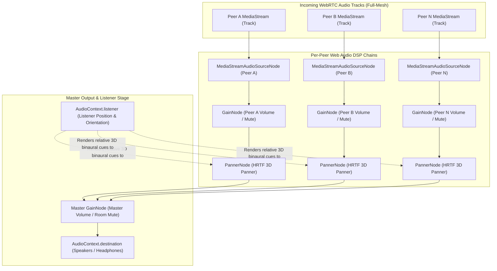
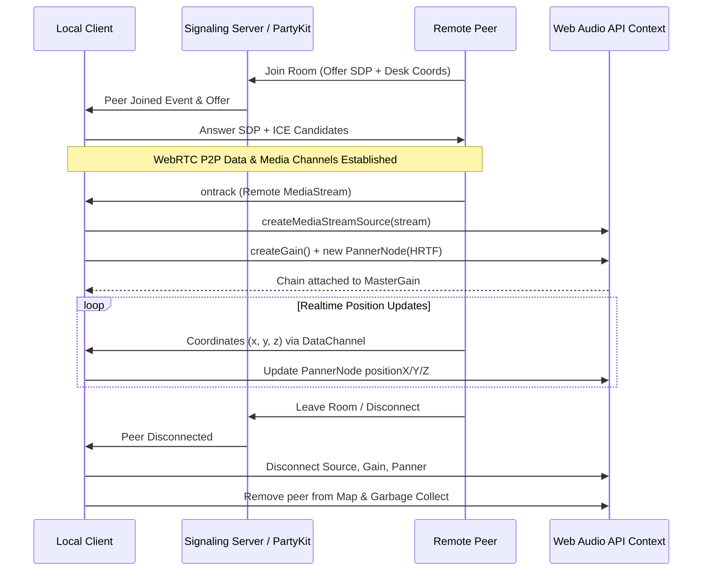

# WebRTC Mesh Audio Mixer & Spatial Panner Architecture Guide

This guide details the architectural implementation of WorkSphere's peer-to-peer WebRTC mesh audio mixing, Web Audio API DSP pipeline, spatial HRTF panning, gain level decay algorithms, and bandwidth management strategies implemented across [`src/lib/spatial/SpatialAudioRouter.ts`](file:///c:/Users/admin/Desktop/workfere/src/lib/spatial/SpatialAudioRouter.ts), [`src/core/audio/SpatialAudioPanner.ts`](file:///c:/Users/admin/Desktop/workfere/src/core/audio/SpatialAudioPanner.ts), and WebRTC collaborative room audio components.

---

## 1. Architectural Overview & Web Audio Graph

In a full-mesh WebRTC topology, each connected peer streams microphone audio directly to every other participant via dedicated `RTCPeerConnection` instances. On the receiving client, incoming `MediaStreamTrack` audio streams are decoded, routed into the browser's `AudioContext`, individually gain-adjusted, 3D binauralized through `PannerNode` units, mixed across a master stage, and finally delivered to the hardware audio destination.

### Web Audio API Node Graph

The client-side audio graph pipeline establishes isolated source-gain-panner chains for every remote peer:



---

## 2. Peer Connection Lifecycle & Audio Track Routing

### Lifecycle States



### Track Routing Implementation

When a remote track is discovered via `pc.ontrack`:
1. **Creation:** An existing peer chain is checked. If one exists, it is detached first to prevent lingering orphaned audio nodes.
2. **Audio Nodes Initialization:**
   ```typescript
   const source = audioContext.createMediaStreamSource(stream);
   const gain = audioContext.createGain();
   gain.gain.value = 1.0;

   const panner = new PannerNode(audioContext, {
     panningModel: "HRTF",
     distanceModel: "inverse",
     refDistance: 1.0,
     maxDistance: 50.0,
     rolloffFactor: 1.0,
   });

   source.connect(gain);
   gain.connect(panner);
   panner.connect(masterGain);
   ```
3. **Map Registration:** Retained in an internal registry (`Map<string, PeerSpatialChain>`).

---

## 3. Spatial Coordinate Transforms & Panning

### Coordinate Frame Convention

WorkSphere maps 2D interactive desk layouts and 3D virtual floorplans onto an ISO right-handed coordinate convention:
- **X-axis ($+X$):** Lateral right.
- **Y-axis ($+Y$):** Elevation / Vertical height (default elevation $= 1.5\text{m}$ sitting height).
- **Z-axis ($+Z$):** Depth forward / backward (negative $Z$ corresponds to facing forward).

### Listener Positioning & Orientation

The local user corresponds to the `AudioContext.listener`:
```typescript
// Update listener position
listener.positionX.value = clampedX;
listener.positionY.value = clampedY;
listener.positionZ.value = clampedZ;

// Update listener facing orientation (forward and up unit vectors)
listener.forwardX.value = forwardX;
listener.forwardY.value = forwardY;
listener.forwardZ.value = forwardZ;
listener.upX.value = upX;
listener.upY.value = upY;
listener.upZ.value = upZ;
```

### Panner Configuration

- **Panning Model:** `"HRTF"` (Head-Related Transfer Function) enables realistic binaural filtering, frequency notches, and interaural time difference (ITD) emulation when listening with stereo headphones.
- **Distance Model:** `"inverse"` (physically realistic inverse distance decay) or `"linear"` (configurable for bounded rooms).

---

## 4. Gain Level Decay & Distance Attenuation Algorithms

To deliver comfortable acoustic spatialization and avoid audio clipping or sudden jumps, distance attenuation gains are strictly sanitized and clamped between $0.0$ and $1.0$.

### Distance Calculation
Given source position $S = (x_s, y_s, z_s)$ and listener position $L = (x_l, y_l, z_l)$:
$$\Delta x = x_s - x_l, \quad \Delta y = y_s - y_l, \quad \Delta z = z_s - z_l$$
$$d = \sqrt{(\Delta x)^2 + (\Delta y)^2 + (\Delta z)^2}$$

### Attenuation Curves

1. **Inverse Distance Model (Default):**
   $$\text{Gain}(d) = \frac{d_{\text{ref}}}{d_{\text{ref}} + \text{rolloff} \times (\max(d, d_{\text{ref}}) - d_{\text{ref}})}$$
   - $d_{\text{ref}} = 1.0\text{m}$ (Reference distance where gain is $1.0$).
   - $\text{rolloff} = 1.0$.
   - When $d > d_{\text{max}} = 50.0\text{m}$ (or $100.0\text{m}$ depending on room size), gain falls to $0.0$.

2. **Linear Distance Model:**
   $$\text{Gain}(d) = 1.0 - \text{rolloff} \times \frac{\max(d, d_{\text{ref}}) - d_{\text{ref}}}{d_{\text{max}} - d_{\text{ref}}}$$
   Clamped to $[0.0, 1.0]$:
   $$\text{Gain}_{\text{clamped}} = \max(0.0, \min(1.0, \text{Gain}(d)))$$

3. **Smooth AudioParam Ramping:**
   To prevent audio pops and zipper noise during rapid coordinate changes, gain values and panner coordinates are transitioned smoothly using exponential or linear de-zippering:
   ```typescript
   gainNode.gain.setTargetAtTime(targetGain, audioContext.currentTime, 0.05);
   ```

---

## 5. Bandwidth Conservation & Quality Strategies

In full-mesh WebRTC topologies ($N$ peers require $N \times (N - 1)$ connections), audio bandwidth scales exponentially with participant count. WorkSphere implements multiple conservation layers:

1. **Spatial Proximity Culling:**
   - Peers exceeding `maxDistance` (e.g. $> 50\text{m}$ away on opposite ends of a large coworking venue) have their inbound tracks muted or paused (`receiver.track.enabled = false`).
   - Muted streams consume zero Web Audio processing cycles.

2. **Opus Dynamic Bitrate Adaptation:**
   - Track sender bitrates are configured dynamically via SDP / `RTCRtpSender.setParameters()`:
     - Close proximity ($< 3\text{m}$): High fidelity voice (32–48 kbps).
     - Mid proximity ($3\text{m} - 15\text{m}$): Standard voice (20–24 kbps).
     - Far proximity ($> 15\text{m}$): Low bandwidth or comfort noise (12–16 kbps).

3. **Voice Activity Detection (VAD) & DTX:**
   - Enables discontinuous transmission (`useinbandfec=1;usedtx=1`) in the Opus codec payload to cease sending packets during conversational pauses.

4. **Acoustic Echo Cancellation (AEC) & Noise Suppression:**
   - User microphone streams request native browser constraints:
     ```typescript
     navigator.mediaDevices.getUserMedia({
       audio: {
         echoCancellation: true,
         noiseSuppression: true,
         autoGainControl: true,
       },
     });
     ```

---

## 6. Peer Disconnect & Resource Cleanup

When a participant closes their browser tab or disconnects from the WebRTC mesh, failure to clean up audio nodes results in memory leaks and lingering AudioContext background processing.

### Clean Detachment Protocol

The cleanup sequence executed by `detachPeer(peerId)`:

```typescript
detachPeer(peerId: string): void {
  const chain = this.chains.get(peerId);
  if (!chain) return;

  // 1. Disconnect nodes from the audio graph to break reference cycles
  try {
    chain.source.disconnect();
  } catch {}
  try {
    chain.gain.disconnect();
  } catch {}
  try {
    chain.panner.disconnect();
  } catch {}

  // 2. Clear remote track references
  if (chain.source.mediaStream) {
    chain.source.mediaStream.getTracks().forEach((track) => {
      track.stop();
    });
  }

  // 3. Remove entry from registry map for GC collection
  this.chains.delete(peerId);
}
```

On room unmount, `detachAll()` is invoked to disconnect all nodes and suspend or close the `AudioContext` cleanly.
