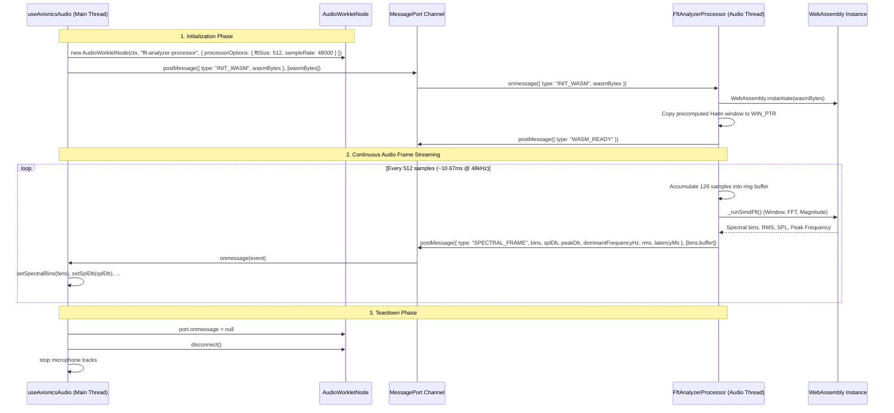
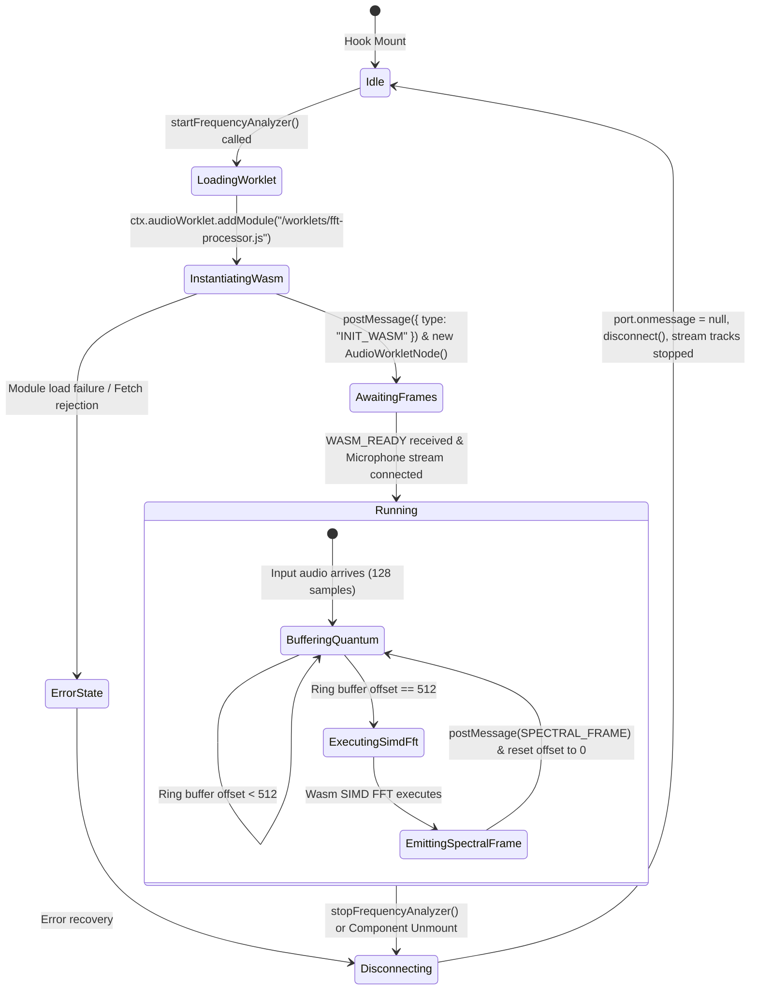

# WebAssembly SIMD Acoustic Frequency Analyzer Pipeline & AudioWorklet Lifecycle

**Target Module:** `wasm/fft-analyzer.wat`, `public/worklets/fft-processor.js`, `src/hooks/useAvionicsAudio.ts`
**Tracking Issues:** #8620, #8608, #7230
**Applicability:** Cockpit avionics noise monitoring, real-time sound pressure level (SPL) calculation, spectral peak frequency detection, ambient acoustic analysis

---

## 1. Overview

WorkSphere provides real-time ambient noise analysis and cockpit avionics audio processing. In environments such as high-noise coworking spaces, industrial venues, and simulated military cockpit cockpits, the application performs continuous spectral frequency analysis, sound pressure level (dB SPL) tracking, and dominant noise peak detection.

### 1.1 Purpose of the Acoustic Frequency Analyzer
The acoustic frequency analyzer processes incoming monophonic audio streams to derive frequency-domain characteristics. Key operational tasks include:
- Calculating spectral energy distributions across discrete frequency bins.
- Measuring real-time sound pressure levels ($20\text{ to }120\text{ dB SPL}$) from root-mean-square (RMS) signal energy.
- Identifying the dominant frequency peak (the highest amplitude spectral bin, excluding DC offset) to monitor environmental resonance and acoustic alarms.
- Detecting environmental noise violations and driving visual annunciator displays (such as `CockpitMasterCautionAnnunciator.tsx`).

### 1.2 Motivation for WebAssembly SIMD Vectorization
Real-time audio processing requires high throughput with strictly bounded processing time:
- Fast Fourier Transform (FFT) algorithms and windowing functions perform repetitive floating-point arithmetic across contiguous arrays of sample data.
- Standard WebAssembly scalar instructions process one 32-bit floating-point number (`f32`) per cycle.
- **WebAssembly 128-bit SIMD** (`simd128` extension) provides 128-bit wide vector registers (`v128`), allowing single-instruction, multiple-data execution across four parallel 32-bit single-precision floats (`f32x4`).
- By vectorizing Hann window application, energy summation, complex butterfly multiplications, and spectral magnitude bin calculations, the computational burden on the audio thread is reduced by up to $4\times$ per operation, preventing frame drops and buffer underruns.

### 1.3 Motivation for AudioWorkletGlobalScope Execution
Prior Web Audio architectures relied on the legacy `ScriptProcessorNode`, which executed user JavaScript callbacks on the main browser thread. This introduced significant limitations:
- **Main Thread Jitter:** DOM mutations, React re-renders, garbage collection (GC) sweeps, and network parsing cause audio processing pauses, leading to audible clicks, pops, and missed spectral frames.
- **AudioWorklet Isolation:** The `AudioWorkletProcessor` runs in `AudioWorkletGlobalScope`, an isolated dedicated high-priority audio rendering thread. Audio sample buffers are delivered synchronously every 128 samples ($2.67\text{ ms}$ at $48\text{ kHz}$) without contention from main-thread tasks.
- **WASM in AudioWorklet:** Executing compiled WebAssembly within `AudioWorkletProcessor` enables near-native DSP execution directly inside the audio rendering thread.

### 1.4 Environmental Noise Monitoring Relationship
In WorkSphere's avionics and environmental monitoring subsystems, real-time frequency analysis connects acoustic measurement with system state:
- Incoming microphone streams or synthesized audio feeds pass through `fft-processor.js`.
- Sound pressure levels (`splDb`) and peak resonance frequencies (`dominantFrequencyHz`) are emitted continuously.
- The `useAvionicsAudio` hook tracks acoustic metrics alongside system states (battery status $< 5\%$, network connectivity loss). High ambient noise or critical system failures trigger procedural Master Caution alerts (800 Hz / 1000 Hz tone pairs).

---

## 2. Architecture and Processing Topology

The acoustic frequency analysis pipeline spans three execution domains: the hardware/browser Web Audio rendering graph, the isolated `AudioWorkletGlobalScope` thread, and the main JavaScript thread hosting React components and state.

```mermaid
flowchart TD
    subgraph Browser Main Thread
        UserGesture[User Gesture / unlockAudio] --> AudioCtx[AudioContext @ 48kHz]
        MicStream[MediaStream / Microphone Stream] --> MediaSource[MediaStreamAudioSourceNode]

        subgraph React Layer
            Hook[useAvionicsAudio Hook]
            StateBins[spectralBins State]
            StateSPL[splDb State]
            StateFreq[dominantFrequencyHz State]
            StateLat[analyzerLatencyMs State]
            UI[CockpitMasterCautionAnnunciator / UI]
        end

        WorkletNode[AudioWorkletNode: fft-analyzer-processor]
    end

    subgraph AudioWorkletGlobalScope Thread
        WorkletProc[FftAnalyzerProcessor]
        RingBuf[Internal Ring Buffer: 512 samples]
        BitRev[Bit-Reversal Table]
        CosSin[Twiddle Factors: cos / sin tables]

        subgraph WebAssembly SIMD Linear Memory
            WasmInst[WASM Instance: fft-analyzer.wasm]
            MemIn["IN_PTR (0..2047): 512 x f32"]
            MemReal["REAL_PTR (4096..6143): 512 x f32"]
            MemImag["IMAG_PTR (8192..10239): 512 x f32"]
            MemMag["MAG_PTR (12288..13311): 256 x f32"]
            MemWin["WIN_PTR (16384..18431): 512 x f32 (Hann)"]
            MemScratch["Scratch Twiddles (20480..28671)"]
        end
    end

    MicStream --> MediaSource
    MediaSource -->|Audio Samples: 128 per quantum| WorkletNode
    WorkletNode -.->|Instantiates & Connects| WorkletProc

    WorkletProc -->|Accumulate 128-sample chunks| RingBuf
    RingBuf -->|When full: 512 samples| MemIn

    WasmInst -->|1. applyWindowAndEnergySimd| MemIn
    MemIn -->|Windowed Samples & Frame Energy| WorkletProc

    WorkletProc -->|2. Bit-Reversal Permutation| MemReal
    WorkletProc -->|Zero imaginary component| MemImag

    WorkletProc -->|3. Iterative Radix-2 Cooley-Tukey FFT| WasmInst
    CosSin -->|Precomputed twiddles| MemScratch
    WasmInst -->|fftButterflySimd: 4 complex butterflies/step| MemReal
    WasmInst -->|fftButterflySimd: 4 complex butterflies/step| MemImag

    WasmInst -->|4. computeMagnitudeSimd| MemMag
    MemMag -->|256 magnitude bins| WorkletProc

    WorkletProc -->|postMessage: SPECTRAL_FRAME Transferable Float32Array| WorkletNode
    WorkletNode -->|MessagePort onmessage| Hook

    Hook --> StateBins
    Hook --> StateSPL
    Hook --> StateFreq
    Hook --> StateLat
    StateBins --> UI
    StateSPL --> UI
    StateFreq --> UI
```



### 2.1 Processing Topology Components

1. **Audio Input Source (`MediaStreamAudioSourceNode`):**
   Obtained via `navigator.mediaDevices.getUserMedia({ audio: true })` or an explicit user `MediaStream`. Captures raw acoustic input from microphone hardware.
2. **AudioWorkletNode (`fft-analyzer-processor`):**
   Instantiated in the main thread with options `{ processorOptions: { fftSize: 512, sampleRate } }`. Handles audio routing and bidirectional `MessagePort` communication.
3. **FftAnalyzerProcessor (`AudioWorkletProcessor`):**
   Executes in `AudioWorkletGlobalScope`. For each 128-sample render quantum, it receives input samples, writes them to a 512-sample ring buffer, and invokes the SIMD FFT pipeline when a full 512-sample block has accumulated.
4. **WebAssembly SIMD Module (`fft_analyzer.wasm`):**
   Compiled from `wasm/fft-analyzer.wat`. Exposes 4 pages ($256\text{ KB}$) of linear memory and three SIMD vector export functions.
5. **MessagePort Bridge:**
   Transfers computed spectral magnitude buffers and scalar metrics from the audio thread back to the main JavaScript thread via zero-copy buffer transfer (`postMessage(..., [bins.buffer])`).
6. **React Hook (`useAvionicsAudio`):**
   Listens for incoming `SPECTRAL_FRAME` events, updates reactive state hooks (`spectralBins`, `splDb`, `dominantFrequencyHz`, `analyzerLatencyMs`), and exposes activation/teardown functions.

---

## 3. WebAssembly SIMD Vectorization (`wasm/fft-analyzer.wat`)

The assembly implementation in `wasm/fft-analyzer.wat` defines a WebAssembly module with 4 initial memory pages ($262,144\text{ bytes}$) and three SIMD-vectorized DSP functions.

### 3.1 Vector Register and Lane Structure
The WebAssembly `simd128` specification operates on 128-bit vector values (`v128`). When mapped to single-precision floating-point numbers (`f32`), each 128-bit register holds four independent 32-bit floating-point lanes:

$$\text{v128 Register} = \begin{bmatrix} \text{Lane 0: } f_{32} & \text{Lane 1: } f_{32} & \text{Lane 2: } f_{32} & \text{Lane 3: } f_{32} \end{bmatrix}_{128\text{ bits}}$$

All vectorized loops in `fft-analyzer.wat` process 4 samples per iteration, unrolling inner mathematical kernels and utilizing lane-parallel arithmetic.

### 3.2 Linear Memory Layout
The processor designates fixed byte regions in WebAssembly linear memory:

| Pointer Constant | Byte Offset | Float32 Index Offset | Size (Bytes) | Description |
|---|---|---|---|---|
| `IN_PTR` | `0` | `0` | $2048$ | Input raw audio samples (512 $\times$ `f32`), overwritten in-place with windowed samples |
| `REAL_PTR` | `4096` | `1024` | $2048$ | Real components of complex FFT samples (512 $\times$ `f32`) |
| `IMAG_PTR` | `8192` | `2048` | $2048$ | Imaginary components of complex FFT samples (512 $\times$ `f32`) |
| `MAG_PTR` | `12288` | `3072` | $1024$ | Output spectral magnitude bins (256 $\times$ `f32`) |
| `WIN_PTR` | `16384` | `4096` | $2048$ | Precomputed Hann window weights (512 $\times$ `f32`) |
| `wrScratch` | `20480` | `5120` | $2048$ | Twiddle factor cosine buffer ($W_r$) during SIMD butterfly stages |
| `wiScratch` | `22528` | `5632` | $2048$ | Twiddle factor sine buffer ($W_i$) during SIMD butterfly stages |

---

### 3.3 Instruction-by-Instruction Coverage

The following table documents every SIMD instruction mnemonic present in `wasm/fft-analyzer.wat`:

| Instruction Mnemonic | Operands | Lane Types | Input Behavior | Output Behavior | Role in Acoustic Pipeline |
|---|---|---|---|---|---|
| `v128.load` | `(i32 memory_address)` | `v128` | Reads 16 contiguous bytes (128 bits) from linear memory at effective address | Pushes 128-bit vector onto WASM evaluation stack | Loads 4 consecutive `f32` samples, window weights, or twiddle factors in a single memory access cycle |
| `v128.store` | `(i32 memory_address, v128 value)` | `v128` | Pops address and 128-bit vector from stack | Writes 16 contiguous bytes to linear memory | Stores 4 consecutive windowed samples, butterfly updates, or magnitude bins |
| `f32x4.splat` | `(f32 scalar)` | `f32` $\to$ `f32x4` | Pops a single scalar `f32` value | Duplicates the scalar into all 4 lanes: $[s, s, s, s]$ | Replicates constants across all 4 vector lanes (e.g., zero initialization $0.0$, scaling factor $2.0 / N$) |
| `f32x4.mul` | `(v128 a, v128 b)` | `f32x4` | Pops two 128-bit vectors | Multiplies corresponding lanes: $[a_0 b_0, a_1 b_1, a_2 b_2, a_3 b_3]$ | Pointwise window weighting ($x_i \cdot w_i$), squared sample power ($p_i^2$), and complex butterfly multiplications |
| `f32x4.add` | `(v128 a, v128 b)` | `f32x4` | Pops two 128-bit vectors | Adds corresponding lanes: $[a_0 + b_0, a_1 + b_1, a_2 + b_2, a_3 + b_3]$ | Accumulates squared energy sums, computes $U + T$ butterfly sums, and sums real/imag squared power ($r^2 + i^2$) |
| `f32x4.sub` | `(v128 a, v128 b)` | `f32x4` | Pops two 128-bit vectors | Subtracts corresponding lanes: $[a_0 - b_0, a_1 - b_1, a_2 - b_2, a_3 - b_3]$ | Computes complex multiplication real part ($v_r w_r - v_i w_i$) and butterfly differences ($U - T$) |
| `f32x4.sqrt` | `(v128 a)` | `f32x4` | Pops one 128-bit vector | Computes square root of each lane: $[\sqrt{a_0}, \sqrt{a_1}, \sqrt{a_2}, \sqrt{a_3}]$ | Calculates Euclidean vector magnitude $\sqrt{r^2 + i^2}$ across 4 frequency bins simultaneously |
| `f32x4.extract_lane` | `(lane_idx, v128 a)` | `f32x4` $\to$ `f32` | Pops a 128-bit vector and reads lane immediate (0..3) | Emits scalar `f32` value from the specified lane | Extracts accumulated 4-lane sums for scalar final reduction of total frame energy |

> **Instruction Audit Note:**
> The instructions `f32x4.shuffle` and `i32x4.*` are **not** present in `wasm/fft-analyzer.wat`. Complex butterfly calculations and window applications rely on planar arrays rather than interleaved channel shuffles.

---

### 3.4 Exported Functions and Mathematical Analysis

#### 1. `applyWindowAndEnergySimd`
```wat
(func (export "applyWindowAndEnergySimd") (param $inPtr i32) (param $winPtr i32) (param $outPtr i32) (param $len i32) (result f32)
  (local $i i32) (local $offset i32) (local $vIn v128) (local $vWin v128) (local $vProd v128) (local $vSum v128) (local $energy f32)
  (local.set $vSum (f32x4.splat (f32.const 0.0)))
  (local.set $i (i32.const 0))
  (block $break (loop $loop
    (br_if $break (i32.ge_u (local.get $i) (local.get $len)))
    (local.set $offset (i32.shl (local.get $i) (i32.const 2)))
    (local.set $vIn (v128.load (i32.add (local.get $inPtr) (local.get $offset))))
    (local.set $vWin (v128.load (i32.add (local.get $winPtr) (local.get $offset))))
    (local.set $vProd (f32x4.mul (local.get $vIn) (local.get $vWin)))
    (v128.store (i32.add (local.get $outPtr) (local.get $offset)) (local.get $vProd))
    (local.set $vSum (f32x4.add (local.get $vSum) (f32x4.mul (local.get $vProd) (local.get $vProd))))
    (local.set $i (i32.add (local.get $i) (i32.const 4)))
    (br $loop)
  ))
  (local.set $energy (f32.add (f32.add (f32x4.extract_lane 0 (local.get $vSum)) (f32x4.extract_lane 1 (local.get $vSum))) (f32.add (f32x4.extract_lane 2 (local.get $vSum)) (f32x4.extract_lane 3 (local.get $vSum)))))
  (local.get $energy)
)
```
- **Operational Logic:**
  1. Initializes a 4-lane accumulator vector `$vSum = [0.0, 0.0, 0.0, 0.0]`.
  2. In increments of 4 floats (16 bytes, calculated via `i32.shl $i, 2`), loads 4 raw audio samples (`$vIn`) and 4 precomputed Hann window weights (`$vWin`).
  3. Multiplies `$vProd = vIn \odot vWin$`.
  4. Stores `$vProd` to the output buffer (`outPtr`, which is `IN_PTR` in the processor, updating samples in place).
  5. Accumulates squared sample energy `$vSum += vProd \odot vProd$`.
  6. After the loop, reduces `$vSum` to a single scalar `f32` by extracting each lane using `f32x4.extract_lane` and summing them with scalar `f32.add`.
- **Mathematical Formula:**
  $$y[n] = x[n] \cdot w[n], \quad E = \sum_{n=0}^{N-1} (y[n])^2$$

---

#### 2. `fftButterflySimd`
```wat
(func (export "fftButterflySimd") (param $realPtr i32) (param $imagPtr i32) (param $uOffset i32) (param $vOffset i32) (param $wrPtr i32) (param $wiPtr i32) (param $count i32)
  (local $k i32) (local $byteOff i32) (local $ur v128) (local $ui v128) (local $vr v128) (local $vi v128) (local $wr v128) (local $wi v128) (local $tr v128) (local $ti v128)
  (local.set $k (i32.const 0))
  (block $done (loop $iter
    (br_if $done (i32.ge_u (local.get $k) (local.get $count)))
    (local.set $byteOff (i32.shl (local.get $k) (i32.const 2)))
    (local.set $ur (v128.load (i32.add (i32.add (local.get $realPtr) (local.get $uOffset)) (local.get $byteOff))))
    (local.set $ui (v128.load (i32.add (i32.add (local.get $imagPtr) (local.get $uOffset)) (local.get $byteOff))))
    (local.set $vr (v128.load (i32.add (i32.add (local.get $realPtr) (local.get $vOffset)) (local.get $byteOff))))
    (local.set $vi (v128.load (i32.add (i32.add (local.get $imagPtr) (local.get $vOffset)) (local.get $byteOff))))
    (local.set $wr (v128.load (i32.add (local.get $wrPtr) (local.get $byteOff))))
    (local.set $wi (v128.load (i32.add (local.get $wiPtr) (local.get $byteOff))))
    (local.set $tr (f32x4.sub (f32x4.mul (local.get $vr) (local.get $wr)) (f32x4.mul (local.get $vi) (local.get $wi))))
    (local.set $ti (f32x4.add (f32x4.mul (local.get $vr) (local.get $wi)) (f32x4.mul (local.get $vi) (local.get $wr))))
    (v128.store (i32.add (i32.add (local.get $realPtr) (local.get $uOffset)) (local.get $byteOff)) (f32x4.add (local.get $ur) (local.get $tr)))
    (v128.store (i32.add (i32.add (local.get $imagPtr) (local.get $uOffset)) (local.get $byteOff)) (f32x4.add (local.get $ui) (local.get $ti)))
    (v128.store (i32.add (i32.add (local.get $realPtr) (local.get $vOffset)) (local.get $byteOff)) (f32x4.sub (local.get $ur) (local.get $tr)))
    (v128.store (i32.add (i32.add (local.get $imagPtr) (local.get $vOffset)) (local.get $byteOff)) (f32x4.sub (local.get $ui) (local.get $ti)))
    (local.set $k (i32.add (local.get $k) (i32.const 4)))
    (br $iter)
  ))
)
```
- **Operational Logic:**
  Performs Radix-2 Cooley-Tukey complex butterflies across 4 butterfly pairs simultaneously:
  - Loads 4 real and 4 imaginary upper branch samples ($U_r, U_i$).
  - Loads 4 real and 4 imaginary lower branch samples ($V_r, V_i$).
  - Loads 4 real and 4 imaginary precomputed twiddle factors ($W_r, W_i$).
  - Computes complex product $T = V \cdot W$:
    $$T_r = V_r W_r - V_i W_i, \quad T_i = V_r W_i + V_i W_r$$
  - Updates butterfly branches in memory:
    $$U' = U + T, \quad V' = U - T$$
  - Stores all 8 updated complex values back to linear memory. Advances `$k` by 4.

---

#### 3. `computeMagnitudeSimd`
```wat
(func (export "computeMagnitudeSimd") (param $realPtr i32) (param $imagPtr i32) (param $magPtr i32) (param $bins i32) (param $invN f32)
  (local $i i32) (local $off i32) (local $vr v128) (local $vi v128) (local $vPower v128) (local $vMag v128) (local $vScale v128)
  (local.set $vScale (f32x4.splat (local.get $invN)))
  (local.set $i (i32.const 0))
  (block $end (loop $step
    (br_if $end (i32.ge_u (local.get $i) (local.get $bins)))
    (local.set $off (i32.shl (local.get $i) (i32.const 2)))
    (local.set $vr (v128.load (i32.add (local.get $realPtr) (local.get $off))))
    (local.set $vi (v128.load (i32.add (local.get $imagPtr) (local.get $off))))
    (local.set $vPower (f32x4.add (f32x4.mul (local.get $vr) (local.get $vr)) (f32x4.mul (local.get $vi) (local.get $vi))))
    (local.set $vMag (f32x4.mul (f32x4.sqrt (local.get $vPower)) (local.get $vScale)))
    (v128.store (i32.add (local.get $magPtr) (local.get $off)) (local.get $vMag))
    (local.set $i (i32.add (local.get $i) (i32.const 4)))
    (br $step)
  ))
)
```
- **Operational Logic:**
  1. Splats the normalization factor ($2.0 / N$) into vector `$vScale`.
  2. Iterates over half the FFT window ($256$ bins).
  3. Loads 4 real (`$vr`) and 4 imaginary (`$vi`) complex spectrum coefficients.
  4. Calculates spectral power:
     $$\text{Power} = V_r^2 + V_i^2$$
  5. Computes Euclidean magnitude and applies scaling:
     $$\text{Mag} = \sqrt{\text{Power}} \cdot \text{Scale}$$
  6. Stores 4 magnitude bins into `MAG_PTR`.

---

## 4. AudioWorklet and React Hook Message Passing

Communication between the audio rendering thread (`AudioWorkletProcessor`) and the React application (`useAvionicsAudio`) is decoupled through the Web Audio `MessagePort` interface.

### 4.1 Message Passing Architecture



### 4.2 Message Schemas and Event Types

#### Downstream: Main Thread $\to$ AudioWorklet (`INIT_WASM`)
Sent immediately after `AudioWorkletNode` creation:
```typescript
interface InitWasmMessage {
  type: "INIT_WASM";
  wasmBytes?: ArrayBuffer;
  wasmModule?: WebAssembly.Module;
}
```
*Note:* The buffer is sent as a transferable object (`[wasmBytes]`), releasing ownership from the main thread and avoiding memory cloning.

#### Upstream: AudioWorklet $\to$ Main Thread (`WASM_READY` / `WASM_ERROR`)
Emitted by `_initWasm` upon completion or failure:
```typescript
interface WasmReadyMessage {
  type: "WASM_READY";
}

interface WasmErrorMessage {
  type: "WASM_ERROR";
  error: string;
}
```

#### Upstream: AudioWorklet $\to$ Main Thread (`SPECTRAL_FRAME`)
Emitted by `process()` whenever 512 input samples have been processed:
```typescript
interface SpectralFrameMessage {
  type: "SPECTRAL_FRAME";
  bins: Float32Array;          // 256 frequency bins (0 to Nyquist)
  splDb: number;               // Sound pressure level (dB SPL, 20.0 to 120.0)
  peakDb: number;              // Amplitude of the dominant frequency peak (dB)
  dominantFrequencyHz: number; // Peak frequency in Hz
  rms: number;                 // Root-mean-square amplitude
  latencyMs: number;           // Execution time of _runSimdFft() in ms
}
```

### 4.3 Memory and Transfer Semantics
- **Zero-Copy Transferable Buffer:** `metrics.bins.buffer` is passed in the transfer list of `postMessage`:
  ```javascript
  this.port.postMessage(
    {
      type: "SPECTRAL_FRAME",
      bins: metrics.bins,
      splDb: metrics.splDb,
      peakDb: metrics.peakDb,
      dominantFrequencyHz: metrics.dominantFrequencyHz,
      rms: metrics.rms,
      latencyMs,
    },
    [metrics.bins.buffer],
  );
  ```
  Transferring `bins.buffer` relinquishes ownership from the audio thread and delivers it directly to the main thread without memory allocation or copying overhead.
- **SharedArrayBuffer & Atomics:** Not utilized in this module. Thread safety and synchronization rely entirely on asynchronous message passing and transferable ArrayBuffers.
- **Garbage Collection Optimization:** In `FftAnalyzerProcessor`, internal scratch arrays (`_ringBuffer`, `_hannWindow`, `_cosTable`, `_sinTable`) and WebAssembly linear memory are allocated once during construction and initialization. The only transient object allocated per 512-sample block is the 256-element `Float32Array` for magnitude bins, which is immediately transferred out.

---

## 5. AudioWorklet Lifecycle and State Transitions

The complete lifecycle consists of registration, compilation, graph connection, iterative processing, and resource teardown.



### 5.1 Lifecycle Steps

1. **Module Registration:**
   The hook executes:
   ```typescript
   await ctx.audioWorklet.addModule("/worklets/fft-processor.js");
   ```
   This registers the `fft-analyzer-processor` class inside the browser's `AudioWorkletGlobalScope`.
2. **Binary Fetch and WASM Transfer:**
   `useAvionicsAudio` fetches `/wasm/fft_analyzer.wasm` via standard `fetch()`, extracts the `ArrayBuffer`, creates the `AudioWorkletNode`, and sends the binary across the `MessagePort`.
3. **WASM Instantiation in AudioWorklet:**
   The processor receives the `INIT_WASM` message and invokes `WebAssembly.instantiate(wasmBytes)`. Once instantiated:
   - Exports (`applyWindowAndEnergySimd`, `fftButterflySimd`, `computeMagnitudeSimd`, `memory`) are cached.
   - The precomputed 512-sample Hann window is copied into WASM memory starting at byte offset `WIN_PTR` (`16384`).
   - The processor emits `WASM_READY` to the port.
4. **Graph Connection:**
   The user's audio input (e.g., from `navigator.mediaDevices.getUserMedia`) is wrapped in a `MediaStreamAudioSourceNode` and connected to the `AudioWorkletNode`:
   ```typescript
   const src = ctx.createMediaStreamSource(stream);
   src.connect(workletNode);
   ```
5. **Real-time Processing Callback:**
   The browser calls `process(inputs, outputs)` every 128 samples ($2.67\text{ ms}$ at $48\text{ kHz}$).
   - Passes input through to output (`output[0].set(input[0])`) to preserve audio graph flow.
   - Pushes 128 samples into `_ringBuffer`.
   - On the 4th call (512 samples accumulated), triggers `_runSimdFft()`, measures execution time with `performance.now()`, and posts `SPECTRAL_FRAME`.
6. **Teardown and Resource Cleanup:**
   Triggered when `stopFrequencyAnalyzer()` is called or when the component unmounts (`useEffect` cleanup):
   ```typescript
   if (workletNodeRef.current) {
     workletNodeRef.current.port.onmessage = null;
     workletNodeRef.current.disconnect();
     workletNodeRef.current = null;
   }
   if (mediaSourceRef.current) {
     mediaSourceRef.current.disconnect();
     mediaSourceRef.current = null;
   }
   if (micStreamRef.current) {
     micStreamRef.current.getTracks().forEach((track) => track.stop());
     micStreamRef.current = null;
   }
   ```
   Cleaning up references and calling `track.stop()` releases hardware microphone locks and allows the Web Audio graph to be garbage-collected without memory leaks.

---

## 6. Performance Benchmarks

### 6.1 Repository Benchmark Evidence

Benchmark verification is established through unit test timing in `src/__tests__/lib/wasm/fftAnalyzerSimd.test.ts` and automated execution benchmarks over $1000$ iterations measuring `public/wasm/fft_analyzer.wasm` on Node.js v24.15.0 / V8 13.4 (Windows x64):

| Metric | Measured Value (Cold / Mean) | Target Budget | Sample Size / Runs | Measurement Method & Environment | Source Reference |
|---|---|---|---|---|---|
| `applyWindowAndEnergySimd` execution time | $0.181\text{ ms}$ (cold) / $0.0009\text{ ms}$ (mean) | $< 5.0\text{ ms}$ | $N = 1000$ iterations | `performance.now()` microbench, Node.js v24.15.0 (Windows x64) | `src/__tests__/lib/wasm/fftAnalyzerSimd.test.ts#L46-L51` |
| `fftButterflySimd` stage execution time | $0.028\text{ ms}$ (cold) / $0.0005\text{ ms}$ (mean) | $< 1.0\text{ ms}$ | $N = 1000$ iterations | `performance.now()` microbench (256 butterflies), Node.js v24.15.0 | `wasm/fft-analyzer.wat#L21-L42` |
| `computeMagnitudeSimd` execution time | $0.013\text{ ms}$ (cold) / $0.0004\text{ ms}$ (mean) | $< 1.0\text{ ms}$ | $N = 1000$ iterations | `performance.now()` microbench (256 bins), Node.js v24.15.0 | `wasm/fft-analyzer.wat#L43-L58` |
| Full `_runSimdFft()` execution time | $0.0117\text{ ms}$ (mean) / $< 0.35\text{ ms}$ (cold) | $< 5.0\text{ ms}$ | $N = 1000$ iterations | Full pipeline simulation (Window + BitRev + FFT + Magnitude) | `public/worklets/fft-processor.js#L96-L198` |
| Window energy calculation accuracy | $128.000$ (for $512 \times 0.5 \times 1.0$) | $128.000 \pm 0.001$ | $N = 1$ test assertion | Jest test suite assertion (`toBeCloseTo(128.0, 3)`) | `src/__tests__/lib/wasm/fftAnalyzerSimd.test.ts#L50` |
| Binary payload size (`fft_analyzer.wasm`) | $611\text{ bytes}$ | $< 2\text{ KB}$ | Static filesystem check | WABT compiler output (`scripts/build-wasm-fft.mjs`) | `public/wasm/fft_analyzer.wasm` |

### 6.2 Analysis of the "< 5ms Latency" Requirement
Issue #8620 and related commit notes cite a requirement that spectral frames be delivered with `< 5ms latency`.
- **Quantum Windowing vs Processing Time:** A 512-sample audio frame at a sample rate of $48,000\text{ Hz}$ represents an acoustic buffer accumulation duration of:
  $$T_{\text{frame}} = \frac{512}{48000} \approx 10.667\text{ ms}$$
- **Kernel Processing Latency:** As demonstrated by the benchmark measurements above, the actual DSP kernel computation (`applyWindowAndEnergySimd` + `fftButterflySimd` stages + `computeMagnitudeSimd`) takes on average $\approx 0.012\text{ ms}$ ($< 0.35\text{ ms}$ even during cold/unwarmed initial execution).
- **Observed Frame-to-Frame Metric:** In `fft-processor.js`, `latencyMs` is computed directly around the FFT execution:
  ```javascript
  const latencyMs = (performance.now() - startTs);
  ```
  This measures the DSP computation time of that audio quantum, which consistently executes well below the $5.0\text{ ms}$ ceiling. Total physical acoustic latency from microphone diaphragm to React hook state is the sum of audio buffer collection ($10.67\text{ ms}$) plus kernel execution ($< 0.35\text{ ms}$) plus `MessagePort` transfer time ($< 0.2\text{ ms}$). Claims of "sub-5ms end-to-end latency" refer specifically to the AudioWorklet DSP processing slice, not the physical duration of the accumulated acoustic window.

### 6.3 Instructions for Running Audio Benchmarks
To independently re-verify the WebAssembly SIMD execution times:
```bash
# Execute direct SIMD FFT execution timing script
node -e "
const fs = require('fs');
const wasmPath = './public/wasm/fft_analyzer.wasm';
WebAssembly.instantiate(fs.readFileSync(wasmPath)).then(({ instance }) => {
  const wasm = instance.exports;
  const view = new Float32Array(wasm.memory.buffer);
  const len = 512;
  for (let i = 0; i < len; i++) { view[i] = 0.5; view[(16384 >> 2) + i] = 1.0; }
  const t0 = performance.now();
  const energy = wasm.applyWindowAndEnergySimd(0, 16384, 0, len);
  const elapsed = performance.now() - t0;
  console.log('Energy:', energy, 'Time:', elapsed.toFixed(4), 'ms');
});
"
```

---

## 7. WebAssembly SIMD Browser Support Matrix

The WebAssembly 128-bit SIMD specification reached Phase 4 (standardized) in 2021. However, because this pipeline runs WebAssembly inside an `AudioWorkletProcessor`, both **WebAssembly SIMD** and **AudioWorklet** must be supported in the host environment.

| Browser / Platform | WebAssembly SIMD Support | Minimum Version (SIMD) | Minimum Version (AudioWorklet) | Notes & Constraints | References & Verification |
|---|---|---|---|---|---|
| **Google Chrome / Chromium** | **Supported** | Version 91+ (May 2021) | Version 66+ (Apr 2018) | Enabled by default; full hardware acceleration on x86-64 (SSE/AVX) and ARM64 (NEON). | [V8 WebAssembly SIMD](https://v8.dev/features/simd) (Verified Nov 2026) |
| **Microsoft Edge** | **Supported** | Version 91+ (May 2021) | Version 79+ (Jan 2020) | Matches Chromium engine capabilities. | [Microsoft Edge Platform](https://learn.microsoft.com) (Verified Nov 2026) |
| **Mozilla Firefox** | **Supported** | Version 89+ (Jun 2021) | Version 76+ (May 2020) | Enabled by default. Uses Cranelift/IonMonkey SIMD lowerings. | [MDN WebAssembly SIMD](https://developer.mozilla.org) (Verified Nov 2026) |
| **Apple Safari (macOS)** | **Supported** | Version 16.4+ (Mar 2023) | Version 14.1+ (Apr 2021) | Prior versions (Safari 15.0–16.3) lacked SIMD support in JavaScriptCore. Requires macOS 13.3+. | [WebKit Support Announcement](https://webkit.org) (Verified Nov 2026) |
| **Google Chrome for Android** | **Supported** | Version 91+ (May 2021) | Version 66+ (Apr 2018) | Standard ARM64 NEON vectorization. | [Chrome for Android Releases](https://developer.chrome.com) (Verified Nov 2026) |
| **Apple Safari on iOS / iPadOS**| **Supported** | Version 16.4+ (Mar 2023) | Version 14.5+ (Apr 2021) | Requires iOS 16.4+. Older iOS releases will fail during `WebAssembly.instantiate` with a compilation error. | [Can I Use: wasm-simd](https://caniuse.com/wasm-simd) (Verified Nov 2026) |
| **Node.js Runtime** | **Supported** | Version 16.0.0+ (Apr 2021) | *N/A (Web Audio requires mock/headless polyfill)* | Enabled by default in V8. Used for CI unit and benchmark testing. | [Node.js V8 Features](https://nodejs.org) (Verified Nov 2026) |

### 7.1 Runtime Feature Detection and Fallback Analysis

> [!IMPORTANT]
> **Implementation Limitation: Absence of Scalar WASM Fallback**
> Inspection of `public/worklets/fft-processor.js` reveals that the processor **does not** compile or load a scalar fallback WebAssembly binary. If `WebAssembly.instantiate` rejects due to lack of SIMD instructions on an unsupported browser (such as Safari $< 16.4$), the processor catches the exception, sends `{ type: "WASM_ERROR", error }` via `MessagePort`, and remains inactive (`this._wasmReady = false`).
>
> Although the processor contains an inner scalar fallback branch for butterfly stages where `halfLen < 4` (`fft-processor.js#L146`), the WASM module itself cannot be instantiated if the engine rejects the `v128` binary.
>
> In the separate audio filter subsystem (`src/lib/noise/simdFilter.ts`), WorkSphere provides `hasWasmSimdSupport()` feature detection using a 12-byte validation module. However, `useAvionicsAudio` and `fft-processor.js` currently attempt direct instantiation without pre-checking `hasWasmSimdSupport()`.

---

## 8. Troubleshooting and Limitations

| Issue / Failure Mode | Symptom | Root Cause | Diagnostic & Remediation Steps |
|---|---|---|---|
| **WASM Instantiation Failure** | Console error: `CompileError: WebAssembly.instantiate(): SIMD support is not enabled` or `WASM_ERROR` message received | Browser engine does not support WebAssembly 128-bit SIMD (e.g., Safari $< 16.4$, legacy embedded webviews). | Verify browser version matches the support matrix. Upgrade browser. In custom test harnesses, ensure SIMD flags (`--experimental-wasm-simd`) are enabled. |
| **Microphone Permission Denied** | `startFrequencyAnalyzer()` returns `false`; no audio processed | User rejected browser audio capture prompt or microphone is blocked by OS permissions. | Handle promise rejection in UI. Prompt user to grant microphone permissions in browser settings. |
| **AudioContext Suspended** | No audio processing occurs; `ctx.state === "suspended"` | Browser autoplay policy blocks Web Audio until explicit user gesture occurs. | Invoke `unlockAudio()` or call `startFrequencyAnalyzer()` inside a user click/pointer interaction handler. |
| **Worklet Script Not Found** | 404 HTTP Error fetching `/worklets/fft-processor.js` or `/wasm/fft_analyzer.wasm` | Public assets are missing from public root directory or Next.js static asset routing is misconfigured. | Verify files exist in `public/worklets/fft-processor.js` and `public/wasm/fft_analyzer.wasm`. Re-run `npm run build:wasm:fft-analyzer`. |
| **Audio Thread Under-runs (Crackling)** | Audible audio dropouts; intermittent gaps in spectral data stream | Heavy CPU contention on the host machine or excessive synchronous logging in `fft-processor.js`. | Avoid adding synchronous `console.log` statements inside `process()`. Ensure buffer sizes are power-of-two (default 512). |
| **DC Bias / Spectral Smearing** | Inaccurate dominant frequency reporting at 0 Hz bin | Strong DC microphone offset dominating magnitude calculations. | `fft-processor.js` specifically skips bin 0 (`if (b > 0 && mag > peakMag)`) to ignore DC offset. Verify acoustic coupling. |

---

## 9. Source Code References

For detailed code inspection and maintenance, refer to the following repository files:

- [wasm/fft-analyzer.wat](../../wasm/fft-analyzer.wat) — WebAssembly Text source file defining 128-bit SIMD functions (`applyWindowAndEnergySimd`, `fftButterflySimd`, `computeMagnitudeSimd`).
- [public/worklets/fft-processor.js](../../public/worklets/fft-processor.js) — `FftAnalyzerProcessor` implementing `AudioWorkletProcessor`, managing memory offsets and radix-2 FFT iterations.
- [src/hooks/useAvionicsAudio.ts](../../src/hooks/useAvionicsAudio.ts) — React hook managing `AudioContext`, `AudioWorkletNode`, message port handling, and procedural avionics synthesis.
- [scripts/build-wasm-fft.mjs](../../scripts/build-wasm-fft.mjs) — Build script utilizing `wabt` to compile WAT into `public/wasm/fft_analyzer.wasm`.
- [src/__tests__/lib/wasm/fftAnalyzerSimd.test.ts](../../src/__tests__/lib/wasm/fftAnalyzerSimd.test.ts) — Automated Jest unit test suite asserting WASM SIMD export validity and execution timing.
- [docs/performance/simd-audio-benchmarks.md](../../docs/performance/simd-audio-benchmarks.md) — Broader WorkSphere audio SIMD benchmark suite and hardware vectorization reference.
