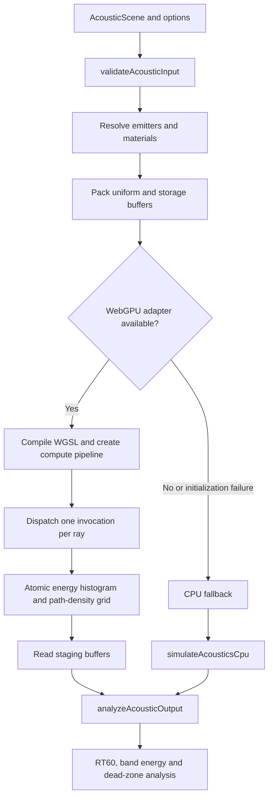

# WebGPU acoustic ray-tracing simulation

This guide describes the acoustic simulation pipeline implemented by
`src/core/spatial/WebGPUAcousticSimulator.ts`, its packed scene data in
`src/core/spatial/acousticTypes.ts`, and the compute shader in
`src/shaders/acoustic_raytrace.wgsl`.

## Execution overview



The simulator validates and normalizes the scene before dispatch. GPU
initialization requests an adapter and device, compiles the WGSL module, and
creates a compute pipeline. A compilation error rejects GPU initialization so
the caller can use the CPU fallback. The simulator exposes backend information
and an optional fallback callback.

## Compute workload

The current defaults are defined in `acousticTypes.ts`:

| Parameter | Value | Meaning |
| --- | ---: | --- |
| Octave bands | 6 | 125, 250, 500, 1,000, 2,000 and 4,000 Hz |
| Rays per simulation | 64,000 | Default ray budget |
| Maximum bounces | 128 | Upper bound on reflections per ray |
| Time bins | 512 | Energy histogram bins |
| Bin duration | 4 ms | Each histogram bin represents 0.004 seconds |
| Workgroup size | 64 | WGSL workgroup width |
| Room-density grid | 16 × 8 × 16 | 2,048 spatial cells |
| Maximum occupants | 64 | Spherical absorbers in the room |
| Simultaneous sources | 16 | Maximum acoustic emitters |

One compute invocation traces one ray. The source is selected from the source
block using the invocation index modulo the active source count. Ray energy is
accumulated by frequency band and time bin; a second atomic output records path
energy in the coarse 3D density grid. CPU analysis converts the histogram into
decay metrics such as RT60 and derives spatial dead-zone information.

## GPU buffer and WGSL layout

The WGSL structures and TypeScript packers must remain byte-for-byte compatible.
The following sizes are the storage strides used by the current implementation.

| Resource | Layout | Bytes per entry | Packing / alignment notes |
| --- | --- | ---: | --- |
| Simulation parameters | `Params` uniform | 112 | Room bounds, bounce count, seed, default source, timing, ray count, wall materials, density scale and mesh counts |
| Source header | 4 × `u32` | 16 | Count followed by three padding words |
| Acoustic source | 4 × `vec4<f32>` | 64 | Origin/gain, low bands, high bands/cone values, direction |
| Source block | Header + 16 sources | 1,040 | `SOURCE_BLOCK_BYTES` |
| Material | 8 × `f32` | 32 | Six absorption values plus two padding floats |
| Occupant | `vec4<f32>` | 16 | XYZ centre and radius |
| BVH node | 3 × `vec4` | 48 | Min bounds, max bounds, first triangle/count/escape index |
| Mesh triangle | 4 × `vec4` | 64 | Three vertices and material metadata |
| Histogram | 6 × 512 × `u32` | 12,288 total | Atomic energy accumulator |
| Density grid | 16 × 8 × 16 × `u32` | 8,192 total | Atomic spatial energy accumulator |

The shader binding contract is:

| Group 0 binding | WGSL resource | Access |
| ---: | --- | --- |
| 0 | `Params` | Uniform |
| 1 | Material table | Read-only storage |
| 2 | Occupants | Read-only storage |
| 3 | Energy histogram | Read/write atomic storage |
| 4 | Path-density grid | Read/write atomic storage |
| 5 | Source block | Uniform |
| 6 | Flattened BVH nodes | Read-only storage |
| 7 | Mesh triangles | Read-only storage |

Do not change a WGSL structure, binding index, or stride without updating the
matching packer and its layout tests. WebGPU uniform/storage alignment and
maximum buffer limits are device-dependent; keep validation and buffer sizing
in the TypeScript layer rather than assuming every adapter supports arbitrary
scene sizes.

## Stackless BVH mesh traversal

Optional triangle meshes are accelerated with a flattened median-split
Bounding Volume Hierarchy. Each node stores an axis-aligned minimum and maximum
bound plus metadata containing the first triangle, triangle count, and escape
node index. Leaf nodes reference a contiguous triangle range.

Traversal is stackless: the shader tests the ray against the current node's
AABB. A miss jumps to the node's escape index; a hit on an internal node moves
to the next flattened node; a leaf tests its triangles using the
Möller–Trumbore intersection routine. This avoids a per-invocation traversal
stack and makes the node representation suitable for linear GPU storage.

The CPU path uses the corresponding BVH representation. A linear reference
path remains selectable with `useBvh: false`, which is useful for correctness
checks and performance comparisons. `benchmarkMeshAcceleration` reports BVH
and linear median times, speedup, backend, node count, and whether the 4× target
was met. A target is not evidence of a measured result: record actual device,
browser, mesh size, run count, warm-up and measured medians before publishing a
performance claim.

## Browser and hardware compatibility

| Environment | Expected behavior |
| --- | --- |
| Browser with `navigator.gpu` and a working adapter/device | Attempts WGSL compilation and GPU compute |
| Browser without WebGPU | Uses the CPU fallback |
| Adapter/device request rejected | Uses the CPU fallback and reports the reason through `onFallback` when supplied |
| WGSL compilation error | GPU initialization fails; use the fallback path and investigate shader diagnostics |
| Device with insufficient buffer/workgroup limits | Scene or buffer sizing must be reduced; do not assume a successful allocation |

WebGPU support and limits depend on browser version, operating system, GPU
driver, and adapter. The repository does not currently maintain a verified
per-version Chrome/Edge hardware certification matrix. Before adding a browser
version to a supported matrix, record a real run of the shader and the BVH
buffer path on that browser/device combination.

## Benchmarking procedure

1. Use a fixed scene and deterministic seed so the accelerated and reference
   paths receive identical geometry and ray inputs.
2. Warm up both paths before timing to separate compilation and allocation
   costs from traversal costs.
3. Record browser/version, OS, GPU/adapter, triangle count, BVH node count,
   ray count, bounce limit, warm-up count, and measured run count.
4. Run `benchmarkMeshAcceleration` and retain both median timings and the
   computed speedup. Do not compare GPU time to CPU time as if they were the
   same backend; report backend alongside each measurement.
5. Run the BVH utility tests and WebGPU simulator tests after changing the
   shader or packers.

Suggested focused test command:

```bash
npm test -- --runInBand src/__tests__/core/spatial/acousticBvh.test.ts src/__tests__/core/spatial/WebGPUAcousticSimulator.test.ts
```

## Maintenance checklist

- Keep `acousticTypes.ts` constants, TypeScript packers and WGSL constants in
  sync.
- Keep `acousticRaytraceShader.ts` synchronized with the standalone WGSL
  source.
- Test empty meshes, degenerate triangles, parallel rays, AABB misses, and
  leaves with multiple triangles.
- Preserve the linear CPU reference path when optimizing BVH traversal.
- Treat benchmark claims as device-specific measurements, not universal
  guarantees.

## Browser compatibility and fallback

WebGPU availability is a runtime capability, not a browser-name guarantee. The simulator should be treated as GPU-backed only after both `navigator.gpu` and adapter/device initialization succeed. Browser policy, driver support, hardware limits, and secure-context requirements can still prevent adapter creation on a browser that exposes the API.

| Runtime condition | Expected simulator behavior | Verification |
| --- | --- | --- |
| Chromium-based Chrome with WebGPU and a usable adapter | Run the WGSL compute pipeline | Confirm `navigator.gpu` exists, request an adapter, and inspect the reported backend |
| Chromium-based Edge with WebGPU and a usable adapter | Run the WGSL compute pipeline | Perform the same adapter/device smoke test on the target device and driver |
| Browser without `navigator.gpu` | Use the CPU fallback | Force the CPU path and verify the simulation still returns an acoustic result |
| API exposed but adapter/device unavailable | Use the CPU fallback and report the fallback reason | Deny adapter access or run on a device without a compatible adapter |
| Shader compilation or pipeline initialization fails | Do not dispatch partial GPU work; fall back to CPU | Exercise the initialization-failure test and assert the fallback callback |

Do not infer support solely from a user-agent string. Record browser version, operating system, GPU model, driver version, and whether adapter creation succeeded when collecting compatibility results. The CPU implementation remains the correctness fallback; performance comparisons should be reported only for devices on which the GPU backend actually ran.
