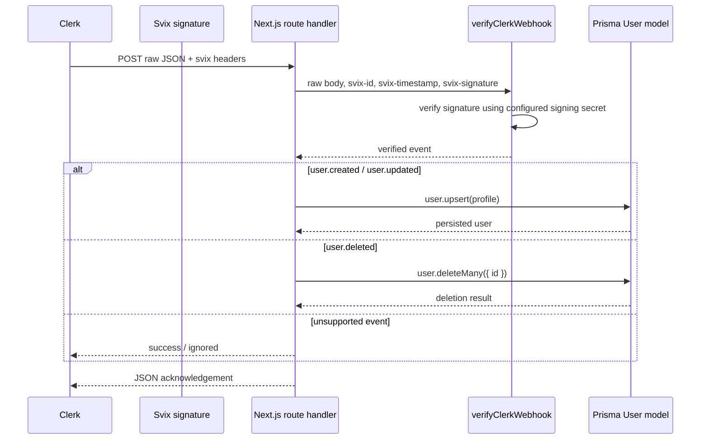

# Clerk Webhook Integration and User Profile Sync Runbook

## Architecture

WorkSphere receives Clerk user lifecycle events at `POST /api/webhooks/clerk`.



The route reads the request as raw text before parsing. The signature is verified by the `standardwebhooks` `Webhook` implementation, using Clerk's Svix-compatible headers. Never parse and re-serialize the body before signature verification: whitespace or key-order changes can invalidate the signature.

## Required headers

| Header | Purpose |
|---|---|
| `svix-id` | Unique webhook message identifier |
| `svix-timestamp` | Signed message timestamp; used by the verifier for replay-window validation |
| `svix-signature` | Signature(s) used to authenticate the exact raw payload |

Missing headers or an invalid signature are rejected before any database operation. The helper throws a `WebhookVerificationError`; the route returns its status code and error message.

## Secret configuration and rotation

The verifier resolves the signing secret in this order:

1. `CLERK_WEBHOOK_SIGNING_SECRET`
2. `CLERK_WEBHOOK_SECRET`
3. `WEBHOOK_SECRET`

For production, configure the Clerk endpoint's signing secret as `CLERK_WEBHOOK_SIGNING_SECRET` in the server runtime and deployment secret store. Never commit the secret, place it in a `NEXT_PUBLIC_*` variable, or include it in logs.

### Rotation procedure

1. Create or reveal the signing secret for the intended Clerk webhook endpoint.
2. Update `CLERK_WEBHOOK_SIGNING_SECRET` in the deployment secret manager.
3. Redeploy/restart the server so the new environment value is loaded.
4. Send a test event from Clerk and confirm a successful acknowledgement and expected user synchronization.
5. If the provider supports overlapping active secrets during rotation, coordinate the overlap according to its dashboard behavior; the current application helper reads one configured secret at a time.
6. Remove the old secret from secret stores and access paths once no longer needed.

Do not paste real signing secrets into issue comments, pull requests, chat, or logs.

## Supported events and database behavior

| Event | WorkSphere behavior | Idempotency |
|---|---|---|
| `user.created` | Resolve profile and `prisma.user.upsert` by Clerk user ID | Repeated deliveries update the same row |
| `user.updated` | Resolve profile and `prisma.user.upsert` by Clerk user ID | Repeated deliveries update the same row |
| `user.deleted` | `prisma.user.deleteMany({ where: { id } })` | Deleting a missing user is safe |
| Other event types | Return success with `action: "ignored"` | No database mutation |

Primary email resolution first matches `primary_email_address_id` to an entry in `email_addresses`; if no match is found, it falls back to the first email address. If no email exists (for example, a phone-only profile), the stored email is `null`. First/last names are nullable. An absent image uses the initials-based avatar URL generated by `resolveUserProfile`.

### Example payloads

These are illustrative JSON bodies; the signature headers must be generated by Clerk or a trusted test sender. Do not send unsigned examples to production.

**user.created / user.updated**

```json
{
  "type": "user.created",
  "data": {
    "id": "user_example_123",
    "first_name": "Asha",
    "last_name": "Patel",
    "image_url": "https://img.clerk.com/example",
    "primary_email_address_id": "idn_example_primary",
    "email_addresses": [
      {
        "id": "idn_example_primary",
        "email_address": "asha@example.test",
        "verification": { "status": "verified" }
      }
    ]
  }
}
```

**user.deleted**

```json
{
  "type": "user.deleted",
  "data": {
    "id": "user_example_123",
    "deleted": true
  }
}
```

## Local testing

1. Run the application locally with the required database environment configured.
2. Use the Clerk webhook development tooling or a secure tunnel such as ngrok to expose the local route.
3. Configure the development webhook endpoint in Clerk to target `https://<your-tunnel-host>/api/webhooks/clerk`.
4. Copy the development endpoint's signing secret into the local `CLERK_WEBHOOK_SIGNING_SECRET` environment variable.
5. Trigger `user.created`, `user.updated`, and `user.deleted` test events from the Clerk dashboard/tooling.
6. Confirm the response status and inspect the local User row using a safe test account.
7. Test an invalid signature and missing headers; both must be rejected without changing the database.

Example request shape (the placeholder values below are not valid signatures):

```bash
curl -i https://<your-tunnel-host>/api/webhooks/clerk \
  -X POST \
  -H 'Content-Type: application/json' \
  -H 'svix-id: <provider-generated-message-id>' \
  -H 'svix-timestamp: <provider-generated-timestamp>' \
  -H 'svix-signature: <provider-generated-signature>' \
  --data-binary @user-created.json
```

Do not generate a signature by hand for production. The raw body supplied to the verifier must exactly match the bytes/text that were signed.

## Troubleshooting

| Symptom | Likely cause | Action |
|---|---|---|
| HTTP 500, signing secret not configured | None of the supported environment variables is set | Configure `CLERK_WEBHOOK_SIGNING_SECRET` and redeploy |
| HTTP 400, missing headers | Provider/test sender omitted one or more Svix headers | Verify webhook delivery configuration |
| HTTP 400, invalid signature | Wrong endpoint secret, modified raw body, stale timestamp, or invalid signature | Confirm endpoint secret and provider delivery details; do not disable verification |
| HTTP 500, database sync failed | Prisma/database error | Inspect server-side error logs without exposing payload PII; verify DB connectivity |
| HTTP 200 with `action: ignored` | Unsupported event or deleted event without an ID | Confirm event type and payload shape |
| User has null email | Payload has no resolvable email address | This is supported for phone-only profiles; do not fabricate an email |

## Security checklist

- Verify the exact raw request body before parsing.
- Require all three Svix headers.
- Keep the signing secret server-side and rotate it through the deployment secret manager.
- Do not log raw user payloads, email addresses, signatures, or secrets.
- Keep webhook handling idempotent; provider retries are expected.
- Return an error for verification/database failures so the provider can retry where appropriate.

## Implementation and tests

- `src/lib/auth/clerkWebhook.ts`
- `src/app/api/webhooks/clerk/route.ts`
- `src/__tests__/api/clerkWebhook.test.ts`
