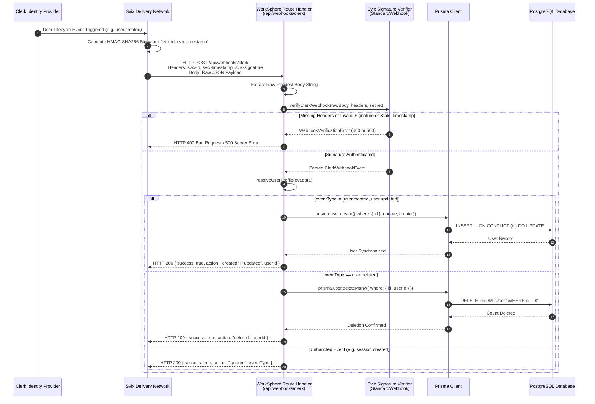

# Clerk Webhook Synchronization & User Metadata Architecture

> **Technical Reference & Operational Guide**  
> **Status:** Production Standard  
> **Target Endpoints:** `/api/webhooks/clerk` (Production Recommended), `/api/webhook` (Legacy Secondary)  
> **Signature Specification:** Svix HMAC-SHA256 (standardwebhooks v2 core)  
> **Database Engine:** PostgreSQL via Prisma ORM  

---

## 1. Overview

WorkSphere relies on **Clerk** as its authoritative identity and authentication provider. While Clerk handles user credentials, multi-factor authentication (MFA), OAuth social connections, and session lifecycle, WorkSphere maintains an internal relational user store within **PostgreSQL** to establish database relationships (such as bookings, venue reviews, favorites, coworking sessions, and notification subscriptions).

To keep this local user directory in continuous, eventual consistency with Clerk without requiring costly synchronous user-profile API queries on every application request, WorkSphere implements an asynchronous **event-driven synchronization pipeline**. When user lifecycle changes occur in Clerk (such as account registration, profile updates, or user deletions), Clerk dispatches HTTP POST webhooks to WorkSphere.



### Why Local Synchronization is Required
1. **Relational Data Integrity:** Features such as seat reservations (`Booking`), space ratings (`VenueRating`), and collaborative whiteboard sessions require a stable foreign key referencing `"User"."id"`.
2. **Low-Latency Reads:** Local queries join directly against the PostgreSQL `User` table rather than executing external HTTPS round-trips to the Clerk Backend API.
3. **Decoupled Architecture:** Read and query paths remain resilient even during transient external API rate-limiting or network degradation.

---

## 2. Webhook Endpoint and Request Lifecycle

### Endpoint Specifications

| Property | Primary / Recommended Endpoint | Legacy Fallback Endpoint |
|---|---|---|
| **Route Path** | `/api/webhooks/clerk` | `/api/webhook` |
| **Source Implementation** | [`src/app/api/webhooks/clerk/route.ts`](../../src/app/api/webhooks/clerk/route.ts) | [`src/app/api/webhooks/route.ts`](../../src/app/api/webhooks/route.ts) |
| **HTTP Method** | `POST` | `POST` |
| **Content-Type** | `application/json` | `application/json` |
| **CSRF & Middleware Exemption** | Exempt via `/api/webhook(.*)` pattern | Exempt via `/api/webhook(.*)` pattern |
| **Verification Engine** | `standardwebhooks` / `verifyClerkWebhook()` | `verifyWebhookPayload()` |

### Request Lifecycle Execution Sequence

1. **Raw Body Extraction:**
   The incoming request body is read as a raw string using `await req.text()`. It must **never** be parsed via `req.json()` before signature verification because JSON deserialization and reserialization alters key order, spacing, and Unicode escapes, invalidating HMAC digest validation.
2. **Svix Header Extraction:**
   The handler inspects incoming HTTP headers:
   - `svix-id`: Unique message delivery identifier (e.g., `msg_2abc...`).
   - `svix-timestamp`: Unix epoch seconds timestamp (e.g., `1716382910`).
   - `svix-signature`: Computed HMAC signature tokens (e.g., `v1,g34...`).
3. **Cryptographic Signature Verification:**
   `verifyClerkWebhook()` checks that all three headers exist, validates that `svix-timestamp` is within the acceptable clock drift window (default 5 minutes), and calculates the expected HMAC-SHA256 signature using the configured signing secret.
4. **Event Dispatch:**
   Once verified, the event `type` is evaluated against the `switch (eventType)` dispatcher.
5. **Database Mutation:**
   Prisma executes the required atomic database operation (`upsert` or `deleteMany`).
6. **HTTP Response Dispatch:**
   - **`200 OK`**: Successfully processed or deliberately ignored event.
   - **`400 Bad Request`**: Missing headers, invalid signature, payload mismatch, or unparseable JSON.
   - **`500 Internal Server Error`**: Database connection failure or unconfigured signing secret.

---

## 3. Supported Clerk Event Types

WorkSphere evaluates incoming Clerk events and executes corresponding database synchronizations:

| Event Type | Purpose in Clerk | WorkSphere Handler Action | Database Effect |
|---|---|---|---|
| **`user.created`** | Triggered when a new user finishes registration in Clerk | Normalizes primary email, names, and avatar; calls `prisma.user.upsert` | Creates new row in `"User"` table (or updates existing row if ID exists) |
| **`user.updated`** | Triggered when a user edits names, email addresses, or avatars in Clerk | Normalizes updated profile fields; calls `prisma.user.upsert` | Updates `email`, `firstName`, `lastName`, and `imageUrl` on existing `"User"` row |
| **`user.deleted`** | Triggered when a user account is deleted in Clerk | Reads `evt.data.id`; calls `prisma.user.deleteMany({ where: { id } })` | Deletes matching record in `"User"` table; cascaded relations execute according to schema |
| **`session.created`** | Triggered when an active authentication session starts | **Explicitly Acknowledged & Ignored** | **No database operation**. Returns HTTP 200 `{ success: true, action: "ignored", eventType: "session.created" }` |

### Detailed Event Behavior & Transformations

#### `user.created` & `user.updated`
Both events share identical profile resolution logic via `resolveUserProfile()`:
- **Identifier Lookup:** Keyed on `data.id` (Clerk User ID string, e.g., `user_2abc...`).
- **Email Resolution:** Resolves primary email by first matching `data.email_addresses` on `primary_email_address_id`. If absent, falls back to `email_addresses[0].email_address`. If no email exists, stores `null`.
- **Avatar Normalization:** Reads `data.image_url`. Automatically resizes Clerk/Google image queries to 150px (`sz=150` / `width=150`). If no image is provided, generates a deterministic SVG avatar via `https://ui-avatars.com/api/?name=INITIALS&background=6366f1&color=fff`.
- **Database Mutation:** Executes `prisma.user.upsert`:
  ```typescript
  await prisma.user.upsert({
    where: { id: profile.id },
    update: {
      email: profile.email,
      firstName: profile.firstName,
      lastName: profile.lastName,
      imageUrl: profile.imageUrl,
    },
    create: {
      id: profile.id,
      email: profile.email,
      firstName: profile.firstName,
      lastName: profile.lastName,
      imageUrl: profile.imageUrl,
    },
  });
  ```

#### `user.deleted`
- Reads `evt.data.id`.
- If `id` is null or undefined, returns HTTP 200 with `{ success: true, action: "ignored", reason: "missing_id" }`.
- Executes `prisma.user.deleteMany({ where: { id: userId } })`. Uses `deleteMany` instead of `delete` so that if the user was already removed or never synchronized, the operation succeeds idempotently without throwing a Prisma `P2025` record-not-found error.

#### `session.created` (Implementation Note)
WorkSphere does **not** persist active browser sessions in PostgreSQL. Session tokens and claims are verified statelessly at the edge via Clerk's RS256 JWT validation and cookie middleware (`clerkMiddleware`). As a result, when Clerk dispatches `session.created`, `session.ended`, or `session.removed`, the webhook router hits the default switch branch and safely acknowledges the payload with `{ success: true, action: "ignored", eventType }`.

---

## 4. Svix Signature Verification

To guarantee authenticity and prevent unauthorized actors from spoofing identity updates, all incoming requests must pass cryptographic HMAC-SHA256 verification before their body is trusted.

### Required HTTP Headers

```http
POST /api/webhooks/clerk HTTP/1.1
Host: worksphere.io
Content-Type: application/json
svix-id: msg_2Xy9Z10aBcDeFgHiJkLmNoPqRs
svix-timestamp: 1716382910
svix-signature: v1,O6XyA5V4N8Yt/7Z6w4s5d4F3g2H1j0K9L8m7N6P5Q4R=
```

### Signature Computation & Verification Algorithm

Svix computes signatures using HMAC-SHA256 over a concatenated envelope:

$$\text{SignedContent} = \text{svix-id} \mathbin{\Vert} \text{"."} \mathbin{\Vert} \text{svix-timestamp} \mathbin{\Vert} \text{"."} \mathbin{\Vert} \text{rawBody}$$

$$\text{ExpectedSignature} = \text{"v1,"} + \text{Base64}\left(\text{HMAC-SHA256}(\text{SigningSecret}, \text{SignedContent})\right)$$

In WorkSphere, [`src/lib/auth/clerkWebhook.ts`](../../src/lib/auth/clerkWebhook.ts) wraps the official `standardwebhooks` package (which powers the core engine of Svix v2):

```typescript
const wh = new StandardWebhook(secret);

wh.verify(
  rawBody,
  {
    "webhook-id": svixId,
    "webhook-timestamp": svixTimestamp,
    "webhook-signature": svixSignature,
  },
  { jsonParse: false },
);
```

### Replay Attack Protection
Svix automatically validates timestamps against system time:
- Requests older than 5 minutes (300 seconds) or requests with timestamps in the future beyond tolerance are rejected.
- This prevents an attacker from recording a legitimate webhook and replaying it at a later time.

### Secret Precedence and Environment Configuration

The handler evaluates webhook secrets in the following order:

```typescript
const secret =
  signingSecret ||
  process.env.CLERK_WEBHOOK_SIGNING_SECRET ||
  process.env.CLERK_WEBHOOK_SECRET ||
  process.env.WEBHOOK_SECRET;
```

#### Example Environment Configuration (`.env.local`)

```dotenv
# Production & Local Recommended Secret Key
CLERK_WEBHOOK_SIGNING_SECRET="whsec_dGVzdF9zZWNyZXRfa2V5XzEyMzQ1Njc4OTA="

# Supported Alternative Keys
CLERK_WEBHOOK_SECRET="whsec_dGVzdF9zZWNyZXRfa2V5XzEyMzQ1Njc4OTA="
WEBHOOK_SECRET="whsec_dGVzdF9zZWNyZXRfa2V5XzEyMzQ1Njc4OTA="
```

> [!WARNING]
> Webhook secrets always begin with the `whsec_` prefix. Never commit real signing secrets to git or version control. Store secrets in environment management pipelines (e.g., Vercel Environment Variables, AWS Secrets Manager).

---

## 5. Database Synchronization and Idempotency

### Prisma Models & Mapping

The webhook interacts with the `User` model declared in [`prisma/schema.prisma`](../../prisma/schema.prisma):

```prisma
model User {
  id                   String                @id
  email                String?               @unique
  firstName            String?
  lastName             String?
  imageUrl             String?
  createdAt            DateTime              @default(now())
  passwordChangedAt    DateTime?
  isAdmin              Boolean               @default(false)
  // ... relations (bookings, ratings, conversations)
}
```

### Idempotency Strategy

Webhooks are inherently an **at-least-once delivery** system. Network timeouts, network partitioning, or slow responses can cause Clerk/Svix to retry an event that was already executed.

WorkSphere achieves idempotency through the following mechanisms:

1. **Deterministic Primary Key Matching:**
   Clerk assigns immutable user identifiers (e.g., `user_2a1b...`). Database mutations target this specific primary key `id`.
2. **Atomic `upsert` Operations:**
   For `user.created` and `user.updated`, `prisma.user.upsert` compiles down to an atomic PostgreSQL statement:
   ```sql
   INSERT INTO "User" ("id", "email", "firstName", "lastName", "imageUrl", "createdAt")
   VALUES ($1, $2, $3, $4, $5, NOW())
   ON CONFLICT ("id") DO UPDATE SET
     "email" = EXCLUDED."email",
     "firstName" = EXCLUDED."firstName",
     "lastName" = EXCLUDED."lastName",
     "imageUrl" = EXCLUDED."imageUrl";
   ```
   If a webhook is delivered three times, the subsequent two executions simply refresh the record with identical data and complete without error.
3. **Idempotent Deletion via `deleteMany`:**
   For `user.deleted`, the handler executes `prisma.user.deleteMany({ where: { id: userId } })`. If repeated deliveries occur, `deleteMany` returns `{ count: 0 }` and does not raise an exception.
4. **Idempotency Limitations:**
   WorkSphere does **not** maintain a persistent deduplication table tracking individual `svix-id` values. Idempotency is enforced strictly at the row-level data layer via PostgreSQL `ON CONFLICT` constraints.

---

## 6. User Metadata Schemas

Clerk provides three distinct metadata buckets attached to user profiles. Understanding their trust boundaries is essential for application security.

### Metadata Categories & Trust Boundaries

```
┌────────────────────────────────────────────────────────────────────────┐
│                        Clerk User Metadata                             │
├────────────────────────────────┬───────────────────────────────────────┤
│  Metadata Type                 │  Client Writeable? │ Security Trust   │
├────────────────────────────────┼────────────────────┼──────────────────┤
│  publicMetadata                │  NO (Server only)  │ TRUSTED          │
│  privateMetadata               │  NO (Server only)  │ TRUSTED          │
│  unsafeMetadata                │  YES (Client/User) │ UNTRUSTED        │
└────────────────────────────────┴────────────────────┴──────────────────┘
```

1. **`publicMetadata`**:
   - Readable by the frontend client via `useUser()`.
   - Modifiable **only** by backend code via the Clerk Backend SDK / Secret Key.
   - Used for application roles, membership tiers, and public badges.
2. **`privateMetadata`**:
   - Readable **only** on the backend; never exposed to client browsers.
   - Modifiable **only** by backend code.
   - Used for internal administrative roles and backend security flags.
3. **`unsafeMetadata`**:
   - Modifiable directly by the authenticated user from the client browser.
   - **Must NEVER be used for authorization, roles, or access control.**

### WorkSphere Role & Authorization Mapping

Administrative authorization in WorkSphere is evaluated in [`src/lib/admin.ts`](../../src/lib/admin.ts):

```typescript
// 1. Env-configured email verification (verified emails only)
const adminEmails = (process.env.ADMIN_EMAILS || process.env.ADMIN_EMAIL || "")
  .split(",")
  .map((e) => e.trim().toLowerCase());

// 2. Clerk metadata role evaluation (private takes precedence over public)
const publicRole = user.publicMetadata?.role;
const privateRole = user.privateMetadata?.role;
const role = (privateRole ?? publicRole ?? "").toLowerCase();

const isAdmin = ["admin", "super_admin", "superadmin"].includes(role);
```

### Verified Schema Structure

#### Example: Admin & Verified Nomad User Metadata

```json
{
  "publicMetadata": {
    "role": "admin",
    "verified": true,
    "nomadRank": "Globetrotter",
    "badges": ["early_adopter", "verified_student"]
  },
  "privateMetadata": {
    "role": "super_admin",
    "internalNotes": "Core infrastructure maintainer",
    "securityTier": 1
  },
  "unsafeMetadata": {
    "preferredTheme": "cyberpunk",
    "bio": "Remote software engineer working from coffee shops"
  }
}
```

> [!IMPORTANT]
> The webhook endpoint `/api/webhooks/clerk` **does not copy Clerk metadata into PostgreSQL**. Metadata is read dynamically during authenticated server sessions via `currentUser()` or `auth()`. The database stores strictly identity fields (`id`, `email`, `firstName`, `lastName`, `imageUrl`).

---

## 7. Complete JSON Webhook Payload Examples

The following JSON payloads reflect authentic Clerk event structures. Note that Svix signature headers are computed dynamically per request and must not be hardcoded.

### 1. `user.created` Event

```json
{
  "data": {
    "id": "user_2Y6eZ8kLmNoPqRsTuVwXyZ01234",
    "object": "user",
    "username": "saransh_dev",
    "first_name": "Saransh",
    "last_name": "Kashyap",
    "image_url": "https://img.clerk.com/eyJhbGciOiJSUzI1NiIsImtpZCI6InByb3ZpZGVyIn0.image.png?width=800",
    "has_image": true,
    "primary_email_address_id": "idn_2Y6eZ8kLmNoPqRsTuVwXyZ99999",
    "email_addresses": [
      {
        "id": "idn_2Y6eZ8kLmNoPqRsTuVwXyZ99999",
        "object": "email_address",
        "email_address": "saransh@example.com",
        "verification": {
          "status": "verified",
          "strategy": "ticket"
        }
      }
    ],
    "public_metadata": {
      "role": "nomad",
      "verified": true
    },
    "private_metadata": {},
    "unsafe_metadata": {},
    "created_at": 1716382910000,
    "updated_at": 1716382910000
  },
  "object": "event",
  "type": "user.created"
}
```

### 2. `user.updated` Event

```json
{
  "data": {
    "id": "user_2Y6eZ8kLmNoPqRsTuVwXyZ01234",
    "object": "user",
    "username": "saransh_dev",
    "first_name": "Saransh",
    "last_name": "Sharma",
    "image_url": "https://img.clerk.com/eyJhbGciOiJSUzI1NiIsImtpZCI6InByb3ZpZGVyIn0.new_image.png",
    "has_image": true,
    "primary_email_address_id": "idn_2Y6eZ8kLmNoPqRsTuVwXyZ99999",
    "email_addresses": [
      {
        "id": "idn_2Y6eZ8kLmNoPqRsTuVwXyZ99999",
        "object": "email_address",
        "email_address": "saransh.updated@example.com",
        "verification": {
          "status": "verified",
          "strategy": "email_code"
        }
      }
    ],
    "public_metadata": {
      "role": "admin",
      "nomadRank": "Master"
    },
    "private_metadata": {},
    "unsafe_metadata": {},
    "created_at": 1716382910000,
    "updated_at": 1716383500000
  },
  "object": "event",
  "type": "user.updated"
}
```

### 3. `user.deleted` Event

```json
{
  "data": {
    "id": "user_2Y6eZ8kLmNoPqRsTuVwXyZ01234",
    "deleted": true,
    "object": "user"
  },
  "object": "event",
  "type": "user.deleted"
}
```

### 4. `session.created` Event

```json
{
  "data": {
    "id": "sess_2Z9aB3cDeFgHiJkLmNoPqRsTuVw",
    "object": "session",
    "user_id": "user_2Y6eZ8kLmNoPqRsTuVwXyZ01234",
    "status": "active",
    "last_active_at": 1716383600000,
    "expire_at": 1716988400000,
    "abandon_at": 1718988400000,
    "client_id": "client_2Xy9Z10aBcDeFgHiJkLmNoPqRs",
    "created_at": 1716383600000,
    "updated_at": 1716383600000
  },
  "object": "event",
  "type": "session.created"
}
```

---

## 8. Local Webhook Development & Testing

When developing locally, Clerk cannot deliver webhooks directly to `http://localhost:3000` because localhost is not reachable from the public internet. Two verified testing workflows are available:

### Workflow A: Using Svix CLI (`npx svix listen`)

Clerk webhooks are delivered through Svix. The Svix CLI can listen for events and forward them directly to your local endpoint:

1. **Terminal 1: Start Next.js Development Server:**
   ```bash
   npm run dev
   ```
2. **Terminal 2: Start Svix Forwarding Tunnel:**
   ```bash
   npx svix listen http://localhost:3000/api/webhooks/clerk
   ```
3. **Capture Endpoint Signing Secret:**
   The CLI outputs:
   ```text
   Listening on http://localhost:3000/api/webhooks/clerk
   Endpoint secret: whsec_xxxxxxxxxxxxxxxxxxxxxxxxxxxxxxxx
   ```
4. **Configure Local Environment:**
   Add the secret to `.env.local`:
   ```dotenv
   CLERK_WEBHOOK_SIGNING_SECRET="whsec_xxxxxxxxxxxxxxxxxxxxxxxxxxxxxxxx"
   ```
5. **Restart `npm run dev`** in Terminal 1 to load the new environment variable.

### Workflow B: Using LocalTunnel or ngrok

Alternatively, establish an HTTPS forwarding tunnel:

1. **Start Tunnel:**
   ```bash
   # Option 1: LocalTunnel
   npx localtunnel --port 3000

   # Option 2: ngrok
   ngrok http 3000
   ```
2. **Register Endpoint in Clerk Dashboard:**
   - Navigate to **Clerk Dashboard → Webhooks → Add Endpoint**.
   - Set URL to `https://<tunnel-subdomain>/api/webhooks/clerk`.
   - Subscribe to events: `user.created`, `user.updated`, `user.deleted`.
   - Copy the **Signing Secret** (`whsec_...`) into `.env.local` as `CLERK_WEBHOOK_SIGNING_SECRET`.
3. **Trigger Test Events:**
   - In Clerk Dashboard → Webhooks → select endpoint → **Testing** tab.
   - Choose `user.created` and click **Send Example**.
   - Check local server console logs and inspect PostgreSQL database:
     ```bash
     npx prisma studio
     ```

---

## 9. Security Considerations

1. **Verify Signatures Before Body Access:**
   Never parse or inspect request body contents before cryptographic signature verification completes.
2. **Raw Body Integrity:**
   Ensure the raw body string passed to the verifier has not been modified by JSON parsers, compression layers, or proxy rewrites.
3. **Timestamp Window & Drift:**
   The verification library rejects requests older than 5 minutes to prevent replay attacks. Ensure server system clocks are synchronized with NTP.
4. **Secret Storage and Rotation:**
   Webhook signing secrets must remain confidential. When rotating secrets in the Clerk Dashboard, use rolling rotation periods so both old and new secrets are recognized during the cutover.
5. **Zero Trust on Client-Controlled Metadata:**
   Never assign roles or privileges based on `unsafeMetadata`. Only backend-controlled `publicMetadata` and `privateMetadata` may be used for access decisions.

---

## 10. Troubleshooting & Common Issues

| Issue / Error Symptom | Probable Cause | Diagnostic & Resolution Step |
|---|---|---|
| **`HTTP 500: Webhook signing secret is not configured`** | Neither `CLERK_WEBHOOK_SIGNING_SECRET`, `CLERK_WEBHOOK_SECRET`, nor `WEBHOOK_SECRET` is defined in `.env.local`. | Add `CLERK_WEBHOOK_SIGNING_SECRET="whsec_..."` to `.env.local` and restart the Next.js process. |
| **`HTTP 400: Missing required Svix signature headers`** | Request sent without `svix-id`, `svix-timestamp`, or `svix-signature`. | Verify that the caller is Clerk/Svix. Check if an intermediate proxy or reverse proxy stripped custom headers. |
| **`HTTP 400: Invalid webhook signature: ...`** | The configured signing secret does not match the Clerk endpoint sending the request. | Confirm the secret in `.env.local` matches the exact endpoint configured in the Clerk Dashboard. |
| **`HTTP 400: Message timestamp too old / too new`** | Server system time has drifted by more than 5 minutes. | Synchronize local development machine or server clock via NTP (`w32tm /resync` or `ntpdate`). |
| **`HTTP 400: Failed to read request body`** | Stream was already consumed or closed. | Ensure no custom Next.js middleware is consuming `req.body` before the route handler executes. |
| **`HTTP 500: Failed to process user synchronization`** | PostgreSQL database unreachable or Prisma migration missing. | Run `npx prisma db push` or verify database credentials in `DATABASE_URL`. |

---

## 11. Related References

- [WorkSphere Security Architecture](../SECURITY_ARCHITECTURE.md) — Comprehensive defense-in-depth whitepaper and threat model.
- [Clerk Authentication Guide](../AUTH_GUIDE.md) — Middleware authentication rules, JWT claims, and session handling.
- [Clerk Webhook Local Setup Guide](CLERK_WEBHOOK_SETUP.md) — Step-by-step developer guide for local webhook forwarding.
- [Environment Variables Reference](../environment/webhooks.md) — Configuration guide for webhook secrets and API tokens.
- [Prisma Schema Definition](../../prisma/schema.prisma) — Relational user model definition.
- [Official Clerk Webhook Documentation](https://clerk.com/docs/integrations/webhooks/overview) — Official Clerk webhook architecture and event catalog.
- [Svix Webhook Documentation](https://docs.svix.com/) — Specification for Svix signature verification and webhook retry behavior.
