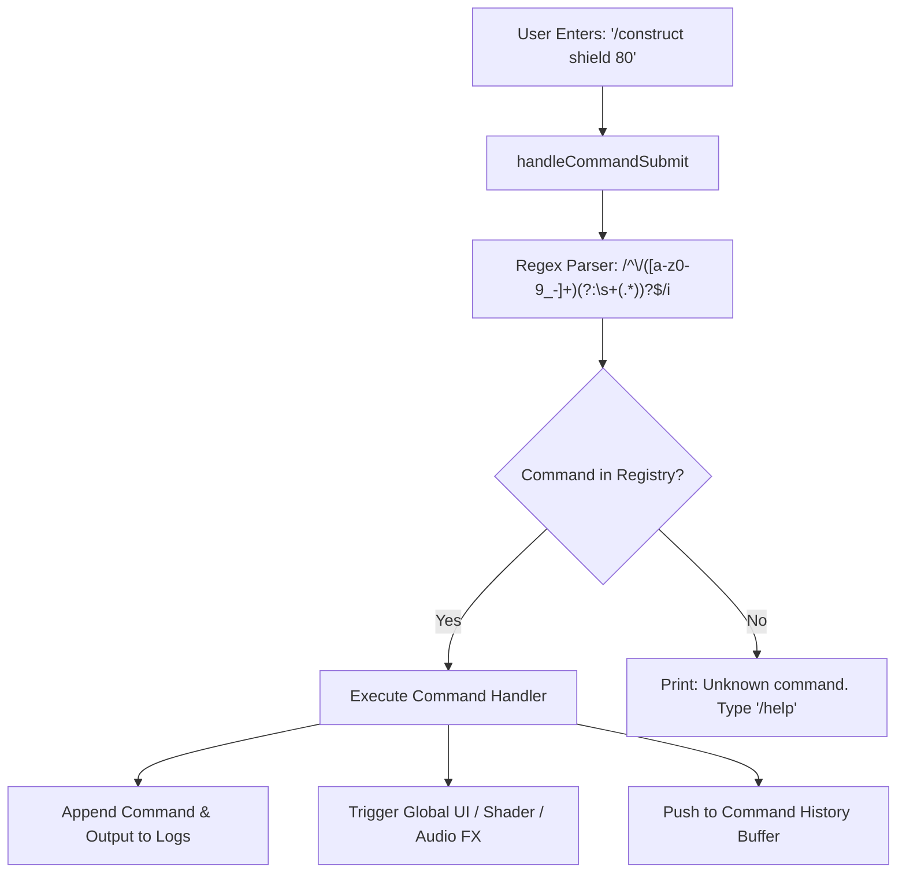
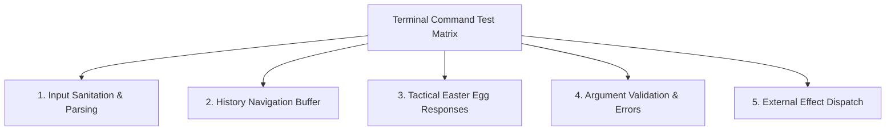

# Lantern & Tactical Terminal Commands Specification

## 1. Executive Summary & Overview

WorkSphere's `BrainTerminal` component (`src/components/chat/BrainTerminal.tsx`) incorporates an interactive command interpreter serving dual functions:

1. **Developer Diagnostics & Telemetry**: Interfacing directly with ambient geolocation, noise floor monitoring, spatial audio engines, and WebXR anchors.
2. **Tactical Easter Eggs & Construct Invocation**: Immersive Green Lantern and aerospace flight commands that trigger custom ASCII art outputs, hard-light shaders, HUD telemetry states, and procedural audio feedback.

This document serves as the canonical reference for available terminal commands, argument schemas, ASCII art responses, visual effects, and unit testing procedures.

---

## 2. Command Architecture & Syntax Handler

The command engine intercepts input strings prefixed with forward slashes (`/`), separates the primary command verb from whitespace-delimited arguments, and matches against the terminal command registry:



### 2.1 Command Handler Contract

```typescript
export interface TerminalCommandResponse {
  output: string | string[];
  isError?: boolean;
  effect?: {
    type:
      "EMERALD_BLOOM" | "AFTERBURNER_BURST" | "RADAR_SWEEP" | "CONSTRUCT_SPAWN";
    payload?: Record<string, unknown>;
  };
}

export type TerminalCommandHandler = (
  args: string[],
  rawInput: string,
) => TerminalCommandResponse;
```

---

## 3. Terminal Command Catalog

### 3.1 `/oath`

- **Aliases**: `/lantern`, `/willpower`
- **Description**: Recites the Green Lantern Corps oath and manifests the sacred Power Battery.
- **Arguments**: None.
- **Visual / Sound Effects**:
  - Triggers full-screen emerald bloom pulse (`--color-lantern-emerald`).
  - Plays procedural resonant harmonic chime.
- **Output**:

```text
               .---.
              /     \
             | () () |
             |   _   |
           .='-------'=.
          /             \
         |   .-------.   |
         |  /  ( * )  \  |
         | |  ( ( ) )  | |
         |  \  ( * )  /  |
         |   '-------'   |
          \             /
           '=========='
          /  [POWER]  \
         '-------------'

"In brightest day, in blackest night,
No evil shall escape my sight.
Let those who worship evil's might,
Beware my power... Green Lantern's light!"

[STATUS: WILLPOWER CONSTRUCT ENGINE ONLINE // SECTOR 2814]
```

---

### 3.2 `/sector2814`

- **Aliases**: `/space`, `/orbital`
- **Description**: Initiates an Earth sector orbital diagnostic scan across active WorkSphere coworking hubs.
- **Arguments**: None.
- **Visual / Sound Effects**:
  - Activates concentric radar sweep in `AmbientCoworkingCircle.tsx`.
  - Displays GPS & WGS84 micro-location datum coordinates.
- **Output**:

```text
==================================================
         SECTOR 2814 // EARTH TELEMETRY SCAN
==================================================
ORBITAL DATUM  : 37°46'29.7"N 122°25'09.8"W (SF-01)
CORPS DEFENSE  : GREEN LANTERN CORPS ACTIVE
SPACE SECTOR   : 2814 (SOL SYSTEM / TERRA)
COWORKING HUBS : 1,428 ONLINE // SYNCHRONIZED
NOISE FLOOR    : 44.2 dB(A) [DEEP FOCUS NOMINAL]
STATUS         : SECTOR 2814 CLEARANCE GRANTED
==================================================
```

---

### 3.3 `/afterburner`

- **Aliases**: `/boost`, `/supersonic`
- **Description**: Overclocks spatial pathfinding and multi-threaded Web Workers into supersonic mode.
- **Arguments**: `[level: 1-5 | max]` (Default: `3`).
- **Visual / Sound Effects**:
  - Amber flame border glow (`--color-hud-amber`) and screen shake.
  - Synthesizes low-frequency jet turbine afterburner roar via Web Audio.
- **Output (Level 5 / Max)**:

```text
               ▲
              / \
             / _ \
            | / \ |
           /|     |\
          / |  ▲  | \
         /  | / \ |  \
        /   |/   \|   \
       [====][===][====]
        \  /  \ /  \  /
         ▼     ▼     ▼
       (=== AFTERBURNER ===)
       [REHEAT: 100% MAXIMUM]

>> THRUST: MACH 3.2 DETECTED
>> CPU WORKERS: MULTI-THREAD SIMD CLUSTER ENGAGED
>> TRANSIT ROUTE SOLVER ACCELERATION: 400%
```

---

### 3.4 `/construct`

- **Aliases**: `/hardlight`, `/forge`
- **Description**: Projects a parametric hard-light geometric construct into WebXR space or whiteboard canvas.
- **Arguments**: `<shield | ring | arrow | hexagon>`
- **Visual / Sound Effects**:
  - Activates `HardLightCrystallineBackdrop` Voronoi fragment shader.
  - Spawns construct vector in `CanvasWhiteboard.tsx` or `ARScene.tsx`.

#### Sub-types & Outputs:

##### `/construct shield`

```text
         .------------------.
        /                    \
       |      .--------.      |
       |     /          \     |
       |    |  HARDLIGHT |    |
       |    |   SHIELD   |    |
       |     \          /     |
        \     '--------'     /
         \                  /
          '----------------'
                 \  /
                  \/
>> CONSTRUCT: AEGIS DEFLECTION MATRIX
>> ENERGY DENSITY: 100% SOLID HARD-LIGHT
>> REFRACTION: POINTER DYNAMIC WARP ACTIVE
```

##### `/construct ring`

```text
            .-------.
         .-'         '-.
       .'   .-------.   '.
      /   .'         '.   \
     |   /   POWER    \   |
     |  |    RING      |  |
     |   \   2814     /   |
      \   '.         .'   /
       '.   '-------'   .'
         '-.         .-'
            '-------'
>> CONSTRUCT: POWER RING CONSTRUCT RETICLE
>> EMISSIVE BLOOM: SHADER UNIFORMS LOADED
```

---

### 3.5 `/flightlead`

- **Aliases**: `/formation`, `/lead`
- **Description**: Assumes flight lead status, commanding online coworkers in `AmbientCoworkingCircle.tsx` into a tactical flight formation.
- **Arguments**: `<callsign>` (e.g., `/flightlead RAPTOR-01`).
- **Visual / Sound Effects**:
  - Re-indexes orbital concentric radar circles into a forward echelon V-formation.
  - Activates aerospace HUD boresight crosshair overlay.
- **Output**:

```text
                 ▲  [FLIGHT LEAD: RAPTOR-01]
                / \
               /   \
              /     \
             /       \
     ▲      /         \      ▲
    / \    /           \    / \
   [W-1]  /             \  [W-2]

>> FORMATION: TACTICAL V-ECHELON
>> CALLSIGN: RAPTOR-01 (LEAD)
>> RADAR PING: CONCENTRIC ORBIT LOCK ACQUIRED
>> SECTOR 2814 FLIGHT CLEARANCE CONFIRMED
```

---

### 3.6 Standard Terminal Utilities

| Command   | Arguments   | Description                                       | Output                                 |
| :-------- | :---------- | :------------------------------------------------ | :------------------------------------- |
| `/help`   | `[command]` | Lists all available public and tactical commands  | Formatted command table & syntax guide |
| `/clear`  | None        | Flushes the active terminal log buffer            | Empty buffer                           |
| `/status` | None        | Displays active AI Agent Orchestrator node health | JSON-like system status readout        |
| `/noise`  | None        | Runs real-time WASM decibel analysis              | `42.5 dB(A) · DEEP_FOCUS_HUM`          |

---

## 4. Test Procedures for Terminal Command Unit Tests

Testing terminal command execution in Jest and `@testing-library/react` requires verifying input sanitation, history buffer management, ASCII response formatting, and external effect callbacks.

### 4.1 Test Suite Organization

Unit tests reside in `src/__tests__/components/chat/LanternTerminalCommands.test.tsx` and validate the following test matrix:



### 4.2 Standard Jest Test Pattern

```typescript
import React from "react";
import { render, screen, fireEvent } from "@testing-library/react";
import "@testing-library/jest-dom";
import { BrainTerminal } from "@/components/chat/BrainTerminal";

describe("BrainTerminal Tactical Command Handlers", () => {
  it("executes /oath and renders Green Lantern battery ASCII art", () => {
    const handleCommand = jest.fn();
    render(<BrainTerminal isOpen={true} onCommand={handleCommand} />);

    const input = screen.getByTestId("terminal-command-input");
    const form = screen.getByTestId("terminal-command-form");

    // Enter '/oath'
    fireEvent.change(input, { target: { value: "/oath" } });
    fireEvent.submit(form);

    expect(handleCommand).toHaveBeenCalledWith("/oath");
    expect(screen.getByText(/In brightest day, in blackest night/i)).toBeInTheDocument();
  });

  it("validates /construct arguments and rejects invalid construct types", () => {
    const handleCommand = jest.fn();
    render(<BrainTerminal isOpen={true} onCommand={handleCommand} />);

    const input = screen.getByTestId("terminal-command-input");
    const form = screen.getByTestId("terminal-command-form");

    // Enter valid construct
    fireEvent.change(input, { target: { value: "/construct shield" } });
    fireEvent.submit(form);
    expect(screen.getByText(/HARDLIGHT SHIELD/i)).toBeInTheDocument();

    // Enter invalid construct
    fireEvent.change(input, { target: { value: "/construct unkown_item" } });
    fireEvent.submit(form);
    expect(screen.getByText(/Invalid construct type/i)).toBeInTheDocument();
  });

  it("navigates history buffer with ArrowUp and ArrowDown keys", () => {
    render(<BrainTerminal isOpen={true} />);
    const input = screen.getByTestId("terminal-command-input") as HTMLInputElement;
    const form = screen.getByTestId("terminal-command-form");

    // Submit two commands
    fireEvent.change(input, { target: { value: "/oath" } });
    fireEvent.submit(form);

    fireEvent.change(input, { target: { value: "/sector2814" } });
    fireEvent.submit(form);

    // Press ArrowUp: should recall latest command '/sector2814'
    fireEvent.keyDown(input, { key: "ArrowUp" });
    expect(input.value).toBe("/sector2814");

    // Press ArrowUp again: should recall '/oath'
    fireEvent.keyDown(input, { key: "ArrowUp" });
    expect(input.value).toBe("/oath");

    // Press ArrowDown: should return to '/sector2814'
    fireEvent.keyDown(input, { key: "ArrowDown" });
    expect(input.value).toBe("/sector2814");
  });
});
```
