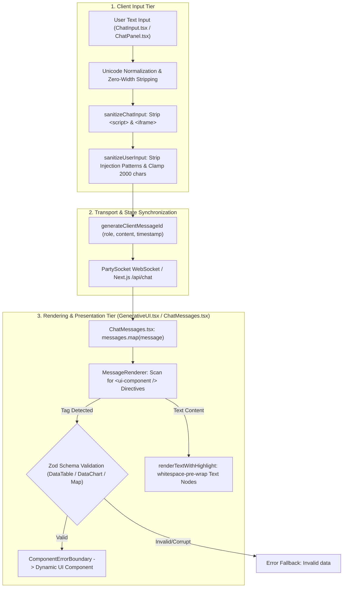

# Markdown Syntax Rendering & Collaborative Chat Formatting Specification

This document serves as the formal technical specification for WorkSphere's collaborative chat formatting, input sanitization pipeline, Generative UI rendering architecture, security boundaries against Cross-Site Scripting (XSS), message list performance, and recommended DOMPurify/Markdown enhancements.

---

## 1. Overview and Rendering Architecture

WorkSphere provides real-time collaborative workspace chat and AI assistant interactions (`src/components/chat/ChatPanel.tsx`, `ChatMessages.tsx`, `ChatInput.tsx`). Users submit messages containing formatted text, venue queries, attachments, and interactive generative UI directives.

### 1.1 End-to-End Message Processing Lifecycle

1. **User Input (`ChatInput.tsx` / `ChatPanel.tsx`):** Users enter text into the chat textarea. Leading/trailing whitespace is trimmed, and zero-width/invisible Unicode characters are stripped.
2. **Input Sanitization (`sanitizeChatInput` in `ChatPanel.tsx` & `sanitizeUserInput` in `chatAgents.ts`):** Input text passes through client-side sanitizers that strip `<script>` and `<iframe>` injection tags, filter adversarial prompt injection sequences (e.g., `ignore previous instructions`, `[INST]`), and clamp input length to 2,000 characters.
3. **Transport & WebSocket Dispatch:** The message payload is assigned a deterministic client message ID (`generateClientMessageId`) and dispatched via PartySocket/WebSocket (`src/party/`) or Next.js API routes (`/api/chat`).
4. **Content Parsing (`MessageRenderer` in `GenerativeUI.tsx`):** Messages are scanned for structured generative widget tags (`<ui-component name="..." props='...' />`). Non-widget segments are parsed into sentences with speech synthesis highlighting (`renderTextWithHighlight`).
5. **DOM Projection:** Standard text segments render as React text nodes inside `<span className="whitespace-pre-wrap">`. Because React renders text children using `document.createTextNode()`, all raw HTML tags (e.g., ``, `<a href="javascript:...">`) are safely escaped as plain text rather than executed as DOM markup.

### 1.2 Architectural Data Flow



---

## 2. Supported Formatting Syntax and Constraints

WorkSphere balances expressive collaborative communication with strict security and low rendering overhead.

### 2.1 Feature Support Matrix

| Formatting Feature | Syntax Example | Parsed Token / DOM Output | Current Status | Restrictions & Caveats |
|---|---|---|:---:|---|
| **Plain Text & Whitespace** | `Hello WorkSphere\nNext line` | `<span class="whitespace-pre-wrap">` | **Supported** | Line breaks and consecutive spaces preserved via CSS `whitespace-pre-wrap`. |
| **Generative UI Directives** | `<ui-component name="DataChart" props='{...}' />` | React Component (`DataChart`, `DataTable`, `Map`) | **Supported** | Strictly validated with Zod schemas (`DataTable`, `DataChart`, `Map`); unknown widgets rejected. |
| **Speech Highlighting** | `Active sentence.` | `<mark class="bg-yellow-300">` | **Supported** | Enabled when Read Aloud (`useSpeechSynthesis`) is active for the message ID. |
| **Inline Code** | `` `npm run test` `` | Plain text | *Unsupported* | Rendered verbatim as plain text characters. |
| **Fenced Code Blocks** | ` ```typescript\ncode\n``` ` | Plain text | *Unsupported* | Rendered verbatim within `whitespace-pre-wrap` span. |
| **Bold Text** | `**Bold text**` | Plain text | *Unsupported* | Asterisks render literally as text. |
| **Italic Text** | `*Italic text*` | Plain text | *Unsupported* | Asterisks render literally as text. |
| **Blockquotes** | `> Important note` | Plain text | *Unsupported* | Greater-than symbol renders literally. |
| **Unordered Lists** | `- Item 1\n- Item 2` | Plain text | *Unsupported* | Hyphens render literally; indentation preserved via whitespace. |
| **Ordered Lists** | `1. First\n2. Second` | Plain text | *Unsupported* | Digits and periods render literally. |
| **Hyperlinks** | `[WorkSphere](https://example.com)` | Plain text | *Unsupported* | Markdown link syntax renders literally without clickable anchor tag. |
| **Raw HTML Elements** | `<b>Bold</b>`, `<a href="...">` | Escaped Text | **Restricted / Escaped** | React text interpolation escapes all tags; `<script>` and `<iframe>` stripped at input. |

> **Implementation Note:** WorkSphere does **not** currently bundle a third-party Markdown parsing library (such as `marked` or `react-markdown`) in its production client bundle. Chat message bodies are rendered through React text node interpolation (`{content}` inside `renderTextWithHighlight`), which provides automatic, zero-overhead browser HTML entity escaping.

---

## 3. Parsing and Generative UI Pipeline

Rather than converting Markdown to HTML, WorkSphere uses a regex tokenizer that splits message content into interactive component directives and styled text blocks.

### 3.1 Generative Component Regex
In `src/components/chat/GenerativeUI.tsx`:
```typescript
const regex = /<ui-component\s+name="([^"]+)"\s+props=(?:'([^']+)'|"([^"]+)")\s*\/>/g;
```

### 3.2 Parsing and Deserialization Sequence
1. **Token Matching:** The regex matches `<ui-component name="..." props='...' />` directives generated by AI reasoning agents.
2. **HTML Entity Normalization:** Escaped quote entities within props (`&quot;`, `&#x27;`, `&amp;`) are decoded back to standard JSON quotes.
3. **JSON Deserialization:** `JSON.parse(rawProps)` parses the properties into a JavaScript object. Malformed JSON renders a red `ui-component-parse-error` message.
4. **Zod Runtime Schema Validation:**
   - **`DataTable`:** `z.object({ columns: z.array(z.string()).optional(), data: z.array(z.record(z.string(), z.any())) })`
   - **`DataChart`:** Validates column/data arrays or label/dataset tuples.
   - **`Map`:** Validates coordinates: `z.object({ center: z.object({ lat: z.number(), lng: z.number() }), markers: ... })`.
   - If validation fails, an `Invalid {componentName} data` error is rendered.
5. **Error Boundary Wrapping:** Every valid widget is wrapped in `<ComponentErrorBoundary componentName={componentName}>` to prevent widget runtime crashes from unmounting the chat container.

---

## 4. XSS Protection and Input Sanitization

WorkSphere employs a defense-in-depth model combining input preprocessing, schema validation, and React's text escaping.

### 4.1 Input Sanitization Functions

#### A. `sanitizeChatInput` (`src/components/chat/ChatPanel.tsx`)
```typescript
export function sanitizeChatInput(rawInput: string | null | undefined): string {
  if (typeof rawInput !== "string") return "";

  // 1. Normalize Unicode zero-width characters and spaces
  const normalized = rawInput
    .replace(/[\u200B-\u200D\uFEFF]/g, "")
    .replace(/[\u00A0\u1680\u2000-\u200A\u202F\u205F\u3000]/g, " ")
    .trim();

  if (!normalized) return "";

  // 2. Strip script and iframe tags
  return normalized
    .replace(/<script\b[^<]*(?:(?!<\/script>)<[^<]*)*<\/script>/gi, "")
    .replace(/<iframe\b[^<]*(?:(?!<\/iframe>)<[^<]*)*<\/iframe>/gi, "");
}
```

#### B. `sanitizeUserInput` (`src/lib/ai/chatAgents.ts`)
Strips prompt injection tokens (e.g., `ignore previous instructions`, `[INST]`, `<|im_start|>`) and caps query length at 2,000 characters to prevent buffer and token exhaustion attacks.

### 4.2 XSS Payload Verification Matrix

The following table documents common adversarial injection payloads and their behavior under WorkSphere's current architecture:

| Payload Category | Raw Input Payload | Sanitizer / React Processing | Rendered DOM Result | Security Outcome |
|---|---|---|---|:---:|
| **Executable Script Tag** | `<script>alert('XSS')</script>` | Stripped by `sanitizeChatInput` regex | `""` (Empty string; rejected from submission) | **Blocked** |
| **Embedded Iframe** | `<iframe src="https://evil.example"></iframe>` | Stripped by `sanitizeChatInput` regex | `""` (Empty string; rejected from submission) | **Blocked** |
| **Inline Event Handler** | `` | Untouched by input regex; passed to React | `<span>&lt;img src="x" onerror="alert(1)"&gt;</span>` | **Neutralized** (Escaped text) |
| **JavaScript Pseudo-URL** | `<a href="javascript:alert(1)">Click</a>` | Untouched by input regex; passed to React | `<span>&lt;a href="javascript:alert(1)"&gt;Click&lt;/a&gt;</span>` | **Neutralized** (Escaped text) |
| **SVG Script Injection** | `<svg><script>alert(1)</script></svg>` | `<script>` stripped; `<svg></svg>` remains | `<span>&lt;svg&gt;&lt;/svg&gt;</span>` | **Neutralized** (Escaped text) |
| **Zero-Width Character Evasion**| `s\u200Bcript` | Normalized by stripping `\u200B` | Normalized to `script` prior to keyword matching | **Neutralized** |

---

## 5. Recommended DOMPurify Policy (For Future Full Markdown Integration)

When WorkSphere integrates full Markdown rendering (e.g., via `react-markdown` or `marked`), it must enforce a strict **DOMPurify** sanitization policy before injecting HTML into the DOM:

```typescript
// Recommended DOMPurify Configuration for WorkSphere Collaborative Chat
import DOMPurify from "dompurify";

export const CHAT_DOMPURIFY_CONFIG: DOMPurify.Config = {
  ALLOWED_TAGS: [
    "b", "strong", "i", "em", "code", "pre", "blockquote",
    "p", "br", "ul", "ol", "li", "a", "span", "mark", "table",
    "thead", "tbody", "tr", "th", "td"
  ],
  ALLOWED_ATTR: [
    "href", "title", "target", "rel", "class", "data-testid"
  ],
  ALLOWED_URI_REGEXP: /^(?:(?:https?|mailto):|[^a-z]|[a-z+.-]+(?:[^a-z+.-:]|$))/i,
  FORBID_TAGS: [
    "script", "iframe", "object", "embed", "form", "input",
    "button", "textarea", "svg", "math", "style", "link", "meta"
  ],
  FORBID_ATTR: [
    "style", "onerror", "onload", "onclick", "onmouseover",
    "onfocus", "onblur", "formaction", "dangerouslySetInnerHTML"
  ],
  ADD_ATTR: ["target", "rel"],
};

// Hook: Force target="_blank" and rel="noopener noreferrer" on all external links
DOMPurify.addHook("afterSanitizeAttributes", (node) => {
  if (node.tagName === "A" && node.hasAttribute("href")) {
    node.setAttribute("target", "_blank");
    node.setAttribute("rel", "noopener noreferrer nofollow");
  }
});
```

---

## 6. Collaborative Chat Performance & Virtualization

High-concurrency chat systems require efficient rendering to prevent UI jank during rapid streaming and multi-participant message bursts.

### 6.1 Performance Optimization Registry

| Optimization Area | Implementation Location | Mechanism / Technique | Current Status |
|---|---|---|:---:|
| **Message Deduplication** | `ChatPanel.tsx` (`deduplicateMessages`) | Deduplicates messages by `clientMessageId`, `id`, or `role:content` composite key | **Implemented** |
| **Optimistic IDs** | `ChatPanel.tsx` (`generateClientMessageId`) | Hash of trimmed content + role + timestamp prevents double-rendering on socket reconnect | **Implemented** |
| **Token Estimation** | `ChatPanel.tsx` (`estimateTokens`) | Characters / 4 heuristic with 0%–100% progress clamping | **Implemented** |
| **Error Isolation** | `GenerativeUI.tsx` (`ComponentErrorBoundary`) | Prevents individual chart or map rendering errors from crashing chat | **Implemented** |
| **Smooth Auto-Scroll** | `ChatMessages.tsx` (`messagesEndRef`) | `messagesEndRef.current.scrollIntoView({ behavior: "smooth" })` on new message arrival | **Implemented** |
| **DOM Virtualization** | `ChatMessages.tsx` | Virtualized windowing (`react-window` / `@tanstack/react-virtual`) | *Not Implemented* (Standard `messages.map` DOM rendering) |
| **Message Memoization** | `ChatMessages.tsx` | `React.memo` on individual message bubbles | *Not Implemented* |

### 6.2 Virtualization Guidelines for Large Message Histories
Because WorkSphere currently renders messages using `messages.map((message) => ...)`, rooms with >500 messages may experience DOM node accumulation.
When implementing virtualized windowing:
1. Use `@tanstack/react-virtual` or `react-window` (`VariableSizeList`).
2. Measure dynamic message heights dynamically via `ResizeObserver` to accommodate variable-height generative widgets (`DataChart`, `InteractiveMap`).
3. Preserve scroll position when older historical messages are prepended during upward scrolling.

---

## 7. Testing and Verification Guide

Contributors modifying chat formatting or sanitization must run the existing test suites:

```bash
# 1. Run chat input sanitization unit tests
npx jest src/__tests__/lib/chatInputSanitization.test.ts

# 2. Run chat input component tests
npx jest src/__tests__/components/ChatInput.test.tsx

# 3. Run chat panel deduplication and message lifecycle tests
npx jest src/__tests__/components/ChatPanelDeduplication.test.tsx
```

### Manual Security Validation Test Cases
- **Script Tag Submission:** Enter `<script>alert(1)</script>`. Confirm `sanitizeChatInput` returns empty string and disables the submit button.
- **Iframe Submission:** Enter `<iframe src="https://example.com"></iframe>`. Confirm input is stripped.
- **Malicious Attribute Submission:** Enter ``. Confirm the text renders literally on screen without executing JavaScript.
- **Generative UI Injection:** Enter `<ui-component name="DataChart" props='{"invalid": true}' />`. Confirm Zod rejects the payload and displays `Invalid DataChart data`.

---

## 8. Source References

- [`src/components/chat/ChatPanel.tsx`](../../src/components/chat/ChatPanel.tsx) — Chat panel container, `sanitizeChatInput`, and message deduplication.
- [`src/components/chat/ChatInput.tsx`](../../src/components/chat/ChatInput.tsx) — Chat textarea, attachment compression, and drag-and-drop.
- [`src/components/chat/ChatMessages.tsx`](../../src/components/chat/ChatMessages.tsx) — Chat message stream rendering and scroll management.
- [`src/components/chat/GenerativeUI.tsx`](../../src/components/chat/GenerativeUI.tsx) — Generative UI regex tokenizer, Zod schema validation, and `renderTextWithHighlight`.
- [`src/lib/ai/chatAgents.ts`](../../src/lib/ai/chatAgents.ts) — Adversarial prompt injection sanitization (`sanitizeUserInput`).
- [`src/__tests__/lib/chatInputSanitization.test.ts`](../../src/__tests__/lib/chatInputSanitization.test.ts) — Input sanitization regression test suite.
