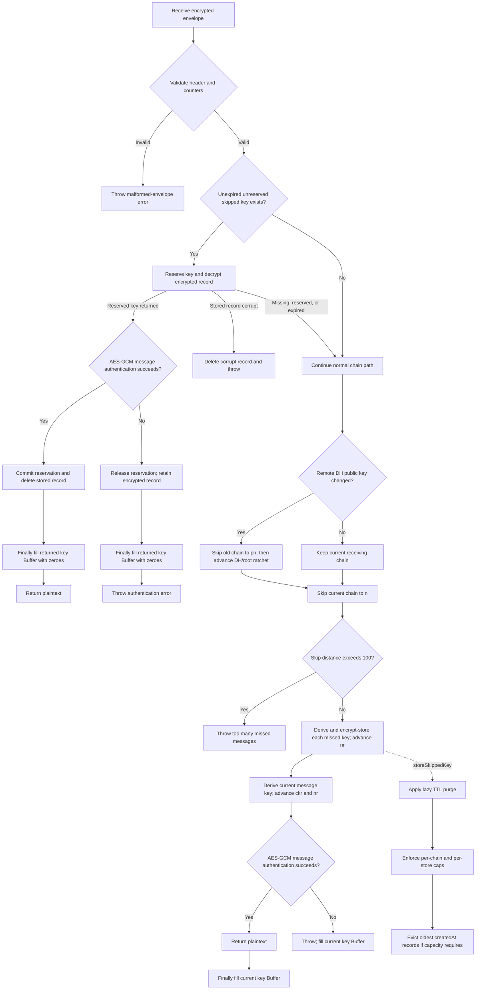

# Skipped Message Key Store Lifecycle Runbook

> **Source status:** The current [`SkippedMessageKeyStore.ts`](../../src/core/chat/SkippedMessageKeyStore.ts) file contains an incomplete, syntactically invalid `SkippedMessageKeyStore` declaration before a second declaration of the same class. The later implementation described below is source-visible, but the module does not compile as checked in. The legacy-looking declaration and one old test also disagree with the later implementation. Treat the described behavior as the intended behavior of that complete implementation, not as a verified running security guarantee, until the source and tests are repaired.

This runbook is source-focused. It distinguishes Double Ratchet concepts from behavior visible in WorkSphere's [`DoubleRatchetSession.ts`](../../src/core/chat/DoubleRatchetSession.ts), and from guarantees that still require implementation and integration work.

## A. Overview and Architecture

Skipped message keys let a receiver decrypt an earlier message after its receiving chain has advanced past that message. They are necessary when transport reorders or delays messages: a receiver cannot wait indefinitely for every missing packet before processing later packets.

The source-visible path is:

1. `DoubleRatchetSession.decrypt(envelope)` validates the header `{ dhPublicKey, pn, n }`.
2. The session looks for a skipped key indexed by the remote ratchet public key and message counter.
3. If present, it reserves and decrypts that stored key, authenticates the message with AES-256-GCM, then commits (deletes) the stored record on success. A failed authentication releases the reservation.
4. If there is no usable stored key, the session advances the receiving chain, stores intermediate keys for missing counters, and uses the next key for the incoming message.
5. `SkippedMessageKeyStore` stores skipped keys as AES-256-GCM encrypted records in memory, keyed by session, chain public key, and sequence counter.

The implementation surface is [`DoubleRatchetSession.ts`](../../src/core/chat/DoubleRatchetSession.ts), [`SkippedMessageKeyStore.ts`](../../src/core/chat/SkippedMessageKeyStore.ts), and the [`core/index.ts`](../../src/core/index.ts) exports. The direct protocol test suite is [`DoubleRatchetSession.test.ts`](../../src/__tests__/chat/DoubleRatchetSession.test.ts).

Repository search found no production call site for `DoubleRatchetSession` outside its own module; it is exported from the core index and exercised by tests. The separate [`KeyManager.ts`](../../src/core/chat/KeyManager.ts) manages other session/key state and does not call or persist this store in the source inspected here. Do not infer that this class is wired into every WorkSphere chat transport or production message service.

Retaining a skipped key is a deliberate exception to discarding message keys after chain advancement: it permits delayed-message recovery, but means that retained keys remain useful for decrypting their specific messages until consumed, expired, evicted, or the store is destroyed.

## B. Double Ratchet and Forward Secrecy

The general Double Ratchet model combines:

- A **root key (`rk`)**, updated when a new Diffie-Hellman ratchet key is received.
- **Sending (`cks`) and receiving (`ckr`) chain keys**, advanced for individual messages.
- A **message key (`mk`)**, derived from the current chain key for one encrypted message.
- **Counters (`ns`, `nr`, `pn`)**, tracking the next sending and receiving message numbers and the previous sending-chain length.
- **Skipped message keys**, derived for counters between the receiver's current `nr` and an incoming message's `n`, retained so the missing messages can be opened later.

In the source, `kdfCk` uses HMAC-SHA-256 with the labels `"ChainStep"` and `"MessageKey"` to derive the next chain key and one message key. `kdfRk` uses HMAC-SHA-256 to derive the next root key and a new chain key from a DH output. Messages use AES-256-GCM; the serialized header is authenticated as additional data.

In a protocol implementation, advancing the chain and securely discarding prior keys limits the ability to derive prior message keys from later state. A DH ratchet can add fresh entropy to subsequent chains. Those are protocol concepts, not proof that this code achieves all formal Double Ratchet guarantees.

**Implementation caveats:** the code replaces `rk`, `cks`, and `ckr` buffers when advancing but does not explicitly `fill(0)` on the old buffers at each replacement. The class also replaces its ECDH object during a DH ratchet without an explicit private-key zeroization operation. The session's serialized object includes `rkHex`, `cksHex`, and `ckrHex`; those fields are key material and must not be treated as a secret-free export. Skipped message records are encrypted, but that does not make the entire session serialization safe to disclose.

The source comments and the existing [Double Ratchet Protocol document](../security/DOUBLE_RATCHET_PROTOCOL.md) make broader forward-secrecy and post-compromise-security claims. This runbook does not certify those claims: old root/chain buffers are not explicitly erased on ratchet advancement, skipped keys are retained temporarily, session state contains root/chain keys in hex, the session class has no production call site found in this repository search, and no protocol-conformance audit is established here. In particular, do not claim post-compromise security based only on the presence of DH-ratchet code.

## C. Out-of-Order Message Arrival

Assume Alice sends messages with counters `n=0`, `n=1`, and `n=2` on one sending chain, but Bob receives them in order `2`, `0`, `1`.

1. Bob begins with `nr=0` and receives `n=2`.
2. The store has no key for that chain/counter, so `skipMessageKeys(2)` derives and stores keys for counters `0` and `1`, advancing the receiving chain and `nr`.
3. Bob derives the key for counter `2`, advances the chain again, and attempts AES-GCM decryption.
4. When message `n=0` later arrives, its chain public key and counter locate the stored key. The session reserves it, decrypts with it, commits its removal on successful authentication, and zeroes the returned key buffer in a `finally` block.
5. Message `n=1` is recovered the same way. After successful consumption, neither skipped record remains.

When a message introduces a new remote DH public key, the receiver first attempts to skip remaining keys in the old chain up to the envelope's `pn`, then performs the DH ratchet and skips through the new chain up to `n`. The skipped-key identifier includes the remote DH public key, so keys from older chains remain distinguishable.

If a skipped key has expired, been evicted, already been committed, or is currently reserved, `hasSkippedKey`/`reserveSkippedKey` will not provide it. `decrypt` then continues into the normal chain path; that is not a special “expired message” response, and authentication will generally fail if the chain has already passed the counter. There is no separate replay-cache response code.

**Failure nuance:** for a stored skipped key, failed AES-GCM authentication releases the reservation and retains the encrypted record, allowing a later legitimate packet with that counter to be tried. For a message using the current receiving chain, the chain key and `nr` advance before AES-GCM authentication; a failed authentication zeroes `mk` but does not roll the chain state back. That distinction is important for error handling and retry expectations.

## D. Skipped Message Key Store Architecture

The complete implementation later in `SkippedMessageKeyStore.ts` exposes:

- `SkippedKeyMetadata`: `sessionId`, lowercased `ratchetPublicKeyHex`, `sequenceCounter`, and `createdAt`.
- `EncryptedSkippedKeyRecord`: metadata plus hex `ciphertext`, `iv`, and `authTag`.
- `SkippedKeyReservation`: `reservationId`, `keyId`, plaintext `messageKey: Buffer`, and `reservedAt`.
- `SkippedKeyStoreConfig`: session ID, optional root/storage keys, capacity/TTL/lease overrides, and a time provider.

The main data structures are:

- `records`: canonical key ID to encrypted record.
- `chainIndex`: lowercased ratchet public key to a set of record IDs.
- `reservations`: reservation ID to record ID and reservation timestamp.
- `reservedKeyIds`: record ID to reservation ID, preventing simultaneous reservation in the same store instance.

`buildSkippedKeyId(sessionId, ratchetPublicKeyHex, sequenceCounter)` lowercases the public-key string and creates `sessionId:ratchetPublicKeyHex:sequenceCounter`. This identifies the session, ratchet chain, and message counter. A separate per-chain set supports counting and oldest-key selection.

On `storeSkippedKey`, the complete implementation validates a non-empty public key string, a nonnegative safe-integer counter, and a 32-byte `Buffer`. It purges expired records, rejects a duplicate ID, enforces capacity, records creation time, and encrypts the key using AES-256-GCM with a random 12-byte IV. The metadata JSON is authenticated as AAD; the 16-byte tag, IV, ciphertext, and metadata are retained, not the plaintext key.

The store encryption key is a copy of a supplied `storageKey`, or is derived with HKDF-SHA-256 from the configured `rootKey` and session-specific info, or is randomly generated if neither is supplied. `DoubleRatchetSession` passes its initial `rk` as `rootKey` unless a storage key is provided. Restoration requires a separately supplied 32-byte storage key so encrypted skipped records can be opened again.

The file also has an earlier, incomplete class fragment that uses `set/get`, a plaintext string cache, `activeWindow`, and an apparent single 100-entry cache. Its interpolations are syntactically invalid and a second class of the same name follows. It is not a functioning alternate implementation; it is a source/build blocker and must not be conflated with the complete encrypted implementation described here.

## E. Storage Limits and Memory Bounds

The complete implementation declares:

| Limit                                    |                                 Default | Scope                                                   |
| ---------------------------------------- | --------------------------------------: | ------------------------------------------------------- |
| `SKIPPED_KEYS_MAX_PER_CHAIN`             |                                     100 | Per store/session and lowercased ratchet public key.    |
| `SKIPPED_KEYS_MAX_GLOBAL`                |                                   2,000 | Across all chains in one store/session.                 |
| `DoubleRatchetSession` max skip distance | 100 message counters per skip operation | Before deriving intermediate keys in `skipMessageKeys`. |

Both storage limits can be overridden with `maxKeysPerChain` and `maxGlobalKeys` in `SkippedKeyStoreConfig` / corresponding session options. The skip-distance check rejects when `nr + 100 < untilNr`; a gap of exactly 100 missing counters is allowed, and a larger gap throws `Too many missed messages to skip`.

When storing an additional key at a positive limit, the complete implementation evicts the oldest eligible record in the affected chain until that chain is below its limit, then does the same against the global session-store limit if needed. If all candidates are reserved, the selection helper falls back to the oldest record anyway, so a reservation is not an absolute protection from capacity eviction under full pressure. Import also applies capacity checks while records are restored.

These are per-store limits, not process-wide limits across all sessions. There is no explicit maximum number of `DoubleRatchetSession` instances in the code inspected. The configuration values are not validated as positive integers; do not rely on zero or negative overrides as a strict zero-capacity setting.

The complete implementation declares a 100-key **per-chain** bound and a 2,000-key **per-store** bound. Tests exercise per-chain eviction and configurable global eviction at smaller values; the benchmark uses a 100-key chain. The malformed preliminary class fragment instead uses one global cache size check of 100 and is not executable. Because of the syntax error and duplicate declaration, no storage bound is currently runtime-verified from this source snapshot.

## F. Timestamp-Based Eviction and LRU Pruning

The complete implementation timestamps records with `createdAt`, using an explicit supplied timestamp or the configured time provider (default `Date.now`). The timestamp has two roles:

1. **TTL:** a record expires when its timestamp is not finite, is more than 60 seconds in the future, or `now - createdAt >= ttlMs`. The default `ttlMs` is seven days (`SKIPPED_KEYS_RETENTION_TTL_MS`).
2. **Capacity eviction:** when a capacity is reached, records with the smallest `createdAt` are selected first.

This is timestamp/creation-age eviction, **not access-based LRU**. Retrieval does not update `createdAt` or a last-access field. The `activeWindow` field appears only in the malformed preliminary fragment and an outdated test; the complete encrypted record has no active-window marker and does not protect an “active decryption window.”

Expired records are checked lazily: insertion calls `purgeExpired`; `hasSkippedKey` and `reserveSkippedKey` remove the requested expired record; `exportEncryptedRecords` purges before export; import skips expired records; and callers can call `purgeExpired` or `DoubleRatchetSession.purgeExpiredSkippedKeys`. There is no background timer in the store. A stale record can remain until one of these operations occurs.

Reservation leases default to 30 seconds. Expired reservation metadata is cleaned lazily when store methods call `cleanExpiredReservations`; there is no timer that wakes up at 30 seconds. Lease expiration unlocks the encrypted record; it does not itself delete the skipped key.

At the exact TTL boundary (`now - createdAt === ttlMs`), the record is expired. A timestamp over one minute in the future is rejected as expired; a smaller future skew is not expired by that check until age meets the TTL. Invalid timestamps are treated as expired. If all stored records are expired, `purgeExpired` removes them and returns the count; a later insertion can proceed without capacity eviction.

## G. Single-Use Key Consumption and Zeroization

The normal skipped-key path in `DoubleRatchetSession.decrypt` is two-phase:

1. `hasSkippedKey` checks an unexpired, unreserved record.
2. `reserveSkippedKey` authenticates the metadata, decrypts the encrypted record, and marks it reserved. A concurrent/re-entrant reserve for the same key returns `null`.
3. The session authenticates/decrypts the envelope with the returned message-key `Buffer`.
4. On success, `commitSkippedKey` removes the reservation and record from `records` and `chainIndex`.
5. On message-authentication failure, `releaseSkippedKey` removes the reservation but keeps the encrypted record for a legitimate retry.
6. In either result, the session's `finally` block calls `reservation.messageKey.fill(0)`.

On `reserveSkippedKey`, corrupt stored ciphertext/tag or metadata that fails the record checks causes the store to delete that record and throw. Import checks record fields, session identity, and expiration, but does not perform AEAD decryption up front; tampering may be discovered only when a caller reserves the key. If the decrypted stored key is not 32 bytes, the store fills that buffer with zeroes, deletes the record, and throws. The convenience method `consumeSkippedKey` reserves and commits **before returning** the plaintext buffer; a direct caller must zero that returned buffer, and cannot restore the stored key if a later message decryption fails. The session's normal decrypt path uses reserve/commit/release instead.

`storeSkippedKey` itself does not wipe the caller's `messageKey` buffer. The integrated `skipMessageKeys` caller does wrap it in `finally { mk.fill(0) }`; direct callers must manage their input buffer. Similarly, the store retains ciphertext strings, so deleting a record removes references from maps but does not overwrite those strings' underlying JavaScript memory.

`DoubleRatchetSession.destroy()` fills its current `rk`, `cks`, and `ckr` buffers, clears `dhr`, and calls store `destroy()`. The store clears record/index/reservation maps and fills its own `storageKey` buffer with zeroes. This is logical deletion plus best-effort writes to mutable Buffers, not a guarantee of physical memory erasure by JavaScript, V8, or the operating system. `destroy()` does not wipe plaintext message-key Buffers already handed to external callers, nor does the session expose an explicit ECDH private-key zeroization path.

**Replay behavior:** after a skipped key is successfully committed, the record is gone; a replay cannot use that stored key and normally fails authentication through the current-chain path. There is no separate replay cache or explicit `n < nr` rejection in `decrypt`. In addition, current-chain state advances before authentication, so do not describe the implementation as providing robust replay resistance without qualification.

## H. Mermaid Lifecycle Diagram



The diagram distinguishes the recoverable skipped-key failure path from the current-chain failure path. Only the former has an existing encrypted record and reservation that can be released for retry. The diagram describes the complete implementation's control flow; the current source syntax error prevents confirming it by execution.

## I. Memory Leak Prevention Rules

| Operational rule                                              | Status in source                                                                                                                                                                                                                                                                                                                                   |
| ------------------------------------------------------------- | -------------------------------------------------------------------------------------------------------------------------------------------------------------------------------------------------------------------------------------------------------------------------------------------------------------------------------------------------- |
| Keep skipped records bounded per chain and per session store. | **Implemented in the complete class:** defaults 100 per chain and 2,000 total per store, with configurable values. Not runtime-verified while the module has a syntax error; configuration values are not validated.                                                                                                                               |
| Remove old skipped keys.                                      | **Partially implemented:** seven-day TTL and explicit/lazy purge triggers exist; no scheduled background purge.                                                                                                                                                                                                                                    |
| Avoid retaining consumed key material.                        | **Partially implemented:** successful session decryption deletes the encrypted record; JS map deletion is logical removal, and external serialized/exported references may remain.                                                                                                                                                                 |
| Avoid unnecessary copies of secret byte arrays.               | **Recommendation / partial:** code creates Buffers for KDF and decrypt operations; `storeSkippedKey` does not retain plaintext but also does not zero the caller's buffer. Prefer single ownership and wipe in caller `finally` blocks.                                                                                                            |
| Clean temporary buffers where supported.                      | **Partially implemented:** skipped derivation and decrypt message-key Buffers are filled; `destroy` fills storage and current root/chain Buffers; old replaced chain/root and ECDH private-key material are not explicitly erased.                                                                                                                 |
| Prevent unbounded chain-map growth.                           | **Partially implemented:** record deletion removes empty chain-index sets, and positive default global capacity bounds a store. There is no process-wide cap across sessions and no validation of invalid capacity overrides.                                                                                                                      |
| Handle session termination and store disposal.                | **Available, caller-dependent:** `DoubleRatchetSession.destroy()` clears store state; no production lifecycle caller was found in the repository search. The store itself has no disposed flag.                                                                                                                                                    |
| Avoid logging secret key material.                            | **Observed:** these two implementation files do not log message-key bytes. Continue to avoid logging buffers, storage keys, serialized ratchet state, or decrypted plaintext.                                                                                                                                                                      |
| Ensure errors do not retain keys indefinitely.                | **Partially implemented:** skipped-key authentication failures release a reservation and wipe the returned key in the session `finally`; expired leases are cleaned lazily, and the encrypted skipped record remains until consumed, TTL expiry, capacity eviction, or destruction. Current-chain decrypt failures advance state without rollback. |

For production integration, call session destruction at session termination, invoke purge as part of lifecycle management if sessions can remain idle, ensure external persistence is access-controlled, and avoid copying or logging secret-bearing state.

## J. Security Guarantees and Limitations

| Property                           | Mechanism visible in source                                                                                                  | Source location                                                                                                                                        | Status and limitations                                                                                                                                                            |
| ---------------------------------- | ---------------------------------------------------------------------------------------------------------------------------- | ------------------------------------------------------------------------------------------------------------------------------------------------------ | --------------------------------------------------------------------------------------------------------------------------------------------------------------------------------- |
| Forward secrecy                    | HMAC-derived message keys, chain advancement, DH ratchet, and explicit fills for some message/DH buffers.                    | [`DoubleRatchetSession.ts`](../../src/core/chat/DoubleRatchetSession.ts)                                                                               | **Partial / not certified.** Prior `rk`/chain buffers are replaced without explicit zeroization; skipped keys persist; serialized state exposes root/chain keys as hex.           |
| Out-of-order recovery              | Derive keys for missing counters; key them by session, remote ratchet public key, and counter; reserve/decrypt/commit later. | [`DoubleRatchetSession.ts`](../../src/core/chat/DoubleRatchetSession.ts), [`SkippedMessageKeyStore.ts`](../../src/core/chat/SkippedMessageKeyStore.ts) | **Implemented in source-visible logic, unverified at runtime.** The store source has a parse error; no production session caller was found.                                       |
| Replay resistance                  | Successful skipped-key commit deletes that key; no dedicated replay cache.                                                   | `decrypt`, `commitSkippedKey` in the same source files                                                                                                 | **Partial.** Replays generally fail authentication after key loss, but `decrypt` has no explicit old-counter rejection and current-chain state advances before authentication.    |
| Key retention limits               | 100 per chain and 2,000 per store; skip distance 100.                                                                        | `SKIPPED_KEYS_MAX_PER_CHAIN`, `SKIPPED_KEYS_MAX_GLOBAL`, `skipMessageKeys`                                                                             | **Declared in complete implementation.** Configurable, not process-global, and not runtime-verified due malformed source.                                                         |
| Expiration                         | `createdAt`, default seven-day TTL, `purgeExpired` and access-triggered checks.                                              | `isRecordExpired`, `purgeExpired`                                                                                                                      | **Implemented in source-visible logic, lazy only.** No timer; clock anomalies are conservatively handled.                                                                         |
| Single-use consumption             | Reservation lease; commit after successful AEAD; release after failed skipped-message authentication.                        | `reserveSkippedKey`, `commitSkippedKey`, `releaseSkippedKey`, `DoubleRatchetSession.decrypt`                                                           | **Implemented in source-visible path.** Direct `consumeSkippedKey` deletes before the caller's later operation; use the two-phase API when decryption must be retryable.          |
| Zeroization                        | `Buffer.fill(0)` on selected message, DH, root/chain, and storage-key buffers.                                               | `DoubleRatchetSession.ts`, `SkippedMessageKeyStore.ts`                                                                                                 | **Partial best effort.** No guaranteed physical erasure; old chain/root buffers and ECDH private material are not explicitly wiped; caller-owned buffers need lifecycle handling. |
| Memory exhaustion prevention       | Per-chain/global record caps and max skip distance.                                                                          | `SkippedMessageKeyStore.ts`, `DoubleRatchetSession.skipMessageKeys`                                                                                    | **Declared in complete implementation.** No process-wide cap across sessions; malformed source means behavior is not currently executable/verified.                               |
| Session isolation at record lookup | Composite ID includes `sessionId`; metadata session ID is checked before reserve/import.                                     | `buildSkippedKeyId`, `reserveSkippedKey`, `importEncryptedRecords`                                                                                     | **Implemented in source-visible logic.** Not a substitute for protecting the storage key or whole serialized session state.                                                       |

## K. Testing and Troubleshooting

### Relevant tests and coverage

[`src/__tests__/chat/DoubleRatchetSession.test.ts`](../../src/__tests__/chat/DoubleRatchetSession.test.ts) contains integration-style tests for sequential and out-of-order messages, skipped-key consumption and replay attempts, multiple DH chains, per-chain/global capacity, maximum skip distance, seven-day retention and purge, encrypted persistence/restoration, tampered records, failed forged-message authentication, malformed headers, and session destruction.

[`src/__tests__/chat/SkippedMessageKeyStore.bench.test.ts`](../../src/__tests__/chat/SkippedMessageKeyStore.bench.test.ts) benchmarks insertion, lookup, consumption, and eviction. [`src/core/chat/__tests__/SkippedMessageKeyStore.test.ts`](../../src/core/chat/__tests__/SkippedMessageKeyStore.test.ts) is an older test for `set/get`, plaintext keys, and `activeWindow`; those methods/fields are not present in the complete encrypted implementation. That file also contains the invalid expression `key-` and is not valid executable coverage for the current API.

Run the relevant suites from the repository root:

```bash
npx jest src/__tests__/chat/DoubleRatchetSession.test.ts --runInBand
npx jest src/__tests__/chat/SkippedMessageKeyStore.bench.test.ts --runInBand
npx jest src/core/chat/__tests__/SkippedMessageKeyStore.test.ts --runInBand
```

In the current source snapshot, the session suite fails before running because `SkippedMessageKeyStore.ts` has malformed interpolation expressions in the first declaration (TypeScript reports errors at lines 7 and 15). The older direct store suite fails to parse its own `key-` expression. Do not treat test names or the existing protocol document's reported test totals as current passing evidence.

There are no focused tests found for concurrent reservations, lease expiry after an idle period, exact TTL-boundary behavior, zero/negative configuration, direct store input-buffer wiping, all-leased capacity fallback, export object aliasing, or current-chain authentication-failure rollback. Add regression tests for these cases when the implementation is repaired. Tests that inspect key bytes should use generated test buffers only and must never print secret values.

Although the integration test has a “Secure Zeroization” section, its store-input test does not assert that `storeSkippedKey` wiped the original argument; it manually fills the retrieved buffer and checks that manual fill. Its session-destroy test checks that encryption is rejected after destruction, not that every secret buffer was overwritten.

### Troubleshooting checklist

- **A delayed message cannot decrypt:** check its `dhPublicKey`/`n` pair, whether the record expired or was evicted, whether the correct storage key was supplied on restore, and whether a previous successful decrypt consumed it.
- **A forged skipped packet fails:** the session should release its reservation and preserve the encrypted record; verify subsequent legitimate-delayed-message behavior after tests are runnable.
- **A large counter jump throws:** `skipMessageKeys` limits a single skip to 100 missing counters; verify `n`/`pn` are valid for the receiving chain.
- **A message decrypt error is followed by later failures:** current-chain state advances before authentication and is not rolled back; inspect the sequence and session state rather than retrying blindly.
- **Stored records fail authentication after restore:** confirm the external 32-byte storage key matches the one used to encrypt the records; tampered ciphertext, IV, tag, or authenticated metadata will fail.
- **Memory grows while sessions are idle:** TTL pruning is lazy, not timer-driven. Confirm callers invoke `purgeExpiredSkippedKeys()` or destroy terminated sessions, and remember the limits are per session store, not process-wide.
- **Tests fail to start:** repair the malformed duplicate class in the store and stale test before interpreting runtime behavior. This documentation task does not modify application code.

## References

- [Skipped message key store source](../../src/core/chat/SkippedMessageKeyStore.ts)
- [Double Ratchet session source](../../src/core/chat/DoubleRatchetSession.ts)
- [Core exports](../../src/core/index.ts)
- [Double Ratchet lifecycle tests](../../src/__tests__/chat/DoubleRatchetSession.test.ts)
- [Skipped key store benchmark](../../src/__tests__/chat/SkippedMessageKeyStore.bench.test.ts)
- [Legacy skipped key store test](../../src/core/chat/__tests__/SkippedMessageKeyStore.test.ts)
- [Double Ratchet Protocol architecture document](../security/DOUBLE_RATCHET_PROTOCOL.md)
- [Key manager source](../../src/core/chat/KeyManager.ts)
