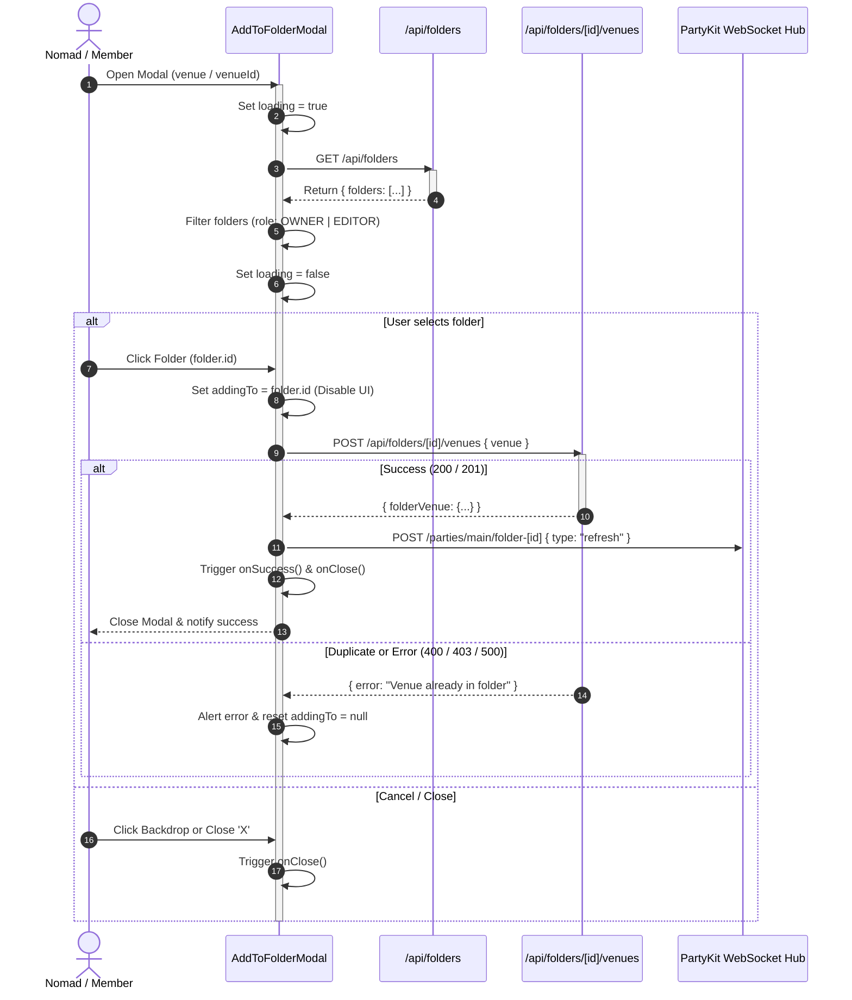
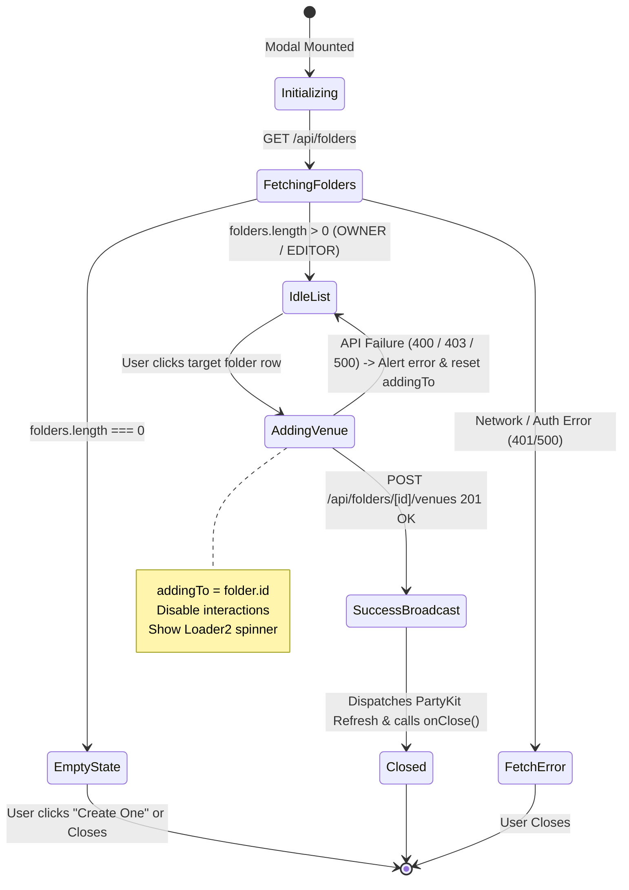

# `AddToFolderModal`: Collection Management & Venue Bookmark Reference

This document details the architecture, component props, state machine transitions, error handling strategies, and backend API integration for the **`AddToFolderModal`** component ([`src/components/collections/AddToFolderModal.tsx`](../../src/components/collections/AddToFolderModal.tsx)).

---

## 1. Overview & Architecture

The `AddToFolderModal` allows users to bookmark and organize coworking spaces, cafes, and private offices into custom collections (folders). It enforces access-role boundaries (requiring `OWNER` or `EDITOR` privileges) and dispatches real-time state invalidations across collaborative peer sessions via PartyKit WebSockets.



---

## 2. Component Props & Event Callbacks

`AddToFolderModal` supports the following prop interface:

| Prop        | Type                         | Required | Default     | Description                                                                                                                                |
| :---------- | :--------------------------- | :------- | :---------- | :----------------------------------------------------------------------------------------------------------------------------------------- |
| `venue`     | `Venue \| VenueSummary`      | **Yes**  | —           | Venue data object containing at minimum `id`, `name`, and optional geographical metadata (`address`, `category`, `latitude`, `longitude`). |
| `onClose`   | `() => void`                 | **Yes**  | —           | Invoked when the user dismisses the modal via the backdrop, close button (`X`), or after successfully adding a venue.                      |
| `isOpen`    | `boolean`                    | Optional | `true`      | Controls modal visibility when used in controlled dialog patterns.                                                                         |
| `venueId`   | `string`                     | Optional | `venue?.id` | Explicit venue identifier when working with lightweight ID references.                                                                     |
| `onSuccess` | `(folderId: string) => void` | Optional | `undefined` | Callback invoked immediately after the venue has been persisted to the folder and the real-time refresh signal is sent.                    |

### TypeScript Definition

```typescript
export interface AddToFolderModalProps {
  /**
   * Venue object or summary to be added to the selected collection.
   */
  venue: {
    id: string;
    placeId?: string;
    name: string;
    latitude?: number;
    longitude?: number;
    category?: string;
    address?: string;
    [key: string]: unknown;
  };

  /**
   * Callback fired when closing or dismissing the modal dialog.
   */
  onClose: () => void;

  /**
   * Optional controlled open state.
   */
  isOpen?: boolean;

  /**
   * Optional explicit venue identifier override.
   */
  venueId?: string;

  /**
   * Optional callback triggered on successful addition to a folder.
   */
  onSuccess?: (folderId: string) => void;
}
```

---

## 3. State Machine & Transitions

The component manages three internal state variables across its lifecycle:

- `folders`: Collection list retrieved from the server.
- `loading`: Boolean flag indicating initial folder query resolution.
- `addingTo`: Holds the `folderId` currently processing a bookmark request, or `null` when idle.



### State Descriptions

1. **`Initializing / Fetching` (`loading === true`):**
   - Renders a centered `<Loader2 className="animate-spin text-zinc-400" />` spinner.
   - Dispatches `GET /api/folders` to fetch the current user's workspace collections.
2. **`Empty State` (`folders.length === 0`):**
   - Displayed when the user has not created any folders or holds only `VIEWER` permissions on shared collections.
   - Shows guidance text and an action link pointing to `/collections` to create a new folder.
3. **`Idle Folder List` (`loading === false && folders.length > 0`):**
   - Filters the returned folder list to include only folders where `accessRole === "OWNER"` or `accessRole === "EDITOR"`.
   - Renders color-coded folder icons, folder titles, and a `+` action button.
4. **`Adding In-Flight` (`addingTo === folder.id`):**
   - Disables all list items (`disabled={addingTo !== null}`) to prevent duplicate clicks.
   - Replaces the `+` icon with `<Loader2 className="animate-spin accent-text" />` on the targeted item.
5. **`Success & Dismissal`:**
   - Triggers a non-blocking WebSocket cache invalidation broadcast to the PartyKit server.
   - Calls `onSuccess?.(folderId)` and `onClose()`.

---

## 4. Backend API Integration & Realtime Sync

### 4.1 Folder Listing (`GET /api/folders`)

- **Endpoint:** `GET /api/folders`
- **Authentication:** Requires valid Clerk session (`auth()`). Returns `401 Unauthorized` if unauthenticated.
- **Payload Response:**
  ```json
  {
    "folders": [
      {
        "id": "cly18abc0001...",
        "name": "Quiet Cafes with Fast Wi-Fi",
        "description": "Spots with >100 Mbps and quiet corners",
        "color": "#10b981",
        "accessRole": "OWNER",
        "_count": {
          "venues": 12,
          "members": 3
        }
      }
    ]
  }
  ```
- **Permission Filtering:**
  ```typescript
  const writableFolders = data.folders.filter(
    (folder: { accessRole?: string }) =>
      folder.accessRole === "OWNER" || folder.accessRole === "EDITOR",
  );
  ```

### 4.2 Adding Venue to Folder (`POST /api/folders/[id]/venues`)

- **Endpoint:** `POST /api/folders/${folderId}/venues`
- **Validation Schema:**
  ```typescript
  const addVenueSchema = z.object({
    venue: z.object({
      id: z.string(),
      placeId: z.string().optional(),
      name: z.string(),
      latitude: z.number().optional(),
      longitude: z.number().optional(),
      category: z.string().optional(),
      address: z.string().optional(),
    }),
  });
  ```
- **Idempotency & Database Upsert:**
  The server verifies whether the venue exists in the database. If absent, it persists the venue record, then inserts a `FolderVenue` relation. If the venue is already present in the folder, Prisma throws code `P2002` (Unique Constraint), returning status `400 Bad Request`.

### 4.3 PartyKit Realtime Multi-User Sync

When a venue is added, the modal fires an asynchronous notification to the PartyKit collaboration server:

```typescript
await fetch(`http://127.0.0.1:1999/parties/main/folder-${folderId}`, {
  method: "POST",
  body: JSON.stringify({ type: "refresh" }),
}).catch(() => {
  // Fire-and-forget fallback if PartyKit server is unreachable
});
```

This notifies all active collaborators viewing that shared collection in real time, triggering live list revalidation without manual page reloads.

---

## 5. Error States & Handling Matrix

| HTTP Status         | Error Scenario                           | Server Response                              | Component Behavior & User Feedback                                       |
| :------------------ | :--------------------------------------- | :------------------------------------------- | :----------------------------------------------------------------------- |
| **`401`**           | Unauthenticated user                     | `{"error": "Unauthorized"}`                  | `loading` halts; console error logged; folder list remains empty.        |
| **`403`**           | Insufficient permissions (e.g. `VIEWER`) | `{"error": "Forbidden"}`                     | Request fails; modal shows alert: `"Could not add venue to folder"`.     |
| **`404`**           | Target folder deleted concurrently       | `{"error": "Folder not found"}`              | Request fails; modal alerts user and resets `addingTo` state.            |
| **`400`**           | Duplicate entry (`P2002` violation)      | `{"error": "Venue already in folder"}`       | Rejects addition; user notified that venue already exists in collection. |
| **`500`**           | Internal server or database error        | `{"error": "Failed to add venue to folder"}` | Exception caught; resets `addingTo: null` allowing retry.                |
| **Network Failure** | Client offline or gateway timeout        | `TypeError: Failed to fetch`                 | Handled via `try...catch`; prevents infinite spinner lock.               |

---

## 6. Implementation Examples

### 6.1 Venue Detail Page Integration (`src/app/venues/[id]/page.tsx`)

Triggering the modal from the header action bar on the individual venue page:

```tsx
"use client";

import React, { useState } from "react";
import { FolderPlus, Share2, Heart } from "lucide-react";
import { AddToFolderModal } from "@/components/collections/AddToFolderModal";

interface VenueActionsProps {
  venue: {
    id: string;
    name: string;
    address?: string;
    category?: string;
    latitude?: number;
    longitude?: number;
  };
}

export function VenueDetailActions({ venue }: VenueActionsProps) {
  const [showFolderModal, setShowFolderModal] = useState(false);
  const [isSaved, setIsSaved] = useState(false);

  return (
    <>
      <div className="flex items-center gap-2">
        <button
          onClick={() => setShowFolderModal(true)}
          className="inline-flex items-center gap-2 px-3.5 py-2 rounded-xl border border-zinc-200 dark:border-zinc-800 bg-white dark:bg-zinc-900 text-sm font-medium text-zinc-700 dark:text-zinc-200 hover:bg-zinc-50 dark:hover:bg-zinc-800 transition-colors shadow-xs"
          title="Save venue to collection"
        >
          <FolderPlus className="w-4 h-4 text-primary-500" />
          <span>Save to Collection</span>
        </button>

        <button
          onClick={() => setIsSaved(!isSaved)}
          className="p-2 rounded-xl border border-zinc-200 dark:border-zinc-800 bg-white dark:bg-zinc-900 text-zinc-500 hover:text-red-500 transition-colors"
        >
          <Heart
            className={`w-4 h-4 ${isSaved ? "fill-red-500 text-red-500" : ""}`}
          />
        </button>
      </div>

      {showFolderModal && (
        <AddToFolderModal
          venue={venue}
          onClose={() => setShowFolderModal(false)}
        />
      )}
    </>
  );
}
```

### 6.2 Venue Directory Card Integration (`src/components/VenueCard.tsx`)

Triggering the modal from a quick-action button in search and directory grids:

```tsx
// Inside VenueCard render output
<div className="flex items-center justify-between border-t border-zinc-100 dark:border-zinc-800 pt-3 mt-3">
  <span className="text-xs text-zinc-500">{venue.category}</span>

  <div className="flex items-center gap-1.5">
    <button
      onClick={(e) => {
        e.stopPropagation();
        setShowFolderModal(true);
      }}
      className="p-2 text-zinc-400 hover:text-zinc-700 dark:hover:text-zinc-200 rounded-lg hover:bg-zinc-100 dark:hover:bg-zinc-800 transition-colors"
      aria-label={`Add ${venue.name} to folder`}
    >
      <FolderPlus className="w-4 h-4" />
    </button>
  </div>
</div>;

{
  showFolderModal && venue.id && (
    <AddToFolderModal venue={venue} onClose={() => setShowFolderModal(false)} />
  );
}
```

---

## 7. Accessibility & UX Best Practices

- **Backdrop Blur & Focus Isolation:** Uses `fixed inset-0 z-50 bg-black/50 backdrop-blur-sm` to dim background content and focus attention on the modal dialog.
- **Scroll Containment:** The folder list uses `max-h-64 overflow-y-auto` to prevent oversized dialogs on displays with many user collections.
- **Color Swatches:** Each folder displays its custom branding color (`style={{ backgroundColor: folder.color || "#3b82f6" }}`) alongside standard Lucide folder glyphs for rapid visual identification.
- **Motion Polish:** Animated with Tailwind CSS zoom entrance classes (`animate-in zoom-in-95 duration-200`).
