# `AudioEqualizer`: Multi-Band BiquadFilterNode Architecture & Acoustic Presets

This document details the architectural design, frequency band topologies, Biquad filter node cascade, preset response curves, and Web Audio API signal graph configuration for the **`AudioEqualizer`** component ([`src/components/audio/AudioEqualizer.tsx`](../../src/components/audio/AudioEqualizer.tsx)).

---

## 1. Overview & System Architecture

In WorkSphere, audio equalization serves two vital acoustic functions:

1. **Coworking Ambience Synthesis:** Synthesizing ambient cafe chatter, library silence, and jazz soundscapes with frequency balancing to aid deep focus.
2. **WebRTC Spatial Mesh Voice Processing:** Shaping incoming and outgoing participant voice streams to maximize speech intelligibility, eliminate HVAC low-frequency rumble, and prevent digital clipping when mixing multiple peer audio tracks.

```mermaid
flowchart LR
    subgraph AudioSource["Audio Input Source"]
        Mic["Microphone Stream<br/>(getUserMedia)"]
        Synthesizer["Ambience Generator<br/>(Pink/Brown Noise/Oscillator)"]
    end

    subgraph BiquadCascade["5-Band BiquadFilterNode Cascade"]
        B0["Band 0: 60 Hz<br/>Type: lowshelf<br/>Gain: -12 to +12 dB"]
        B1["Band 1: 250 Hz<br/>Type: peaking (Q=1.4)<br/>Gain: -12 to +12 dB"]
        B2["Band 2: 1 kHz<br/>Type: peaking (Q=1.4)<br/>Gain: -12 to +12 dB"]
        B3["Band 3: 4 kHz<br/>Type: peaking (Q=1.4)<br/>Gain: -12 to +12 dB"]
        B4["Band 4: 12-14 kHz<br/>Type: highshelf<br/>Gain: -12 to +12 dB"]

        B0 --> B1 --> B2 --> B3 --> B4
    end

    subgraph PostProcessing["Dynamics & Output Stage"]
        MasterGain["Master GainNode<br/>(Volume & Mute)"]
        Compressor["DynamicsCompressorNode<br/>Threshold: -24 dB, Ratio: 4:1<br/>(Anti-Clipping Limiter)"]
        Analyser["AnalyserNode<br/>(FFT Spectrum Visualizer)"]
        Destination["Audio Destination /<br/>WebRTC Peer Track"]
    end

    Mic --> B0
    Synthesizer --> B0
    B4 --> MasterGain
    MasterGain --> Compressor
    Compressor --> Analyser
    Analyser --> Destination
```



---

## 2. Frequency Bands & Acoustic Role

The equalizer divides the audible acoustic spectrum ($20\text{ Hz} - 20\text{ kHz}$) into five discrete octave-spaced frequency anchors:

| Band Index |   Center / Cutoff Frequency    | Filter Type | Nominal Q Factor | Acoustic Role & Frequency Domain Character                                                                               |
| :--------: | :----------------------------: | :---------: | :--------------: | :----------------------------------------------------------------------------------------------------------------------- |
|   **0**    |       **$60\text{ Hz}$**       | `lowshelf`  |   N/A ($S=1$)    | **Sub-Bass & Rumble:** HVAC air conditioning hum, electrical mains rumble, desk vibrations, and heavy bass resonance.    |
|   **1**    |      **$250\text{ Hz}$**       |  `peaking`  |      $1.4$       | **Low-Mids & Warmth:** Vocal chest resonance, room boominess, muddy reflections, and ambient acoustic body.              |
|   **2**    |       **$1\text{ kHz}$**       |  `peaking`  |      $1.4$       | **Midrange Core:** Human voice fundamental vowel sounds, telephone band presence, and clarity in noisy workspaces.       |
|   **3**    |       **$4\text{ kHz}$**       |  `peaking`  |      $1.4$       | **Presence & Consonants:** Speech intelligibility, consonant articulation ($s, t, k$), sibilance, and spatial crispness. |
|   **4**    | **$12\text{--}14\text{ kHz}$** | `highshelf` |   N/A ($S=1$)    | **Brilliance & Air:** High-frequency sheen, room airiness, mechanical keyboard click overtones, and audio openness.      |

---

## 3. Filter Types, Q Factors & Gain Ranges

### 3.1 BiquadFilterNode Types

The Web Audio API `BiquadFilterNode` implements a second-order IIR (Infinite Impulse Response) filter transfer function in the digital $z$-domain:

$$H(z) = \frac{b_0 + b_1 z^{-1} + b_2 z^{-2}}{a_0 + a_1 z^{-1} + a_2 z^{-2}}$$

WorkSphere configures three complementary filter topologies across the cascade:

1. **`lowshelf` (Band 0 at $60\text{ Hz}$):**
   - Applies uniform boost or cut to all frequencies below the shelf cutoff, tapering off to unity gain ($0\text{ dB}$) above the cutoff.
   - Ideal for bass management without altering vocal fundamentals.
2. **`peaking` (Bands 1, 2, 3 at $250\text{ Hz}$, $1\text{ kHz}$, $4\text{ kHz}$):**
   - Forms a parametric bell curve centered exactly on frequency $f_0$.
   - Bandwidth is determined by the Quality Factor $Q$:
     $$Q = \frac{f_0}{\Delta f} = 1.4$$
     A $Q$ of $1.4$ provides approximately **one octave bandwidth**, preventing harsh resonant peaks while avoiding excessive overlap with adjacent sliders.
3. **`highshelf` (Band 4 at $12\text{--}14\text{ kHz}$):**
   - Applies uniform boost or cut to all frequencies above the shelf cutoff, tapering to unity gain below the cutoff.
   - Adds air and brilliance or cuts harsh hiss and high-frequency digital noise.

### 3.2 Gain Ranges & Parameter Smoothing

- **Standard UI Slider Range:** $-12\text{ dB}$ to $+12\text{ dB}$ (in $0.5\text{ dB}$ increments).
- **Engine Guardrail Clamp:** Hard-clamped to $[-20\text{ dB}, +20\text{ dB}]$ to avoid numerical overflow and internal clipping.
- **AudioParam Ramping:** Direct assignment to `filter.gain.value` causes audible "zipper noise" and clicks due to instantaneous waveform discontinuities. Gain updates use exponential smoothing:
  ```typescript
  // 15ms exponential time constant prevents clicks during rapid slider dragging
  filter.gain.setTargetAtTime(targetGainDb, audioContext.currentTime, 0.015);
  ```

---

## 4. Preset Curves Specification

WorkSphere includes standard acoustic presets calibrated for coworking calls and focus music:

```
+6 dB |      .-. (Voice Clarity)
+3 dB |     /   \---.                .---. (Bass Boost)
 0 dB |----+-----+---+--------------/-----\---------------- (Flat)
-3 dB |   /       \
-6 dB | -'         `
       60Hz 250Hz  1kHz  4kHz  12kHz
```

| Preset Name          | Label             | $60\text{ Hz}$ | $250\text{ Hz}$ | $1\text{ kHz}$ | $4\text{ kHz}$ | $12\text{--}14\text{ kHz}$ | Acoustic Objective                                                                             |
| :------------------- | :---------------- | :------------: | :-------------: | :------------: | :------------: | :------------------------: | :--------------------------------------------------------------------------------------------- |
| **`flat`**           | **Flat**          | $0\text{ dB}$  |  $0\text{ dB}$  | $0\text{ dB}$  | $0\text{ dB}$  |       $0\text{ dB}$        | Transparent pass-through with zero coloration.                                                 |
| **`speech-clarity`** | **Voice Clarity** | $-2\text{ dB}$ | $-1\text{ dB}$  | $+3\text{ dB}$ | $+2\text{ dB}$ |       $0\text{ dB}$        | Attenuates desk thumps; boosts voice presence ($1\text{--}4\text{ kHz}$) for conference calls. |
| **`bass-boost`**     | **Bass Boost**    | $+5\text{ dB}$ | $+3\text{ dB}$  | $0\text{ dB}$  | $0\text{ dB}$  |       $0\text{ dB}$        | Deep warm low-end for focus beats and ambient electronic music.                                |
| **`music`**          | **Music**         | $+4\text{ dB}$ | $+1\text{ dB}$  | $-1\text{ dB}$ | $+2\text{ dB}$ |       $+3\text{ dB}$       | Classic "smile" curve scooping the mids and elevating bass and treble sparkle.                 |
| **`warm`**           | **Warm**          | $+3\text{ dB}$ | $+2\text{ dB}$  | $+1\text{ dB}$ | $-1\text{ dB}$ |       $-2\text{ dB}$       | Smooth, non-fatiguing sound reducing ear fatigue during all-day coworking sessions.            |
| **`treble-boost`**   | **Treble Boost**  | $0\text{ dB}$  |  $0\text{ dB}$  | $0\text{ dB}$  | $+3\text{ dB}$ |       $+5\text{ dB}$       | Enhances high-frequency detail and intelligibility of distant quiet speakers.                  |

---

## 5. Web Audio Graph Setup with Microphone Stream

The following complete TypeScript implementation demonstrates creating an `AudioContext`, requesting microphone access via `getUserMedia`, building the 5-band cascade, inserting an anti-clipping compressor, and routing to both an analyser and output stream:

```typescript
/**
 * Sets up a 5-band Web Audio Equalizer pipeline connected to a live microphone stream.
 */
export async function setupMicrophoneEqualizer(): Promise<{
  audioContext: AudioContext;
  filters: BiquadFilterNode[];
  setBandGain: (bandIndex: number, gainDb: number) => void;
  outputStream: MediaStream;
  cleanup: () => void;
}> {
  // 1. Request user microphone stream
  const micStream = await navigator.mediaDevices.getUserMedia({
    audio: {
      echoCancellation: true,
      noiseSuppression: true,
      autoGainControl: true,
    },
  });

  // 2. Initialize Web Audio Context
  const AudioContextClass =
    window.AudioContext || (window as any).webkitAudioContext;
  const audioContext = new AudioContextClass();

  // Handle Safari iOS suspended AudioContext state
  if (audioContext.state === "suspended") {
    await audioContext.resume();
  }

  // 3. Create MediaStreamSource from microphone
  const sourceNode = audioContext.createMediaStreamSource(micStream);

  // 4. Frequency bands and filter definitions
  const BANDS = [
    { freq: 60, type: "lowshelf" as BiquadFilterType, q: 1.0 },
    { freq: 250, type: "peaking" as BiquadFilterType, q: 1.4 },
    { freq: 1000, type: "peaking" as BiquadFilterType, q: 1.4 },
    { freq: 4000, type: "peaking" as BiquadFilterType, q: 1.4 },
    { freq: 14000, type: "highshelf" as BiquadFilterType, q: 1.0 },
  ];

  // 5. Instantiate and link BiquadFilterNode cascade
  const filters: BiquadFilterNode[] = BANDS.map(({ freq, type, q }) => {
    const filter = audioContext.createBiquadFilter();
    filter.type = type;
    filter.frequency.setValueAtTime(freq, audioContext.currentTime);
    if (type === "peaking") {
      filter.Q.setValueAtTime(q, audioContext.currentTime);
    }
    filter.gain.setValueAtTime(0, audioContext.currentTime); // Start flat (0 dB)
    return filter;
  });

  // Connect source -> filter 0 -> filter 1 -> ... -> filter 4
  sourceNode.connect(filters[0]);
  for (let i = 0; i < filters.length - 1; i++) {
    filters[i].connect(filters[i + 1]);
  }

  // 6. Master Gain & Dynamics Compressor (Anti-clipping protection)
  const masterGain = audioContext.createGain();
  masterGain.gain.setValueAtTime(1.0, audioContext.currentTime);

  const compressor = audioContext.createDynamicsCompressor();
  compressor.threshold.setValueAtTime(-24, audioContext.currentTime);
  compressor.knee.setValueAtTime(12, audioContext.currentTime);
  compressor.ratio.setValueAtTime(4, audioContext.currentTime);
  compressor.attack.setValueAtTime(0.003, audioContext.currentTime);
  compressor.release.setValueAtTime(0.25, audioContext.currentTime);

  // 7. MediaStreamDestination for WebRTC peer broadcast
  const streamDestination = audioContext.createMediaStreamDestination();

  // Connect Filter Cascade -> Master Gain -> Compressor -> Destination
  filters[filters.length - 1].connect(masterGain);
  masterGain.connect(compressor);
  compressor.connect(streamDestination);

  // 8. Dynamic smooth gain adjustment function
  const setBandGain = (bandIndex: number, gainDb: number) => {
    const filter = filters[bandIndex];
    if (filter) {
      const clamped = Math.max(-20, Math.min(20, gainDb));
      const now = audioContext.currentTime;
      filter.gain.setTargetAtTime(clamped, now, 0.015);
    }
  };

  // 9. Teardown and resource release handler
  const cleanup = () => {
    micStream.getTracks().forEach((track) => track.stop());
    sourceNode.disconnect();
    filters.forEach((f) => f.disconnect());
    masterGain.disconnect();
    compressor.disconnect();
    if (audioContext.state !== "closed") {
      audioContext.close();
    }
  };

  return {
    audioContext,
    filters,
    setBandGain,
    outputStream: streamDestination.stream,
    cleanup,
  };
}
```

---

## 6. Battery & Motion Throttling Optimizations

To prevent excess CPU utilization on mobile devices:

1. **Low Battery Throttling:** When device battery drops below $20\%$ (`navigator.getBattery()`) and the device is discharging, the spectrum analyser Canvas loop is throttled down from $60\text{ fps}$ to $8\text{ fps}$ ($125\text{ ms}$ intervals).
2. **Critical Battery Auto-Pause:** If battery falls below $15\%$, active ambience synthesis is auto-paused to preserve system power.
3. **`prefers-reduced-motion`:** When users have enabled reduced motion in OS preferences, visualizer bar animations are slowed to gentle $350\text{ ms}$ stepped intervals.
4. **Visibility Lifecycle:** AudioContext is automatically suspended when `document.visibilityState === "hidden"` and resumed upon tab refocus to avoid background battery drain.
