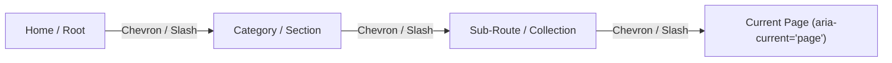

# Breadcrumb Component Reference & Routing Integration Guide

## Overview

The `Breadcrumb` component ([`src/components/ui/Breadcrumb.tsx`](file:///c:/Users/admin/Desktop/workfere/src/components/ui/Breadcrumb.tsx)) provides an accessible navigation hierarchy trail across nested venue details, user collections, booking confirmation workflows, and category pages. It conforms to W3C WAI-ARIA breadcrumb standards and Next.js App Router conventions with responsive text truncation and schema.org structured data compatibility.



---

## 1. Props Reference

`Breadcrumb` accepts the following configuration props:

| Prop | Type | Required | Default | Description |
| :--- | :--- | :--- | :--- | :--- |
| `items` | `BreadcrumbItem[]` | **Yes** | — | Ordered array of trail entries leading from section root to current page. |
| `className` | `string` | No | `""` | Additional Tailwind utility classes applied to the outer `<nav>` container. |
| `showHomeIcon` | `boolean` | No | `true` | When `true`, prepends an accessible home link icon pointing to `"/"`. |

### `BreadcrumbItem` Structure

```typescript
export interface BreadcrumbItem {
  /** Display label for the breadcrumb step (truncated responsively) */
  label: string;
  /** Destination route path. If omitted or if item is the last entry, renders as plain text */
  href?: string;
}
```

---

## 2. Accessibility & Navigation Semantics

`Breadcrumb` adheres strictly to WCAG 2.1 and WAI-ARIA breadcrumb recommendations:

1. **Semantic Landmark:** Wraps items in a `<nav aria-label="Breadcrumb">` tag.
2. **List Structure:** Renders trail items inside an ordered list (`<ol>`) where each step is an `<li>` element.
3. **Current Page Indication:** The final item in the `items` array automatically omits an anchor link and applies `aria-current="page"`, indicating to screen readers that it represents the active page.
4. **Separators:** Visual divider icons (`ChevronRight`) include `aria-hidden="true"` so assistive technologies avoid announcing decorative characters.
5. **Responsive Truncation:** Intermediate links truncate gracefully at `max-w-[160px]`, while the active page label truncates at `max-w-[200px]`, both preserving full text tooltips via `title={item.label}`.

---

## 3. Custom Separator & Layout Variations

By default, `Breadcrumb` uses `ChevronRight` from `lucide-react`. To customize separators, responsive collapsibility, or slot custom icons:

### Custom Separator Utility Pattern

```tsx
import React from "react";
import Link from "next/link";
import { Slash, Home } from "lucide-react";
import { BreadcrumbItem } from "@/components/ui/Breadcrumb";

interface CustomBreadcrumbProps {
  items: BreadcrumbItem[];
  separator?: React.ReactNode;
}

export function SlashBreadcrumb({ items, separator = <Slash className="w-3 h-3 text-zinc-400 rotate-[-15deg] mx-1" /> }: CustomBreadcrumbProps) {
  return (
    <nav aria-label="Breadcrumb" className="flex items-center text-sm text-zinc-500">
      <ol className="flex items-center flex-wrap list-none p-0 m-0">
        <li className="flex items-center">
          <Link href="/" aria-label="Home" className="hover:text-zinc-700">
            <Home className="w-3.5 h-3.5" />
          </Link>
          <span aria-hidden="true">{separator}</span>
        </li>
        {items.map((item, idx) => {
          const isLast = idx === items.length - 1;
          return (
            <li key={idx} className="flex items-center">
              {isLast ? (
                <span aria-current="page" className="font-semibold text-zinc-900 dark:text-zinc-100 truncate max-w-[200px]">
                  {item.label}
                </span>
              ) : (
                <>
                  <Link href={item.href || "#"} className="hover:text-zinc-700 truncate max-w-[160px]">
                    {item.label}
                  </Link>
                  <span aria-hidden="true">{separator}</span>
                </>
              )}
            </li>
          );
        })}
      </ol>
    </nav>
  );
}
```

---

## 4. Next.js App Router Integration Examples

### 4.1 Nested Venue Detail Page (`/venues/[id]`)

Located in [`src/app/venues/[id]/page.tsx`](file:///c:/Users/admin/Desktop/workfere/src/app/venues/%5Bid%5D/page.tsx):

```tsx
import { Breadcrumb } from "@/components/ui/Breadcrumb";

interface VenuePageProps {
  venue: {
    id: string;
    name: string;
    city: string;
  };
}

export default function VenueDetailPage({ venue }: VenuePageProps) {
  return (
    <div className="max-w-4xl mx-auto px-4 py-4">
      {/* Route: Home > Explore > San Francisco > Venue Name */}
      <Breadcrumb
        items={[
          { label: "Explore", href: "/ai" },
          { label: venue.city, href: `/ai?city=${encodeURIComponent(venue.city)}` },
          { label: venue.name },
        ]}
        className="mb-4"
      />

      <h1 className="text-2xl font-bold">{venue.name}</h1>
    </div>
  );
}
```

---

### 4.2 Multi-Level Collection Folder Route (`/collections/[id]`)

Located in [`src/app/collections/[id]/page.tsx`](file:///c:/Users/admin/Desktop/workfere/src/app/collections/%5Bid%5D/page.tsx):

```tsx
import { Breadcrumb } from "@/components/ui/Breadcrumb";

export default function CollectionDetailPage({ folder }) {
  return (
    <div className="max-w-6xl mx-auto px-4 py-6">
      <Breadcrumb
        items={[
          { label: "Collections", href: "/collections" },
          { label: folder.category || "Workspaces", href: `/collections?category=${folder.category}` },
          { label: folder.name },
        ]}
        className="mb-6"
      />

      <header>
        <h1 className="text-3xl font-extrabold">{folder.name}</h1>
      </header>
    </div>
  );
}
```

---

### 4.3 Booking & Desk Checkout Route (`/bookings/[bookingId]`)

Provides clear parent-child context during reservation checkouts:

```tsx
import { Breadcrumb } from "@/components/ui/Breadcrumb";

export function BookingConfirmationView({ venue, bookingId }) {
  return (
    <div className="max-w-3xl mx-auto p-4">
      <Breadcrumb
        items={[
          { label: "Venues", href: "/ai" },
          { label: venue.name, href: `/venues/${venue.id}` },
          { label: `Reservation #${bookingId}` },
        ]}
        className="mb-4"
      />

      <div className="bg-white dark:bg-zinc-900 p-6 rounded-2xl shadow">
        <h2>Booking Confirmed</h2>
      </div>
    </div>
  );
}
```

---

## 5. Schema.org BreadcrumbList Structured Data

To boost SEO ranking and render rich Google search result breadcrumb paths, pair `Breadcrumb` with a Schema.org `BreadcrumbList` JSON-LD script:

```tsx
import { Breadcrumb, BreadcrumbItem } from "@/components/ui/Breadcrumb";

export function SEOBreadcrumb({ items, baseUrl = "https://worksphere.io" }: { items: BreadcrumbItem[]; baseUrl?: string }) {
  const schemaData = {
    "@context": "https://schema.org",
    "@type": "BreadcrumbList",
    itemListElement: items.map((item, index) => ({
      "@type": "ListItem",
      position: index + 1,
      name: item.label,
      item: item.href ? `${baseUrl}${item.href}` : undefined,
    })),
  };

  return (
    <>
      <script
        type="application/ld+json"
        dangerouslySetInnerHTML={{ __html: JSON.stringify(schemaData) }}
      />
      <Breadcrumb items={items} />
    </>
  );
}
```
