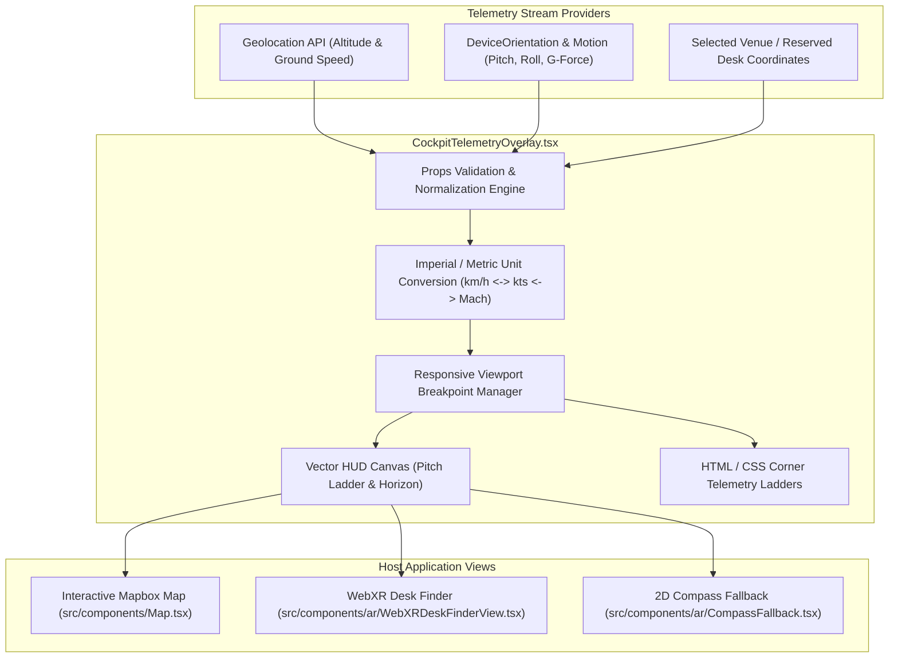

# `CockpitTelemetryOverlay`: Avionics HUD Component Reference Guide

This document details the component architecture, TypeScript prop interfaces, telemetry streaming protocols, responsive layout breakpoints, and integration patterns for the **`CockpitTelemetryOverlay`** component (`src/components/telemetry/CockpitTelemetryOverlay.tsx`).

---

## 1. Overview & Architecture

`CockpitTelemetryOverlay` provides an authentic fighter jet avionics Heads-Up Display (HUD) overlay designed to float over interactive Mapbox/MapLibre views, WebGL 3D floor plans, and WebXR Augmented Reality viewports.

It projects high-frequency flight and nomadic mobility telemetry:
- **Pitch Angle & Artificial Horizon:** Dynamic pitch ladder with roll compensation.
- **Altitude Ribbon (Tape):** True barometric / GPS elevation in meters or feet.
- **Heading Compass Tape:** 360° cardinal and numerical heading ribbon.
- **G-Force Accelerometer Meter:** Real-time lateral, longitudinal, and normal G-load sensor meter.
- **Airspeed / Mach Indicator:** Ground velocity or simulated Mach speed index.
- **Target Reticle & Waypoint Range:** Spatial vector to selected desk or venue destination.



---

## 2. Component Props Specification

The component accepts a declarative set of continuous telemetry inputs and configuration flags:

### 2.1 Complete Props Table

| Prop Name | Type | Required | Default | Update Interval | Description |
| :--- | :--- | :--- | :--- | :--- | :--- |
| `pitchAngle` | `number` | **Yes** | `0` | $16\text{ ms}$ (60Hz) | Aircraft/device pitch angle in degrees ($-90^\circ$ to $+90^\circ$). |
| `rollAngle` | `number` | Optional | `0` | $16\text{ ms}$ (60Hz) | Aircraft/device roll angle in degrees ($-180^\circ$ to $+180^\circ$). |
| `heading` | `number` | **Yes** | `0` | $33\text{ ms}$ (30Hz) | Magnetic or True North heading in degrees ($0^\circ$ to $359^\circ$). |
| `altitudeMeters` | `number` | **Yes** | `0` | $100\text{ ms}$ (10Hz) | Current altitude above sea level or ground floor in meters. |
| `speedKnots` | `number` | Optional | `0` | $100\text{ ms}$ (10Hz) | Ground speed in knots. Converted internally to Mach or km/h. |
| `gForce` | `number` | Optional | `1.0` | $16\text{ ms}$ (60Hz) | Normal accelerometer force in Gs ($1.0\text{ G}$ at rest). |
| `targetBearing` | `number` | Optional | `null` | $200\text{ ms}$ (5Hz) | Azimuth bearing toward destination waypoint in degrees. |
| `targetDistanceMeters`| `number` | Optional | `null` | $500\text{ ms}$ (2Hz) | Euclidean or Haversine distance to destination waypoint. |
| `unitSystem` | `"metric" \| "imperial" \| "aviation"` | Optional | `"aviation"` | Static | Display units for tape ladders (m/s vs. kts/ft). |
| `themeColor` | `"emerald" \| "cyan" \| "amber"` | Optional | `"emerald"` | Static | Phosphor color palette (`#00ff66`, `#00e5ff`, `#ffb300`). |
| `showRadarSweep`| `boolean` | Optional | `true` | Static | Enables circular tactical radar sweep in bottom-right corner. |
| `className` | `string` | Optional | `""` | Static | Additional container Tailwind utility classes. |

### 2.2 TypeScript Interface Definition

```typescript
export interface CockpitTelemetryOverlayProps {
  /** Pitch attitude angle in degrees [-90, +90] */
  pitchAngle: number;
  /** Roll attitude angle in degrees [-180, +180] */
  rollAngle?: number;
  /** Current compass heading in degrees [0, 359] */
  heading: number;
  /** Altitude in meters above ground/sea level */
  altitudeMeters: number;
  /** Current ground speed in knots */
  speedKnots?: number;
  /** Normal G-force accelerometer load factor */
  gForce?: number;
  /** Optional bearing angle towards selected venue/desk */
  targetBearing?: number | null;
  /** Optional distance to destination in meters */
  targetDistanceMeters?: number | null;
  /** Measurement unit system */
  unitSystem?: "metric" | "imperial" | "aviation";
  /** HUD Phosphor theme color */
  themeColor?: "emerald" | "cyan" | "amber";
  /** Whether to render tactical radar sweep widget */
  showRadarSweep?: boolean;
  /** Custom wrapper styling */
  className?: string;
}
```

---

## 3. Responsive Layout Breakpoints

The telemetry overlay adapts its tape density to prevent cluttering smaller viewports:

| Breakpoint | Viewport Width | Displayed Symbology Elements |
| :--- | :--- | :--- |
| **Mobile (`xs` / `<640px`)** | Smartphone (<390px) | Simplified heading ribbon, compact altitude & speed digits, central boresight crosshair. Radar sweep and G-meter hidden. |
| **Tablet (`md` / `640px - 1024px`)**| iPad / Small Laptops | Full pitch ladder, altitude & airspeed tape ribbons, active waypoint diamond. |
| **Desktop / Headset (`lg` / `>1024px`)**| Headset / Wide Displays | Complete fighter cockpit suite: full pitch ladder, tape ribbons, Mach index, G-force meter, and tactical radar sweep. |

---

## 4. Integration Example: Embedding in Map View

The following example shows how `CockpitTelemetryOverlay` is integrated into a Mapbox/MapLibre map view (`src/components/Map.tsx`), consuming live mobile geolocation and orientation sensors:

```tsx
"use client";

import React, { useState, useEffect } from "react";
import { CockpitTelemetryOverlay } from "@/components/telemetry/CockpitTelemetryOverlay";
import { useDeviceOrientation } from "@/hooks/useDeviceOrientation";

interface MapWithHUDProps {
  targetVenue: {
    lat: number;
    lng: number;
    name: string;
  };
}

export function MapWithCockpitHUD({ targetVenue }: MapWithHUDProps) {
  const { heading, beta, gamma } = useDeviceOrientation();
  const [altitude, setAltitude] = useState(120);
  const [speedKnots, setSpeedKnots] = useState(0);

  useEffect(() => {
    if (!navigator.geolocation) return;

    const watchId = navigator.geolocation.watchPosition(
      (pos) => {
        if (pos.coords.altitude !== null) {
          setAltitude(pos.coords.altitude);
        }
        if (pos.coords.speed !== null) {
          // Convert m/s to knots
          setSpeedKnots(pos.coords.speed * 1.94384);
        }
      },
      (err) => console.warn(err),
      { enableHighAccuracy: true }
    );

    return () => navigator.geolocation.clearWatch(watchId);
  }, []);

  return (
    <div className="relative w-full h-[600px] rounded-2xl overflow-hidden border border-zinc-800">
      {/* 1. Underlying Mapbox Layer */}
      <div id="mapbox-container" className="absolute inset-0 bg-slate-950" />

      {/* 2. Avionics HUD Overlay */}
      <CockpitTelemetryOverlay
        pitchAngle={beta ?? 0}
        rollAngle={gamma ?? 0}
        heading={heading ?? 0}
        altitudeMeters={altitude}
        speedKnots={speedKnots}
        gForce={1.0}
        targetDistanceMeters={450}
        targetBearing={145}
        unitSystem="aviation"
        themeColor="emerald"
        showRadarSweep={true}
        className="pointer-events-none z-20"
      />
    </div>
  );
}
```

---

## 5. Performance & Telemetry Streaming Protocols

1. **Decoupled Ticks:** High-frequency attitude angles (`pitchAngle`, `rollAngle`) render at the native screen refresh rate (60Hz / 90Hz / 120Hz) via `requestAnimationFrame`.
2. **GPS Throttling:** Low-frequency altitude and waypoint distance updates are throttled to 2Hz–5Hz to prevent unnecessary canvas redraw thrashing.
3. **Hardware Acceleration:** All HUD tapes utilize CSS transforms (`translate3d`, `rotateZ`) to leverage GPU compositing layers.
