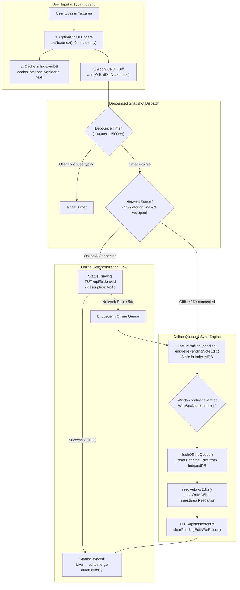

# Component Reference: `CollaborativeNotes` & Debounced Offline Autosave

This document provides developer reference documentation for the **`CollaborativeNotes`** component ([`src/components/collections/CollaborativeNotes.tsx`](../../src/components/collections/CollaborativeNotes.tsx)), detailing debounced autosave timings, optimistic state updates, CRDT and Last-Write-Wins (LWW) conflict resolution, offline IndexedDB queuing, and local testing instructions.

---

## 1. Overview & System Architecture

In WorkSphere, collections of saved coworking venues, desks, and meeting pods allow digital nomads and distributed teams to organize shared itineraries.

`CollaborativeNotes` provides real-time, multi-user rich text note editing with robust offline resilience:

1. **Real-Time CRDT Collaboration (Yjs + PartyKit):** Multiple collaborators edit simultaneously with zero merge conflicts and live typing presence badges.
2. **Debounced Autosave (1000ms–1500ms):** Typing events update local state instantly while server snapshot persists are debounced to prevent API flooding.
3. **Optimistic Local Updates:** Text edits and caret positions are rendered with 0ms perceived latency.
4. **Offline Persistence (IndexedDB):** Edits made without internet connectivity are queued in IndexedDB and cached locally.
5. **Automatic Reconnection Drain:** Reconnecting to the network automatically replays queued edits using Last-Write-Wins (LWW) timestamp reconciliation.



---

## 2. Component Props Specification

The component accepts the following props:

| Prop Name                        | Type                              |      Default       | Description                                                                                                                            |
| :------------------------------- | :-------------------------------- | :----------------: | :------------------------------------------------------------------------------------------------------------------------------------- |
| `folderId`                       | `string`                          | `"default-folder"` | Unique collection/folder identifier. Used to scope the PartyKit WebSocket room (`folder-notes-${folderId}`) and IndexedDB cache keys.  |
| `initialContent` / `initialText` | `string \| null`                  |       `null`       | Initial plain text or Markdown note content used to seed the document on initial load or when loading from an offline cache.           |
| `readOnly` / `canEdit`           | `boolean`                         |       `true`       | When `readOnly={true}` (or `canEdit={false}`), disables textarea editing, hides delete/clear controls, and inhibits autosave triggers. |
| `roomId`                         | `string`                          |    `undefined`     | Optional room name override (automatically formatted as `folder-notes-${folderId}` if omitted).                                        |
| `currentUser`                    | `{ userId, userName, avatarUrl }` |     Clerk User     | Current collaborator metadata displayed in the live presence bar and typing indicators.                                                |
| `className`                      | `string`                          |        `""`        | Additional CSS utility classes applied to the root `<section>` container.                                                              |
| `tags`                           | `string[]`                        |        `[]`        | Array of collection tags rendered as chips below the editor.                                                                           |
| `onAddTag`                       | `(tag: string) => void`           |    `undefined`     | Optional callback when a new tag is attached to the note collection.                                                                   |
| `onRemoveTag`                    | `(tag: string) => void`           |    `undefined`     | Optional callback when an existing tag is removed.                                                                                     |

### Code Usage Example

```tsx
import React from "react";
import { CollaborativeNotes } from "@/components/collections/CollaborativeNotes";

export function VenueCollectionDetailPage({
  collectionId,
}: {
  collectionId: string;
}) {
  return (
    <div className="max-w-3xl mx-auto p-6">
      <h2 className="text-xl font-bold mb-4">Team Trip Notes</h2>
      <CollaborativeNotes
        folderId={collectionId}
        initialText="# Coworking Space Shortlist\n- Space A: Great Wi-Fi\n- Space B: 24/7 Access"
        canEdit={true}
        tags={["Remote Team", "Berlin Offsite", "Q4 Planning"]}
      />
    </div>
  );
}
```

---

## 3. Save Delay Intervals & Timing Mechanics

The editing lifecycle utilizes three coordinated timers to balance real-time feedback with server performance:

| Timer Name                                              |          Delay Interval           | Purpose & Behavior                                                                                                                                                       |
| :------------------------------------------------------ | :-------------------------------: | :----------------------------------------------------------------------------------------------------------------------------------------------------------------------- |
| **Autosave Snapshot Debounce** (`SNAPSHOT_DEBOUNCE_MS`) | **$1000\text{--}1500\text{ ms}$** | Waits until the user pauses typing before executing an HTTP snapshot `PUT` request to PostgreSQL, preventing excessive database writes while preserving every character. |
| **Typing Presence Timeout** (`TYPING_TIMEOUT_MS`)       |       **$2500\text{ ms}$**        | Broadcasts `isTyping: true` over WebSockets on the first keystroke, then resets to `isTyping: false` after 2.5 seconds of inactivity.                                    |
| **Presence Heartbeat** (`HEARTBEAT_INTERVAL_MS`)        |       **$5000\text{ ms}$**        | Sends a periodic ping every 5 seconds over PartyKit to maintain active collaborator state and prune disconnected peers.                                                  |

---

## 4. Conflict Resolution & Offline Synchronization

### 4.1 Real-Time Conflict-Free Replicated Data Types (CRDT)

When collaborators are online simultaneously:

- **Yjs Text CRDT (`Y.Text`):** Text changes are modeled as a sequence of unique, immutable character insertion and deletion operations identified by `(client_id, clock)`.
- **Convergence Guarantee:** Concurrent edits from two or more users interleave deterministically without merge conflicts, central locking, or overwritten sentences.
- **Relative Caret Tracking:** User cursor selections are converted to `Y.RelativePosition` before applying external updates, ensuring the user's cursor does not jump when remote edits arrive.

### 4.2 Asynchronous Offline Last-Write-Wins (LWW) Reconciliation

When edits are made offline:

1. **Local Enqueueing:** Every keystroke updates the local React state and is written to IndexedDB store `pending_notes_queue` with a high-resolution millisecond timestamp:
   ```typescript
   export interface PendingNoteEdit {
     id?: number;
     folderId: string;
     text: string;
     timestamp: number; // LWW Timestamp
   }
   ```
2. **Offline Indicator:** UI badge displays `"Offline — pending sync"` with a `<CloudOff />` icon.
3. **Queue Replay:** Upon detecting reconnection (`window.addEventListener("online")` or WebSocket `connected` event), the hook invokes `flushOfflineQueue()`:
   ```typescript
   // Last-Write-Wins resolution across pending offline edits
   export function resolveLwwEdits(
     edits: PendingNoteEdit[],
   ): PendingNoteEdit | null {
     if (!edits.length) return null;
     return edits.reduce((latest, current) => {
       return current.timestamp >= latest.timestamp ? current : latest;
     }, edits[0]);
   }
   ```
4. **State Convergence:** The winning edit is applied to the Yjs document and persisted to the REST backend, followed by clearing the IndexedDB queue.

---

## 5. Instructions for Testing Autosave Behavior Locally

### 5.1 Automated Jest Unit Tests

Run the dedicated offline sync and autosave test suites:

```bash
# Run unit tests for optimistic updates, sync indicators, and LWW resolution
npm test src/__tests__/components/CollaborativeNotesOfflineSync.test.tsx

# Run unit tests for typing presence indicators and CRDT notes
npm test src/__tests__/components/CollaborativeNotes.test.tsx
```

### 5.2 Manual Browser DevTools Testing

Follow this step-by-step verification procedure:

1. **Start the Development Server:**
   ```bash
   npm run dev
   ```
2. **Open DevTools Application Tab:**
   - In Google Chrome or Microsoft Edge, press `F12` and navigate to **Application** &rarr; **Storage** &rarr; **IndexedDB**.
   - Locate the database **`worksphere-collaborative-notes`**.
   - Verify that the two object stores exist: `notes_cache` and `pending_notes_queue`.
3. **Test Debounced Autosave (Online):**
   - Navigate to any collection note page (e.g. `/collections/my-folder`).
   - Open the **Network** tab and filter by `Fetch/XHR`.
   - Type a sentence in the textarea. Observe that the UI status immediately transitions to `"Saving…"` (`syncStatus: 'saving'`).
   - Confirm that the `PUT /api/folders/:id` request fires **exactly once**, $1000\text{--}1500\text{ms}$ after you stop typing.
   - Verify the status indicator flips to `"Live — edits merge automatically"` (`syncStatus: 'synced'`).
4. **Test Offline Optimistic Queuing:**
   - In DevTools **Network** tab, change the throttling dropdown from **No throttling** to **Offline**.
   - Type additional paragraphs in the notes editor.
   - Notice that text typing remains fast with **zero lag**.
   - Observe the sync status badge transition to **`"Offline — pending sync"`** (`syncStatus: 'offline_pending'`).
   - In DevTools **IndexedDB** &rarr; `pending_notes_queue`, click **Refresh**. Verify that pending edits are stored with timestamps.
5. **Test Reconnection Sync:**
   - In DevTools **Network** tab, switch back to **No throttling** (Online).
   - Observe the `online` event firing.
   - Verify that the status switches to `"Saving…"` and then to `"Live — edits merge automatically"`.
   - Check IndexedDB `pending_notes_queue` to confirm that all synced entries have been cleanly purged.
