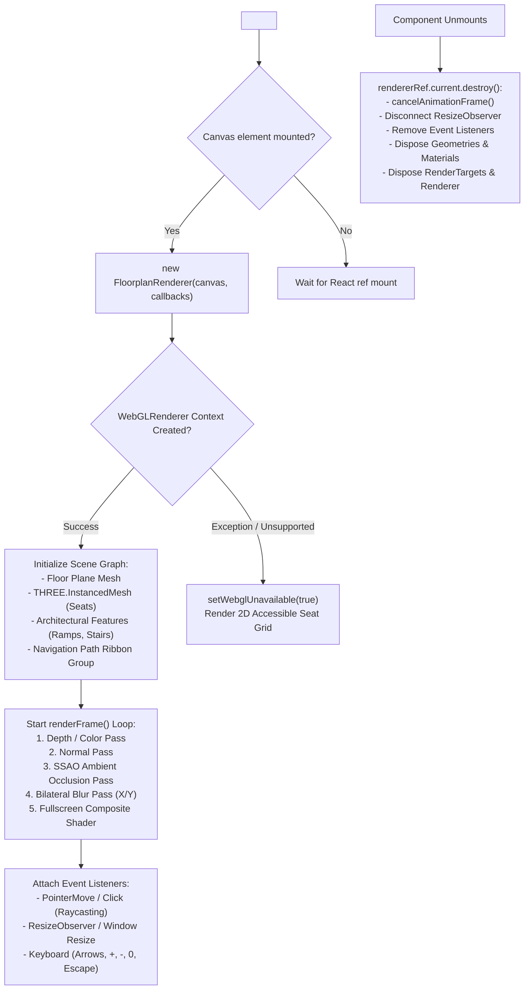
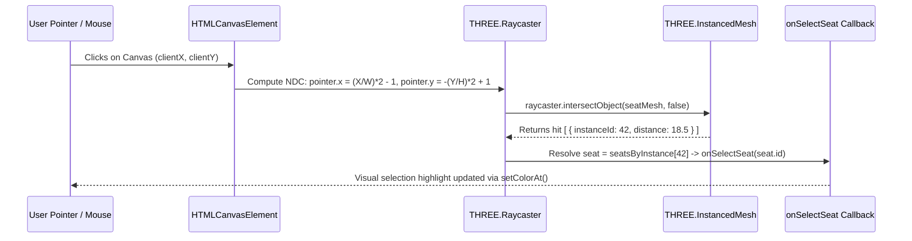

# Component Reference: `FloorPlanViewer3D` & WebGL Floorplan Rendering Engine

This document provides a comprehensive architectural guide, coordinate system specification, raycasting interaction model, camera navigation controls, and WebGL resource lifecycle documentation for the **`FloorPlanViewer3D`** component ([`src/components/floorplan/FloorPlanViewer3D.tsx`](file:///c:/Users/admin/Desktop/workfere/src/components/floorplan/FloorPlanViewer3D.tsx)) and its underlying renderer [`FloorplanRenderer`](file:///c:/Users/admin/Desktop/workfere/src/lib/floorplan/floorplanRenderer.ts).

---

## 1. Executive Summary & Component Role

The **`FloorPlanViewer3D`** component delivers an interactive, hardware-accelerated 3D desk booking and navigation experience directly inside the browser. It translates 2D architectural floor plan blueprints (SVG / CAD coordinates) into a lightweight 3D WebGL scene rendered via Three.js.

Key Architectural Capabilities:
1. **Instanced Mesh Optimization (`THREE.InstancedMesh`):** Renders hundreds of interactive desks, meeting pods, and phone booths in a single GPU draw call.
2. **GPU Screen-Space Ambient Occlusion (SSAO) & Post-Processing:** Applies bilateral depth-aware blurring and composite shading pipelines for tactile architectural depth.
3. **Desk Selection & Pointer Raycasting:** Converts 2D canvas mouse / touch pointer events into 3D scene rays to detect desk hovering and selection by instance ID.
4. **Keyboard & Camera Pan / Zoom Controls:** Supports keyboard arrow navigation, zoom clamping, and smooth camera refocusing.
5. **Accessible Step-Free Wayfinding:** Calculates wheelchair-accessible navigation routes avoiding stairs and turnstiles (`accessibleNavigation.ts`), rendering dynamic 3D ribbon path meshes.
6. **Low-Tier Device Degradation (2D Fallback):** Catches WebGL initialization failures (unsupported drivers or low-tier mobile contexts) and degrades gracefully to an accessible 2D seat selector grid and SVG contour exporter.



---

## 2. Props Reference (`FloorPlanViewer3DProps`)

```typescript
export interface FloorPlanViewer3DProps {
  venueId?: string;
  floorIndex?: number;
  seats: SeatProps[];
  selectedSeat: string | null;
  onSelectSeat: (id: string | null) => void;
  activeHolds?: Record<string, ActiveSeatHold>;
  onHeldSeatClick?: (
    seat: SeatProps,
    hold: { heldByName?: string; remainingSeconds?: number },
  ) => void;
  contours?: ContourPolygon[];
}
```

### Detailed Props Table

| Prop Name | Type | Default | Description |
| :--- | :--- | :---: | :--- |
| `venueId` | `string` | `"venue-sf-01"` | Unique identifier of the coworking venue. Used for SVG contour exports and analytics. |
| `floorIndex` | `number` | `0` | Optional floor level index (e.g. Ground Floor `0`, Mezzanine `1`) for multi-level layouts. |
| `seats` | `SeatProps[]` | *(Required)* | Array of desk objects defining coordinates, dimensions, availability, and amenities. |
| `selectedSeat` | `string \| null` | *(Required)* | ID of the currently selected desk, or `null` if none selected. |
| `onSelectSeat` | `(id: string \| null) => void` | *(Required)* | Callback fired when the user selects or deselects a desk via 3D raycast click or Escape key. |
| `activeHolds` | `Record<string, ActiveSeatHold>` | `{}` | Map of ephemeral lock holds on seats preventing race conditions during checkout. |
| `onHeldSeatClick` | `(seat, hold) => void` | `undefined` | Callback invoked when a user clicks a desk currently held by another coworker. |
| `contours` | `ContourPolygon[]` | `undefined` | Architectural boundary polygon coordinates for floor contour rendering and SVG download. |

### Seat Data Structure (`SeatProps`)

```typescript
export type SeatProps = {
  id: string;
  seatNumber: string;
  type: "HOT_DESK" | "FIXED_DESK" | "MEETING_ROOM" | "PHONE_BOOTH";
  x: number;          // 2D Floorplan X coordinate in SVG pixels
  y: number;          // 2D Floorplan Y coordinate in SVG pixels
  width: number;      // Desk width in SVG pixels
  height: number;     // Desk depth in SVG pixels
  amenities: string[];// e.g. ["Dual Monitors", "Standing Desk", "Window View"]
  available: boolean; // Current reservation availability
};
```

---

## 3. Coordinate Systems & Spatial Transformations

### 3.1 2D SVG to 3D World Space Mapping

Floor plan assets are authored in standard SVG vector space ($800\text{px} \times 480\text{px}$). The renderer maps these coordinates into a centered, right-handed 3D Cartesian world space:

$$\text{SCENE\_SCALE} = 0.02$$

$$\begin{aligned}
X_{\text{3D}} &= \left(\text{SVG}_x - \frac{\text{SVG\_WIDTH}}{2}\right) \times \text{SCENE\_SCALE} \\
Y_{\text{3D}} &= \text{Elevation (Half Height)} \\
Z_{\text{3D}} &= \left(\text{SVG}_y - \frac{\text{SVG\_HEIGHT}}{2}\right) \times \text{SCENE\_SCALE}
\end{aligned}$$

With $\text{SVG\_WIDTH} = 800$ and $\text{SVG\_HEIGHT} = 480$:
- Top-Left $(0, 0)$ maps to $(-8.0, Y, -4.8)$
- Center $(400, 240)$ maps to $(0.0, Y, 0.0)$
- Bottom-Right $(800, 480)$ maps to $(+8.0, Y, +4.8)$

### 3.2 Seat Dimension & Height Extrusion

Each desk type is extruded vertically along the $Y$-axis:
- `HOT_DESK` / `FIXED_DESK`: Height $0.55\text{m}$ ($Y = 0.275\text{m}$)
- `MEETING_ROOM`: Height $1.8\text{m}$ ($Y = 0.90\text{m}$)
- `PHONE_BOOTH`: Height $2.1\text{m}$ ($Y = 1.05\text{m}$)

---

## 4. Raycasting & Desk Interaction Model

To maintain 60 FPS even with hundreds of interactive furniture assets, all desks share a single `THREE.InstancedMesh`. Raycasting determines the hovered and clicked desk instance:



### Color State Hierarchy

Desk colors are updated dynamically using `seatMesh.setColorAt(instanceId, color)`:
- **Selected Desk:** Indigo (`#6366f1`)
- **Occupied / Unavailable:** Red (`#ef4444`)
- **Hovered Desk:** Emerald (`#10b981`)
- **Meeting Room:** Violet (`#8b5cf6`)
- **Phone Booth:** Pink (`#ec4899`)
- **Standard Available Hot Desk:** Blue (`#3b82f6`)

---

## 5. Camera Controls & Keyboard Navigation

The viewer includes built-in keyboard pan and zoom controls configured with bounded clamping:

| Key Binding | Action | Transformation Math |
| :---: | :--- | :--- |
| `ArrowUp` | Pan Forward | Pans camera and target $+0.8\text{m}$ along $+Z$ axis |
| `ArrowDown` | Pan Backward | Pans camera and target $-0.8\text{m}$ along $-Z$ axis |
| `ArrowLeft` | Pan Left | Pans camera and target $+0.8\text{m}$ along $+X$ axis |
| `ArrowRight` | Pan Right | Pans camera and target $-0.8\text{m}$ along $-X$ axis |
| `+` / `=` | Zoom In | Reduces camera distance: $\text{distance} \times 0.9$ (Clamped to $[12\text{m}, 58\text{m}]$) |
| `-` | Zoom Out | Increases camera distance: $\text{distance} \times 1.1$ (Clamped to $[12\text{m}, 58\text{m}]$) |
| `0` | Reset View | Resets camera position to $(0, 25, 34)$ looking at origin $(0, 0, 0)$ |
| `Escape` | Clear Selection | Deselects active desk (`onSelectSeat(null)`) |

---

## 6. WebGL Resource Disposal & Lifecycle Management

Failing to dispose WebGL textures, geometries, and shader render targets causes severe V8 heap and GPU video memory leaks in Single Page Applications (SPAs).

`FloorplanRenderer.destroy()` performs an exhaustive tear-down on component unmount:

```typescript
destroy() {
  if (this.destroyed) return;
  this.destroyed = true;

  // 1. Cancel active animation frame loop
  cancelAnimationFrame(this.animationFrame);

  // 2. Disconnect DOM & window listeners
  this.resizeObserver?.disconnect();
  window.removeEventListener("resize", this.resizeHandler);
  this.canvas.removeEventListener("pointermove", this.pointerMoveHandler);
  this.canvas.removeEventListener("pointerleave", this.pointerLeaveHandler);
  this.canvas.removeEventListener("click", this.clickHandler);

  // 3. Traverse and dispose scene geometries and materials
  this.scene.traverse(disposeObject);
  this.fullscreenScene.traverse(disposeObject);
  this.normalMaterial.dispose();

  // 4. Dispose custom post-processing shader materials
  Object.values(this.materials).forEach((material) => material.dispose());

  // 5. Dispose offscreen SSAO & Depth RenderTargets
  this.targets.dispose();

  // 6. Dispose WebGLRenderer and release GL context
  this.renderer.dispose();
}
```

---

## 7. Low-Tier Mobile Fallback Behavior

When WebGL context creation fails (e.g. low-memory mobile browser, disabled hardware acceleration, or blacklisted GPU drivers), `FloorPlanViewer3D` catches the exception:

```typescript
try {
  rendererRef.current = new FloorplanRenderer(canvas, callbacks);
} catch {
  setWebglUnavailable(true);
}
```

When `webglUnavailable === true`:
- The 3D canvas is replaced with a **responsive 2D accessible desk list**.
- Users can view desk status badges, select desks, and complete bookings without WebGL support.
- Users can download architectural blueprint drawings via the **Export Floorplan SVG** button.

---

## 8. Integration Example

```tsx
"use client";

import React, { useState } from "react";
import FloorPlanViewer3D, { SeatProps } from "@/components/floorplan/FloorPlanViewer3D";

const SAMPLE_SEATS: SeatProps[] = [
  {
    id: "desk-01",
    seatNumber: "101",
    type: "HOT_DESK",
    x: 120,
    y: 140,
    width: 60,
    height: 40,
    amenities: ["Standing Desk", "Dual Monitors"],
    available: true,
  },
  {
    id: "desk-02",
    seatNumber: "102",
    type: "FIXED_DESK",
    x: 200,
    y: 140,
    width: 60,
    height: 40,
    amenities: ["Ergonomic Chair"],
    available: false,
  },
  {
    id: "pod-01",
    seatNumber: "Pod A",
    type: "PHONE_BOOTH",
    x: 320,
    y: 100,
    width: 80,
    height: 80,
    amenities: ["Acoustic Padding"],
    available: true,
  },
];

export function VenueDeskSelectorView() {
  const [selectedSeat, setSelectedSeat] = useState<string | null>("desk-01");

  return (
    <div className="p-6 max-w-5xl mx-auto space-y-4">
      <div className="flex items-center justify-between">
        <h2 className="text-xl font-bold text-zinc-900 dark:text-zinc-100">
          Select Your Workspace
        </h2>
        <span className="text-xs text-zinc-500">
          Use arrow keys to pan, +/- to zoom
        </span>
      </div>

      <FloorPlanViewer3D
        venueId="venue-sf-downtown"
        seats={SAMPLE_SEATS}
        selectedSeat={selectedSeat}
        onSelectSeat={setSelectedSeat}
        onHeldSeatClick={(seat, hold) => {
          alert(`Seat ${seat.seatNumber} is held by ${hold.heldByName}`);
        }}
      />
    </div>
  );
}
```
