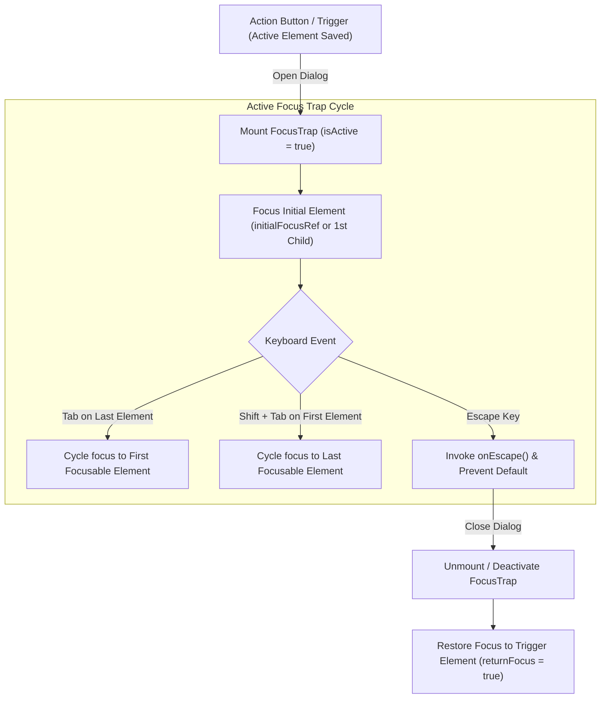

# FocusTrap Component Documentation

The `FocusTrap` component ([`src/components/ui/FocusTrap.tsx`](file:///c:/Users/admin/Desktop/workfere/src/components/ui/FocusTrap.tsx)) and accompanying `useFocusTrap` hook ([`src/hooks/useFocusTrap.ts`](file:///c:/Users/admin/Desktop/workfere/src/hooks/useFocusTrap.ts)) provide comprehensive keyboard focus containment and accessible dialog semantics adhering to the **WAI-ARIA Authoring Practices Guide (APG) for Modal Dialogs**.

---

## 1. Overview & Accessibility Model

When displaying interactive modal dialogs, drawers, confirmation prompts, or popovers, assistive technologies and keyboard users require strict boundaries so focus does not escape into underlying, obscured page content.

The `FocusTrap` ensures:
1. **Focus Containment:** Pressing <kbd>Tab</kbd> on the last focusable element wraps around to the first focusable element; pressing <kbd>Shift</kbd> + <kbd>Tab</kbd> on the first element wraps to the last.
2. **Initial Focus Management:** Automatically focuses the designated element (`initialFocusRef`, `initialFocusSelector`) or defaults to the first interactive child on mount.
3. **Focus Restoration:** Restores focus back to the triggering element upon deactivation or unmount (`returnFocus`).
4. **Escape Key Handling:** Listens for the <kbd>Esc</kbd> key to trigger `onEscape` dismiss handlers without propagating to parent contexts.
5. **ARIA Dialog Semantics:** Exposes `role="dialog"`, `aria-modal="true"`, and label association (`aria-labelledby`, `aria-describedby`).



---

## 2. Component Props Reference

### `FocusTrapProps`

The `FocusTrap` component accepts all options from `UseFocusTrapOptions` plus HTML/ARIA attributes:

| Prop | Type | Default | Description |
| :--- | :--- | :---: | :--- |
| `children` | `React.ReactNode` | *(Required)* | Child content and interactive elements contained within the trap boundary. |
| `isActive` | `boolean` | `true` | When `true`, activates keyboard trapping, sets initial focus, and captures events. |
| `initialFocusRef` | `RefObject<HTMLElement \| null>` | `undefined` | Ref pointing to the specific element to receive focus upon mount. |
| `initialFocusSelector` | `string` | `undefined` | CSS selector (e.g. `'input[type="text"]'`) targeting the initial focused element. |
| `returnFocus` | `boolean` | `true` | Restores keyboard focus back to the previously active element upon unmounting. |
| `onEscape` | `() => void` | `undefined` | Callback fired when the user presses <kbd>Esc</kbd>. Traps and stops event propagation. |
| `as` | `keyof JSX.IntrinsicElements` | `"div"` | HTML tag rendered for the container element (e.g. `"div"`, `"aside"`, `"section"`). |
| `role` | `string` | `"dialog"` | ARIA role rendered on the container (`"dialog"` or `"alertdialog"`). |
| `aria-modal` | `boolean \| "true" \| "false"` | `true` | Signals assistive technology that windows behind the element are inert. |
| `aria-label` | `string` | `undefined` | Accessible label for dialogs without visible heading elements. |
| `aria-labelledby` | `string` | `undefined` | ID referencing the visible dialog title element. |
| `aria-describedby` | `string` | `undefined` | ID referencing the descriptive body text element. |
| `className` | `string` | `""` | Optional CSS classes applied to the container element. |

---

## 3. Focusable Elements Selection

The internal query selector identifies and filters interactive targets using:

```typescript
const FOCUSABLE_SELECTORS = [
  'a[href]:not([tabindex="-1"]):not([disabled])',
  'button:not([tabindex="-1"]):not([disabled])',
  'textarea:not([tabindex="-1"]):not([disabled])',
  'input:not([tabindex="-1"]):not([disabled])',
  'select:not([tabindex="-1"]):not([disabled])',
  '[tabindex]:not([tabindex="-1"]):not([disabled])',
  '[contenteditable="true"]:not([tabindex="-1"])',
].join(", ");
```

In addition to selector matching, the hook filters out:
- Elements with the `disabled` attribute.
- Elements marked with `aria-hidden="true"`.
- Hidden elements with no client bounding rects (`el.getClientRects().length === 0`).

---

## 4. Usage Examples

### 4.1 Accessible Modal Dialog Integration

Below is an implementation of a standard confirmation modal with `initialFocusRef`, `onEscape`, and ARIA title/description wiring:

```tsx
"use client";

import React, { useRef, useState } from "react";
import { FocusTrap } from "@/components/ui/FocusTrap";
import { X } from "lucide-react";

export function BookingConfirmationModal({ isOpen, onClose }: { isOpen: boolean; onClose: () => void }) {
  const confirmButtonRef = useRef<HTMLButtonElement | null>(null);

  if (!isOpen) return null;

  return (
    <div className="fixed inset-0 z-50 flex items-center justify-center bg-black/50 backdrop-blur-sm">
      <FocusTrap
        role="dialog"
        aria-modal={true}
        aria-labelledby="modal-title"
        aria-describedby="modal-desc"
        initialFocusRef={confirmButtonRef}
        onEscape={onClose}
        returnFocus={true}
        className="w-full max-w-md p-6 bg-white dark:bg-zinc-900 rounded-2xl shadow-xl border border-zinc-200 dark:border-zinc-800"
      >
        <div className="flex items-center justify-between pb-3 border-b border-zinc-200 dark:border-zinc-800">
          <h2 id="modal-title" className="text-lg font-bold text-zinc-900 dark:text-zinc-100">
            Confirm Desk Reservation
          </h2>
          <button
            type="button"
            onClick={onClose}
            aria-label="Close dialog"
            className="p-1 rounded-lg text-zinc-400 hover:text-zinc-600 dark:hover:text-zinc-200"
          >
            <X className="w-5 h-5" />
          </button>
        </div>

        <p id="modal-desc" className="py-4 text-sm text-zinc-600 dark:text-zinc-400">
          Your reservation will be locked for 15 minutes. Would you like to proceed with this booking?
        </p>

        <div className="flex items-center justify-end gap-3 pt-4">
          <button
            type="button"
            onClick={onClose}
            className="px-4 py-2 text-sm font-medium text-zinc-700 dark:text-zinc-300 hover:bg-zinc-100 dark:hover:bg-zinc-800 rounded-lg"
          >
            Cancel
          </button>
          <button
            ref={confirmButtonRef}
            type="button"
            onClick={() => {
              // Proceed with confirmation
              onClose();
            }}
            className="px-4 py-2 text-sm font-medium text-white bg-blue-600 hover:bg-blue-700 rounded-lg"
          >
            Confirm Reservation
          </button>
        </div>
      </FocusTrap>
    </div>
  );
}
```

### 4.2 Using the Standalone Hook (`useFocusTrap`)

When integrating directly into an existing container ref or composite component:

```tsx
import React, { useRef } from "react";
import { useFocusTrap } from "@/hooks/useFocusTrap";

export function CustomDrawer({ isOpen, onClose }: { isOpen: boolean; onClose: () => void }) {
  const drawerRef = useRef<HTMLDivElement | null>(null);

  useFocusTrap(drawerRef, {
    isActive: isOpen,
    onEscape: onClose,
    returnFocus: true,
  });

  if (!isOpen) return null;

  return (
    <div
      ref={drawerRef}
      role="dialog"
      aria-modal="true"
      aria-label="Filter Options Drawer"
      className="fixed right-0 top-0 h-full w-80 bg-white p-4 shadow-2xl"
    >
      <h3>Filters</h3>
      <button onClick={onClose}>Close</button>
    </div>
  );
}
```

---

## 5. Testing & Verification Checklist

- [x] **Tab Forward Cycling:** Tabbing from the last focusable element wraps to the first focusable element without escaping into the background DOM.
- [x] **Shift + Tab Reverse Cycling:** Shift-tabbing from the first element moves focus to the last element.
- [x] **Initial Focus:** If `initialFocusRef` is supplied, focus lands on that target; otherwise, lands on the first focusable child.
- [x] **Escape Handling:** Pressing <kbd>Esc</kbd> triggers `onEscape` and stops keyboard event bubbling.
- [x] **Focus Restoration:** On dialog unmount, keyboard focus returns to the element that was focused prior to modal opening.
