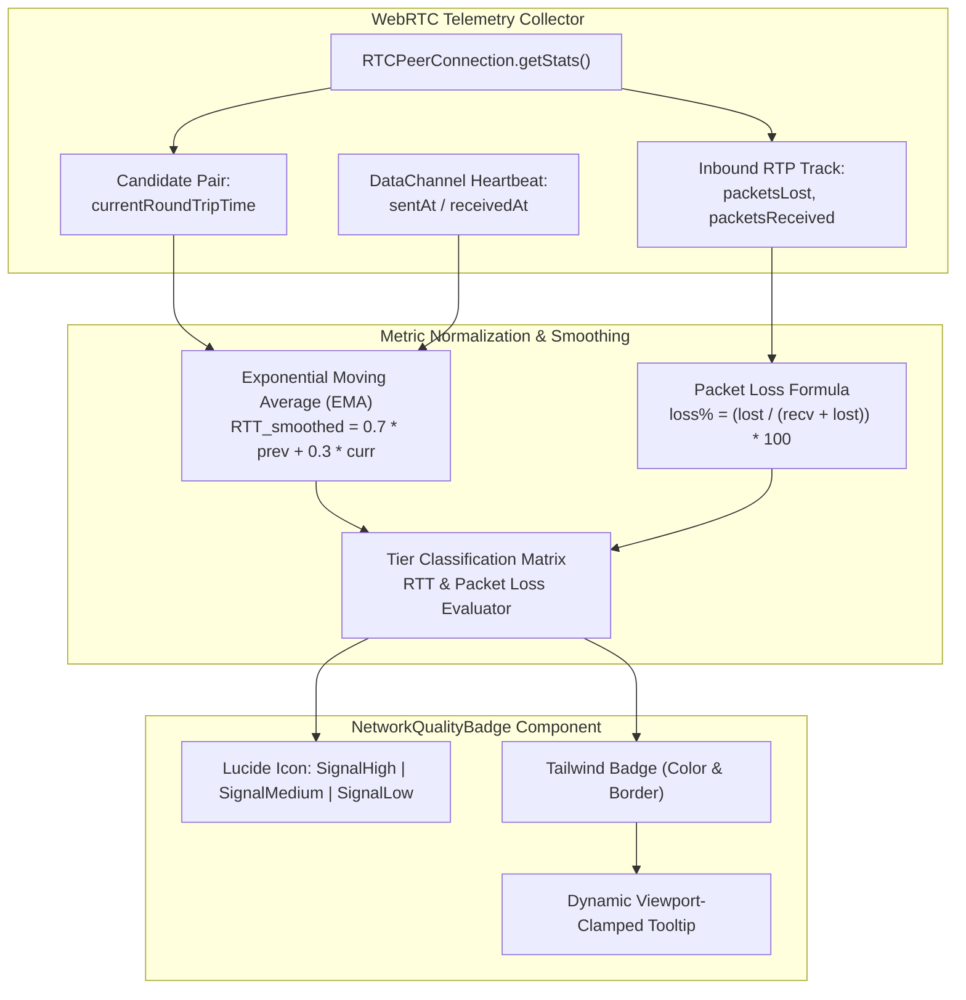
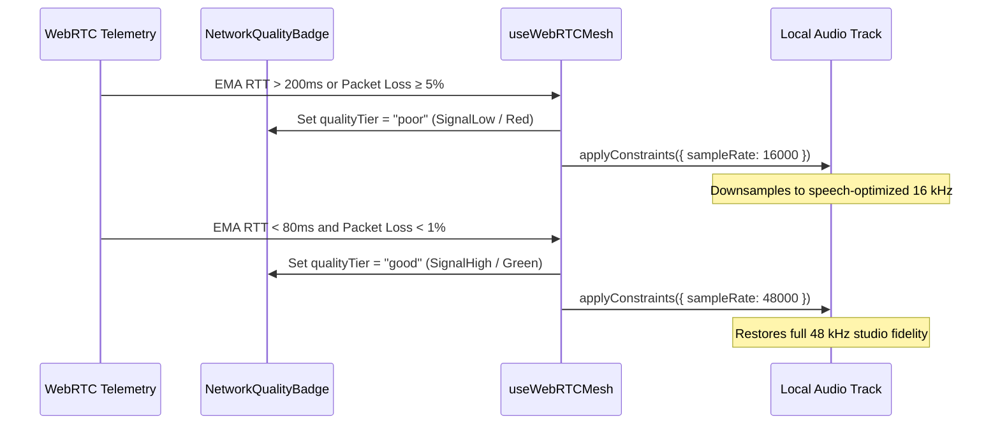

# `NetworkQualityBadge`: WebRTC Latency Telemetry, Signal Strength & Packet Loss Reference

This document details the telemetry architecture, round-trip time (RTT) latency boundaries, packet loss formulas, visual color mappings, and WebRTC stats integration for the **`NetworkQualityBadge`** component ([`src/components/audio/NetworkQualityBadge.tsx`](../../src/components/audio/NetworkQualityBadge.tsx)).

---

## 1. Overview & Telemetry Architecture

In WorkSphere's peer-to-peer audio and video spaces, real-time spatial audio immersion and voice clarity depend on low transmission delay and minimal packet dropouts. The `NetworkQualityBadge` provides a lightweight, accessible, and reactive visual indicator of connection health across WebRTC mesh topologies.



### Telemetry Pipeline

1. **Raw Metric Ingestion:** Samples WebRTC statistical counters via `RTCPeerConnection.getStats()` or signaling server WebSocket ping/pong round trips.
2. **Exponential Moving Average (EMA):** Dampens transient jitter spikes so rapid metric fluctuations do not cause visual badge flickering.
3. **Threshold Classification:** Maps smoothed RTT latency and packet loss percentages into distinct quality tiers (`good`, `fair`, `poor`, `unknown`).
4. **Adaptive Reaction:** Triggers audio downsampling constraints (e.g., dropping from 48 kHz studio fidelity to 16 kHz speech mode during poor network conditions).

---

## 2. Latency Thresholds & Visual Mapping Matrix

The component translates raw millisecond latency values and packet loss percentages into three primary operating tiers and a fallback state:

| Quality Tier                 | RTT Latency Boundary                          | Packet Loss Boundary       | Lucide Icon        | Icon Color        | Badge Background & Border                     | Text Color                                   | User Perception & Call Behavior                                                                                              |
| :--------------------------- | :-------------------------------------------- | :------------------------- | :----------------- | :---------------- | :-------------------------------------------- | :------------------------------------------- | :--------------------------------------------------------------------------------------------------------------------------- |
| **`good`** (Excellent)       | **$< 80\text{ ms}$** _(< 100 ms)_             | **$< 1.0\%$**              | `<SignalHigh />`   | `text-green-500`  | `bg-green-500/10`<br/>`border-green-500/20`   | `text-green-600`<br/>`dark:text-green-400`   | **Studio Clarity:** Full 48 kHz stereo audio, imperceptible conversational delay, optimal spatial acoustics.                 |
| **`fair`** (Good / Moderate) | **$80\text{--}200\text{ ms}$** _(100–249 ms)_ | **$1.0\%\text{--}4.99\%$** | `<SignalMedium />` | `text-yellow-500` | `bg-yellow-500/10`<br/>`border-yellow-500/20` | `text-yellow-600`<br/>`dark:text-yellow-400` | **Acceptable Voice:** Minor talk-over delay, minor jitter buffer expansion; speech remains easily intelligible.              |
| **`poor`** (High Latency)    | **$> 200\text{ ms}$** _(≥ 250 ms)_            | **$\ge 5.0\%$**            | `<SignalLow />`    | `text-red-500`    | `bg-red-500/10`<br/>`border-red-500/20`       | `text-red-600`<br/>`dark:text-red-400`       | **Degraded / Throttled:** Noticeable conversational lag, robotic voice artifacts; triggers automated downsampling to 16 kHz. |
| **`unknown`** (Connecting)   | _Metric unavailable_                          | _Metric unavailable_       | `<SignalMedium />` | `text-zinc-400`   | `bg-zinc-500/10`<br/>`border-zinc-500/20`     | `text-zinc-500`<br/>`dark:text-zinc-400`     | **Initializing:** ICE gathering in progress, or peer connection establishing initial telemetry.                              |

> [!NOTE]
> In high-precision audio environments, RTT below $80\text{ ms}$ guarantees natural turn-taking in conversation. For broader consumer WebRTC topologies, latencies between $80\text{ ms}$ and $200\text{ ms}$ remain viable before echo-cancellation and jitter buffers incur noticeable latency overhead.

---

## 3. WebRTC Stats Telemetry & Calculation Formulas

### 3.1 Round-Trip Time (RTT) Calculation

#### Standard WebRTC Candidate-Pair Metric

From an active `RTCPeerConnection`, RTT is extracted from the active ICE candidate pair:

$$\text{RTT}_{\text{ms}} = \text{currentRoundTripTime} \times 1000$$

```typescript
export async function getPeerRtt(
  pc: RTCPeerConnection,
): Promise<number | null> {
  const stats = await pc.getStats();
  for (const report of stats.values()) {
    if (
      report.type === "candidate-pair" &&
      report.state === "succeeded" &&
      typeof report.currentRoundTripTime === "number"
    ) {
      return Math.round(report.currentRoundTripTime * 1000);
    }
  }
  return null;
}
```

#### DataChannel Heartbeat Ping / Pong

When measuring direct peer-to-peer DataChannel latency, round trips are timestamped at dispatch and receipt:

$$\text{RTT}_{\text{ms}} = \max(0, T_{\text{received}} - T_{\text{sent}})$$

Clamping to $0\text{ ms}$ protects against negative duration calculations caused by host operating system clock skew.

#### Exponential Moving Average (EMA) Smoothing

To prevent UI thrashing from sporadic TCP/UDP packet bursts, incoming samples are smoothed using an EMA filter ($\alpha = 0.3$):

$$\text{RTT}_{\text{EMA}}^{(t)} = \alpha \cdot \text{RTT}_{\text{sample}}^{(t)} + (1 - \alpha) \cdot \text{RTT}_{\text{EMA}}^{(t-1)}$$

```typescript
// Smooth incoming RTT sample
const alpha = 0.3;
rttEma = rttEma === 0 ? currentRtt : rttEma * (1 - alpha) + currentRtt * alpha;
```

---

### 3.2 Packet Loss Percentage Formula

Packet loss represents the fraction of RTP audio/video packets lost in transit across the public Internet relative to total expected packets.

From the `inbound-rtp` statistics report:

$$\text{Packet Loss \%} = \left( \frac{\Delta \text{packetsLost}}{\Delta \text{packetsReceived} + \Delta \text{packetsLost}} \right) \times 100$$

```typescript
export function calculatePacketLossPercent(
  prevLost: number,
  currLost: number,
  prevReceived: number,
  currReceived: number,
): number {
  const deltaLost = Math.max(0, currLost - prevLost);
  const deltaReceived = Math.max(0, currReceived - prevReceived);
  const totalDelta = deltaLost + deltaReceived;

  if (totalDelta === 0) return 0;
  return Number(((deltaLost / totalDelta) * 100).toFixed(1));
}
```

### 3.3 Quality Tier Classification Function

Callers use a unified classification routine to select the appropriate `qualityTier` prior to passing it to `NetworkQualityBadge`:

```typescript
import { NetworkQualityTier } from "@/components/audio/NetworkQualityBadge";

export function evaluateNetworkQualityTier(
  rttMs?: number,
  packetLossPercent?: number,
): NetworkQualityTier {
  if (rttMs === undefined && packetLossPercent === undefined) {
    return "unknown";
  }

  const rtt = rttMs ?? 0;
  const loss = packetLossPercent ?? 0;

  // Severe degradation condition
  if (rtt > 200 || loss >= 5.0) {
    return "poor";
  }

  // Moderate latency or packet loss condition
  if (rtt >= 80 || loss >= 1.0) {
    return "fair";
  }

  // Optimal connection condition
  return "good";
}
```

---

## 4. Component API & Props Reference

The component interface is exported from [`src/components/audio/NetworkQualityBadge.tsx`](../../src/components/audio/NetworkQualityBadge.tsx):

```typescript
export type NetworkQualityTier = "good" | "fair" | "poor" | "unknown";

export interface NetworkQualityBadgeProps {
  /**
   * Round-trip network latency in milliseconds.
   * Rendered in tooltip diagnostic text (e.g., "42 ms").
   */
  ping?: number;

  /**
   * Percentage of transmitted packets that failed to arrive (0 to 100).
   * Rendered in tooltip diagnostic text (e.g., "1.2% loss").
   */
  packetLoss?: number;

  /**
   * Precomputed network-quality tier rendered by the badge.
   * Dictates icon, accent colors, and semantic label.
   */
  qualityTier: NetworkQualityTier;

  /**
   * Optional additional CSS utility classes applied to the outer badge container.
   */
  className?: string;
}
```

### Dynamic Tooltip Positioning

The component features an interactive hover tooltip that calculates viewport bounds at runtime to prevent offscreen rendering:

```typescript
// Viewport clamping logic in NetworkQualityBadge
const tooltipWidth = 200;
let left = rect.left + rect.width / 2 - tooltipWidth / 2;

if (left < 8) left = 8;
if (left + tooltipWidth > window.innerWidth - 8) {
  left = window.innerWidth - 8 - tooltipWidth;
}
```

---

## 5. Usage Examples

### 5.1 WebRTC Audio Grid Header (`MeshCallGrid.tsx`)

In multi-peer mesh calls, the badge displays aggregate session latency in the room toolbar, providing participants with live feedback on connection stability:

```tsx
"use client";

import React from "react";
import { NetworkQualityBadge } from "@/components/audio/NetworkQualityBadge";
import { useWebRTCMesh } from "@/hooks/useWebRTCMesh";

interface RoomHeaderProps {
  sessionSlug: string;
  userId?: string;
}

export function MeshRoomHeader({ sessionSlug, userId }: RoomHeaderProps) {
  const { isJoined, networkQuality, rtt } = useWebRTCMesh({
    roomId: `session-${sessionSlug}`,
    userId,
  });

  return (
    <header className="flex items-center justify-between border-b border-zinc-800 bg-zinc-900/60 px-4 py-3 backdrop-blur-md">
      <div className="flex items-center gap-3">
        <h2 className="text-sm font-semibold text-zinc-100">
          Spatial Audio Grid
        </h2>
        {isJoined && (
          <span className="inline-flex items-center gap-1.5 rounded-full bg-emerald-500/10 px-2.5 py-0.5 text-[10px] font-medium text-emerald-300 border border-emerald-500/20">
            <span className="h-1.5 w-1.5 rounded-full bg-emerald-400 animate-pulse" />
            Live Mesh
          </span>
        )}
      </div>

      {isJoined && (
        <NetworkQualityBadge
          qualityTier={networkQuality}
          ping={rtt > 0 ? rtt : undefined}
          className="text-[10px]"
        />
      )}
    </header>
  );
}
```

### 5.2 Participant Peer Tile (`PeerAvatarTile.tsx`)

In conference tiles or peer video streams, each remote participant avatar displays a dedicated badge indicating point-to-point connection quality:

```tsx
"use client";

import React from "react";
import { NetworkQualityBadge } from "@/components/audio/NetworkQualityBadge";
import { evaluateNetworkQualityTier } from "@/lib/telemetry/networkTier";

interface PeerAvatarTileProps {
  peerId: string;
  displayName: string;
  avatarUrl?: string;
  isSpeaking: boolean;
  rttMs?: number;
  packetLossPercent?: number;
}

export function PeerAvatarTile({
  displayName,
  avatarUrl,
  isSpeaking,
  rttMs,
  packetLossPercent,
}: PeerAvatarTileProps) {
  const qualityTier = evaluateNetworkQualityTier(rttMs, packetLossPercent);

  return (
    <div className="relative flex flex-col items-center justify-center rounded-xl bg-zinc-900/90 p-4 border border-zinc-800/80 shadow-md">
      {/* Network telemetry badge pinned to top-right of the tile */}
      <div className="absolute top-2 right-2">
        <NetworkQualityBadge
          qualityTier={qualityTier}
          ping={rttMs}
          packetLoss={packetLossPercent}
          className="shadow-sm"
        />
      </div>

      {/* Avatar with speaking ring */}
      <div
        className={`relative h-16 w-16 rounded-full overflow-hidden border-2 transition-all ${
          isSpeaking
            ? "border-emerald-500 shadow-[0_0_12px_rgba(16,185,129,0.4)]"
            : "border-zinc-700"
        }`}
      >
        {avatarUrl ? (
          
        ) : (
          <div className="flex h-full w-full items-center justify-center bg-zinc-800 text-zinc-300 font-medium">
            {displayName.slice(0, 2).toUpperCase()}
          </div>
        )}
      </div>

      <span className="mt-3 text-xs font-medium text-zinc-200">
        {displayName}
      </span>
    </div>
  );
}
```

---

## 6. Adaptive Audio Degradation & Bitrate Fallback

When `qualityTier === "poor"`, WorkSphere's WebRTC audio engine (`useWebRTCMesh.ts`) automatically reconfigures local audio track constraints to maintain intelligible conversation under severe bandwidth or packet loss constraints:



### Constraints Transition Implementation

```typescript
useEffect(() => {
  if (!localStreamRef.current) return;
  const audioTrack = localStreamRef.current.getAudioTracks()[0];
  if (!audioTrack) return;

  if (networkQuality === "poor") {
    // Reduce bandwidth demand by downsampling to 16 kHz narrowband speech
    audioTrack.applyConstraints({ sampleRate: 16000 }).catch((err) => {
      console.warn("Failed to downsample audio stream:", err);
    });
  } else if (networkQuality === "good") {
    // Restore full studio 48 kHz fidelity when network conditions recover
    audioTrack.applyConstraints({ sampleRate: 48000 }).catch((err) => {
      console.warn("Failed to restore studio audio sample rate:", err);
    });
  }
}, [networkQuality]);
```

---

## 7. Accessibility & Internationalization

- **Screen Reader Announcements:** The badge renders `aria-label` describing current connection quality and measurements (e.g., `aria-label="Good network quality: 45 ms"`), while icons are marked `aria-hidden="true"`.
- **Color Independence:** Signal quality is conveyed through both icon bar count (`SignalHigh`, `SignalMedium`, `SignalLow`) and semantic labels in addition to color tokens, adhering to WCAG 2.1 Level AA color-contrast and non-color dependency guidelines.
