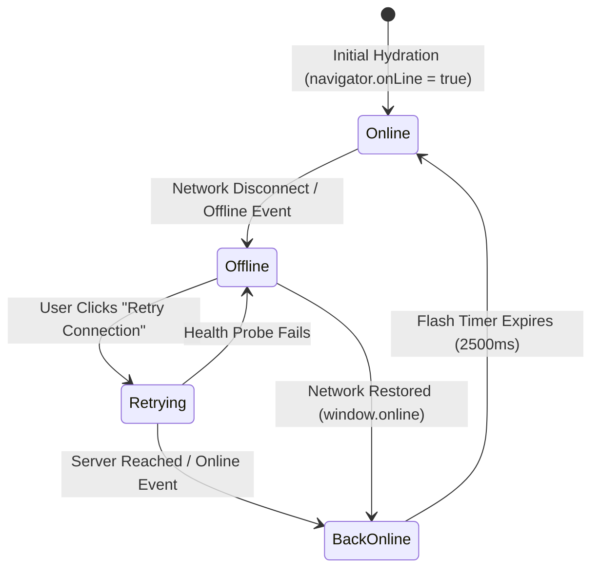

# `NetworkStatusPill` Component Reference & Usage Guide

## 1. Overview

The `NetworkStatusPill` component ([`src/components/NetworkStatusPill.tsx`](file:///c:/Users/admin/Desktop/workfere/src/components/NetworkStatusPill.tsx)) provides a compact, accessible, real-time connectivity badge designed for WorkSphere's offline-first navigation bars and headers. It automatically reflects network connectivity state (**Online/Live**, **Offline/Local Mode**, **Back online** confirmation, and **Slow network/2G** conditions) alongside queued offline mutation counts and an interactive manual retry button.

---

## 2. Component Props Specification

The component accepts the following props defined in `NetworkStatusPillProps`:

| Prop Name | Type | Required | Default | Description |
| :--- | :--- | :---: | :---: | :--- |
| `className` | `string` | No | `""` | Custom Tailwind CSS utility classes for layout, margins, and positioning (e.g. `fixed top-4 right-4 z-50`). |
| `showLive` | `boolean` | No | `true` | When `true`, displays the persistent green animated pulse pill with `"Live"` while online. When `false`, hides the badge completely while online, rendering only during offline or recovery states. |
| `onlineFlashDurationMs` | `number` | No | `2500` | Duration in milliseconds that the green checkmark `"Back online"` transition badge stays visible after network recovery before returning to the normal state. |
| `pendingCount` | `number` | No | `undefined` | Optional explicit override for the count of pending offline mutations. When omitted, automatically binds to `useOfflineSync().pendingCount`. |
| `showRetry` | `boolean` | No | `true` | Whether to display the manual `"Retry Connection"` button with spinner icon when offline. |
| `onRetry` | `() => Promise<boolean \| void> \| void` | No | `undefined` | Custom callback invoked when clicking `"Retry Connection"`. If not supplied, defaults to probing `/api/health` and dispatching synthetic `online` and `trigger-sync` events. |
| `showPing` | `boolean` | No | `false` | When enabled, shows round-trip latency (e.g. `45ms`) alongside network indicator status. |
| `position` | `"inline" \| "top-right" \| "bottom-right"` | No | `"inline"` | Predefined layout positioning preset for embedding in headers or floating as a fixed overlay. |
| `onReconnect` | `() => void` | No | `undefined` | Optional event callback executed immediately when the client transitions from offline back to online. |

---

## 3. Network States & Visual Variations



### 3.1 State Variations Matrix

| State | Visual Indicator | Icon | Text Label | Tailwind Classes (Light / Dark) |
| :--- | :--- | :--- | :--- | :--- |
| **Online ("Live")** | Emerald pulsing dot | Dot | `Live` | `bg-emerald-50 text-emerald-800 border-emerald-300 dark:bg-emerald-950/60 dark:text-emerald-300 dark:border-emerald-800` |
| **Offline ("Local Mode")** | Amber pinging radar | `WifiOff` | `Offline · Local Mode (N)` | `bg-amber-50 text-amber-800 border-amber-300 dark:bg-amber-950/60 dark:text-amber-300 dark:border-amber-800` |
| **Retrying / Reconnecting** | Spinning circular arrows | `RotateCw` (spin) | `Retrying...` | `bg-amber-200/80 hover:bg-amber-300 dark:bg-amber-900/60 text-amber-900 dark:text-amber-200` |
| **Transition: Back Online** | Solid Emerald check | `Check` | `Back online` | `bg-emerald-50 text-emerald-800 border-emerald-300 dark:bg-emerald-950/60 dark:text-emerald-300` |
| **Degraded / Slow (2G/3G)** | Yellow dot | `Wifi` | `Slow Connection` | `bg-yellow-50 text-yellow-800 border-yellow-300 dark:bg-yellow-950/60 dark:text-yellow-300` |

---

## 4. Theme & Variant Support

`NetworkStatusPill` is built with first-class support for WorkSphere's design themes:

### 4.1 Light Mode
- Soft pastel containers (`bg-emerald-50`, `bg-amber-50`).
- High-contrast typography (`text-emerald-800`, `text-amber-800`) meeting WCAG 2.1 AA 4.5:1 minimum contrast ratios.

### 4.2 Dark Mode (`.dark`)
- Semi-transparent tinted obsidian containers (`dark:bg-emerald-950/60`, `dark:bg-amber-950/60`).
- Vibrant luminescent indicator dots (`dark:text-emerald-300`, `dark:text-amber-300`, `dark:border-emerald-800`).

### 4.3 High-Contrast Mode (`forced-colors: active` / WCAG AAA)
- Rendered with explicit 1px solid borders (`border-current`).
- Native system indicator colors for focused buttons (`outline-2 outline-offset-2`).
- Standard ARIA live region attributes (`role="status"`, `aria-live="polite"`).

---

## 5. Usage Examples

### 5.1 Embedding in Top Navigation Bar

```tsx
import React from "react";
import Link from "next/link";
import { NetworkStatusPill } from "@/components/NetworkStatusPill";

export function TopNavbar() {
  return (
    <header className="sticky top-0 z-40 w-full border-b bg-background/95 backdrop-blur supports-[backdrop-filter]:bg-background/60">
      <div className="container flex h-14 items-center justify-between px-4">
        {/* Brand Logo */}
        <Link href="/" className="flex items-center gap-2 font-bold text-lg">
          <span>WorkSphere</span>
        </Link>

        {/* Center / Right Section with Network Status Pill */}
        <div className="flex items-center gap-3">
          <NetworkStatusPill
            showLive={true}
            onlineFlashDurationMs={3000}
            showRetry={true}
            className="shadow-sm"
          />

          <nav className="flex items-center gap-2">
            <Link
              href="/venues"
              className="text-sm font-medium hover:text-primary"
            >
              Venues
            </Link>
            <Link
              href="/bookings"
              className="text-sm font-medium hover:text-primary"
            >
              Bookings
            </Link>
          </nav>
        </div>
      </div>
    </header>
  );
}
```

### 5.2 Floating Global Overlay with Custom Reconnect Callback

```tsx
import React from "react";
import { NetworkStatusPill } from "@/components/NetworkStatusPill";

export function FloatingNetworkStatus() {
  const handleCustomRetry = async () => {
    // Custom synchronization or health ping logic
    const res = await fetch("/api/health");
    if (!res.ok) throw new Error("Health check failed");
  };

  return (
    <div className="fixed bottom-4 right-4 z-50 pointer-events-auto">
      <NetworkStatusPill
        showLive={false} // Hidden while fully online
        showRetry={true}
        onRetry={handleCustomRetry}
        className="shadow-lg backdrop-blur"
      />
    </div>
  );
}
```

---

## 6. Accessibility & Keyboard Navigation

- **Screen Readers**: Encapsulated with `role="status"` and `aria-live="polite"`, ensuring state announcements are voiced politely without interrupting ongoing reading.
- **Keyboard Navigation**: The `"Retry Connection"` action button features a visible focus ring (`focus:ring-1 focus:ring-amber-500`) and explicit `aria-label="Retry connection"`.
- **Reduced Motion**: Pulse and ping radar indicators degrade gracefully to static circles when `prefers-reduced-motion: reduce` is detected.
