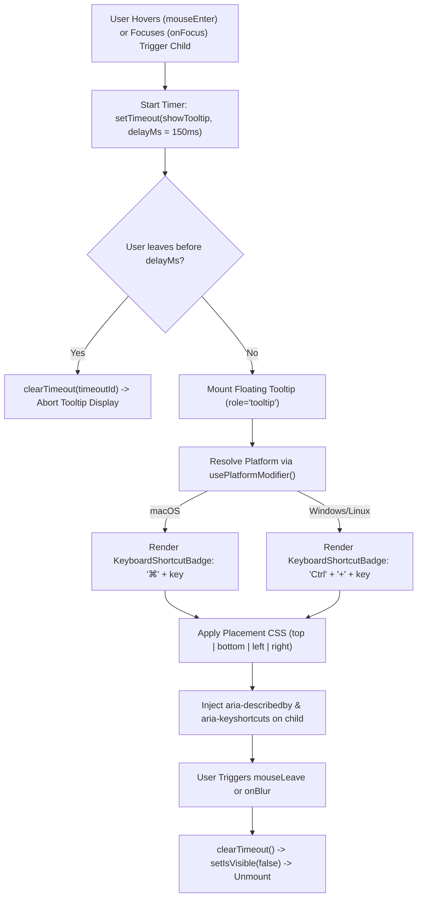

# Component Reference: `ShortcutTooltip` & Keyboard Shortcut Tooltips

This document details the architecture, props interface, placement positioning engine, cross-platform modifier key resolution, and accessibility guidelines for the **`ShortcutTooltip`** component ([`src/components/ui/ShortcutTooltip.tsx`](file:///c:/Users/admin/Desktop/workfere/src/components/ui/ShortcutTooltip.tsx)).

---

## 1. Executive Summary & Component Role

The **`ShortcutTooltip`** is a high-visibility, accessible floating tooltip that presents a descriptive action label alongside a dynamically platform-adapted keyboard shortcut (e.g. `⌘ + K` on macOS vs. `Ctrl + K` on Windows/Linux).

Key Capabilities:
1. **Platform-Adaptive Key Badging:** Integrates with `usePlatformModifier` and `KeyboardShortcutBadge` to render `⌘` on macOS/iOS and `Ctrl` on Windows/Linux without SSR hydration flicker.
2. **Four-Directional Placement Engine:** Positions tooltips cleanly along `top`, `bottom`, `left`, or `right` edges with built-in offset spacing and CSS transform centering.
3. **Configurable Debounce Delay (`delayMs`):** Prevents visual flicker when users rapidly skim over button toolbars.
4. **W3C Accessibility Conformance:** Automatically clones the trigger child element to inject `role="tooltip"`, `aria-describedby`, and `aria-keyshortcuts="Control+<key> Meta+<key>"`.



---

## 2. Props Reference (`ShortcutTooltipProps`)

```typescript
export interface ShortcutTooltipProps {
  children: React.ReactNode;
  content: string;
  shortcut?: string;
  keys?: string;
  position?: "top" | "bottom" | "left" | "right";
  placement?: "top" | "bottom" | "left" | "right";
  className?: string;
  delayMs?: number;
}
```

### Detailed Props Specification

| Prop Name | Aliases | Type | Default | Description |
| :--- | :--- | :--- | :---: | :--- |
| **`children`** | — | `React.ReactNode` | *(Required)* | The interactive trigger element (e.g. `<button>`, `<input>`, `<a>`). Cloned to inject ARIA attributes. |
| **`content`** | — | `string` | *(Required)* | Text label explaining the action performed by the trigger (e.g. `"Search venues"`, `"Zoom in"`). |
| **`shortcut`** | `keys` | `string` | *(Required)* | Trigger key character or name (e.g. `"K"`, `"F"`, `"0"`, `"+"`). Automatically paired with platform modifier. |
| **`position`** | `placement` | `"top" \| "bottom" \| "left" \| "right"` | `"bottom"` | Spatial alignment of the tooltip relative to the trigger child. |
| **`delayMs`** | — | `number` | `150` | Milliseconds to wait before rendering the tooltip after hover or focus. |
| **`className`** | — | `string` | `""` | Additional CSS class overrides appended to the outer relative wrapper. |

---

## 3. Placement & Positioning Engine

The component positions floating tooltips relative to the trigger container using Tailwind CSS utility classes:

| Placement Option | Positioning Utility Classes | Alignment Behavior | Recommended Use Case |
| :---: | :--- | :--- | :--- |
| **`top`** | `bottom-full left-1/2 -translate-x-1/2 mb-2` | Centered horizontally above the trigger | Canvas bottom docks, floating action buttons |
| **`bottom`** | `top-full left-1/2 -translate-x-1/2 mt-2` | Centered horizontally below the trigger | Top navigation bars, header search inputs |
| **`left`** | `right-full top-1/2 -translate-y-1/2 mr-2` | Centered vertically to the left of the trigger | Right-hand sidebars, vertical inspection drawers |
| **`right`** | `left-full top-1/2 -translate-y-1/2 ml-2` | Centered vertically to the right of the trigger | Left-hand application sidebars, tool palettes |

---

## 4. Cross-Platform Modifier Key Resolution

The tooltip integrates with [`src/hooks/usePlatformModifier.ts`](file:///c:/Users/admin/Desktop/workfere/src/hooks/usePlatformModifier.ts) and [`src/components/ui/KeyboardShortcutBadge.tsx`](file:///c:/Users/admin/Desktop/workfere/src/components/ui/KeyboardShortcutBadge.tsx):

- **macOS / iOS:** Resolves `isMac = true`. Formats visual label as `⌘ + <key>` or `⌘<key>`.
- **Windows / Linux:** Resolves `isMac = false`. Formats visual label as `Ctrl + <key>`.
- **SSR Hydration:** Initializes with a deterministic server fallback without throwing React hydration mismatch warnings.

---

## 5. Usage Examples

### 5.1 Top-Bar Global Search Trigger

```tsx
"use client";

import React from "react";
import { Search } from "lucide-react";
import { ShortcutTooltip } from "@/components/ui/ShortcutTooltip";
import { openCommandPalette } from "@/hooks/usePlatformModifier";

export function TopBarSearchButton() {
  return (
    <ShortcutTooltip
      content="Search venues & spaces"
      shortcut="K"
      position="bottom"
      delayMs={100}
    >
      <button
        type="button"
        onClick={openCommandPalette}
        className="flex items-center gap-2 px-3 py-1.5 rounded-xl border border-zinc-200 dark:border-zinc-800 bg-white dark:bg-zinc-900 text-xs text-zinc-500 hover:border-zinc-300 dark:hover:border-zinc-700 transition-colors"
      >
        <Search className="w-4 h-4 text-zinc-400" />
        <span>Search...</span>
      </button>
    </ShortcutTooltip>
  );
}
```

### 5.2 3D Canvas / Floorplan Action Toolbar

```tsx
"use client";

import React from "react";
import { ZoomIn, ZoomOut, RotateCcw } from "lucide-react";
import { ShortcutTooltip } from "@/components/ui/ShortcutTooltip";

interface CanvasToolbarProps {
  onZoomIn: () => void;
  onZoomOut: () => void;
  onReset: () => void;
}

export function CanvasNavigationToolbar({
  onZoomIn,
  onZoomOut,
  onReset,
}: CanvasToolbarProps) {
  return (
    <div className="flex items-center gap-1.5 p-1.5 rounded-2xl bg-zinc-900/90 border border-white/10 shadow-xl backdrop-blur-md">
      <ShortcutTooltip content="Zoom In" shortcut="+" position="top">
        <button
          type="button"
          onClick={onZoomIn}
          className="p-2 rounded-xl text-zinc-300 hover:text-white hover:bg-white/10 transition-colors"
          aria-label="Zoom in floorplan"
        >
          <ZoomIn className="w-4 h-4" />
        </button>
      </ShortcutTooltip>

      <ShortcutTooltip content="Zoom Out" shortcut="-" position="top">
        <button
          type="button"
          onClick={onZoomOut}
          className="p-2 rounded-xl text-zinc-300 hover:text-white hover:bg-white/10 transition-colors"
          aria-label="Zoom out floorplan"
        >
          <ZoomOut className="w-4 h-4" />
        </button>
      </ShortcutTooltip>

      <ShortcutTooltip content="Reset View" shortcut="0" position="top">
        <button
          type="button"
          onClick={onReset}
          className="p-2 rounded-xl text-zinc-300 hover:text-white hover:bg-white/10 transition-colors"
          aria-label="Reset floorplan perspective"
        >
          <RotateCcw className="w-4 h-4" />
        </button>
      </ShortcutTooltip>
    </div>
  );
}
```

---

## 6. Accessibility (a11y) Conformance

- **Automatic ARIA Injection:** Using `React.cloneElement`, the trigger child receives:
  - `aria-describedby={tooltipId}` when the tooltip is active.
  - `aria-keyshortcuts="Control+<key> Meta+<key>"` compliant with the W3C WAI-ARIA authoring practices.
  - Fallback native `title` attribute for environments where JavaScript or floating layers are suppressed.
- **Focus & Blur Event Handling:** The tooltip listens to `onFocus` and `onBlur`, ensuring keyboard-only users navigating via <kbd>Tab</kbd> receive the same visual guidance as mouse users.
- **Screen Reader Cleanliness:** Inner tooltip badges use `aria-hidden="true"` or are cleanly described by parent attributes to avoid duplicate screen reader announcements.
