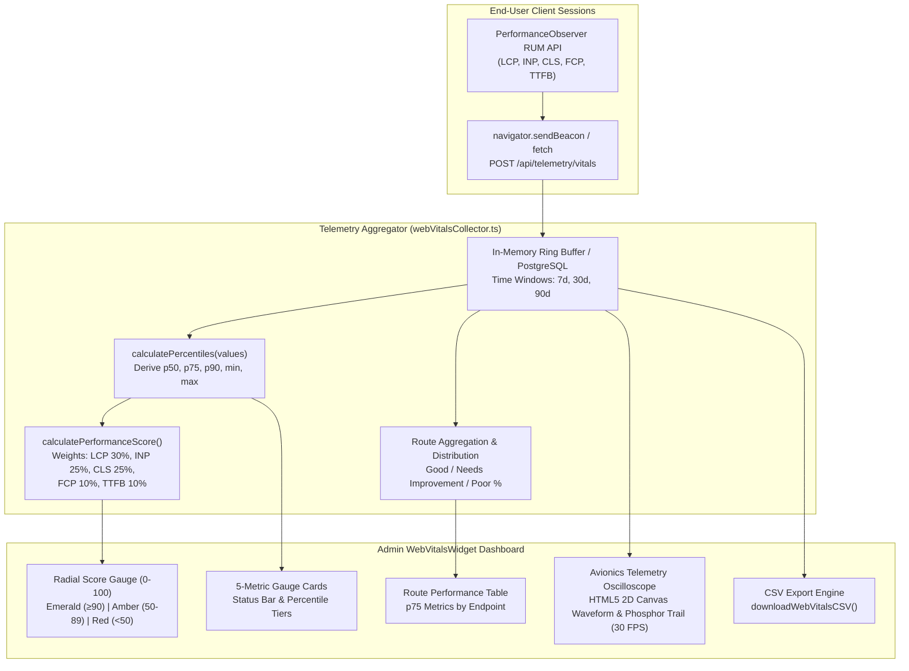

# Component Reference: `WebVitalsWidget` & Core Web Vitals Aggregation

This document details the architectural design, metric thresholds, scoring rubrics, aggregation algorithms, and embedding instructions for the **`WebVitalsWidget`** component ([`src/components/admin/WebVitalsWidget.tsx`](../../src/components/admin/WebVitalsWidget.tsx)) and its telemetry collection engine ([`src/lib/webVitalsCollector.ts`](../../src/lib/webVitalsCollector.ts)).

---

## 1. Overview & System Architecture

In WorkSphere, real-world user performance directly influences conversion rates, search indexing, and user satisfaction across coworking bookings, interactive 3D floorplans, and WebRTC mesh calls.

`WebVitalsWidget` tracks and aggregates Google Core Web Vitals metrics gathered client-side via `PerformanceObserver`:

1. **Real-User Monitoring (RUM):** Telemetry collected from actual end-user browser sessions rather than synthetic lab benchmarks.
2. **75th Percentile (p75) Compliance:** Evaluates performance against Google's standard threshold requiring 75% of page visits to pass the "Good" tier.
3. **Multi-Scale Radial Score Gauge:** Computes a composite 0–100 health score weighted across Largest Contentful Paint (LCP), Interaction to Next Paint (INP), Cumulative Layout Shift (CLS), First Contentful Paint (FCP), and Time to First Byte (TTFB).
4. **Route-by-Route Breakdown:** Isolates performance regressions to specific routes (e.g. `/venues`, `/map`, `/bookings`, `/chat`).
5. **Telemetry Export:** Generates instant CSV downloads of aggregated percentiles for offline analysis.
6. **Avionics Telemetry Oscilloscope:** Real-time HTML5 2D Canvas cathode-ray beam visualizer tracing latency pulses and dynamic voltage blips with phosphor persistence decay, throttled at 30 FPS.



---

## 2. Tracked Metric Definitions & Target Google Thresholds

WorkSphere adheres to the official Google Core Web Vitals specifications:

| Metric Name | Full Name & Description                                                                                                                                                  |    Unit    |                 Good (Green)                  |                   Needs Improvement (Amber)                    |                Poor (Red)                 | Score Weight |
| :---------: | :----------------------------------------------------------------------------------------------------------------------------------------------------------------------- | :--------: | :-------------------------------------------: | :------------------------------------------------------------: | :---------------------------------------: | :----------: |
|   **LCP**   | **Largest Contentful Paint:** Measures perceived loading speed by recording when the largest main image or text block finishes rendering.                                | `ms` / `s` | **$\le 2500\text{ ms}$** ($\le 2.5\text{ s}$) | **$2500\text{--}4000\text{ ms}$** ($2.5\text{--}4.0\text{ s}$) | **$> 4000\text{ ms}$** ($> 4.0\text{ s}$) |   **30%**    |
|   **INP**   | **Interaction to Next Paint:** Evaluates overall responsiveness across all clicks, taps, and keyboard inputs throughout the entire page lifecycle. Replaced FID in 2024. |    `ms`    |            **$\le 200\text{ ms}$**            |                **$200\text{--}500\text{ ms}$**                 |           **$> 500\text{ ms}$**           |   **25%**    |
|   **CLS**   | **Cumulative Layout Shift:** Quantifies visual stability by measuring unexpected layout movements and shifts of visible elements.                                        |  `score`   |                **$\le 0.100$**                |                   **$0.100\text{--}0.250$**                    |               **$> 0.250$**               |   **25%**    |
|   **FCP**   | **First Contentful Paint:** Measures the time from navigation start to when the browser renders the first piece of DOM content.                                          | `ms` / `s` | **$\le 1800\text{ ms}$** ($\le 1.8\text{ s}$) | **$1800\text{--}3000\text{ ms}$** ($1.8\text{--}3.0\text{ s}$) | **$> 3000\text{ ms}$** ($> 3.0\text{ s}$) |   **10%**    |
|  **TTFB**   | **Time to First Byte:** Measures server responsiveness and network latency before the first byte of HTML arrives.                                                        |    `ms`    |            **$\le 800\text{ ms}$**            |                **$800\text{--}1800\text{ ms}$**                |          **$> 1800\text{ ms}$**           |   **10%**    |
|   **FID**   | **First Input Delay:** Legacy first-input responsiveness metric retained for historical comparison. Deprecated in favor of INP.                                          |    `ms`    |              $\le 100\text{ ms}$              |                  $100\text{--}300\text{ ms}$                   |             $> 300\text{ ms}$             |      0%      |

---

## 3. Color Scoring & Percentile Rubrics

### 3.1 Three-Tier Visual Styling

The component maps metric ratings into high-contrast Tailwind tokens:

```typescript
function getRatingBadgeStyle(rating: WebVitalRating) {
  switch (rating) {
    case "good":
      return {
        bg: "bg-emerald-500/10 text-emerald-400 border-emerald-500/20",
        dot: "bg-emerald-400",
        label: "Good",
        color: "#10b981", // Emerald
      };
    case "needs-improvement":
      return {
        bg: "bg-amber-500/10 text-amber-400 border-amber-500/20",
        dot: "bg-amber-400",
        label: "Needs Improvement",
        color: "#f59e0b", // Amber
      };
    case "poor":
      return {
        bg: "bg-red-500/10 text-red-400 border-red-500/20",
        dot: "bg-red-400",
        label: "Poor",
        color: "#ef4444", // Red
      };
  }
}
```

### 3.2 The p75 Standard & Distribution Percentiles

Averages (means) are severely distorted by outlier network drops and slow mobile devices. WorkSphere calculates three statistical percentiles:

- **p50 (Median):** The typical user experience.
- **p75 (Google Standard):** The primary qualification metric. If the 75th percentile is under the threshold, Google classifies the site as passing.
- **p90 (Worst 10%):** Highlights edge-case degradations, weak mobile radios, or heavy background thread stalls.

### 3.3 Composite Performance Score (0–100)

The radial gauge score is computed via `calculatePerformanceScore()`:

$$\text{Score} = \frac{\sum_{m} W_m \cdot S_m}{\sum_m W_m}$$

Where:

- $W_m$ are weights: $\text{LCP } (0.30)$, $\text{INP } (0.25)$, $\text{CLS } (0.25)$, $\text{FCP } (0.10)$, $\text{TTFB } (0.10)$.
- Metric score $S_m$ is normalized:
  - If $p75 \le \text{Threshold}_{\text{good}}$: Scale from $100$ down to $90$.
  - If $\text{Threshold}_{\text{good}} < p75 \le \text{Threshold}_{\text{needsImprovement}}$: Scale from $89$ down to $50$.
  - If $p75 > \text{Threshold}_{\text{needsImprovement}}$: Scale from $49$ down to $0$.

---

## 4. Admin Dashboard Aggregation Architecture

### 4.1 Time Ranges

The widget supports three historical aggregation windows:

- **`7d` (Default):** Highlights recent production releases and regressions.
- **`30d`:** Monthly performance trajectory matching Google Search Console cycles.
- **`90d`:** Quarterly trend analysis for infrastructure and bundle size audits.

### 4.2 Auto-Refresh Polling

Configurable polling (`autoRefreshMs`, default $30000\text{ ms}$) fetches updated metrics in the background with `cache: "no-store"` to ensure administrative views remain fresh during live load tests or deployments.

### 4.3 Route-by-Route Breakdown Table

Switching to the **Route Distributions** tab parses telemetry by URL path:

- Isolates heavy 3D WebGL scenes (`/map`, `/venues/[id]/3d`) from lightweight static pages (`/about`, `/pricing`).
- Highlights route-level LCP and INP bottlenecks for focused optimization sprints.

---

## 5. Sample Integration Snippet

The following code illustrates embedding `WebVitalsWidget` inside an administrative analytics page:

```tsx
"use client";

import React from "react";
import { WebVitalsWidget } from "@/components/admin/WebVitalsWidget";
import { BarChart3, ShieldCheck } from "lucide-react";

export default function AdminPerformanceAnalyticsPage() {
  return (
    <main className="min-h-screen bg-zinc-950 p-6 sm:p-8 text-white space-y-8">
      {/* Page Header */}
      <div className="flex flex-col sm:flex-row sm:items-center sm:justify-between gap-4 border-b border-zinc-800 pb-6">
        <div>
          <div className="flex items-center gap-2 text-violet-400 text-xs font-semibold uppercase tracking-wider mb-1">
            <ShieldCheck className="w-4 h-4" />
            <span>Infrastructure Observability</span>
          </div>
          <h1 className="text-2xl sm:text-3xl font-extrabold tracking-tight">
            System Performance &amp; Web Vitals
          </h1>
          <p className="text-sm text-zinc-400 mt-1">
            Real-user Core Web Vitals telemetry across all production routes.
          </p>
        </div>
      </div>

      {/* Embedded Web Vitals Widget */}
      <div className="w-full">
        <WebVitalsWidget
          initialRange="7d"
          autoRefreshMs={30000}
          className="w-full shadow-2xl"
        />
      </div>
    </main>
  );
}
```

---

## 6. Component Props Specification

| Prop Name       | Type     | Default | Description                                                               |
| :-------------- | :------- | :-----: | :------------------------------------------------------------------------ |
| `initialRange`  | `string` | `"7d"`  | Default time window selected on initial mount (`"7d"`, `"30d"`, `"90d"`). |
| `className`     | `string` |  `""`   | Additional CSS class overrides for the container card element.            |
| `autoRefreshMs` | `number` | `30000` | Background interval in milliseconds for polling `/api/admin/vitals`.      |
