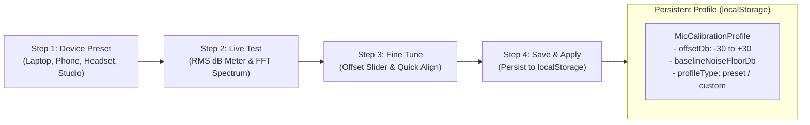

# MicCalibrationWizard: Microphone Permission, Gain Offset & Acoustic Calibration Architecture

This document details the user workflow, audio permission handling, Web Audio API constraints, hardware presets, gain sensitivity adjustments, and ambient noise floor sampling implemented in [`src/components/noise/MicCalibrationWizard.tsx`](file:///c:/Users/admin/Desktop/workfere/src/components/noise/MicCalibrationWizard.tsx) and [`src/lib/noise/calibration.ts`](file:///c:/Users/admin/Desktop/workfere/src/lib/noise/calibration.ts).

---

## 1. Executive Summary & Problem Statement

WorkSphere monitors acoustic levels in coworking spaces and cafés so nomads can identify quiet focus areas versus lively collaborative zones. However, uncalibrated consumer microphones introduce massive decibel discrepancies:
- **Preamplifier Variances:** Laptop microphones, external USB conference mics, and smartphone capsules exhibit up to $\pm 15\text{ dB}$ gain disparities.
- **Operating System Post-Processing:** Automated Gain Control (AGC), noise suppression, and echo cancellation distort ambient decibel measurements.
- **Microphone Placement & Attenuation:** A headset boom mic close to a user's mouth reads differently than an omnidirectional condenser mic resting on a wooden desk.

The **MicCalibrationWizard** solves this by guiding users through an interactive 4-step wizard to calibrate microphone gain offsets, sample ambient noise floors, and match readings against real-world reference decibel standards.



---

## 2. 4-Step Calibration Workflow

The wizard (`MicCalibrationWizard.tsx`) organizes acoustic calibration into four sequential stages:

### Step 1: Hardware Device Profile Selection
Users select their recording hardware archetype from predefined presets:

| Profile Key | Hardware Type | Default Offset | Acoustic Characteristics |
| :--- | :--- | :---: | :--- |
| `built_in` | Built-in Laptop / PC Mic | $0\text{ dB}$ | Standard integrated omnidirectional microphone (baseline reference). |
| `smartphone` | Smartphone / Tablet Mic | $+4\text{ dB}$ | Higher preamp sensitivity for mobile speech capture. |
| `headset` | USB / Bluetooth Headset | $-5\text{ dB}$ | Directional boom capsule with acoustic proximity attenuation. |
| `studio_mic` | External Condenser Mic | $-8\text{ dB}$ | High-sensitivity studio capsule requiring negative attenuation. |
| `custom` | Custom Reference Meter | User-defined | Tuned manually or against a handheld sound pressure level (SPL) meter. |

### Step 2: Live Microphone Test & Spectrum Analysis
- **Live Decibel SPL Gauge:** Computes Root Mean Square (RMS) energy in real-time from the Web Audio `AnalyserNode` ($N = 512$ FFT window).
- **Peak Hold Indicator:** Tracks maximum observed decibels during the current session.
- **3-Band Frequency Spectrum Analyzer:**
  - **Low Band ($20 - 250\text{ Hz}$):** Monitors HVAC drone, sub-bass rumble, and mechanical vibrations.
  - **Mid Band ($250 - 4000\text{ Hz}$):** Captures speech fundamentals, phone calls, and ambient chatter.
  - **High Band ($4000 - 20000\text{ Hz}$):** Detects espresso steam hisses, cutlery clatter, and typing clicks.
- **Ambient Noise Floor Sampling:** Measures $3$ seconds of ambient silence to record `baselineNoiseFloorDb` (typical quiet room: $30 - 40\text{ dB}$).

### Step 3: Fine-Tuning Acoustic Gain Offset
- **Manual Offset Slider:** Provides granular continuous adjustment between **$-30.0\text{ dB}$** and **$+30.0\text{ dB}$** in $0.5\text{ dB}$ increments.
- **Quick Reference Align Buttons:**
  - **Quiet ($\approx 35\text{ dB}$):** Matches offset to quiet bedroom or whisper level.
  - **Voice ($\approx 60\text{ dB}$):** Matches normal conversational speech volume.
  - **Café ($\approx 68\text{ dB}$):** Matches energetic coffee shop background ambiance.
- **Calculation Formula:**
  $$\text{New Offset} = \operatorname{clamp}\left(\operatorname{round}_{0.5}\left(\text{Target dB} - \text{Raw Input dB}\right), \; -30, \; +30\right)$$

### Step 4: Summary, Reset & Storage Persistence
- Displays hardware profile, total applied offset, baseline noise floor, and connected hardware audio device label.
- Saves profile to `localStorage` under `worksphere_mic_calibration` and emits a `worksphere:mic-calibration-changed` custom window event to synchronize live charts without page reload.

---

## 3. Browser Audio Permissions & Audio Constraints

Accurate acoustic measurements require raw, uncompressed, un-attenuated PCM audio. Default browser settings enable speech enhancement filters that severely distort ambient SPL calculations.

### Clean Microphone Stream Constraints

In [`MicCalibrationWizard.tsx`](file:///c:/Users/admin/Desktop/workfere/src/components/noise/MicCalibrationWizard.tsx#L116-L122):

```typescript
const stream = await navigator.mediaDevices.getUserMedia({
  audio: {
    echoCancellation: false, // Disables anti-echo filters that suppress ambient reverberations
    noiseSuppression: false, // Disables background noise gates that mute steady HVAC hums
    autoGainControl: false,  // Disables dynamic digital gain pumping
  },
});
```

### Permission Handling & Error Boundaries
- **Prompt:** Invoking `getUserMedia()` requests the `microphone` permission prompt.
- **Permission Denied / Insecure Context:** Caught in the `try/catch` block:
  - Surfaces a user-friendly error toast (`VolumeX` icon).
  - Handles `NotAllowedError` (user blocked access) and `NotFoundError` (no hardware microphone connected).
- **Web Audio Auto-Pause:** Integrates [`useWebAudioAutoPause`](file:///c:/Users/admin/Desktop/workfere/src/hooks/useWebAudioAutoPause.ts) to automatically suspend the audio stream when the user minimizes the tab, preserving battery and privacy.

---

## 4. Acoustic Conversion & Gain Formulas

The acoustic conversion pipeline in [`calibration.ts`](file:///c:/Users/admin/Desktop/workfere/src/lib/noise/calibration.ts#L110-L130) transforms raw PCM samples into calibrated decibels:

### 1. Root Mean Square (RMS) Amplitude
For discrete frame samples $x[i]$ across buffer size $N$:

$$\text{RMS} = \sqrt{\frac{1}{N} \sum_{i=0}^{N-1} x[i]^2}$$

### 2. Full-Scale Decibels ($\text{dBFS}$)
$$\text{dBFS} = 20 \log_{10}(\text{RMS} \cdot S)$$
where $S$ is the hardware sensitivity multiplier (default $1.0$).

### 3. Calibrated Sound Pressure Level ($\text{dB SPL}$)
Digital maximum ($0\text{ dBFS}$) is mapped to standard acoustic reference full scale ($+100\text{ dB}$):

$$\text{Raw SPL} = \text{dBFS} + 100$$

$$\text{Calibrated SPL} = \operatorname{clamp}\left(\operatorname{round}_{0.1}\left(\text{Raw SPL} + \text{offsetDb}\right), \; 0, \; 130\right)$$

- **Clamping Limits:** $0\text{ dB}$ (absolute acoustic silence) to $130\text{ dB}$ (human threshold of pain), filtering out microphone clipping and hardware bus noise.

---

## 5. Developer Guide: Mounting the Calibration Modal

### 5.1 Basic Component Usage

```tsx
import React, { useState } from 'react';
import { MicCalibrationWizard } from '@/components/noise/MicCalibrationWizard';
import { MicCalibrationProfile } from '@/lib/noise/calibration';
import { Sliders } from 'lucide-react';

export function VenueNoiseSettings() {
  const [isWizardOpen, setIsWizardOpen] = useState(false);

  const handleCalibrationSaved = (profile: MicCalibrationProfile) => {
    console.log('New calibration saved:', profile);
    // Profile is automatically persisted to localStorage and window event dispatched
  };

  return (
    <div className="p-4">
      <button
        type="button"
        onClick={() => setIsWizardOpen(true)}
        className="flex items-center gap-2 px-4 py-2 bg-blue-600 text-white font-bold rounded-xl shadow-md hover:bg-blue-500 transition-colors"
      >
        <Sliders className="w-4 h-4" />
        <span>Calibrate Microphone</span>
      </button>

      {/* Mount Calibration Wizard Dialog */}
      <MicCalibrationWizard
        isOpen={isWizardOpen}
        onClose={() => setIsWizardOpen(false)}
        onCalibrationSaved={handleCalibrationSaved}
      />
    </div>
  );
}
```

### 5.2 Subscribing to Live Calibration Updates

Other UI components (e.g. `VenueNoiseChart.tsx`) can subscribe to real-time calibration updates via the custom event bus:

```typescript
useEffect(() => {
  const handleCalibrationChange = (event: Event) => {
    const customEvent = event as CustomEvent<MicCalibrationProfile>;
    console.log('Acoustic calibration updated:', customEvent.detail);
  };

  window.addEventListener('worksphere:mic-calibration-changed', handleCalibrationChange);
  return () => {
    window.removeEventListener('worksphere:mic-calibration-changed', handleCalibrationChange);
  };
}, []);
```
