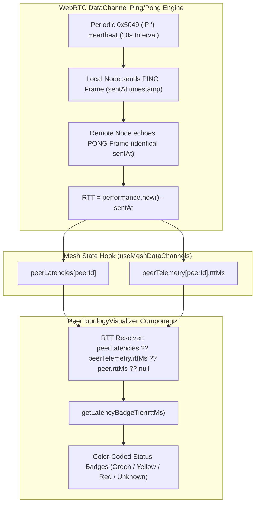
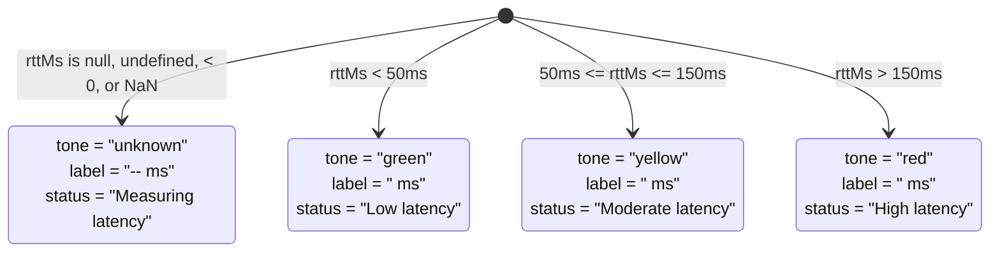

# `PeerTopologyVisualizer`: WebRTC Mesh Latency Ping Overlay & Usage Guide

The **`PeerTopologyVisualizer`** component ([`src/components/p2p/PeerTopologyVisualizer.tsx`](../../src/components/p2p/PeerTopologyVisualizer.tsx)) renders a real-time visual map of connected peer nodes within a collaborative WebRTC mesh workspace. It provides live round-trip time (RTT) latency telemetry badges next to peer avatars, giving immediate feedback on connection quality, potential data sync delays, and network degradation across distributed sessions.

---

## 1. Overview & Purpose

WorkSphere uses decentralized WebRTC DataChannels and CRDT state synchronization for real-time collaboration across whiteboards, notes, and room audio. Because collaborators communicate peer-to-peer (P2P), asymmetric network conditions or distant geographic regions can lead to varying degrees of latency between nodes.

`PeerTopologyVisualizer` acts as the primary HUD (Heads-Up Display) overlay for monitoring mesh health:
- Identifies the local user and all active remote peers in the mesh room.
- Renders avatar initials or profile images with safe URL sanitization.
- Continuously reflects peer latency sampled via binary WebRTC DataChannel ping/pong heartbeats and ICE candidate-pair statistics.
- Dynamically assigns color-coded latency status badges based on precise millisecond thresholds.
- Adheres to strict accessibility conventions including `role="status"`, dynamic `aria-label`s, and high-contrast indicators.



---

## 2. Public Props & Component API

### `PeerTopologyVisualizerProps`

| Prop Name | Type | Default Value | Description |
| :--- | :--- | :--- | :--- |
| `localPeerId` | `string` | *(Required)* | The unique identifier or public key of the local user in the WebRTC mesh room. Displayed in parentheses next to `localDisplayName`. |
| `localDisplayName` | `string` | `"You"` | The human-readable display name of the local user. Shown in the top header alongside their generated avatar initials. |
| `peers` | `TopologyPeerNode[]` | *(Required)* | Array of active remote peer objects currently recognized in the collaborative room. If empty, an empty-state message is displayed. |
| `peerLatencies` | `Record<string, number \| null>` | `undefined` | Dictionary mapping `peerId` to current round-trip latency in milliseconds, typically provided directly by `useMeshDataChannels()`. Takes precedence during RTT resolution. |
| `peerTelemetry` | `Record<string, PeerTelemetry>` | `undefined` | Full telemetry records indexed by `peerId`, providing fallback `rttMs`, packet loss, bitrate, and relay status. |
| `className` | `string` | `undefined` | Optional Tailwind CSS classes to override or append to the root `<section>` styling. |

### `TopologyPeerNode` Shape

```typescript
export interface TopologyPeerNode {
  /** Unique peer identifier in the mesh room. */
  peerId: string;
  /** Human-readable name for display (e.g., "Asha Dev"). Defaults to peerId if missing. */
  displayName?: string;
  /** Optional HTTP/HTTPS avatar URL. Sanitized before rendering to guard against XSS/javascript: URLs. */
  avatarUrl?: string;
  /** Role badge text or label (e.g., "Editor", "Viewer", "Admin"). */
  role?: string;
  /** Direct RTT in milliseconds if embedded within the peer structure. */
  rttMs?: number | null;
  /** Connection lifecycle status. */
  status?: "connected" | "connecting" | "disconnected";
}
```

### RTT Resolution Precedence

When evaluating the latency for each peer, `PeerTopologyVisualizer` resolves `rttMs` using the following fallback order:

$$\text{resolvedRtt} = \text{peerLatencies}[\text{peerId}] \;\;?\?\;\; \text{peerTelemetry}[\text{peerId}]\text{.rttMs} \;\;?\?\;\; \text{peer.rttMs} \;\;?\?\;\; \text{null}$$

---

## 3. Peer Mesh Latency Ping Overlay Mechanics

Latency measurement in WorkSphere occurs out-of-band on open WebRTC DataChannels using a dedicated binary framing protocol designed to bypass CRDT state vector parsers and JSON deserializers.

### 3.1 Binary Framing (`0x5049` / `'PI'`)

To guarantee zero interference with application data channels:
1. Every heartbeat frame begins with a 2-byte magic identifier: `0x5049` (ASCII string `"PI"` for Ping Indicator).
2. The third byte defines the message type:
   - `0x01`: `MeshHeartbeatType.PING`
   - `0x02`: `MeshHeartbeatType.PONG`
3. The remaining 8 bytes encode a 64-bit IEEE 754 float representing high-resolution epoch time (`performance.now()` or `Date.now()`).

```
 0                   1                   2                   3
 0 1 2 3 4 5 6 7 8 9 0 1 2 3 4 5 6 7 8 9 0 1 2 3 4 5 6 7 8 9 0 1
+-+-+-+-+-+-+-+-+-+-+-+-+-+-+-+-+-+-+-+-+-+-+-+-+-+-+-+-+-+-+-+-+
|      Magic: 0x5049 ('P', 'I') |  Type (1=PING, 2=PONG)        |
+-+-+-+-+-+-+-+-+-+-+-+-+-+-+-+-+-+-+-+-+-+-+-+-+-+-+-+-+-+-+-+-+
|                   Timestamp: sentAt (Float64, Part 1)         |
+-+-+-+-+-+-+-+-+-+-+-+-+-+-+-+-+-+-+-+-+-+-+-+-+-+-+-+-+-+-+-+-+
|                   Timestamp: sentAt (Float64, Part 2)         |
+-+-+-+-+-+-+-+-+-+-+-+-+-+-+-+-+-+-+-+-+-+-+-+-+-+-+-+-+-+-+-+-+
```

### 3.2 Heartbeat Lifecycle

1. **Emission:** Every 10 seconds (`MESH_HEARTBEAT_INTERVAL_MS = 10_000`), the local mesh coordinator broadcasts a `PING` frame to all open peer channels containing the dispatch timestamp $T_1$.
2. **Echo:** The remote peer receives the binary buffer, recognizes the `0x5049` header ahead of CRDT decompression, and immediately transmits a `PONG` frame back with the exact original $T_1$ timestamp.
3. **Receipt & Calculation:** The local peer intercepts the `PONG` response at $T_2$ and calculates the round-trip time:
   $$\text{RTT} = T_2 - T_1$$
4. **State Dispatch:** The calculated RTT is recorded into `peerLatencies[peerId]` and `peerTelemetry[peerId].rttMs`, prompting a re-render of `PeerTopologyVisualizer`.

---

## 4. Latency Thresholds & Color States

Latency values are classified into three distinct operating bands and one fallback state by `getLatencyBadgeTier(rttMs: number | null | undefined)`:



### Detailed Threshold Classification Table

| Tier Tone | Latency Condition | Display Label | Status Text | Visual Styling | User Experience Impact |
| :--- | :--- | :--- | :--- | :--- | :--- |
| **`green`** | $\text{round}(\text{RTT}) < 50\text{ ms}$ | `"{rtt} ms"` | `Low latency` | Border: `border-emerald-500/40`<br/>Background: `bg-emerald-500/15`<br/>Text: `text-emerald-300`<br/>Dot: `bg-emerald-400` | **Optimal:** Instantaneous cursor movement, real-time concurrent drawing, zero perceptible lag. |
| **`yellow`** | $50\text{ ms} \le \text{round}(\text{RTT}) \le 150\text{ ms}$ | `"{rtt} ms"` | `Moderate latency` | Border: `border-amber-500/40`<br/>Background: `bg-amber-500/15`<br/>Text: `text-amber-300`<br/>Dot: `bg-amber-400` | **Acceptable:** Minimal lag; CRDT conflict resolution seamlessly converges with slight delay. |
| **`red`** | $\text{round}(\text{RTT}) > 150\text{ ms}$ | `"{rtt} ms"` | `High latency` | Border: `border-rose-500/40`<br/>Background: `bg-rose-500/15`<br/>Text: `text-rose-300`<br/>Dot: `bg-rose-400` | **Degraded:** Noticeable sync delay; cursors may appear jerky, and audio/video fallback may engage. |
| **`unknown`** | `null`, `undefined`, $< 0$, or non-finite | `"-- ms"` | `Measuring latency` | Border: `border-zinc-700`<br/>Background: `bg-zinc-800/80`<br/>Text: `text-zinc-300`<br/>Dot: `bg-zinc-400` | **Connecting / Pending:** Initial connection handshake in progress; ping frame awaiting response. |

### Exact Boundary Behavior

- **$49.4\text{ ms}$:** Rounds to $49\text{ ms} \rightarrow$ **`green`**.
- **$49.5\text{ ms}$:** Rounds to $50\text{ ms} \rightarrow$ **`yellow`** ($50\text{ ms}$ boundary is inclusive for yellow).
- **$150.0\text{ ms}$:** Rounds to $150\text{ ms} \rightarrow$ **`yellow`** ($150\text{ ms}$ boundary is inclusive for yellow).
- **$150.5\text{ ms}$:** Rounds to $151\text{ ms} \rightarrow$ **`red`**.
- **Negative or Invalid Numbers (e.g., `-5`, `NaN`, `Infinity`):** Handled safely and mapped to **`unknown`** with label `"-- ms"`.

---

## 5. UI Elements & Test IDs Reference

The component instruments its DOM nodes with descriptive `data-testid` attributes and dataset indicators to support deterministic unit and integration testing:

| Test ID | DOM Element | Purpose & Attributes |
| :--- | :--- | :--- |
| `peer-topology-visualizer` | `<section>` | Root container for the component. Carries `aria-label="Collaborative workspace peer topology"`. |
| `topology-peer-{peerId}` | `<li>` | Container element for a single remote peer card in the grid list. |
| `peer-latency-badge-{peerId}` | `<span>` | Badge element rendering the latency pill. Includes:<br/>- `data-latency-tier="green\|yellow\|red\|unknown"`<br/>- `role="status"`<br/>- Descriptive `aria-label` |

---

## 6. Accessibility & Screen Reader Support

`PeerTopologyVisualizer` adheres to WAI-ARIA guidelines for live status widgets:

1. **Section Landmark & Context:** The visualizer is contained within a semantic `<section>` element labeled with `aria-label="Collaborative workspace peer topology"`.
2. **Accessible Status Badges:** Each latency badge has `role="status"`. Assistive technologies announce updates when connection quality changes.
3. **Comprehensive ARIA Labels:** Badges provide a descriptive `aria-label` combining peer identity, numeric latency, and qualitative tier description:
   ```
   aria-label="Latency to Dev One: 32 ms (Low latency)"
   aria-label="Latency to Sam Two: 110 ms (Moderate latency)"
   aria-label="Latency to Lee Three: 220 ms (High latency)"
   aria-label="Latency to New Peer: -- ms (Measuring latency)"
   ```
4. **Decorative Visual Dot:** The pulsing colored dot inside each badge is flagged with `aria-hidden="true"`, preventing redundant screen reader clutter.
5. **Image Fallback & Initials:** Peer avatars render an `` tag with `alt="{displayName} avatar"`. If no image is provided, uppercase two-letter initials are rendered inside an accessible fallback container.
6. **URL Sanitization:** Avatar URLs are validated through `sanitizeExternalHttpUrl` to prevent `javascript:` or malformed URI injection.

---

## 7. Practical Usage Example

The following example demonstrates how to integrate `PeerTopologyVisualizer` inside a real-time collaborative workspace alongside `useMeshDataChannels`:

```tsx
"use client";

import React from "react";
import { PeerTopologyVisualizer } from "@/components/p2p/PeerTopologyVisualizer";
import { useMeshDataChannels } from "@/hooks/useMeshDataChannels";

export function CollaborativeRoomTopology({
  roomId,
  currentUserId,
  currentUserName,
}: {
  roomId: string;
  currentUserId: string;
  currentUserName: string;
}) {
  const {
    peerLatencies,
    peerTelemetry,
    isConnected,
    peerCount,
  } = useMeshDataChannels({
    roomId,
    userId: currentUserId,
    onData: (data, fromPeerId) => {
      // Process incoming CRDT data payloads
    },
  });

  // Example active peer roster in the workspace
  const activePeers = [
    {
      peerId: "user-alpha-101",
      displayName: "Sarah Connor",
      role: "Host",
      avatarUrl: "https://images.unsplash.com/photo-1494790108377-be9c29b29330",
    },
    {
      peerId: "user-beta-204",
      displayName: "Alex Murphy",
      role: "Editor",
      avatarUrl: "https://images.unsplash.com/photo-1507003211169-0a1dd7228f2d",
    },
    {
      peerId: "user-gamma-309",
      displayName: "Ellen Ripley",
      role: "Reviewer",
    },
    {
      peerId: "user-delta-410",
      displayName: "Deckard Shaw",
      role: "Viewer",
    },
  ];

  return (
    <aside className="w-full max-w-xl space-y-4">
      <div className="flex items-center justify-between">
        <h2 className="text-sm font-semibold text-zinc-200">Mesh Telemetry</h2>
        <span className="text-xs text-zinc-400">
          Status: {isConnected ? "Connected" : "Reconnecting"} ({peerCount} active)
        </span>
      </div>

      <PeerTopologyVisualizer
        localPeerId={currentUserId}
        localDisplayName={currentUserName}
        peers={activePeers}
        peerLatencies={peerLatencies}
        peerTelemetry={peerTelemetry}
        className="w-full"
      />
    </aside>
  );
}
```

---

## 8. Limitations & Edge Cases

1. **Unidirectional RTT Measurement:** RTT is measured end-to-end between the local browser and the respective peer. If symmetric routing is disrupted, transit times in one direction may differ, but the badge reflects total round-trip time.
2. **Background Tab Throttling:** When a browser tab is placed in the background, browser engines (e.g. Chrome, Safari) throttle `setInterval` timers up to 1,000ms or suspend WebRTC DataChannel message processing. Latency values may reflect temporarily inflated numbers until the user re-focuses the tab.
3. **TURN Relay Impact:** When direct peer-to-peer ICE negotiation fails and traffic routes through a TURN server, latency badges will reflect the elevated RTT of the relayed path (typically 40–120ms higher than direct UDP).
4. **Initial Warm-up State:** Newly joined peers will display `"-- ms"` with `tone="unknown"` until the first 10-second heartbeat interval fires and receives a `PONG` acknowledgement.
5. **Transient Network Jitter:** Since the badge renders the most recent ping measurement directly, high network jitter may cause the badge to transition between green and yellow across consecutive intervals.
