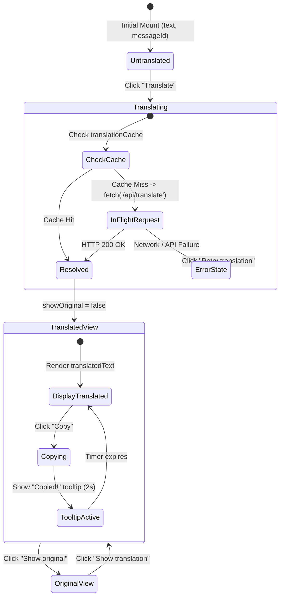

# `TranslatedMessage`: Real-Time Chat Translation, Language Detection & Tooltip States

This documentation details the architecture, component properties, translation state machine, clipboard copying behavior, fallback handling, and UI states of the **`TranslatedMessage`** React component ([`src/components/chat/TranslatedMessage.tsx`](file:///c:/Users/admin/Desktop/workfere/src/components/chat/TranslatedMessage.tsx)) and its underlying hook ([`src/hooks/useMessageTranslation.ts`](file:///c:/Users/admin/Desktop/workfere/src/hooks/useMessageTranslation.ts)).

---

## 1. Executive Summary & Design Overview

WorkSphere brings together remote workers, global digital nomads, and venue staff across multinational coworking hubs and cafés. The chat experience frequently involves messages typed in different languages (e.g., Spanish, Japanese, German, French, English).

`TranslatedMessage` provides seamless inline translation within active chat streams:
- **On-Demand & Zero-Flicker Translation:** Chat messages render their original text by default. Users can translate messages on demand with a single click.
- **Bi-Directional View Toggle:** Once translated, users can instantly toggle between the translated text and the original text without repeating network requests.
- **Language Detection Badges:** Displays detected source language metadata (e.g. `Translated from Spanish`).
- **One-Click Clipboard Copying with Tooltip Feedback:** Users can copy the active text (translated or original) with transient visual confirmation (`Copied!` tooltip and `Check` icon).
- **In-Memory Caching & Request Deduplication:** Integrates [`useMessageTranslation`](file:///c:/Users/admin/Desktop/workfere/src/hooks/useMessageTranslation.ts), caching translation responses in memory and deduplicating concurrent in-flight requests for identical strings and language targets.



---

## 2. Component Interface (`TranslatedMessageProps`)

The component exports a focused, type-safe interface:

```typescript
interface TranslatedMessageProps {
  /** Unique identifier of the chat message (used for cache key tracking and re-render isolation). */
  messageId: string;
  /** Raw text content of the message originally authored by the user. */
  text: string;
}
```

### Prop Definitions

| Prop Name | Type | Required | Description |
| :--- | :--- | :---: | :--- |
| `messageId` | `string` | **Yes** | The unique UUID or entity ID of the chat message. Changes in `messageId` trigger state resets in [`useMessageTranslation`](file:///c:/Users/admin/Desktop/workfere/src/hooks/useMessageTranslation.ts). |
| `text` | `string` | **Yes** | The message string to display and optionally translate into the active user's locale. |

---

## 3. UI States & Component Lifecycle

`TranslatedMessage` transitions across four primary visual and interactive states:

### 3.1 Initial Untranslated State
- Displays the raw message body with CSS formatting (`whitespace-pre-wrap`).
- Below the message, renders a compact translation trigger button:
  - Icon: `Languages` (`lucide-react`)
  - Label: `Translate`
  - Accessible name: `aria-label="Translate message"`
  - Disabled when `isLoading === true` or when `text` is blank/whitespace.

### 3.2 Loading State (`Translating…`)
- Initiated when the user clicks the `Translate` button.
- The trigger button transitions into an active loading state:
  - Icon: Animated spinner `Loader2` with `animate-spin`.
  - Label: `Translating…`
  - Style: `cursor-wait opacity-60` to prevent rapid duplicate clicks.

### 3.3 Translated State (Active Translation)
When translation succeeds, the component displays an informative header row above the message:
1. **Source Language Detection Badge:** Text string: `Translated from <sourceLanguage>` (e.g., `Translated from Spanish`).
2. **Toggle Button:** Underlined text button toggling view mode:
   - When viewing translation: Label is `Show original` (`aria-label="Show original message"`).
   - When viewing original: Label is `Show translation` (`aria-label="Show translated message"`).
3. **Copy Button & Floating Tooltip:**
   - Normal state: Displays `Copy` icon (`lucide-react`) with title `Copy`.
   - Copied state: Transitions to green `Check` icon (`text-emerald-500`) and displays a floating badge:
     ```tsx
     <span
       role="status"
       className="absolute -top-6 left-1/2 -translate-x-1/2 rounded bg-zinc-800 px-1.5 py-0.5 text-[9px] font-medium text-white shadow-sm dark:bg-zinc-700"
     >
       Copied!
     </span>
     ```
   - Automatically reverts back to the copy icon after $2000\text{ms}$ ($2$ seconds).

### 3.4 Error State & Fallback
If the translation API fails or returns an error status:
- An accessible error alert is displayed directly below the text:
  ```tsx
  <p role="alert" className="mt-1 text-xs text-red-500">
    {error}
  </p>
  ```
- The action button switches to a retry state:
  - Label: `Retry translation`
  - Accessible name: `aria-label="Retry translation"`

---

## 4. Visual Mockups in Active Chat Stream

### 4.1 Mockup: Active Chat Conversation Stream

```
┌────────────────────────────────────────────────────────────────────────┐
│ # General Coworking Lounge — Kyoto Hub                                 │
├────────────────────────────────────────────────────────────────────────┤
│                                                                        │
│  [Avatar] Kenji Sato  10:42 AM                                         │
│  ┌──────────────────────────────────────────────────────────────────┐  │
│  │ こんにちは！2階の静かなポッドは今空いていますか？               │  │
│  │                                                                  │  │
│  │ [🌐 Translate]                                                   │  │
│  └──────────────────────────────────────────────────────────────────┘  │
│                                                                        │
│  [Avatar] Sofia Rossi  10:43 AM                                        │
│  ┌──────────────────────────────────────────────────────────────────┐  │
│  │ Translated from Japanese · Show original · [📋 Copy]             │  │
│  │                                                                  │  │
│  │ Hello! Are the quiet pods on the 2nd floor available right now?  │  │
│  └──────────────────────────────────────────────────────────────────┘  │
│                                                                        │
│  [Avatar] Elena Rostova (You)  10:44 AM                                │
│  ┌──────────────────────────────────────────────────────────────────┐  │
│  │                                        ┌─────────┐               │  │
│  │                                        │ Copied! │               │  │
│  │ Translated from Spanish · Show original · [✔ ]                   │  │
│  │                                                                  │  │
│  │ Yes, there are 3 free hot-desks near the terrace window!         │  │
│  └──────────────────────────────────────────────────────────────────┘  │
│                                                                        │
└────────────────────────────────────────────────────────────────────────┘
```

### 4.2 Mockup: Toggle and Tooltip Transition

```
State A: Active Translation Mode
┌──────────────────────────────────────────────────────────────────┐
│ Translated from Spanish  Show original  [📋]                     │
│ Good morning everyone! The Wi-Fi password is in the lobby.      │
└──────────────────────────────────────────────────────────────────┘

State B: Showing Original Text Mode
┌──────────────────────────────────────────────────────────────────┐
│ Translated from Spanish  Show translation  [📋]                  │
│ ¡Buenos días a todos! La contraseña del Wi-Fi está en el lobby. │
└──────────────────────────────────────────────────────────────────┘

State C: Copy Tooltip State (2-second temporary status)
┌──────────────────────────────────────────────────────────────────┐
│                          ┌─────────┐                             │
│                          │ Copied! │                             │
│ Translated from Spanish  Show original  [✔ ]                     │
│ Good morning everyone! The Wi-Fi password is in the lobby.      │
└──────────────────────────────────────────────────────────────────┘
```

---

## 5. Clipboard Copy & Browser Fallback Strategy

The copy handler in [`TranslatedMessage.tsx`](file:///c:/Users/admin/Desktop/workfere/src/components/chat/TranslatedMessage.tsx#L26-L45) copies whichever text representation is currently visible (`currentText`):

```typescript
const currentText = translation && !showOriginal ? translation.translatedText : text;
```

### Modern API vs. Fallback Implementation

1. **Modern Clipboard API (`navigator.clipboard.writeText`):**
   Used when running in modern browsers with standard HTTPS security contexts.
2. **Hidden Textarea Fallback (`document.execCommand('copy')`):**
   Used when running in non-secure HTTP developer environments, legacy web views, or restricted iframe contexts where `navigator.clipboard` is unavailable:
   ```typescript
   const textarea = document.createElement("textarea");
   textarea.value = currentText;
   textarea.style.position = "fixed";
   textarea.style.opacity = "0";
   document.body.appendChild(textarea);
   textarea.select();
   document.execCommand("copy");
   document.body.removeChild(textarea);
   ```

---

## 6. Developer Integration Guide

### 6.1 Basic Chat Stream Integration

```tsx
import React from "react";
import { TranslatedMessage } from "@/components/chat/TranslatedMessage";

interface ChatMessage {
  id: string;
  senderName: string;
  avatarUrl: string;
  text: string;
  timestamp: string;
}

export function ChatMessageItem({ message }: { message: ChatMessage }) {
  return (
    <div className="flex items-start gap-3 p-3 rounded-xl hover:bg-zinc-50 dark:hover:bg-zinc-800/50">
      
      <div className="flex-1 min-w-0">
        <div className="flex items-center gap-2 mb-1">
          <span className="font-semibold text-xs text-zinc-900 dark:text-zinc-100">
            {message.senderName}
          </span>
          <span className="text-[10px] text-zinc-400">
            {message.timestamp}
          </span>
        </div>

        {/* Mount TranslatedMessage */}
        <div className="text-sm text-zinc-800 dark:text-zinc-200">
          <TranslatedMessage
            messageId={message.id}
            text={message.text}
          />
        </div>
      </div>
    </div>
  );
}
```

### 6.2 Unit Testing Best Practices

When unit testing components that mount `TranslatedMessage`, mock `react-i18next` and the global `fetch` or `@/hooks/useMessageTranslation`:

```typescript
import { render, screen, fireEvent } from "@testing-library/react";
import { TranslatedMessage } from "@/components/chat/TranslatedMessage";

test("renders and translates message", async () => {
  global.fetch = jest.fn().mockResolvedValue({
    ok: true,
    json: async () => ({
      translatedText: "Hello world",
      sourceLanguage: "Spanish",
    }),
  });

  render(<TranslatedMessage messageId="msg-101" text="Hola mundo" />);

  // Trigger translation
  fireEvent.click(screen.getByRole("button", { name: "Translate message" }));

  // Assert translation and badge render
  expect(await screen.findByText("Hello world")).toBeInTheDocument();
  expect(screen.getByText("Translated from Spanish")).toBeInTheDocument();
});
```

---

## 7. Accessibility (a11y) Standards

- **Interactive Buttons:** All icon and text buttons define precise `aria-label` attributes (`"Translate message"`, `"Show original message"`, `"Show translated message"`, `"Copy translated text"`).
- **Status Announcements:** The `Copied!` tooltip element carries `role="status"` to announce the copy action to screen readers.
- **Alert Roles:** Translation error messages are marked with `role="alert"` so errors are conveyed immediately to assistive devices.
- **Keyboard Navigation:** All interactive elements are native `<button type="button">` nodes with visible focus rings and standard Enter/Space keyboard trigger support.
