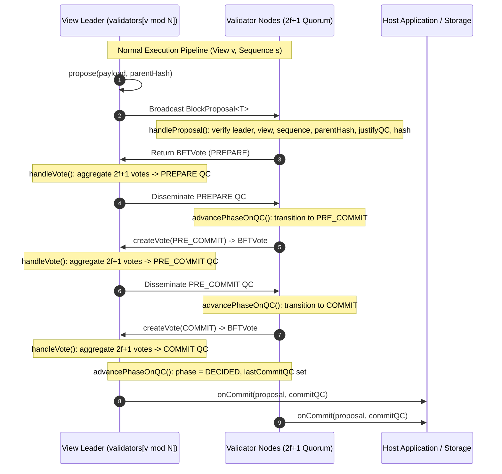
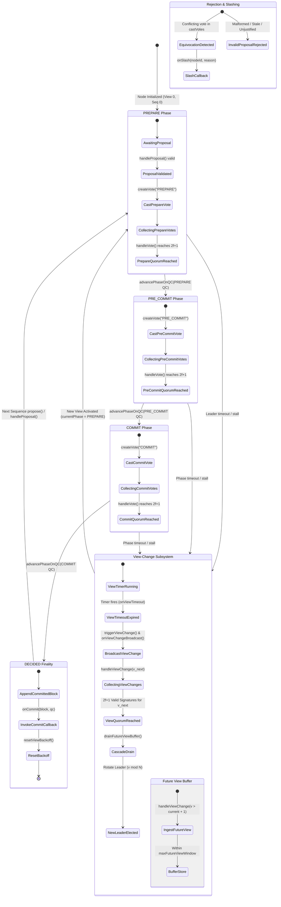

# BFT Consensus Coordinator: Architecture & View-Change Quorum Protocol Specification

This specification documents the Byzantine Fault Tolerant (BFT) Consensus Coordinator implementation within WorkSphere. It provides a formal, technically accurate architectural specification of the protocol lifecycle, quorum mathematics, message formats, proposal validation invariants, view-change mechanics, pacemaker timeout strategies, and security boundaries.

- **Primary Source:** [`src/core/consensus/BFTConsensusCoordinator.ts`](../../src/core/consensus/BFTConsensusCoordinator.ts)
- **Export Entry Point:** [`src/core/consensus/index.ts`](../../src/core/consensus/index.ts)
- **Unit & Regression Tests:**
  - [`src/__tests__/consensus/BFTConsensusCoordinator.test.ts`](../../src/__tests__/consensus/BFTConsensusCoordinator.test.ts)
  - [`src/__tests__/consensus/BFTViewChangeTimeout.test.ts`](../../src/__tests__/consensus/BFTViewChangeTimeout.test.ts)
  - [`src/__tests__/consensus/BFTFutureViewChangeReproduction.test.ts`](../../src/__tests__/consensus/BFTFutureViewChangeReproduction.test.ts)
- **Threat Model:** [`docs/consensus/BFT_COORDINATOR_THREAT_MODEL.md`](BFT_COORDINATOR_THREAT_MODEL.md)

---

## Table of Contents

1. [Overview and Design Goals](#1-overview-and-design-goals)
2. [Consensus Lifecycle and Phases](#2-consensus-lifecycle-and-phases)
3. [Quorum Mathematics and Fault Tolerance Model](#3-quorum-mathematics-and-fault-tolerance-model)
4. [Proposal Sequence and Chain Validation](#4-proposal-sequence-and-chain-validation)
5. [View-Change Triggers and Pacemaker Timeout Strategy](#5-view-change-triggers-and-pacemaker-timeout-strategy)
6. [View-Change Justification and Quorum Certificates](#6-view-change-justification-and-quorum-certificates)
7. [State Transition Diagram](#7-state-transition-diagram)
8. [Quorum Certificate Validation Invariants](#8-quorum-certificate-validation-invariants)
9. [Network Partition and Recovery Procedures](#9-network-partition-and-recovery-procedures)
10. [Security Considerations, Cryptographic Boundaries, and Known Limitations](#10-security-considerations-cryptographic-boundaries-and-known-limitations)
11. [Troubleshooting and Operational Verification](#11-troubleshooting-and-operational-verification)

---

## 1. Overview and Design Goals

### 1.1 Purpose of the BFT Consensus Coordinator

The `BFTConsensusCoordinator<T>` class is a Byzantine Fault Tolerant consensus state machine modeled after HotStuff and PBFT. Its primary role is to coordinate state-machine replication (SMR) across a known set of distributed validators, guaranteeing deterministic ordering and finality for arbitrary payload transitions `T` in the presence of malicious (Byzantine) or crashing nodes.

### 1.2 Core Responsibilities

1. **Deterministic Leader Selection:** Implements a deterministic round-robin leader mapping across views: $\text{leader} = \text{validators}[\text{view} \pmod N]$.
2. **3-Phase Quorum Certification:** Drives block proposals through `PREPARE`, `PRE_COMMIT`, and `COMMIT` phases, forming authenticated `QuorumCertificate` (QC) objects at each stage upon aggregating $2f + 1$ validator votes.
3. **Chain Continuity and Sequence Monotonicity:** Enforces strict monotonic sequence incrementing ($s_{i+1} = s_i + 1$), cryptographically verifies parent hash pointers, and requires valid justification QCs extending committed history.
4. **Pacemaker and Deterministic View-Change:** Manages local view timers with exponential backoff, cascades eligible out-of-order future views via a bounded buffer, and transitions views upon collecting certified $2f + 1$ view-change quorums.
5. **Equivocation Detection and Slashing:** Identifies double-signing by validators (conflicting block hashes within the same view, sequence, and phase) and triggers registered alert callbacks.

### 1.3 Architecture Paradigm: Pure In-Memory State Machine

The coordinator operates as an in-memory, deterministic state machine:

- **No Direct Network I/O:** The class does not open network sockets or manage WebRTC/WebSocket transports. Transport adapters must deliver incoming network envelopes into the coordinator methods (`handleProposal`, `handleVote`, `handleViewChange`) and broadcast emitted objects (`BlockProposal`, `BFTVote`, `ViewChangeMessage`).
- **No Persistent Storage Layer:** Chain history (`committedBlocks`, `lastCommitQC`) and message pools reside in memory. The host application must persist finalized blocks and QCs to stable disk storage.
- **Active Pacemaker Timers:** Unlike passive state models, the coordinator provides an integrated view pacemaker (`startViewTimer`, `stopViewTimer`, `dispose`) utilizing Node.js timer handles to monitor round progress and broadcast signed view changes upon timeout.

### 1.4 Scope and Protocol Guarantees

| Guarantee                           | Current Implementation Status | Notes                                                                                                          |
| :---------------------------------- | :---------------------------- | :------------------------------------------------------------------------------------------------------------- |
| **Safety (No Conflicting Commits)** | **Enforced**                  | Two conflicting blocks cannot obtain $2f+1$ COMMIT QCs under $f \le \lfloor(N-1)/3\rfloor$ Byzantine nodes.    |
| **Monotonic Sequence Growth**       | **Enforced**                  | `handleProposal` strictly enforces `proposal.sequence === currentSequence + 1`.                                |
| **Parent Commitment Linkage**       | **Enforced**                  | `proposal.parentHash` must match `lastCommitQC.blockHash` (or genesis zero-hash).                              |
| **Justification QC Verification**   | **Enforced**                  | Proposals extending a committed chain must carry a verified `justifyQC` with valid signatures.                 |
| **Cryptographic Authentication**    | **Enforced**                  | Asymmetric Ed25519 signatures verified against registered validator public keys with domain separation.        |
| **View-Change Livelock Prevention** | **Enforced**                  | Bounded future-view buffer cascades sequential transitions when out-of-order messages arrive.                  |
| **Prepared-Value Recovery**         | **Design Limitation**         | HotStuff/PBFT-style carrying forward of the highest prepared block across view changes is **not** implemented. |
| **Disk Persistence / State Sync**   | **External Requirement**      | Host application must handle crash recovery and log synchronization.                                           |

---

## 2. Consensus Lifecycle and Phases

Consensus proceeds in numbered views ($v = 0, 1, 2, \dots$). Within each view, the designated leader proposes blocks, and validators drive them through a 3-phase commit pipeline:



### 2.1 Pre-Prepare (Proposal Broadcast & Ingestion)

1. **Leader Proposing:**
   - The designated leader calls `coordinator.propose(payload, parentHash)`.
   - The coordinator validates that `this.nodeId === this.getCurrentLeader()`, throwing an error if a non-leader attempts to propose.
   - Computes `nextSeq = this.currentSequence + 1`.
   - Assembles the proposal and generates the canonical deterministic SHA-256 block hash.
   - Attaches `justifyQC = this.lastCommitQC ?? undefined`.
   - If operating in a rotated view ($v > 0$) where view-change evidence exists, attaches `viewChangeEvidence` ($2f + 1$ verified `ViewChangeMessage`s).
   - Sets internal `currentProposal = proposal`, `currentSequence = nextSeq`, and `currentPhase = "PREPARE"`.

2. **Validator Proposal Ingestion (`handleProposal`):**
   When receiving a `BlockProposal<T>`, validators execute seven strict checks:
   - **Malformed Envelope Check:** Rejects non-object or null proposals.
   - **Leader Authority:** Rejects proposals where `proposal.proposerId !== getLeaderForView(proposal.view)`.
   - **Stale View Rejection:** Rejects proposals where `proposal.view < this.currentView`.
   - **Future View Authorization:** If `proposal.view > this.currentView`:
     - Rejects if `proposal.view > this.currentView + this.maxFutureViewWindow`.
     - Rejects unless certified by local quorum (`viewChangePool.get(proposal.view).size >= quorumSize`) or verified attached evidence (`verifyViewChangeEvidence(proposal.view, proposal.viewChangeEvidence)`).
   - **Sequence Monotonicity:** Rejects proposals if `typeof proposal.sequence !== "number"`, if `proposal.sequence <= this.currentSequence` (stale/replayed), or if `proposal.sequence !== this.currentSequence + 1` (out-of-order gap).
   - **Parent Hash Linkage:** Rejects proposals where `proposal.parentHash !== expectedParentHash`. `expectedParentHash` is derived from `lastCommitQC.blockHash` or the last committed block in memory (falling back to a 64-character zero hex string for sequence 1).
   - **Justification Certificate:** If `this.lastCommitQC` exists, `proposal.justifyQC` is mandatory and its `blockHash` must match `this.lastCommitQC.blockHash`. Additionally, `verifyQuorumCertificate(proposal.justifyQC)` must pass, `justifyQC.view <= proposal.view`, and `justifyQC.sequence < proposal.sequence`.
   - **Payload Hash Integrity:** Recomputes the canonical SHA-256 hash using `BFTConsensusCoordinator.hashPayload(...)` and verifies strict equality with `proposal.blockHash`.

3. **State Adoption and PREPARE Vote:**
   - If the proposal targets a valid certified future view, updates `this.currentView = proposal.view`, resets the view timer backoff, and cleans up stale view pools.
   - Sets `this.currentProposal = proposal`, `this.currentSequence = proposal.sequence`, and `this.currentPhase = "PREPARE"`.
   - Calls `this.createVote("PREPARE", proposal.blockHash)` and returns the signed `BFTVote`.

### 2.2 Prepare Phase

1. **Voting:**
   - Validators return their signed `PREPARE` votes to the leader (or gossip network).
   - Payload format: `BFT_VOTE_V1:${nodeId}:PREPARE:${view}:${sequence}:${blockHash}`.
2. **Ingestion & Equivocation Checking (`handleVote` / `handleVoteAsync`):**
   - Validates validator membership: `this.validators.includes(vote.nodeId)`.
   - Checks against prior cast votes for `${view}:${sequence}:${phase}:${nodeId}`. If a prior vote exists for a different `blockHash`, `slashValidator(...)` is invoked and the vote is rejected.
   - Cryptographically verifies the 64-byte Ed25519 signature.
   - Inserts the vote into `votePool` keyed by `${phase}:${view}:${sequence}:${blockHash}`.
3. **Prepare Quorum Certificate (QC):**
   - When the pool size reaches `this.quorumSize` ($2f + 1$ distinct authorized validators), an aggregated `QuorumCertificate` is formed.
   - Calls `advancePhaseOnQC(qc)`, which validates the QC signatures and advances `this.currentPhase = "PRE_COMMIT"`.

### 2.3 Commit Phase

1. **Pre-Commit Voting & QC:**
   - Validators observing the `PREPARE` QC sign and emit `PRE_COMMIT` votes via `createVote("PRE_COMMIT", blockHash)`.
   - The coordinator aggregates votes into the `PRE_COMMIT` pool.
   - Upon reaching $2f + 1$ votes, forms a `PRE_COMMIT` QC and advances `this.currentPhase = "COMMIT"`.
2. **Commit Voting & QC:**
   - Validators sign and emit `COMMIT` votes via `createVote("COMMIT", blockHash)`.
   - The coordinator aggregates votes into the `COMMIT` pool.
   - Upon reaching $2f + 1$ votes, forms a `COMMIT` QC.
3. **Finalization (`DECIDED`):**
   - `advancePhaseOnQC(qc)` detects `qc.phase === "COMMIT"`.
   - Transitions `this.currentPhase = "DECIDED"`.
   - Assigns `this.lastCommitQC = qc`.
   - Resets the pacemaker backoff (`resetViewBackoff()`).
   - If `this.currentProposal.blockHash === qc.blockHash`, appends the proposal to `this.committedBlocks` and invokes `this.onCommitCallback(this.currentProposal, qc)`.

### 2.4 View-Change Phase

When the current leader is unresponsive or faulty, validators initiate a view change:

1. **Trigger:** Local view timer expires or external pacemaker calls `triggerViewChange(reason, targetView?)`.
2. **Message Construction:** Builds a signed `ViewChangeMessage` targeting $v_{\text{target}} = \text{max}(v_{\text{current}}, v_{\text{requested}}) + 1$.
3. **Aggregation & Quorum:** Ingests peer view-change messages via `handleViewChange(msg)`. Upon collecting $2f + 1$ valid signatures for $v_{\text{target}}$, advances `currentView = targetView`, resets phase to `PREPARE`, and rotates the leader.
4. **Cascading Drain:** Processes buffered future-view messages that have now become sequentially eligible.

---

## 3. Quorum Mathematics and Fault Tolerance Model

### 3.1 Byzantine Quorum Thresholds

WorkSphere's BFT consensus operates under the classic partially synchronous Byzantine model with $N$ total validators:

$$\lfloor\frac{N - 1}{3}\rfloor = f \quad \text{(Maximum tolerated Byzantine faulty nodes)}$$

$$Q = 2f + 1 \quad \text{(Supermajority Quorum Size)}$$

In the coordinator constructor:

```ts
this.f = Math.floor((n - 1) / 3);
this.quorumSize =
  2 * this.f + 1 > 0 ? 2 * this.f + 1 : Math.floor((n * 2) / 3) + 1;
```

### 3.2 Validator Count Examples

| Total Validators ($N$) | Max Faulty Nodes ($f$) | Honest Nodes ($N - f$) | Quorum Size ($2f + 1$) |      Quorum Intersection ($\ge f + 1$)      |
| :--------------------: | :--------------------: | :--------------------: | :--------------------: | :-----------------------------------------: |
|       **1 to 3**       |          $0$           |   $1 \text{ to } 3$    |          $1$*          | $1$ (Trivial test setup; no BFT resilience) |
|         **4**          |         **1**          |         **3**          |         **3**          |             **2** ($\ge 1 + 1$)             |
|         **5**          |           1            |           4            |           3            |     1* (Suboptimal; see analysis below)     |
|         **6**          |           1            |           5            |           3            |     0* (Suboptimal; see analysis below)     |
|         **7**          |         **2**          |         **5**          |         **5**          |             **3** ($\ge 2 + 1$)             |
|         **10**         |         **3**          |         **7**          |         **7**          |             **4** ($\ge 3 + 1$)             |
|         **13**         |         **4**          |         **9**          |         **9**          |             **5** ($\ge 4 + 1$)             |
|         **16**         |         **5**          |         **11**         |         **11**         |             **6** ($\ge 5 + 1$)             |

> [!WARNING]
> **Suboptimal Cluster Sizes:** Always deploy clusters where $N = 3f + 1$ (e.g., 4, 7, 10, 13). For $N = 5$ or $N = 6$, $f = 1$ and the code calculates `quorumSize = 3`. However, two quorums of size 3 from 5 nodes intersect in only $3 + 3 - 5 = 1$ node. If that 1 intersecting node is Byzantine, quorum intersection guarantees are violated. Production clusters must strictly adhere to $N = 3f + 1$.

### 3.3 Quorum Intersection Proof

For any cluster of size $N = 3f + 1$, consider any two arbitrary quorums $Q_1$ and $Q_2$ of size $2f + 1$:

$$|Q_1 \cap Q_2| = |Q_1| + |Q_2| - |Q_1 \cup Q_2|$$

Since $|Q_1 \cup Q_2| \le N = 3f + 1$:

$$|Q_1 \cap Q_2| \ge (2f + 1) + (2f + 1) - (3f + 1) = 4f + 2 - 3f - 1 = f + 1$$

Because at most $f$ validators in the entire cluster are Byzantine:

$$\text{Honest nodes in } (Q_1 \cap Q_2) \ge (f + 1) - f = 1$$

**Safety Consequence:** Any two quorums share at least one honest validator. An honest validator never equivocates (never votes for two distinct proposals for the same view, sequence, and phase). Therefore, two conflicting proposals can never both achieve a valid Quorum Certificate.

---

## 4. Proposal Sequence and Chain Validation

To guarantee strict chain continuity and prevent replay attacks, `handleProposal()` implements rigorous sequence validation rules.

### 4.1 Sequence Validation Rules

1. **Numeric Integrity:** `typeof proposal.sequence === "number" && !isNaN(proposal.sequence)`.
2. **Replay & Stale Protection:** `proposal.sequence > this.currentSequence`. A proposal with a sequence less than or equal to `this.currentSequence` is immediately rejected.
3. **Gap Prevention (Strict Increments):** `proposal.sequence === this.currentSequence + 1`. Out-of-order blocks or skipped sequence numbers are rejected.
4. **State Machine Invariant:** If any sequence check fails, the internal coordinator state (`currentSequence`, `currentProposal`, `currentPhase`, `currentView`) remains completely unchanged.

### 4.2 Parent Hash Verification

Proposals must form an unbroken cryptographic hash chain:

- **Genesis / First Proposal ($s = 1$):** `parentHash` defaults to `0000000000000000000000000000000000000000000000000000000000000000` (64 zero hex characters).
- **Subsequent Proposals ($s > 1$):** `proposal.parentHash` must equal `this.lastCommitQC.blockHash` (or the `blockHash` of the latest entry in `this.committedBlocks`).

### 4.3 Justification Quorum Certificate Verification

When extending a committed chain, `proposal.justifyQC` provides proof that the preceding sequence was finalized:

1. **Mandatory Presence:** If `this.lastCommitQC !== null`, proposals without `justifyQC` are rejected.
2. **Predecessor Binding:** `proposal.justifyQC.blockHash === this.lastCommitQC.blockHash`.
3. **Cryptographic Validity:** `this.verifyQuorumCertificate(proposal.justifyQC)` must return `true`.
4. **View & Sequence Bounds:**
   - `proposal.justifyQC.view <= proposal.view` (justification cannot originate from a future view).
   - `proposal.justifyQC.sequence < proposal.sequence` (justification must precede the proposed sequence).

---

## 5. View-Change Triggers and Pacemaker Timeout Strategy

The coordinator incorporates an active pacemaker to ensure liveness during leader failure or network stalling.

### 5.1 Timeout Configuration Parameters

Configured via `BFTCoordinatorConfig`:

- `viewChangeTimeoutMs` (default: `5000` ms, minimum: `1` ms): Base duration before a view times out.
- `maxViewChangeTimeoutMs` (default: `30000` ms, floor: `viewChangeTimeoutMs`): Upper ceiling for exponential backoff.
- `maxFutureViewWindow` (default: `10`, minimum: `1`): Maximum future view distance accepted into pools and buffers.
- `maxBufferedMessagesPerView` (default: `validators.length`): Capacity limit per view in the future-view buffer.
- `onViewChangeBroadcast`: Callback invoked with a signed `ViewChangeMessage` when the view timer expires.

### 5.2 Exponential Backoff Algorithm

The pacemaker employs exponential backoff to handle persistent network degradation or sequential faulty leaders:

1. **Timer Expiration (`onViewTimeout`):**
   - Increments `consecutiveFailedViews`.
   - Multiplies timeout duration by 2, capped at `maxViewChangeTimeoutMs`:
     $$\text{currentViewTimeoutMs}_{k+1} = \min\left(\text{maxViewChangeTimeoutMs}, \; \text{currentViewTimeoutMs}_k \times 2\right)$$
   - Calculates target view: $v_{\text{target}} = \max(v_{\text{current}}, \; v_{\text{highestRequested}}) + 1$.
   - Constructs and signs a `ViewChangeMessage` for $v_{\text{target}}$.
   - Feeds the message to local `handleViewChange()` and triggers `onViewChangeBroadcast(msg)`.
   - Reschedules the timer with the backed-off duration.

2. **Recovery and Backoff Reset (`resetViewBackoff`):**
   - Triggered when a proposal successfully advances the view (`handleProposal`) or when a block is finalized (`advancePhaseOnQC` for `COMMIT` QC).
   - Resets `consecutiveFailedViews = 0`.
   - Restores `currentViewTimeoutMs = viewChangeTimeoutMs`.
   - Reschedules the view timer with the initial base timeout if active.

### 5.3 Race Prevention and Generation Tokens

To eliminate race conditions between Node.js event loop callbacks and synchronous timer cancellations (`stopViewTimer`, `dispose`):

- A monotonically increasing `viewTimerGeneration` token is incremented on every timer start and stop.
- When `onViewTimeout(generation)` fires, it checks `if (generation !== this.viewTimerGeneration) return;`.
- Queued callbacks from superseded timers become inert, preventing ghost view changes and timer resurrection after disposal.

---

## 6. View-Change Justification and Quorum Certificates

### 6.1 View-Change Message Structure

```ts
export interface ViewChangeMessage {
  fromNodeId: string;
  newView: number;
  lastCommitQC?: QuorumCertificate;
  signature: string;
  timestamp: number;
}
```

- **Domain Separation:** Signatures are computed over the canonical ASCII string:
  $$\text{Payload} = \text{"BFT\_VIEW\_CHANGE\_V1:"} + \text{fromNodeId} + \text{":"} + \text{newView} + \text{":"} + \text{lastCommitQCPart}$$
  where $\text{lastCommitQCPart} = \text{view:sequence:blockHash}$ (or $\text{"none"}$ if omitted).
- **Authentication:** `verifyViewChangeSignature(msg)` verifies the 64-byte Ed25519 signature against the sender's registered public key. Unsigned or corrupted messages are dropped.

### 6.2 Bounded Future-View Buffer and Cascading Drain

When network latency or view skips cause messages for views beyond $v_{\text{current}} + 1$ to arrive prematurely:

1. **Filtering:** Messages targeting $v > v_{\text{current}} + 1$ are redirected to `futureViewChangeBuffer` if within $v_{\text{current}} + \text{maxFutureViewWindow}$.
2. **Per-View Capacity:** Capped at `maxBufferedMessagesPerView` distinct validators.
3. **Iterative Drain (`drainFutureViewBuffer`):** When view $v$ reaches quorum and transitions to $v + 1$, the coordinator inspects `futureViewChangeBuffer` for $v + 2$. If buffered messages for $v + 2$ satisfy quorum, the coordinator cascades to $v + 2$ in a loop protected against re-entrant calls (`isDrainingFutureViewBuffer`).

### 6.3 Proposal View-Change Evidence Verification

When a new leader proposes a block in a rotated view ($v_{\text{prop}} > v_{\text{local}}$):

- The proposal must include `viewChangeEvidence` formatted as either an array of `ViewChangeMessage[]` or a `ViewChangeCertificate` (object containing `{ view, signatures }`).
- `verifyViewChangeEvidence(targetView, evidence)` iterates through the evidence, verifies that signers belong to `validators`, checks cryptographic signatures, and requires at least `quorumSize` ($2f + 1$) distinct valid signers.

### 6.4 Implementation Behavior vs. Standard BFT Protocol Design

> [!IMPORTANT]
> **Distinction Between Implemented Behavior and Theoretical PBFT/HotStuff:**
>
> 1. **Current Code Behavior:**
>    - `lastCommitQC` in `ViewChangeMessage` is informational; the coordinator verifies the signature over the field, but does not parse or compare `lastCommitQC` across messages.
>    - When transitioning to a new view, the leader proposes fresh state or caller-supplied payloads.
> 2. **Standard Protocol Design (PBFT / HotStuff Highest-Prepared Rule):**
>    - In full PBFT or HotStuff, `VIEW-CHANGE` messages carry the highest `PREPARE` certificate ($h_{pc}$) seen by each validator.
>    - The new leader is required to aggregate these certificates into a `NEW-VIEW` message and re-propose the value from the highest prepared certificate (or a `null` block if no value was prepared).
>    - **Design Gap in Implementation:** WorkSphere's `BFTConsensusCoordinator` does **not** track or carry forward uncommitted prepared values across view changes. If a leader crashes during the commit phase after preparing a block, that prepared block is dropped upon view change unless externally managed.

---

## 7. State Transition Diagram

The following Mermaid state diagram details the coordinator's state transitions, covering normal execution, timeout expirations, quorum aggregation, and out-of-order view-change cascading:



---

## 8. Quorum Certificate Validation Invariants

Every Quorum Certificate must satisfy specific protocol invariants before it is accepted by `verifyQuorumCertificate(qc)` or `advancePhaseOnQC(qc)`:

| Invariant                                     | Description                                                                                               |     Implementation Status     | Enforcement Mechanism                                                                                                                        |
| :-------------------------------------------- | :-------------------------------------------------------------------------------------------------------- | :---------------------------: | :------------------------------------------------------------------------------------------------------------------------------------------- |
| **INV-1: Homogeneous Tuple**                  | All constituent signatures in a QC refer to the exact same `(phase, view, sequence, blockHash)`.          |         **Enforced**          | Votes are segregated into pools keyed by `${phase}:${view}:${sequence}:${blockHash}`. Cross-tuple aggregation is impossible.                 |
| **INV-2: Signer Uniqueness**                  | The certificate must contain signatures from distinct validator node IDs; no duplicate counting.          |         **Enforced**          | Signatures are held in `Record<string, string>`. `verifyQuorumCertificate` tracks processed nodes using a `Set<string>`.                     |
| **INV-3: Validator Authorization**            | Every signer must be an authorized member of the static `validators` roster.                              |         **Enforced**          | Signers not present in `this.validators` are rejected during signature verification.                                                         |
| **INV-4: Cryptographic Authenticity**         | Every signature must be a valid 64-byte Ed25519 signature matching the signer's public key.               |         **Enforced**          | Verified against domain-separated payload using Node.js `crypto.verify` or injected `verifier`.                                              |
| **INV-5: Supermajority Quorum**               | Number of unique, authenticated validator signatures must be $\ge 2f + 1$.                                |         **Enforced**          | Strict inequality: `seenSigners.size >= this.quorumSize`.                                                                                    |
| **INV-6: Proposal-Commit Binding**            | A COMMIT QC cannot finalize a block unless its `blockHash` matches `this.currentProposal.blockHash`.      |         **Enforced**          | `advancePhaseOnQC` verifies block hash equality before appending to `committedBlocks` and calling `onCommit`.                                |
| **INV-7: Sequence Monotonicity**              | QC sequence numbers must advance strictly without gaps or regressions ($s_{i+1} = s_i + 1$).              |         **Enforced**          | Enforced during `handleProposal` via `proposal.sequence === this.currentSequence + 1` and `justifyQC.sequence < proposal.sequence`.          |
| **INV-8: Strict Phase Precedence**            | QC progression must strictly follow `PREPARE -> PRE_COMMIT -> COMMIT -> DECIDED`.                         |    **Partially Enforced**     | `advancePhaseOnQC` transitions state based on `qc.phase`, but does not strictly verify that the node was in the immediate predecessor phase. |
| **INV-9: Prepared-Value Safety Across Views** | A new leader must propose the prepared value from the highest view represented in the view-change quorum. | **Not Enforced (Design Gap)** | Not implemented. New view proposals do not inspect prepared certificates from preceding views.                                               |

---

## 9. Network Partition and Recovery Procedures

### 9.1 Network Partition Scenarios

Consider a 4-node cluster ($N = 4, f = 1, Q = 3$) split into two network partitions:

```
        Partition A (Majority)            Partition B (Minority)
       +-----------------------+         +-----------------------+
       | node-0 (Leader)       |         | node-2                |
       | node-1                |         | node-3                |
       | node-2 (Transient)    |         |                       |
       +-----------------------+         +-----------------------+
```

1. **Minority Partition ($< 2f + 1$):**
   - Nodes in a minority partition (e.g., `{node-2, node-3}` with size $2 < 3$) cannot form a quorum.
   - Proposals cannot collect $2f + 1$ PREPARE votes; view-change attempts cannot collect $2f + 1$ messages.
   - **Safety Preservation:** The minority partition halts state advancement, preserving safety over liveness.
2. **Majority Partition ($\ge 2f + 1$):**
   - The majority partition (`{node-0, node-1, node-2}`) holds 3 nodes ($2f + 1 = 3$).
   - Can successfully propose, vote, form QCs, commit blocks, or execute view changes without the minority nodes.

### 9.2 Liveness vs. Safety Trade-Off (CAP Theorem)

In alignment with FLP Impossibility and the CAP theorem, `BFTConsensusCoordinator` prioritizes **Safety over Liveness**:

- Under an asynchronous network partition where no partition contains $\ge 2f + 1$ responsive nodes, the coordinator completely halts commit progress.
- It will never produce conflicting commits, even if the partition persists indefinitely.

### 9.3 Partition Healing and State Resynchronization

When network connectivity is restored:

1. **Delayed and Stale Messages:**
   - Votes from stale views ($v < v_{\text{current}}$) or stale sequences ($s \le s_{\text{current}}$) are rejected and dropped.
   - Stale view-change messages ($v \le v_{\text{current}}$) are pruned by `cleanupStaleViewChangeEntries()`.
2. **View Catch-Up via Certified Future Proposals:**
   - If a partitioned node receives a proposal from a higher view $v_{\text{future}}$, `handleProposal` verifies the attached `viewChangeEvidence`.
   - Upon verifying $2f + 1$ valid signatures for $v_{\text{future}}$, the partitioned node updates `currentView = proposal.view`, resets its pacemaker backoff, and votes on the proposal.
3. **Sequence Log Synchronization (External Requirement):**
   - If a node was partitioned across multiple committed sequences ($s + k$), `handleProposal` will reject the next proposal because `proposal.sequence !== this.currentSequence + 1`.
   - **Operational Recovery Step:** The host application must detect sequence gaps, fetch missing `BlockProposal` and `QuorumCertificate` objects from peers, invoke `onCommit` sequentially, and set coordinator state before re-enabling validator voting.

---

## 10. Security Considerations, Cryptographic Boundaries, and Known Limitations

### 10.1 Byzantine Validator Model

The protocol maintains safety if and only if the number of Byzantine nodes $B$ satisfies:

$$B \le f = \lfloor\frac{N - 1}{3}\rfloor$$

Byzantine behaviors tolerated:

- Message omission, arbitrary drops, or silence.
- Out-of-order message delivery and network delays.
- Equivocation (double-signing conflicting blocks or views).
- Corrupted payloads, invalid parent hashes, or forged sequence numbers.

### 10.2 Cryptographic Boundaries and Replay Protection

1. **Ed25519 Signatures:** All votes and view changes require 64-byte Ed25519 signatures. Deterministic SHA-256 hashes are rejected.
2. **Domain Separation:**
   - Votes: `BFT_VOTE_V1:${nodeId}:${phase}:${view}:${sequence}:${blockHash}`.
   - View Changes: `BFT_VIEW_CHANGE_V1:${fromNodeId}:${newView}:${lastCommitQCPart}`.
     Domain separation ensures that a signature produced for a vote cannot be replayed as a view-change message.
3. **Key Isolation:** Private keys never enter `BFTConsensusCoordinator`. Signing is delegated to injected `BFTSigningInterface` closures.

### 10.3 Identified Limitations and Design Gaps

The following architectural limitations exist in the current implementation:

1. **QC Re-Emission on Super-Quorum Votes:**
   - In `handleVote()`, the condition `if (pool.size >= this.quorumSize)` evaluates to `true` for every vote received past quorum.
   - For a 4-node cluster, the 4th vote emits a second QC and calls `advancePhaseOnQC()` again.
   - For `COMMIT`, this appends the proposal to `committedBlocks` a second time and invokes `onCommit` twice.
   - **Mitigation:** Host applications must ensure `onCommit` callbacks are idempotent (keyed on `blockHash` and `sequence`).
2. **Top-Level Replacer Filtering in `hashPayload`:**
   - `BFTConsensusCoordinator.hashPayload(payload)` uses `JSON.stringify(payload, Object.keys(payload).sort())`.
   - In JavaScript, supplying an array replacer to `JSON.stringify` recursively filters properties in nested objects. Any nested property name not present in the top-level key set is stripped from serialization.
   - Two proposals with identical top-level properties but differing nested properties can produce the same `blockHash`.
   - **Mitigation:** Host applications should flatten block payloads or pre-hash application data.
3. **Missing PBFT Highest-Prepared Rule:**
   - As documented in Section 6.4, uncommitted prepared values are not tracked across view changes.
4. **Advisory Slashing Callback:**
   - Detecting double-signing invokes `onSlash(nodeId, reason)`. The coordinator does not automatically evict the validator or alter the quorum size. Validator removal must be orchestrated externally.
5. **Static Validator Sets:**
   - `validators` is immutable after construction. Dynamic reconfiguration (adding/removing validators) requires creating a new coordinator instance.

---

## 11. Troubleshooting and Operational Verification

### 11.1 Diagnostic Matrix

| Symptom                                        | Primary Root Cause                                                                      | Remediation & Diagnostic Action                                                                                           |
| :--------------------------------------------- | :-------------------------------------------------------------------------------------- | :------------------------------------------------------------------------------------------------------------------------ |
| `propose()` throws `not the designated leader` | Node is attempting to propose when `nodeId !== validators[currentView % N]`.            | Verify `getCurrentLeader()` and inspect `currentView`. Ensure views are synchronized across nodes.                        |
| `handleProposal()` returns `null`              | Failed sequence monotonicity, wrong leader, hash mismatch, or uncertified future view.  | Inspect `console.warn` logs. Check if `proposal.sequence !== currentSequence + 1` or if `viewChangeEvidence` is missing.  |
| Votes arrive but no QC forms                   | Votes carry conflicting block hashes, or fewer than $2f + 1$ distinct validators voted. | Verify that nodes received the exact same proposal and generated identical `blockHash` digests.                           |
| `handleVote()` returns `null` for honest node  | Sender `nodeId` is not in `config.validators` or signature verification failed.         | Ensure identical sorted validator lists across all nodes and verify public key registrations in `validatorPublicKeys`.    |
| View fails to advance after timeout            | Fewer than $2f + 1$ distinct nodes broadcasted `ViewChangeMessage` for the same view.   | Check network connectivity. Ensure pacemaker timers are active (`startViewTimer()`) and `onViewChangeBroadcast` is wired. |
| `onCommit` fires multiple times                | Super-quorum votes re-trigger QC aggregation past $2f + 1$.                             | Implement idempotency in `onCommit` callback handler.                                                                     |

### 11.2 Test Suite Execution

Validate coordinator behavior using the dedicated consensus test suites:

```bash
# Run core BFT consensus suite
npx jest src/__tests__/consensus/BFTConsensusCoordinator.test.ts

# Run view-change timeout and pacemaker suite
npx jest src/__tests__/consensus/BFTViewChangeTimeout.test.ts

# Run future-view out-of-order buffering and livelock prevention suite
npx jest src/__tests__/consensus/BFTFutureViewChangeReproduction.test.ts
```
