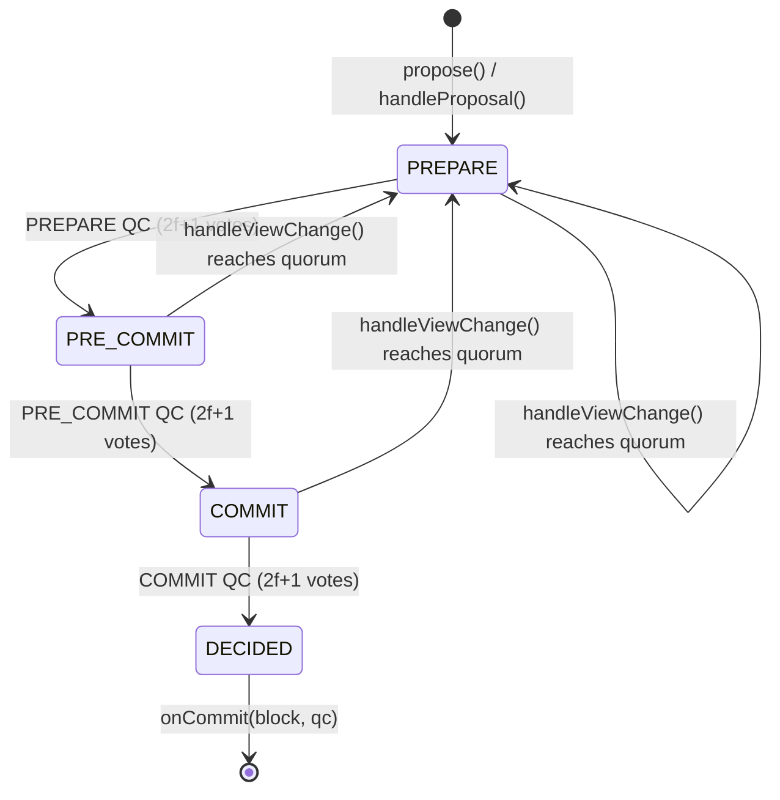
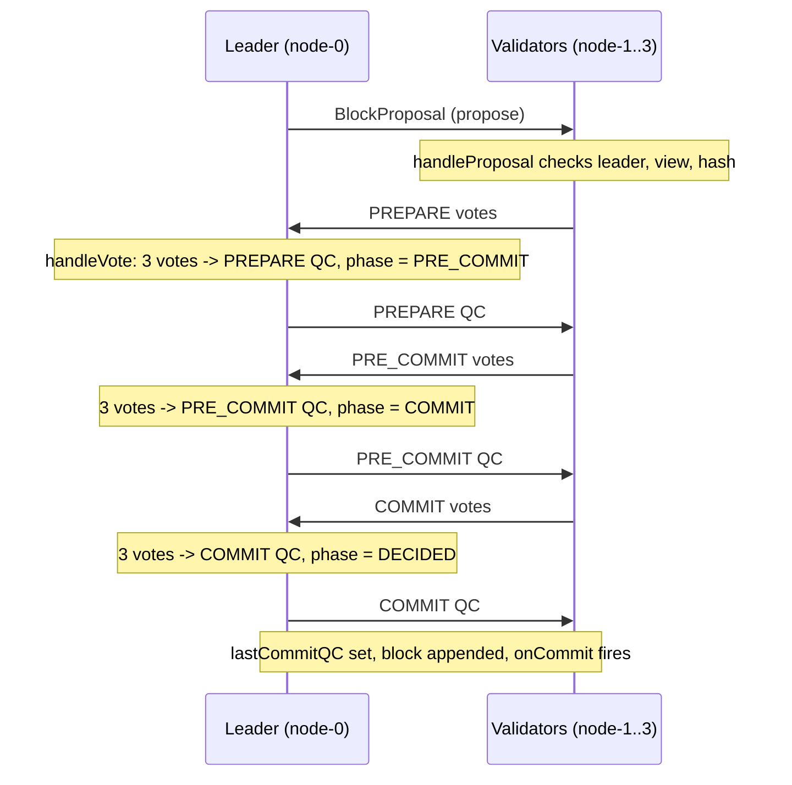
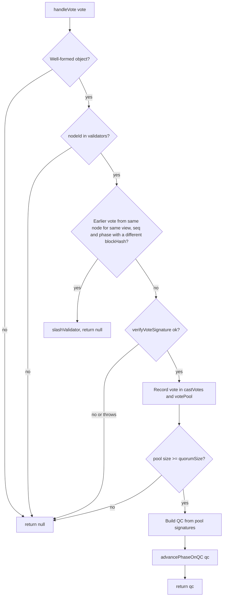
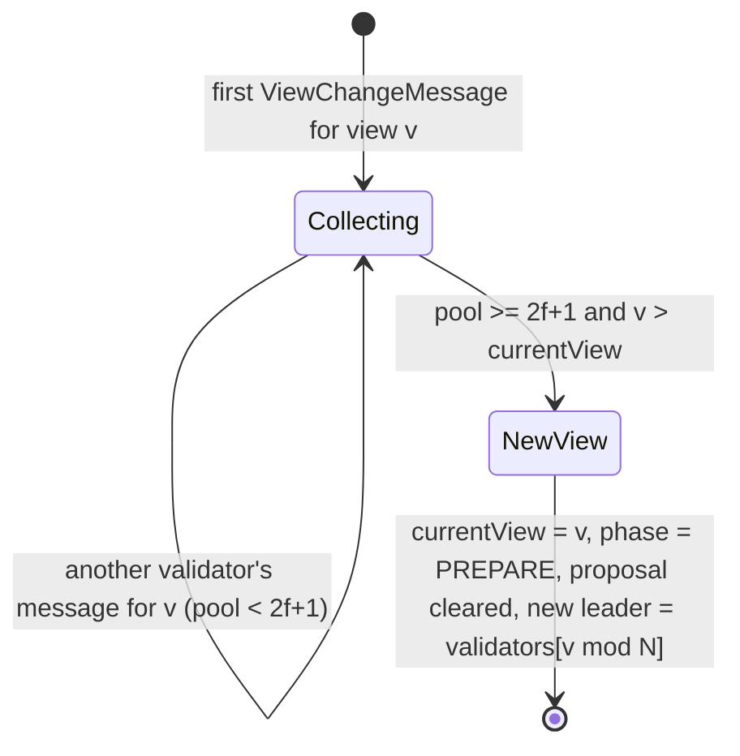

# BFTConsensusCoordinator: quorums, Quorum Certificates and view changes

This runbook explains how `BFTConsensusCoordinator` reaches agreement: how many validators it needs, how votes become Quorum Certificates (QCs), how a stuck leader is replaced, and what happens when a validator misbehaves.

- **Source:** [`src/core/consensus/BFTConsensusCoordinator.ts`](../../src/core/consensus/BFTConsensusCoordinator.ts)
- **Tests:** [`src/__tests__/consensus/BFTConsensusCoordinator.test.ts`](../../src/__tests__/consensus/BFTConsensusCoordinator.test.ts)
- **Export:** `src/core/consensus/index.ts` re-exports the class and its types.

Everything below describes the code as it is today. The class is a **pure, in-memory state machine**: it has no network layer, no timers and no storage. It tells you what to do next (a vote, a QC, a new leader) and your transport code is responsible for delivering messages and calling it on time. Where the code does less than a production BFT protocol would, the runbook says so. See [Current limitations](#9-current-limitations) for the full list.

## Contents

1. [Overview and terminology](#1-overview-and-terminology)
2. [Quorum requirements (2f + 1 of 3f + 1)](#2-quorum-requirements-2f--1-of-3f--1)
3. [Consensus phases](#3-consensus-phases)
4. [Quorum Certificates](#4-quorum-certificates)
5. [View changes and the pacemaker](#5-view-changes-and-the-pacemaker)
6. [Slashable offenses](#6-slashable-offenses)
7. [Timeouts and recovery procedures](#7-timeouts-and-recovery-procedures)
8. [Integration example](#8-integration-example)
9. [Current limitations](#9-current-limitations)
10. [Troubleshooting](#10-troubleshooting)
11. [Testing](#11-testing)

---

## 1. Overview and terminology

The coordinator implements a HotStuff / PBFT-style protocol. One validator, the **leader**, proposes a block. The other validators vote on it in three rounds. Each round that collects enough votes produces a QC, and the third QC finalizes the block.

| Term             | Meaning in this code                                                                                                |
| ---------------- | ------------------------------------------------------------------------------------------------------------------- |
| **Validator**    | A node ID listed in `config.validators`. Only validators can vote.                                                  |
| **View**         | An integer epoch (`currentView`). Each view has exactly one leader.                                                 |
| **Sequence**     | The block height being decided (`currentSequence`).                                                                 |
| **Phase**        | `PREPARE`, `PRE_COMMIT`, `COMMIT` or `DECIDED` (`BFTPhase`).                                                        |
| **Vote**         | A `BFTVote`: one validator's signed statement "for this view, sequence, phase, I accept this block hash".           |
| **QC**           | A `QuorumCertificate`: the votes of at least `2f + 1` validators for the same phase, view, sequence and block hash. |
| **View change**  | The procedure that moves every node to `currentView + 1` and so to the next leader.                                 |
| **Equivocation** | One validator signing two different block hashes for the same view, sequence and phase.                             |

Each node runs its own coordinator instance. The instances never share memory; they only agree because they exchange `BlockProposal`, `BFTVote`, `QuorumCertificate` and `ViewChangeMessage` objects.

### Configuration

```ts
const coordinator = new BFTConsensusCoordinator<MyPayload>({
  nodeId: "node-0",
  validators: ["node-0", "node-1", "node-2", "node-3"],
  timeoutMs: 5000, // optional, default 5000
  onCommit: (block, qc) => {
    /* a block was finalized */
  },
  onSlash: (nodeId, reason) => {
    /* a validator signed conflicting votes */
  },
});
```

| Field        | Required | Notes                                                                                                                                                             |
| ------------ | -------- | ----------------------------------------------------------------------------------------------------------------------------------------------------------------- |
| `nodeId`     | yes      | This node's ID. It should be in `validators`.                                                                                                                     |
| `validators` | yes      | Copied and **sorted** in the constructor. Every node must be given the same list, or leaders and quorums will not match.                                          |
| `timeoutMs`  | no       | Default `5000`. In the current code this is only the default timeout for **async signature verification** (see [section 7](#7-timeouts-and-recovery-procedures)). |
| `onCommit`   | no       | Called with the block and the COMMIT QC when a block is decided.                                                                                                  |
| `onSlash`    | no       | Called with the offender and a reason string when equivocation is detected.                                                                                       |

---

## 2. Quorum requirements (2f + 1 of 3f + 1)

A BFT cluster of `N` validators tolerates `f` Byzantine (arbitrarily faulty or malicious) validators as long as `N >= 3f + 1`. The constructor derives both numbers from the list length:

```ts
f = Math.floor((N - 1) / 3);
quorumSize = 2 * f + 1; // falls back to floor(2N / 3) + 1 only if 2f + 1 is not > 0
```

| Validators (`N`) | Faults tolerated (`f`) | Quorum (`2f + 1`) |
| ---------------- | ---------------------- | ----------------- |
| 1 to 3           | 0                      | 1                 |
| 4                | 1                      | 3                 |
| 5, 6             | 1                      | 3                 |
| 7                | 2                      | 5                 |
| 10               | 3                      | 7                 |

Why `2f + 1`: any two sets of `2f + 1` validators out of `3f + 1` overlap in at least `f + 1` validators, so at least one honest validator is in both sets. That honest validator will not vote for two conflicting blocks, so two conflicting blocks can never both collect a quorum. `2f + 1` is also reachable when `f` validators are silent, so the cluster keeps making progress.

Practical consequences:

- **Use `3f + 1` validators.** `N = 5` and `N = 6` give the same `f = 1` and quorum `3` as `N = 4`, so the extra nodes add cost but no fault tolerance.
- **Clusters smaller than 4 have `f = 0`.** Because `2 * 0 + 1 = 1` is greater than 0, the `floor(2N / 3) + 1` fallback in the constructor is never reached, and the quorum for `N <= 3` is **1**. A single vote forms a QC. Treat clusters of 1 to 3 validators as test setups only, with no Byzantine protection.
- **The quorum is a count of distinct validators**, not of messages. Each validator contributes at most one entry per pool, because pools are keyed by node ID.

---

## 3. Consensus phases

A block moves through `PREPARE`, `PRE_COMMIT` and `COMMIT`, and is `DECIDED` when the COMMIT QC forms. Each of the first three phases is one voting round: validators vote, the votes reach quorum, a QC forms and the phase advances.



The same flow as a message sequence for `N = 4` (`f = 1`, quorum `3`), with `node-0` as leader:



### Phase by phase

| Phase        | Who acts                     | What the code does                                                                                                                                                                          |
| ------------ | ---------------------------- | ------------------------------------------------------------------------------------------------------------------------------------------------------------------------------------------- |
| `PREPARE`    | Leader, then every validator | Leader calls `propose(payload, parentHash)`. It throws if this node is not `getCurrentLeader()`. Each node calls `handleProposal(proposal)`; on success it returns a signed `PREPARE` vote. |
| `PRE_COMMIT` | Every validator              | After a PREPARE QC, the node is in `PRE_COMMIT`. Your transport code calls `createVote('PRE_COMMIT', blockHash)` and sends that vote to whoever collects them.                              |
| `COMMIT`     | Every validator              | After a PRE_COMMIT QC, the node is in `COMMIT`. Your transport code calls `createVote('COMMIT', blockHash)` and sends it on.                                                                |
| `DECIDED`    | Whoever collects the QC      | After a COMMIT QC, `lastCommitQC` is set. If the block hash matches `currentProposal`, the block is appended to `committedBlocks` and `onCommit(block, qc)` is called.                      |

### Proposal validation (`handleProposal`)

A proposal is rejected (the method logs a warning and returns `null`, no vote is cast) when any of these is true:

1. `proposal.proposerId` is not `getLeaderForView(proposal.view)`.
2. `proposal.view` is lower than this node's `currentView` (stale view).
3. The recomputed SHA-256 of the proposal content does not equal `proposal.blockHash`.

On success the node adopts the proposal's `view` and `sequence`, resets its phase to `PREPARE`, and returns a `PREPARE` vote.

### Leader selection

Leaders rotate round-robin over the sorted validator list: `validators[view % N]`. Because the list is sorted in the constructor, every node computes the same leader for a given view, regardless of the order in which it was configured.

---

## 4. Quorum Certificates

### Structure

```ts
interface QuorumCertificate {
  view: number;
  sequence: number;
  blockHash: string;
  phase: BFTPhase;
  signatures: Record<string, string>; // nodeId -> signature
  aggregatedAt: number; // Date.now() when the QC was built
}
```

A QC is a bundle of individual vote signatures that all cover the **same** `(phase, view, sequence, blockHash)` tuple. Anyone holding the validator list can check it without having seen the original votes.

A `BFTVote` carries `nodeId`, `view`, `sequence`, `blockHash`, `phase`, `signature` and `timestamp`. `timestamp` is informational and is not part of the signed content.

### How a vote becomes a QC (`handleVote`)



In words:

1. **Shape check.** A missing or non-object vote is dropped.
2. **Membership check.** Votes from nodes outside `validators` are dropped.
3. **Equivocation check.** The vote is compared with the earlier vote stored under `view:sequence:phase:nodeId`. A conflicting block hash triggers slashing (see [section 6](#6-slashable-offenses)) and the vote is dropped.
4. **Signature check.** `verifyVoteSignature` must return `true`. Any exception is caught and treated as an invalid vote. The coordinator never throws from `handleVote`.
5. **Pooling.** The vote is stored in a pool keyed by `phase:view:sequence:blockHash`. Votes for different block hashes land in different pools, so they cannot be mixed into one QC.
6. **QC formation.** When the pool holds at least `quorumSize` distinct validators, the coordinator builds the QC from the pool's signatures, calls `advancePhaseOnQC` and returns it.

`handleVoteAsync(vote, timeoutMs?)` does the same thing but first verifies the signature through `verifyNodeSignatureAsync` with a timeout guard, then delegates to `handleVote`.

### Verifying a QC (`verifyQuorumCertificate`)

Call this on every QC you receive from another node before acting on it:

1. Reject a missing QC or a QC without a `signatures` object.
2. For each `(nodeId, signature)` entry, count it only if `nodeId` is in `validators` **and** `verifyNodeSignature(nodeId, qc.phase, qc.view, qc.sequence, qc.blockHash, signature)` is `true`. Invalid entries are skipped, not fatal.
3. Return `true` only if the number of valid entries is at least `quorumSize`.

Because the count is over a `Record` keyed by node ID, one validator cannot be counted twice.

`advancePhaseOnQC` runs this same verification before it changes any state, so a QC that does not verify has no effect.

### How signatures are produced

Votes are signed by `generateSignature`, which returns:

```text
sha256("BFT_SIG:" + nodeId + ":" + phase + ":" + view + ":" + sequence + ":" + blockHash)
```

`verifyNodeSignature` recomputes that digest and compares it with the supplied signature. It first rejects empty fields and non-string signatures. **This is a deterministic hash, not an asymmetric signature**, and it uses no secret key. It detects corrupted or mismatched fields, but it does not prove that the named validator produced it. See [Current limitations](#9-current-limitations).

### Block hashing

`BFTConsensusCoordinator.hashPayload(value)` computes SHA-256 over `JSON.stringify(value, sortedTopLevelKeys)`. A block's `blockHash` covers `view`, `sequence`, `proposerId`, `payload`, `parentHash` and `timestamp`. It does not cover `justifyQC` or `blockHash` itself. Read the payload caveat in [section 9](#9-current-limitations) before relying on the hash to protect nested payload fields.

---

## 5. View changes and the pacemaker

A view change replaces the leader. It is how the cluster recovers when the leader is offline, slow or sending invalid proposals.

### Triggers

The coordinator has **no internal timer**. Your code decides when the leader has failed and calls `triggerViewChange(reason)`. Typical triggers:

- No valid proposal arrived within your round timeout after a view started.
- A proposal arrived but `handleProposal` rejected it (wrong proposer, bad hash).
- A phase stalled: the node is stuck in `PREPARE`, `PRE_COMMIT` or `COMMIT` and no QC formed within the timeout.

### Messages

```ts
interface ViewChangeMessage {
  fromNodeId: string;
  newView: number; // currentView + 1
  lastCommitQC?: QuorumCertificate; // this node's latest decided QC, if any
  signature: string;
  timestamp: number;
}
```

`triggerViewChange(reason)` builds a message for `currentView + 1`, signs it with `sha256(nodeId + ":NEW_VIEW:" + targetView + ":" + reason)`, feeds it to this node's own `handleViewChange`, and returns it so you can broadcast it.

### New-view aggregation (`handleViewChange`)



Step by step:

1. Messages from non-validators are ignored (`null`).
2. The message is stored in `viewChangePool[newView]`, keyed by sender, so duplicates from one node count once.
3. When that pool holds at least `quorumSize` messages **and** `newView > currentView`, the node moves to the new view: `currentView = newView`, `currentPhase = 'PREPARE'`, `currentProposal = null`.
4. The method returns `{ newLeader, view }`. In every other case it returns `null`.

Messages for a view that is not higher than the current one still go into the pool but never cause a transition.

After the transition, the new leader calls `propose(...)`. Its proposal carries `justifyQC: lastCommitQC` so followers can see what was last decided.

### Timeout configuration

| Setting                 | Where                                      | Effect                                                                                                                            |
| ----------------------- | ------------------------------------------ | --------------------------------------------------------------------------------------------------------------------------------- |
| `config.timeoutMs`      | constructor, default `5000`                | Default timeout for `handleVoteAsync` signature verification.                                                                     |
| `timeoutMs` argument    | `handleVoteAsync(vote, timeoutMs)`         | Overrides the verification timeout for one vote.                                                                                  |
| `timeoutMs` argument    | `verifyNodeSignatureAsync(..., timeoutMs)` | Default `1000` when called directly.                                                                                              |
| Round or leader timeout | **your code**                              | Not implemented here. Choose a value, start a timer when a view starts or a phase begins, and call `triggerViewChange` on expiry. |

A common choice is to start with a round timeout several times your typical network round trip and to lengthen it for each consecutive failed view, so a slow-but-honest leader is not replaced forever. That policy lives in your pacemaker code, not in this class.

---

## 6. Slashable offenses

The coordinator detects one slashable offense: **equivocation** (double-signing), meaning one validator signs two different block hashes for the same `(view, sequence, phase)`.

| Offense                        | Detected by                                           | Reason string passed to `onSlash`                                             |
| ------------------------------ | ----------------------------------------------------- | ----------------------------------------------------------------------------- |
| Equivocation seen while voting | `handleVote` (compares with `castVotes`)              | `Equivocation detected: signed conflicting hashes for view V, seq S, phase P` |
| Equivocation between two votes | `detectEquivocation(v1, v2)` (public; returns `true`) | `Double-signing conflicting block hashes in same view/sequence`               |

`detectEquivocation` returns `true` only when both votes have the same `nodeId`, `view`, `sequence` and `phase` but different `blockHash` values. Use it when you gather evidence yourself, for example from two votes received through different channels.

What "slashing" means here: the coordinator **only calls `onSlash(nodeId, reason)`**. It does not remove the validator, reduce stake, or block later votes from that node. The conflicting vote itself is dropped. Everything else, such as recording evidence, penalizing stake and updating the validator set, must be done in your `onSlash` handler.

Things that are rejected but are **not** reported through `onSlash`:

- Votes from nodes that are not validators.
- Votes with an invalid or malformed signature.
- Proposals from the wrong leader, from a stale view, or with a mismatching hash.

Log these. Repeated rejections from one node are a useful signal even though the protocol does not treat them as slashable.

---

## 7. Timeouts and recovery procedures

| Situation                                   | What you see                                                        | Recovery                                                                                                                                                |
| ------------------------------------------- | ------------------------------------------------------------------- | ------------------------------------------------------------------------------------------------------------------------------------------------------- |
| Leader is offline or silent                 | No proposal arrives. Your round timer expires.                      | Call `triggerViewChange('leader timeout')`, broadcast the returned message. Once `2f + 1` nodes do the same, each returns `{ newLeader, view }`.        |
| Leader sends an invalid proposal            | `handleProposal` returns `null` and logs a warning.                 | Treat as a failed round and call `triggerViewChange`.                                                                                                   |
| Round stalls after a valid proposal         | Votes arrive, but fewer than `2f + 1` for one block hash.           | Check for network partitions or more than `f` faulty nodes. After your timeout, call `triggerViewChange`.                                               |
| Signature verification hangs                | `handleVoteAsync` logs a timeout and returns `null`.                | The vote is dropped, not retried. Re-deliver the vote if it matters. Raise `timeoutMs` only if verification is legitimately slow.                       |
| A validator equivocates                     | `onSlash` fires; the conflicting vote is ignored.                   | Record the evidence in your `onSlash` handler and apply your penalty policy. Honest validators still reach quorum if at most `f` validators are faulty. |
| A node restarts                             | Its coordinator starts at view `0`, sequence `0`, with empty pools. | The class has no persistence or catch-up. Persist `committedBlocks` and `lastCommitQC` yourself and resync the node's view from peers before it votes.  |
| More than `f` validators are down or faulty | No view change reaches `2f + 1`; nothing commits.                   | The cluster cannot make progress safely. Restore validators. Do not lower `quorumSize`.                                                                 |

Order of operations for a leader failure with `N = 4`:

1. Followers' timers fire at about the same time. Each calls `triggerViewChange(reason)` and broadcasts the message.
2. Each node feeds incoming `ViewChangeMessage`s to `handleViewChange`. After the third distinct message for view `v + 1`, the node switches to view `v + 1`.
3. The node returned as `newLeader` calls `propose(payload, parentHash)`. Everyone else waits for that proposal and starts a fresh `PREPARE` round.

---

## 8. Integration example

The snippet below runs one full round in a single process, the same way the unit tests do. In production each coordinator lives on its own machine and the arrays are replaced by your transport.

```ts
import { BFTConsensusCoordinator } from "@/core/consensus";

const ids = ["node-0", "node-1", "node-2", "node-3"];
const nodes = ids.map(
  (nodeId) =>
    new BFTConsensusCoordinator<{ action: string }>({
      nodeId,
      validators: ids,
      onCommit: (block, qc) =>
        console.log(nodeId, "decided", block.sequence, qc.phase),
    }),
);

const leader = nodes[0]; // view 0 -> validators[0]
const proposal = leader.propose({ action: "open-venue-door" });

// PREPARE round
const prepareVotes = nodes.map((n) => n.handleProposal(proposal)!);
prepareVotes.forEach((v) => leader.handleVote(v)); // quorum on the third vote

// PRE_COMMIT and COMMIT rounds
for (const phase of ["PRE_COMMIT", "COMMIT"] as const) {
  nodes.forEach((n) =>
    leader.handleVote(n.createVote(phase, proposal.blockHash)),
  );
}
```

Handling a leader failure:

```ts
// On each node, when the round timer expires:
const msg = coordinator.triggerViewChange("no proposal before timeout");
broadcast(msg);

// On each node, for every ViewChangeMessage received from a peer:
const result = coordinator.handleViewChange(incoming);
if (result && result.newLeader === coordinator.nodeId) {
  coordinator.propose(nextPayload, lastDecidedBlockHash);
}
```

---

## 9. Current limitations

These are properties of the code today, not design goals. They matter if you plan to expose the coordinator to real or hostile traffic.

1. **Signatures are not secret-backed.** A vote signature is `sha256` of public fields, so any party can compute a "valid" signature for any validator. The checks catch corruption and mismatches, not impersonation. Real deployments need per-validator asymmetric keys (for example Ed25519) in `generateSignature` and `verifyNodeSignature`.
2. **The equivocation check runs before signature verification of the new vote.** A forged conflicting vote that names an honest validator can trigger `onSlash` for that validator. Until this is fixed, treat `onSlash` as a signal to investigate, not as proof.
3. **`blockHash` ignores nested payload fields.** `hashPayload` passes the sorted top-level keys of the object as the `JSON.stringify` replacer array. That array also filters keys at nested levels, so payload properties whose names are not among `view`, `sequence`, `proposerId`, `payload`, `parentHash` or `timestamp` are left out of the hash. Two proposals whose payloads differ only in other keys, such as `{ tx: 'A' }` and `{ tx: 'B' }`, get the same hash.
4. **A QC is re-emitted for each vote past quorum.** The check is `pool.size >= quorumSize`, so with `N = 4` the fourth vote of a phase returns another QC and runs `advancePhaseOnQC` again. For the COMMIT phase this appends the block to `committedBlocks` a second time and calls `onCommit` again. Make `onCommit` idempotent (key on `blockHash` and `sequence`) until this is fixed.
5. **No internal pacemaker.** Nothing starts a timer or triggers a view change by itself. `timeoutMs` only bounds async signature verification.
6. **View-change messages are not authenticated.** The signature on a `ViewChangeMessage` is created but never verified, and `lastCommitQC` inside it is not checked or used to pick which block the new leader extends.
7. **`justifyQC` and `parentHash` are not validated** in `handleProposal`. A follower does not check that a proposal extends the last decided block.
8. **Phase transitions are not strictly ordered.** `advancePhaseOnQC` moves the phase according to the QC's phase and does not check that the previous phase completed or that the QC matches `currentProposal` (only the COMMIT step checks the block hash).
9. **No persistence, no catch-up, no validator-set changes.** State is in memory, and `validators` is fixed at construction time.
10. **Clusters of 1 to 3 validators have quorum 1** (see [section 2](#2-quorum-requirements-2f--1-of-3f--1)). The constructor contains an empty `if (validators.length < 4)` block with comments only; it does not warn or throw.
11. **Slashing is a callback only** (see [section 6](#6-slashable-offenses)).

---

## 10. Troubleshooting

| Symptom                                                | Likely cause                                                                                                           | What to check                                                                                                  |
| ------------------------------------------------------ | ---------------------------------------------------------------------------------------------------------------------- | -------------------------------------------------------------------------------------------------------------- |
| `propose` throws `Node X is not the designated leader` | The node is not `validators[view % N]` for its current view.                                                           | Log `getCurrentView()` and `getCurrentLeader()` on every node. Views may have diverged after a view change.    |
| `handleProposal` returns `null`                        | Wrong proposer for that view, stale view, or hash mismatch.                                                            | Read the `console.warn` line: it names which of the three checks failed.                                       |
| Votes arrive but no QC forms                           | Votes are for different block hashes, or fewer than `quorumSize` distinct validators voted.                            | Compare `blockHash` across votes. Remember each distinct hash has its own pool.                                |
| `handleVote` returns `null` for an honest node         | `nodeId` not in `validators`, or the signature fields (phase, view, sequence, hash) differ from what the voter signed. | Confirm every node was constructed with the same `validators` list and that votes are not modified in transit. |
| `onCommit` fires twice for one block                   | The fourth vote of the COMMIT phase produced a second QC (limitation 4).                                               | Make `onCommit` idempotent.                                                                                    |
| View never changes after a timeout                     | Fewer than `quorumSize` distinct validators sent a `ViewChangeMessage` for the same `newView`.                         | Check that all nodes target the same view (`currentView + 1`) and that messages are delivered to every node.   |
| `onSlash` fired for a validator you trust              | Genuine double-signing, a replayed vote after a restart with a reused sequence, or limitation 2.                       | Compare the two votes' `view`, `sequence`, `phase` and `blockHash`. Check whether the node restarted.          |
| After a restart the node ignores or rejects everything | It restarted at view `0` while the cluster is on a higher view.                                                        | Resync the view from peers (limitation 9).                                                                     |

---

## 11. Testing

Run the existing suite for this class:

```bash
npx jest src/__tests__/consensus/BFTConsensusCoordinator.test.ts
```

It covers parameter bounds (`N = 4` and `N = 7`), round-robin leaders, proposal validation, the full PREPARE to DECIDED pipeline, equivocation and slashing, rejection of unlisted nodes, `2f + 1` view changes, and the signature error and timeout boundaries.

Documentation changes do not alter runtime behavior. Before opening a PR for edits to this file, also run the checks in [CONTRIBUTING.md](../../CONTRIBUTING.md#7-pr-pre-flight-checklist) that apply to your change, and `npx prettier --check docs/consensus/BFT_CONSENSUS_COORDINATOR.md`.
