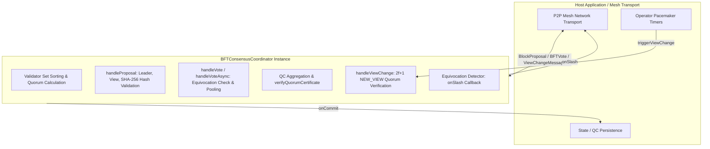
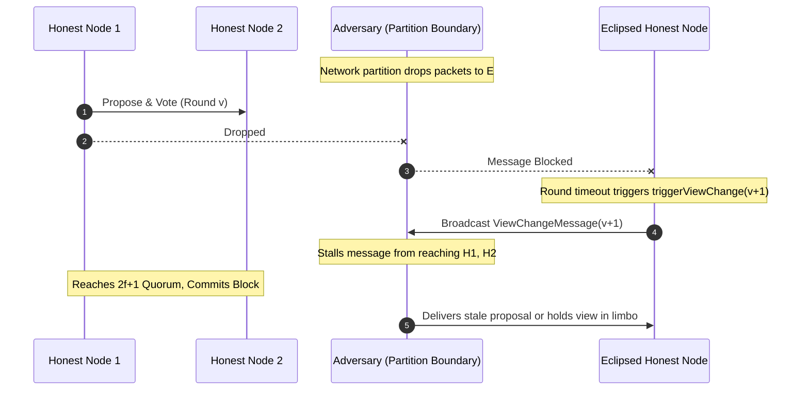
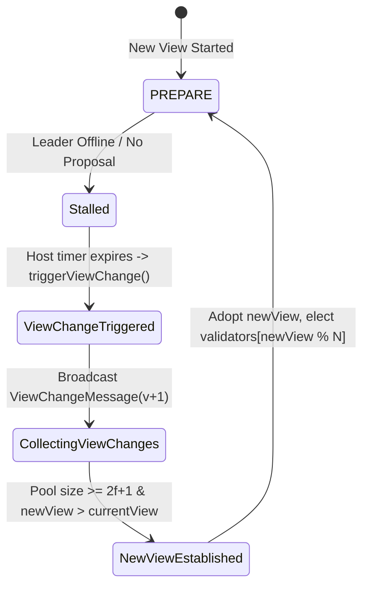
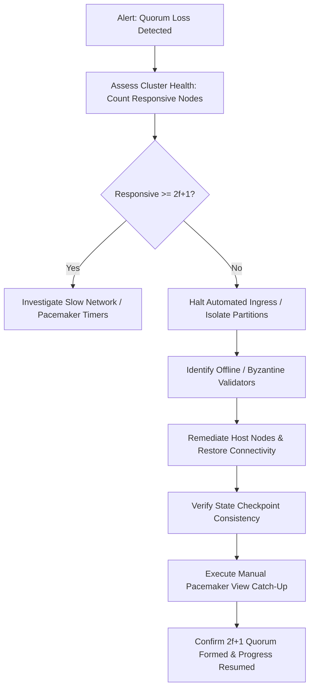

# Byzantine Fault Tolerant (BFT) Consensus Coordinator Threat Model & Recovery Runbook

**File:** `docs/consensus/BFT_COORDINATOR_THREAT_MODEL.md`  
**Reference Code:** [`src/core/consensus/BFTConsensusCoordinator.ts`](../../src/core/consensus/BFTConsensusCoordinator.ts)  
**Tests:** [`src/__tests__/consensus/BFTConsensusCoordinator.test.ts`](../../src/__tests__/consensus/BFTConsensusCoordinator.test.ts)  
**Target Specification:** Issue #8624  

---

## 1. Executive Summary

The `BFTConsensusCoordinator` provides Byzantine Fault Tolerant state replication for WorkSphere mesh collaboration nodes. The protocol coordinates state transitions through a 3-phase HotStuff / PBFT-style pipeline (`PREPARE` $\to$ `PRE_COMMIT` $\to$ `COMMIT` $\to$ `DECIDED`), relying on explicit Quorum Certificates (QCs), round-robin deterministic leader rotation, and explicit view changes.

This document establishes a rigorous security threat model and operational recovery runbook grounded in the actual codebase implementation. It specifies the mathematical safety boundaries under Byzantine conditions, models concrete attack vectors (validator collusion, leader equivocation, Sybil peer flooding, network partitions, and eclipse attacks), maps verified defenses versus residual vulnerabilities, and defines exact, safe recovery runbooks for cluster operators when validator availability falls below the minimum Byzantine quorum threshold ($2f + 1$).

---

## 2. Scope and System Architecture

The consensus coordinator operates as a **pure in-memory, deterministic state-machine**. It executes without native network transport bindings, storage persistence engines, or autonomous background tick timers. Network I/O, message serialization, gossip distribution, and timeout dispatching are delegated to the hosting application wrapper.



### Core Data Structures
- **`BlockProposal<T>`**: Contains `view`, `sequence`, `proposerId`, `payload`, `blockHash`, `parentHash`, `justifyQC`, and `timestamp`.
- **`BFTVote`**: Contains `nodeId`, `view`, `sequence`, `blockHash`, `phase`, `signature`, and `timestamp`.
- **`QuorumCertificate`**: Aggregates at least $2f + 1$ validator signatures for a common `(phase, view, sequence, blockHash)` tuple.
- **`ViewChangeMessage`**: Contains `fromNodeId`, `newView`, `lastCommitQC`, `signature`, and `timestamp`.

---

## 3. Protocol and Trust Boundaries

The system enforces strict security boundaries between the local coordinator runtime and external mesh inputs:

1. **Local State Boundary**: Internal maps (`votePool`, `castVotes`, `viewChangePool`, `committedBlocks`) are private and manipulated exclusively via pure coordinator methods.
2. **Validator Membership Boundary**: Only node identities present in `config.validators` are permitted to propose blocks, cast votes, or sign view-change messages.
3. **Cryptographic Verification Boundary**: Votes and QCs undergo signature verification before phase progression or block commitment.
4. **Pacemaker Boundary**: The coordinator relies on an external caller to monitor timeouts and invoke `triggerViewChange(reason)`.

---

## 4. Validator Membership and Fault Model

### Parameter Definitions
- $N$: Total number of static validators in `config.validators`.
- $f$: Maximum tolerable Byzantine (malicious, compromised, or arbitrarily faulty) nodes, calculated as:
  $$f = \left\lfloor \frac{N - 1}{3} \right\rfloor$$
- $q$: Supermajority quorum threshold required to form a Quorum Certificate or complete a view change:
  $$q = 2f + 1$$

### Implementation Threshold Matrix

| Total Nodes ($N$) | Byzantine Faults Tolerated ($f$) | Quorum Threshold ($2f + 1$) | Resilience Ratio | Operational Status |
|:---:|:---:|:---:|:---:|:---|
| 1 | 0 | 1 | 100% | Single-node testing only; zero Byzantine tolerance |
| 2 | 0 | 1 | 50% | Vulnerable to single node failure; no BFT safety |
| 3 | 0 | 1 | 33.3% | Non-BFT setup; quorum threshold of 1 allows arbitrary unilateral commits |
| **4** | **1** | **3** | **75%** | **Minimum production BFT deployment** ($3f + 1$) |
| 5 | 1 | 3 | 60% | Sub-optimal: same $f=1$ as $N=4$ with higher message overhead |
| 6 | 1 | 3 | 50% | Sub-optimal: same $f=1$ as $N=4$ with higher message overhead |
| **7** | **2** | **5** | **71.4%** | **Standard multi-fault resilient BFT deployment** ($3f + 1$) |
| 10 | 3 | 7 | 70% | High-resilience enterprise cluster ($3f + 1$) |

> [!WARNING]
> In clusters where $N \le 3$, $f = 0$ and $2f + 1 = 1$. Under this condition, any single node can unilaterally produce valid QCs. Production deployments MUST enforce $N \ge 4$.

---

## 5. Threat Actors and Assumptions

1. **Honest Validator**: Follows protocol rules, does not equivocate, votes only on valid proposals, and maintains consistent local logs.
2. **Crashing / Offline Validator**: Ceases message transmission; does not craft malicious payloads.
3. **Byzantine Validator**: Under active adversary control; can selectively delay, drop, replay, fabricate, or double-sign conflicting messages.
4. **Colluding Byzantine Coalition**: A coordinated set of up to $f$ Byzantine validators sharing private keys or message timing to partition honest nodes or force state divergence.
5. **Network Adversary (Man-in-the-Middle / Eclipse)**: Controls network routing, introduces arbitrary transmission delays, splits communication graphs, or isolates target nodes.

---

## 6. Byzantine Threat Scenarios

### A. Leader Equivocation (Double Proposing)
- **Attack Description**: A Byzantine leader transmits proposal $B$ to validator subset $V_1$ and conflicting proposal $B'$ to subset $V_2$ for the same $(view, sequence)$.
- **Protocol Defense**:
  - The leader cannot directly commit without a QC.
  - Honest nodes vote only once per $(view, sequence, phase)$ tuple.
  - Distinct block hashes are partitioned into isolated sub-pools (`phase:view:sequence:blockHash`).
  - Neither proposal can accumulate $2f + 1$ votes without at least one honest validator voting twice, which honest validators reject.
- **Residual Risk**: A malicious leader can cause a round timeout, forcing honest nodes to execute a view change.

### B. Validator Equivocation (Double Signing)
- **Attack Description**: A malicious validator signs conflicting votes for different block hashes within the same view and sequence.
- **Protocol Defense**:
  - `handleVote` queries the internal `castVotes` table (`${view}:${sequence}:${phase}:${nodeId}`).
  - If a prior vote exists for a different `blockHash`, `detectEquivocation` returns true, the conflicting vote is dropped, and `onSlashCallback(nodeId, reason)` is dispatched.
- **Residual Risk**: The coordinator drops the vote and executes the callback, but does **not** dynamically remove the offending node from `validators` in memory. The host application must act upon `onSlash` to evict the validator.

### C. Conflicting Prepare and Commit Attacks
- **Attack Description**: Malicious nodes attempt to bypass the 3-phase progression (`PREPARE` $\to$ `PRE_COMMIT` $\to$ `COMMIT`) by injecting fabricated higher-phase votes or QCs.
- **Protocol Defense**:
  - `verifyQuorumCertificate` checks that the QC contains $\ge 2f + 1$ distinct validator signatures matching the identical phase, view, sequence, and block hash.
  - `advancePhaseOnQC` verifies QC validity before phase mutation.
- **Residual Risk**: `advancePhaseOnQC` does not assert strict sequential phase ordering (e.g. requiring a prior PRE_COMMIT QC before advancing to COMMIT), trusting incoming verified QCs.

---

## 7. Sybil Attack Analysis

- **Attack Vector**: An adversary registers hundreds of synthetic peer IDs on the mesh network to overwhelm quorum calculation.
- **Repository Implementation Defense**:
  - The coordinator relies on a **static, explicitly pre-configured validator array** (`config.validators`).
  - In `handleVote`, `vote.nodeId` is strictly validated against `this.validators.includes(vote.nodeId)`. Unregistered peer votes are rejected with a warning.
  - In `handleProposal`, proposals from non-designated proposers are rejected immediately.
  - In `handleViewChange`, sender IDs outside `this.validators` are rejected.
- **Residual Vulnerability**: The implementation signature mechanism uses SHA-256 over public fields (`BFT_SIG:${nodeId}:${phase}:${view}:${sequence}:${blockHash}`) rather than asymmetric private key signatures. In an untrusted network, an adversary with knowledge of validator IDs can forge signatures unless transport-layer mutual TLS or asymmetric signing is enforced by the host.

---

## 8. Network Delay and Eclipse Attack Analysis



### Attack Impacts
1. **Selective Message Delay**: Adversary delays votes to trigger false view-change timeouts.
2. **Network Partitions**: If the network splits into partitions of size $< 2f + 1$, consensus halts safely without state corruption.
3. **Eclipse Attack**: An isolated validator cannot receive proposals or form QCs; its repeated `triggerViewChange` messages will not reach quorum ($< 2f + 1$) and will not disrupt the main cluster.

---

## 9. View Change and Timeout Analysis

### Pacemaker Architecture
The coordinator is completely passive and has **no background timer**. The host application must implement an external round timer:
1. When entering view $v$, the host starts a timer (recommended: $\ge 5000\text{ ms}$ with exponential backoff).
2. If no valid proposal or QC is reached before expiry, the host invokes:
   ```ts
   const viewChangeMsg = coordinator.triggerViewChange("Round timeout expired");
   transport.broadcast(viewChangeMsg);
   ```
3. Incoming `ViewChangeMessage` payloads are processed by `handleViewChange`.
4. When `viewChangePool.get(newView).size >= quorumSize` and `newView > currentView`:
   - `currentView` advances to `newView`.
   - `currentPhase` resets to `'PREPARE'`.
   - `currentProposal` is cleared.
   - The method returns `{ newLeader, view }`.



---

## 10. Leader Election and Quorum Verification

### Deterministic Leader Selection
Leader election is strictly deterministic and round-robin based on the alphabetically sorted validator list:
$$\text{leaderIndex} = \text{view} \pmod N$$
$$\text{leaderId} = \text{validators}[\text{leaderIndex}]$$

Because `validators` is sorted during construction, every honest node computes the exact same leader for any given view index without extra coordination messages.

### Commit Certification vs. Leader Election
- **Leader Election Quorum**: Requires $2f + 1$ `ViewChangeMessage` declarations for `newView`. It authorizes the designated leader to propose, but **does not certify any transaction state**.
- **Commit Quorum Certificate**: Requires $2f + 1$ `BFTVote` signatures specifically for phase `'COMMIT'`, bound to a unique `blockHash`. Only this certificate satisfies block finality.

---

## 11. Mathematical Safety Proof

### Quorum Intersection Lemma
Let the cluster consist of $N = 3f + 1$ total validators, containing at most $f$ Byzantine validators and at least $N - f = 2f + 1$ honest validators.

Let $Q_1$ and $Q_2$ be any two valid quorums of size $2f + 1$:
$$|Q_1| = 2f + 1, \quad |Q_2| = 2f + 1$$

By standard set theory:
$$|Q_1 \cap Q_2| = |Q_1| + |Q_2| - |Q_1 \cup Q_2|$$

Since $|Q_1 \cup Q_2| \le N = 3f + 1$:
$$|Q_1 \cap Q_2| \ge (2f + 1) + (2f + 1) - (3f + 1)$$
$$|Q_1 \cap Q_2| \ge 4f + 2 - 3f - 1 = f + 1$$

### Non-Equivocation Theorem
Among the $\ge f + 1$ validators in $Q_1 \cap Q_2$, at most $f$ can be Byzantine. Therefore:
$$\text{Honest In Intersection} \ge (f + 1) - f = 1$$

At least one validator $H \in Q_1 \cap Q_2$ is strictly honest. An honest validator never votes for two distinct block hashes for the same view, sequence, and phase. Consequently, two conflicting proposals $B \ne B'$ can never both achieve a valid Quorum Certificate for the same sequence and phase:
$$\text{Safety is preserved against up to } f \text{ Byzantine nodes.}$$

---

## 12. Liveness Assumptions and Boundaries

Consensus liveness requires the following conditions:
1. **Sufficient Responsive Honest Nodes**: At least $2f + 1$ honest validators must be online and connected.
2. **Partial Synchrony**: There must exist a Global Stabilization Time ($GST$) after which message transmission delay between honest nodes is bounded by $\Delta$.
3. **Pacemaker Backoff**: View-change timeouts must increase (e.g. $T_{v+1} = 2 \times T_v$) to ensure the timeout eventually exceeds network latency $2\Delta$.

If $N - \text{faulty} < 2f + 1$, liveness is safely halted to prevent split-brain execution.

---

## 13. Threat Mitigation Matrix

| Threat | Attacker Capability | Preconditions | Impact | Existing Defense in Repository | Residual Risk | Recommended Mitigation | Severity |
|:---|:---|:---|:---|:---|:---|:---|:---:|
| **Leader Equivocation** | Propose distinct blocks to different peers | Attacker is designated leader | Fork attempt / stalled consensus | Vote pools isolated by `blockHash`; honest nodes vote once per round | Leader forces view-change timeouts | Dynamic reputation scoring and view timeout escalation | **High** |
| **Validator Double-Signing** | Sign conflicting votes for same view & sequence | Compromised validator key | Attempt to produce two QCs | `handleVote` checks `castVotes`; triggers `onSlash`; drops vote | `onSlash` is callback only; does not evict validator in memory | Evict node in `onSlash` callback and slash stake | **High** |
| **Sybil Flooding** | Inject arbitrary synthetic node IDs | Network access to coordinator | Resource exhaustion / DoS | `this.validators.includes(nodeId)` rejects unlisted peers | Rejection logs may fill disk if not rate-limited | Enforce firewall/mTLS peering whitelist | **Medium** |
| **Signature Forgery** | Spoof validator signatures | Message modification capability | Impersonate honest validator votes | Recomputed hash checked against `BFT_SIG` digest | Signatures use deterministic SHA-256 without private keys | Migrate to asymmetric Ed25519 signatures | **Critical** |
| **Network Partition** | Split cluster into sub-groups | Network routing control | Liveness starvation | Quorum checks require $\ge 2f + 1$; sub-quorums cannot commit | System halts until partition heals | Automated cluster partition alerts & monitoring | **High** |
| **Replay Attacks** | Replay valid old votes from prior views | Network eavesdropping | Disrupt vote pool counters | `vote.view` and `vote.sequence` checked against current view/seq | If node restarts at view 0, old votes could be processed | Persistent state checkpoints for view and sequence | **Medium** |
| **Nested Payload Tampering** | Mutate nested payload fields without changing hash | Malicious proposer | Non-deterministic state execution | `hashPayload` computes top-level key hashes | Replacer array filters nested keys, causing identical hashes | Implement canonical recursive RFC 8785 JSON hashing | **High** |
| **View-Change Desynchronization** | Flood conflicting `ViewChangeMessage` views | Malicious validator | Delay new leader election | Requires $2f + 1$ votes for identical `newView` | View-change signatures are unverified in `handleViewChange` | Validate view-change signatures before pool insertion | **High** |

---

## 14. Quorum Loss Incident Response

When available validator count drops below $2f + 1$, the coordinator cannot form QCs or advance views. Operators must execute the following incident protocol:



---

## 15. Manual Operator Recovery Runbook

### Scenario: Cluster Quorum Drops Below $2f + 1$ ($N=4, f=1, q=3$; only 2 nodes active)

#### Step 1: Detection
- **Symptom**: Proposals are created, but no `COMMIT` QC forms. `onCommit` callbacks stop firing.
- **Log Indicators**:
  ```text
  [WARN] Proposal stalled in PREPARE phase: received 2 of 3 required votes.
  [WARN] ViewChangeMessage received for view 5, pool size 2 < quorumSize 3.
  ```

#### Step 2: Immediate Containment
- **DO NOT** lower `quorumSize` in source code or restart nodes with $N=2$. Lowering quorum violates the $3f+1$ intersection invariant and causes irreversible state divergence.
- Pause client state write traffic to prevent uncommitted backlog accumulation.

#### Step 3: Diagnostic Triage
Execute the node health inspection script across all validator hosts:
```bash
# Verify process availability and peer mesh reachability
curl -s http://127.0.0.1:8080/api/consensus/status | jq '{nodeId, view: .currentView, sequence: .currentSequence, phase: .currentPhase}'
```

#### Step 4: Remediation
1. Recover crashed validator processes.
2. If a node suffered catastrophic disk failure, reconstruct its state from the highest verified `lastCommitQC` held by responsive peers.
3. Once the 3rd validator re-enters the mesh, trigger a synchronized view change:
   ```ts
   // On recovered validator instance
   const syncMessage = coordinator.triggerViewChange("Operator Quorum Restoration");
   meshTransport.broadcast(syncMessage);
   ```

#### Step 5: Post-Recovery Validation
Verify that the newly designated leader successfully receives $\ge 2f + 1$ `PREPARE` votes and commits sequence $S + 1$:
```bash
# Verify commitment resumed
curl -s http://127.0.0.1:8080/api/consensus/last-commit | jq '.'
```

---

## 16. Recovery Validation Checklist

- [ ] All $N$ validators are registered with identical sorted `validators` lists.
- [ ] No validator is reporting active equivocation alerts via `onSlash`.
- [ ] The current view leader matches `validators[currentView % N]`.
- [ ] `lastCommitQC` block hash is identical across all online nodes.
- [ ] New proposals successfully transition from `PREPARE` to `DECIDED` with $2f + 1$ signatures.
- [ ] Round timers and pacemaker backoff are reset to baseline defaults.

---

## 17. Monitoring and Alerting Recommendations

Operators should instrument the following Prometheus metrics:

| Metric Name | Type | Alert Threshold | Description |
|:---|:---:|:---:|:---|
| `bft_active_validators_count` | Gauge | $< 2f + 1$ (Critical) | Number of responsive consensus validators |
| `bft_current_view` | Counter | Rapid increment $> 5\text{ views/min}$ (Warning) | Indicates frequent leader timeouts or failed views |
| `bft_equivocation_total` | Counter | $> 0$ (Critical) | Equivocation detected by `detectEquivocation` |
| `bft_vote_rejection_total` | Counter | $> 10/\text{min}$ (Warning) | Rejected votes due to membership or signature failure |
| `bft_commit_latency_seconds` | Histogram | $p99 > 5\text{ s}$ (Warning) | Round execution time from PREPARE to DECIDED |

---

## 18. Known Implementation Gaps

Grounding analysis in `src/core/consensus/BFTConsensusCoordinator.ts` highlights the following current code characteristics:

1. **Deterministic Hashes vs. Asymmetric Signatures**: Signatures are generated as `sha256("BFT_SIG:" + ...)`. Secret-key signing (Ed25519 / ECDSA) is required for production adversary resistance.
2. **View Change Signature Verification**: `handleViewChange` stores messages in `viewChangePool` without verifying `msg.signature`.
3. **Payload Key Serialization**: `hashPayload` applies top-level keys to `JSON.stringify`, which omits nested payload fields from the block hash computation.
4. **Redundant QC Emission**: Incoming votes beyond the $2f + 1$ threshold trigger re-execution of `advancePhaseOnQC` and repeated `onCommit` events for the same sequence.
5. **Passive Pacemaker**: The coordinator contains no timer primitives; host orchestration is mandatory.

---

## 19. Recommended Future Hardening

1. **Ed25519 Cryptographic Signatures**: Replace SHA-256 digests in `generateSignature` and `verifyNodeSignature` with cryptographic public/private key pairs.
2. **Canonical JSON Hashing**: Replace custom key-filtering in `hashPayload` with strict RFC 8785 JSON Canonicalization.
3. **Dynamic Validator Set Mutation**: Implement bounded joint-consensus reconfiguration rounds to allow safe validator additions and removals without restarting nodes.
4. **Idempotent Commit Tracking**: Record decided sequence numbers in a committed index set to eliminate duplicate `onCommit` callback firings.
5. **Authenticated View Change Verification**: Verify cryptographic signatures on `ViewChangeMessage` prior to pool insertion.

---

## 20. References to Repository Source Files and Tests

- **Implementation**: [`src/core/consensus/BFTConsensusCoordinator.ts`](../../src/core/consensus/BFTConsensusCoordinator.ts)
  - Quorum calculation: Lines 88–89
  - Leader election: Lines 98–101
  - Proposal validation: Lines 180–193
  - Equivocation check & slashing: Lines 218–226
  - QC verification: Lines 344–363
  - View change handler: Lines 386–413
- **Unit & Boundary Tests**: [`src/__tests__/consensus/BFTConsensusCoordinator.test.ts`](../../src/__tests__/consensus/BFTConsensusCoordinator.test.ts)
  - Quorum bounds ($N=4 \to f=1, q=3$; $N=7 \to f=2, q=5$): Lines 17–37
  - Round-robin leader: Lines 39–53
  - 3-Phase HotStuff pipeline: Lines 130–213
  - Equivocation & Slashing: Lines 216–234
  - View Change consensus: Lines 247–293
  - Signature error boundary & async timeout: Lines 295–354
- **Checkpoint Verifier**: [`src/core/consensus/BFTStateCheckpointVerifier.ts`](../../src/core/consensus/BFTStateCheckpointVerifier.ts)
- **Export Registry**: [`src/core/consensus/index.ts`](../../src/core/consensus/index.ts)
