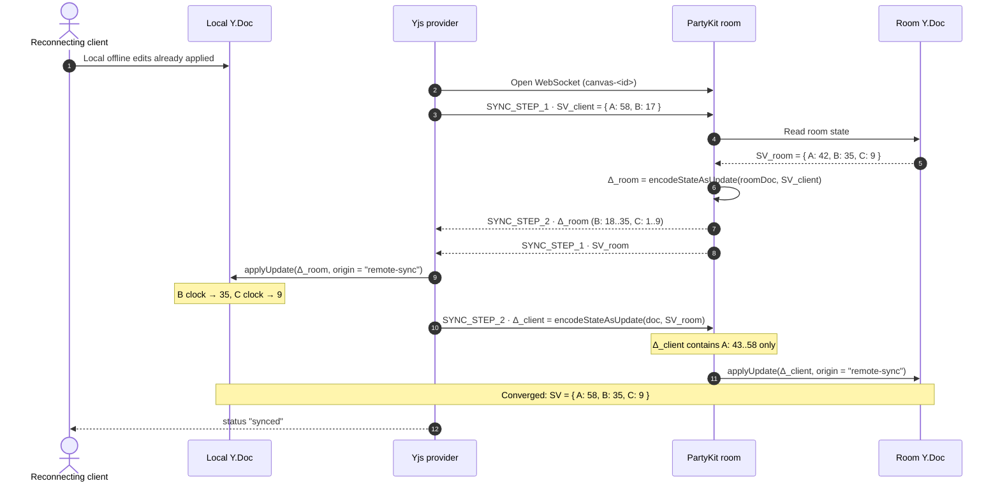
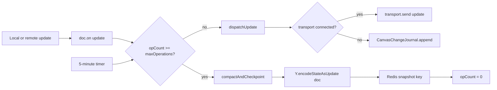

# CRDT State Vector Exchange & Differential Compaction Protocol

How WorkSphere reconciles a collaborative canvas after a partition, and how it flattens accumulated Yjs history into a compact binary checkpoint without breaking the causal clocks that concurrent collaborators depend on.

This document focuses on the **reconciliation** and **compaction** halves of the canvas sync stack. For the document schema and UI wiring see [whiteboard-architecture.md](./whiteboard-architecture.md). For the general wire format and transport summary see [CRDT_REALTIME_SYNC_PROTOCOL.md](../CRDT_REALTIME_SYNC_PROTOCOL.md). For compression framing see [YJS_CRDT_COMPRESSION.md](../YJS_CRDT_COMPRESSION.md).

The provider that owns the offline journal and the compaction checkpoint is [`NomadCanvasProvider`](../../src/lib/crdt/canvasProvider.ts). The WebSocket handshake itself is delegated to the Yjs provider (`y-partykit/provider`); this document describes the protocol it speaks and the invariants the canvas code relies on.

## Contents

1. [Why state vectors exist](#1-why-state-vectors-exist)
2. [Mathematical model](#2-mathematical-model)
3. [The two-phase handshake](#3-the-two-phase-handshake)
4. [Differential update generation](#4-differential-update-generation)
5. [Binary compaction protocol](#5-binary-compaction-protocol)
6. [Compaction heuristics](#6-compaction-heuristics)
7. [Flattening undo history safely](#7-flattening-undo-history-safely)
8. [Offline reconnect reconciliation](#8-offline-reconnect-reconciliation)
9. [Tombstone lifecycle and GC trade-offs](#9-tombstone-lifecycle-and-gc-trade-offs)
10. [Compaction safety invariants](#10-compaction-safety-invariants)
11. [Implementation reference](#11-implementation-reference)
12. [Verification checklist](#12-verification-checklist)

---

## 1. Why state vectors exist

A canvas room may be edited by dozens of peers across flaky mobile links. After a partition, a naive "send me everything" resync is both expensive (the full document can be megabytes) and ambiguous (the receiver cannot tell which bytes it already has). Yjs solves both problems with a **state vector**: a compact summary of everything a replica has already integrated.

A state vector answers exactly one question:

> For every client id I have observed, what is the highest contiguous clock I have applied?

Two replicas exchange state vectors, and each computes the delta the other is missing. Because Yjs updates form a join-semilattice, applying those deltas is commutative, associative and idempotent — so it does not matter who reconnects first, how many times a delta is delivered, or whether two peers push overlapping ranges at the same time.

The practical consequence for WorkSphere:

- A reconnecting nomad uploads only its offline edits, not its whole board.
- The server downloads only the operations the client has never seen.
- No application-level "last synced revision" bookkeeping is required for document data.

---

## 2. Mathematical model

### 2.1 Document, update, state vector

Let a document replica be $D$ and a binary update be $U = \text{encode}(D)$. Each update is a finite set of structs, and every struct carries a unique identity:

$$
\text{id} = (\text{clientId}, \text{clock}) \in \mathbb{N} \times \mathbb{N}
$$

A state vector is a partial function from client ids to the largest contiguous clock observed:

$$
SV: \mathbb{N} \rightharpoonup \mathbb{N}, \qquad SV[c] = \max\{\,k \mid \forall j \le k,\ (c, j) \in D\,\}
$$

Because Yjs clocks are dense and contiguous per client, storing only the maximum is lossless. That is why a vector for hundreds of thousands of operations is usually a few hundred bytes.

### 2.2 Missing-update function

Given a remote state vector $SV_r$, the delta a local replica must send is:

$$
\Delta(D, SV_r) = \{\, s \in D \mid s.\text{clock} > SV_r[s.\text{clientId}] \,\}
$$

In code this is exactly `Y.encodeStateAsUpdate(doc, stateVector)`:

```ts
const remoteVector = Y.encodeStateVector(remoteDoc);
const missing = Y.encodeStateAsUpdate(localDoc, remoteVector);
```

When the state vector is omitted, $SV_r = \varnothing$ and the function degenerates to a **full snapshot** — the behaviour used by `compactState()` in `canvasProvider.ts`.

### 2.3 Join and convergence

Let $D_1 \sqcup D_2$ denote applying update $D_2$ onto replica $D_1$. For Yjs:

$$
\begin{aligned}
&\text{Idempotence:} && D \sqcup D = D \\
&\text{Commutativity:} && D_1 \sqcup D_2 = D_2 \sqcup D_1 \\
&\text{Associativity:} && (D_1 \sqcup D_2) \sqcup D_3 = D_1 \sqcup (D_2 \sqcup D_3)
\end{aligned}
$$

These three properties give **strong eventual consistency**: any two replicas that have received the same set of updates — in any order, with any duplicates — hold byte-identical documents. WorkSphere leans on this directly: the offline journal in `canvasProvider.ts` may replay a block twice, and the peer still converges. The post-sync FNV-1a checksum comparison (`getDocumentChecksum`, `verifyConvergence`) is only a diagnostic for detecting a _different set_ of updates; it is not needed for correctness.

### 2.4 Lamport ordering and tie-breaking

Within a client, clocks are a Lamport sequence: every local struct increments the client's counter, and integrating a remote struct never rewinds a local clock. Concurrent writes therefore have incomparable clocks and are ordered deterministically by Yjs using the struct id (client id, then clock). That is why two collaborators editing the same map key converge on the same winner on every replica, even though neither edit "happened first" in wall-clock time.

> Wall-clock fields such as `updatedAt` and `clock` in the whiteboard shape schema are **application-level** conflict rules layered on top of Yjs. They are not part of the sync protocol and do not affect state vector reconciliation.

---

## 3. The two-phase handshake

The handshake runs every time a provider connects or reconnects. It is bidirectional: both sides both send and receive a diff.

### 3.1 Message framing

| Message type              | Sync subtype        | Payload                      | Purpose                                       |
| :------------------------ | :------------------ | :--------------------------- | :-------------------------------------------- |
| `0` = `MESSAGE_SYNC`      | `0` = `SYNC_STEP_1` | `VarUint8Array` state vector | "Here is what I have; send me what I lack."   |
| `0` = `MESSAGE_SYNC`      | `1` = `SYNC_STEP_2` | Binary update                | "Here is the diff computed from your vector." |
| `0` = `MESSAGE_SYNC`      | `2` = `SYNC_UPDATE` | Binary update                | Steady-state incremental edit.                |
| `1` = `MESSAGE_AWARENESS` | —                   | Ephemeral awareness state    | Cursors, presence; never persisted.           |

### 3.2 Phase 1 — client state vector exchange

1. The client opens the WebSocket and sends `SYNC_STEP_1` containing `Y.encodeStateVector(doc)`.
2. The room server decodes the vector and computes `Y.encodeStateAsUpdate(roomDoc, clientVector)`.
3. The server replies with `SYNC_STEP_2` carrying that diff.
4. In the same round the server sends its **own** `SYNC_STEP_1` so the client can compute the reverse diff.

The exchange is intentionally asymmetric in size: the vectors are small in both directions, while each diff is proportional only to the divergence, not to the document size.

### 3.3 Phase 2 — server missing-update diff generation

The server's diff contains exactly the structs whose `(clientId, clock)` is greater than the client's advertised vector. Two properties matter operationally:

- **Gaps are impossible for a connected client.** A client's vector is contiguous, so any struct beyond the max is genuinely missing. Yjs never needs to request a hole.
- **Duplicates are harmless.** If the client already applied a struct from another peer, re-applying it is a no-op under idempotence.

### 3.4 Phase 3 — client integration

The client applies the diff with `Y.applyUpdate(doc, diff, origin)`. The `origin` tag is important:

- Remote diffs use a provider/mesh origin, so the `update` handler does **not** re-broadcast them or add them to the local undo stack.
- Journal replays use the sentinel `JOURNAL_REPLAY_ORIGIN` (`"journal-replay"`), so replayed blocks are integrated but never re-journaled (`canvasProvider.ts`, the `doc.on("update", ...)` guard).



### 3.5 Steady state

After the handshake the connection carries `SYNC_UPDATE` frames only. Each local transaction emits one binary update; the provider forwards it to the room, and the room broadcasts it to other connections. Updates are not re-encoded through state vectors — the incremental frame is already minimal.

---

## 4. Differential update generation

`Y.encodeStateAsUpdate(doc, sv)` is the only primitive the protocol needs, but the choice of which state vector to pass defines three distinct operations:

| Operation          | State vector argument       | Result                           | Used by                        |
| :----------------- | :-------------------------- | :------------------------------- | :----------------------------- |
| Full snapshot      | omitted / empty             | Entire document as one update    | `compactState()`, checkpoints  |
| Catch-up diff      | remote `SYNC_STEP_1` vector | Only structs the peer lacks      | Handshake `SYNC_STEP_2`        |
| Incremental update | —                           | The single transaction's structs | `doc.on("update")` → transport |

Two rules keep diffs correct:

1. **Never hand-edit a state vector.** Encode it with `Y.encodeStateVector` and decode with `Y.decodeStateVector`. A fabricated vector that claims a clock the replica does not have creates a permanent hole.
2. **Never renumber structs.** Client ids and clocks are identity. Rewriting them breaks idempotence and can resurrect deleted content on peers that still hold the original ids.

The journal adds a durability layer on top: when the transport is offline, each update is appended to IndexedDB with a monotonic sequence number and an FNV-1a checksum (`CanvasChangeJournal.append`). On reconnect, `replayJournal()` streams the backlog in sequence order before normal sync resumes. This is a **belt-and-braces** mechanism for edits made while the WebSocket was down; the state vector handshake would also carry them, but the journal guarantees they survive a browser restart and lets the app detect corruption or divergence.

---

## 5. Binary compaction protocol

Compaction in WorkSphere means **re-encoding the current converged state as one binary update and persisting that as the checkpoint**. It does not mean mutating the logical document, deleting structs, or renumbering history.

### 5.1 What a checkpoint contains

`compactAndCheckpoint()` in `canvasProvider.ts`:

1. Calls `compactState()` → `Y.encodeStateAsUpdate(doc)`.
2. Base64-encodes the bytes.
3. Writes them to `crdt:room:<roomName>:snapshot` in Redis.
4. Resets the operation counter that drives threshold-based compaction.

A joining peer calls `loadRoomSnapshot()`, decodes the base64, and applies the snapshot with `Y.applyUpdate`. Because the snapshot is a normal Yjs update, the subsequent handshake still works: the peer's state vector reflects everything in the snapshot.

The same checkpoint is mirrored into IndexedDB. `CanvasChangeJournal.compact()` writes the encoded update and its `Y.encodeStateVector` into the `snapshots` store and, in the **same readwrite transaction**, deletes every raw `journal` record whose sequence number the snapshot supersedes. The compactor round-trips the bytes through a scratch `Y.Doc` before and after the write, comparing checksums and state vectors, so a failed verification aborts the prune instead of losing history. `restoreFromJournal()` applies the verified baseline first and then replays any surviving journal blocks.

### 5.2 Why a full re-encode is safe

`Y.encodeStateAsUpdate(doc)` is a lossless re-serialization of the same struct set. It does not:

- change any `(clientId, clock)` identity,
- drop tombstones (unless Yjs GC has already collected content),
- change the deterministic winner of any concurrent edit.

It **does** collapse many small incremental frames into one contiguous byte buffer, which reduces storage overhead, transfer size, and the number of updates a fresh peer must apply.

### 5.3 Checkpoint lifecycle



Two independent triggers exist:

- **Threshold:** every `maxOperations` transactions (default **500**).
- **Interval:** every `checkpointIntervalMs` (default **5 minutes**), but only if at least one operation happened since the last checkpoint.

### 5.4 Snapshot versus history persistence

The room server uses `persist: { mode: "snapshot" }`, which stores one document snapshot rather than an ever-growing update log. That is the server-side analogue of the client checkpoint. Contributors should not mix the two mental models:

- **Client checkpoint** (`canvasProvider.ts`) = a full update written to Redis for fast joins and cold starts.
- **Server snapshot** (`y-partykit`) = the authoritative room state persisted by PartyKit.

Both are full-state encodings; neither is a log of deltas.

---

## 6. Compaction heuristics

The defaults in `canvasProvider.ts` are deliberately conservative. The table below documents the operating envelope and the signals that should trigger a review.

| Signal                   | Default / threshold                       | Action                         | Rationale                                                                                                        |
| :----------------------- | :---------------------------------------- | :----------------------------- | :--------------------------------------------------------------------------------------------------------------- |
| Operation count          | `maxOperations = 500`                     | Full checkpoint                | Bounds replay cost for a fresh peer and caps the in-memory op counter.                                           |
| Elapsed time             | `checkpointIntervalMs = 300000` (5 min)   | Full checkpoint if dirty       | Ensures a quiet room still persists after activity stops.                                                        |
| Uncompacted transactions | `> 500` raw IndexedDB records or `> 5 MB` | Compact                        | Keeps the offline journal bounded so long drawing sessions do not slow reloads.                                  |
| Snapshot payload         | `> 5 MB`                                  | Compact and investigate growth | A snapshot this large usually indicates a soft-delete leak (see [§9](#9-tombstone-lifecycle-and-gc-trade-offs)). |
| Tombstone ratio          | `deleted / total >= 0.40`                 | Schedule compaction            | High tombstone density wastes bytes and slows joins.                                                             |
| Offline backlog          | `pendingJournalCount() > 0` on reconnect  | Replay before sync             | Prevents a stale journal from outliving the checkpoint that superseded it.                                       |

Heuristics are **advisory**. Yjs correctness does not depend on compaction frequency; a document that never compacts still converges. Compaction is a performance and storage concern, not a consistency requirement.

---

## 7. Flattening undo history safely

Undo stacks are the most common place where well-meaning compaction breaks collaboration. WorkSphere uses two separate mechanisms, and compaction treats them differently.

### 7.1 Yjs `UndoManager` versus local history

- The whiteboard hook creates a `Y.UndoManager` with `trackedOrigins` set to the local user id and `captureTimeout: 500` ms. It only reverts the local user's own transactions.
- A separate local history stack records add / update / delete / clear actions for UI-level undo.

Compaction must **never** rewrite the document to "bake in" undo steps. Instead, the safe operation is to **discard the undo stack**, not the history it refers to:

1. Wait until the document is quiescent (no in-flight transactions).
2. Encode the checkpoint.
3. Clear or re-create the `UndoManager` so it no longer holds references to superseded items.
4. Leave all structs in the document untouched.

Clearing the manager releases memory; the structs remain part of the document, which is what other peers still reference.

### 7.2 Why you must not collapse concurrent forks

A "fork" is two structs from different clients that are concurrent. Flattening them into a single winner would:

- violate idempotence for peers that already integrated one branch,
- cause a peer that reconnects with the old branch to re-introduce it,
- produce different documents on different replicas — the exact failure CRDTs exist to prevent.

The correct rule is:

> Compaction may change the **encoding** of the document. It may not change the **set of structs** or their identities.

Any operation that deletes a struct, changes a client id, rewinds a clock, or "resolves" a concurrent fork by fiat is out of scope for this protocol and requires a full snapshot reset on every peer.

### 7.3 Undo across a checkpoint

After a checkpoint, undo still works because the `Y.UndoManager` operates on structs, not on the checkpoint file. If the manager is cleared, only the _ability to undo edits made before the clear_ is lost — the content itself is intact. Document that trade-off in any UI that exposes "compact now": users should expect undo history, not data, to be dropped.

---

## 8. Offline reconnect reconciliation

The canvas provider adds a durable journal for edits made while the socket is down. Reconnect is a three-stage reconciliation: journal replay, state vector handshake, then convergence verification.

```mermaid
sequenceDiagram
    autonumber
    actor User as Nomad user
    participant Prov as NomadCanvasProvider
    participant J as IndexedDB journal
    participant Doc as Local Y.Doc
    participant Net as PartyKit transport
    participant Room as Room Y.Doc

    Note over Prov: Socket drops mid-edit
    Prov->>Prov: setConnected(false)
    User->>Doc: Continue drawing offline
    Doc->>Prov: update (origin = local)
    Prov->>J: append(room, update, checksum, seq)
    Note over J: Durable across browser restart

    Note over Prov: Network returns
    Prov->>Prov: setConnected(true)
    Prov->>J: listPending(room)
    J-->>Prov: blocks ordered by seq

    rect rgb(240, 245, 255)
    Note over Prov,Net: Stage 1 — journal replay
    loop each block
        Prov->>Prov: verify computeChecksum(update) == block.checksum
        alt checksum mismatch
            Prov->>J: remove(block.seq)
        else valid
            Prov->>Net: send(update)
            Prov->>J: remove(block.seq)
        end
    end
    end

    rect rgb(245, 255, 240)
    Note over Net,Room: Stage 2 — state vector handshake
    Net->>Room: SYNC_STEP_1 · SV_client
    Room-->>Net: SYNC_STEP_2 · Δ_room
    Net->>Doc: applyUpdate(Δ_room)
    Net->>Room: SYNC_STEP_2 · Δ_client
    Room->>Room: applyUpdate(Δ_client)
    end

    rect rgb(255, 250, 240)
    Note over Prov,Room: Stage 3 — convergence check
    Prov->>Doc: getDocumentChecksum()
    Prov->>Prov: compare with remoteChecksum
    alt checksums differ
        Prov->>Prov: warn divergence; keep journaling
    else equal
        Prov->>Prov: onReconnected({ replayed, checksum, converged: true })
    end
    end
```

### 8.1 Journal ordering and deduplication

- Sequence numbers are monotonic per room and persisted in the `meta` store, so they survive block removals and browser restarts.
- `replayJournal()` refuses re-entrant calls via the `replaying` flag, so a flapping connection cannot double-send a block.
- A corrupt block (checksum mismatch) is dropped rather than streamed. The rest of the backlog continues.
- If the transport fails mid-replay, remaining blocks are kept for the next attempt; already-sent blocks are removed.

### 8.2 Why both the journal and the handshake exist

They protect against different failures:

| Failure                          | Journal             | State vector handshake    |
| :------------------------------- | :------------------ | :------------------------ |
| Socket drops, tab stays open     | Yes                 | Yes (in-memory Y.Doc)     |
| Browser or device restarts       | **Yes** (IndexedDB) | No (in-memory state lost) |
| Remote peer edited while offline | No                  | **Yes**                   |
| Corrupt or truncated local block | **Yes** (checksum)  | Not detected by Yjs       |
| Duplicate delivery               | Harmless            | Harmless                  |

The journal is not a replacement for the handshake, and the handshake is not a replacement for durability. The reconnect path runs both.

### 8.3 Convergence checksum

`computeChecksum` is a 64-bit FNV-1a hash over `Y.encodeStateAsUpdate(doc)`. Two peers that integrated the same struct set produce byte-identical encodings, so equal checksums imply convergence. A mismatch means the peers hold different struct sets — for example, one missed a broadcast — and is logged as `Post-sync divergence`. The checksum is diagnostic only: it must never be used to decide whether to _apply_ an update.

---

## 9. Tombstone lifecycle and GC trade-offs

Deletes in a CRDT are not removals; they are markers that prevent a concurrent or replayed edit from resurrecting content. WorkSphere has three tombstone layers, and they must not be conflated.

### 9.1 The three layers

| Layer                    | Owner               | What it stores                                          | Config                                                         |
| :----------------------- | :------------------ | :------------------------------------------------------ | :------------------------------------------------------------- |
| Yjs struct tombstones    | Yjs                 | Content of deleted/overwritten items, with identity     | `gc` on the client, `gc: false` on the server with persistence |
| Application soft-deletes | Whiteboard schema   | `deleted: true`, `deletedAt`, `clock` on a live `Y.Map` | Always retained                                                |
| Journal blocks           | `canvasProvider.ts` | Unconfirmed offline updates                             | Removed after replay                                           |

Yjs `gc: true` discards deleted **content** but keeps a tiny tombstone. It cannot reclaim application soft-deletes, because those are live map entries, not deleted structs. That is why a board that only ever soft-deletes grows without bound.

### 9.2 The resurrection anomaly

Suppose peer A deletes a shape and peer B, still offline, edits it. If A's delete were physically removed before B reconnects, B's edit would re-create the shape as if it had never been deleted. Tombstones are the memory that makes "delete wins" or "edit wins" a deterministic, globally consistent decision rather than an accident of reconnection order.

Any GC policy must therefore answer: **which peers are guaranteed to have seen the tombstone?** If that question cannot be answered, the tombstone must be retained.

### 9.3 Safe collection horizon

A tombstone at $(c, k)$ can only be purged once every participating replica has acknowledged a state vector that dominates it:

$$
\forall r \in R_{\text{active}}: \quad SV_r[c] \ge k
$$

In practice this is approximated with a **minimum known vector (MKV)** across active replicas, plus an epoch window for disconnected peers. The current canvas code does not implement a purge path; the rules below describe the contract any future implementation must satisfy.

| Policy                       | Trade-off                                              | Recommended use                                         |
| :--------------------------- | :----------------------------------------------------- | :------------------------------------------------------ |
| Never purge                  | Correct, unbounded growth                              | Default for persisted rooms with `gc: false`            |
| Purge below MKV              | Bounded size, requires accurate presence/ack tracking  | Only with server-enforced acknowledgement               |
| Epoch eviction (e.g. 7 days) | Bounds size, risks resurrection for long-offline peers | Pair with `SNAPSHOT_RESET` on reconnect                 |
| Purge on snapshot reset      | Simple, discards incremental history                   | Acceptable when the reset replaces peer state wholesale |

### 9.4 `gc: true` versus `gc: false`

- **Clients** use the Yjs default (`gc: true`), which keeps their memory small.
- **The room server** uses `gc: false` because `y-partykit` requires it when persisting. The room therefore retains deleted content.
- A client that has GC'd content can still receive it again from the server, because the server holds the structs. This asymmetry is intentional but means **server-side size, not client memory, is the growth risk**.

### 9.5 Operational rules

1. Do not "optimize" a board by deleting shapes from the `Y.Array` unless you also accept that a concurrent offline edit can re-add them or that a stale peer can diverge. Removing a struct is a **snapshot-reset-class** operation.
2. Prefer application-level archival (move to an archive map, then compact) over in-place struct deletion.
3. If you introduce GC, gate it on an explicit minimum-vector acknowledgement and log every purge epoch.
4. Never compare tombstones by wall-clock `deletedAt` for GC decisions; use causal clocks and state vectors.
5. When a peer is evicted from the epoch window, require a full snapshot reset rather than an incremental diff.

---

## 10. Compaction safety invariants

Any change to `canvasProvider.ts`, the provider wiring, or a future GC path must preserve these invariants:

1. **Identity is immutable.** No struct's `(clientId, clock)` may change during compaction.
2. **Encoding may shrink; the struct set may not.** A checkpoint is a re-encoding, not a rewrite.
3. **Remote and replayed updates are not re-broadcast or re-journaled.** Origins distinguish local, remote, mesh, and `JOURNAL_REPLAY_ORIGIN`.
4. **A state vector is only produced by `Y.encodeStateVector`.** Never synthesize one.
5. **A journal block is sent at most once per replay attempt** and removed only after a successful `send`.
6. **Corruption is dropped, not repaired by guessing.** Checksum mismatches discard the block and log it.
7. **Compaction never touches awareness state.** Presence is ephemeral and is not part of the document.
8. **Tombstones are retained until the minimum-vector condition is provably satisfied** for every active replica.
9. **Undo history may be dropped; document content may not.** Clearing the `UndoManager` is safe; mutating structs to flatten undo is not.
10. **Snapshots are ordinary Yjs updates.** `loadRoomSnapshot` must apply them with `Y.applyUpdate`, never parse them as a custom format.

---

## 11. Implementation reference

| Symbol                         | Location                                  | Responsibility                                             |
| :----------------------------- | :---------------------------------------- | :--------------------------------------------------------- |
| `NomadCanvasProvider`          | `src/lib/crdt/canvasProvider.ts`          | Owns the `Y.Doc`, journal, transport, and checkpoint timer |
| `compactState()`               | `canvasProvider.ts`                       | Full `Y.encodeStateAsUpdate(doc)` snapshot                 |
| `compactAndCheckpoint()`       | `canvasProvider.ts`                       | Encodes, base64-encodes, writes Redis, resets `opCount`    |
| `loadRoomSnapshot()`           | `canvasProvider.ts`                       | Reads Redis, decodes, `Y.applyUpdate`                      |
| `getDocumentChecksum()`        | `canvasProvider.ts`                       | FNV-1a over the full update                                |
| `verifyConvergence()`          | `canvasProvider.ts`                       | Compares local checksum to a remote one                    |
| `CanvasChangeJournal.append()` | `canvasProvider.ts`                       | Durable, sequenced offline block with checksum             |
| `replayJournal()`              | `canvasProvider.ts`                       | Ordered, checksum-verified backlog flush                   |
| `setConnected()`               | `canvasProvider.ts`                       | Offline→online transition that triggers replay             |
| `SYNC_STEP_1` / `SYNC_STEP_2`  | `y-partykit/provider`, `y-protocols/sync` | Two-phase state vector handshake                           |
| `encodeStateAsUpdate(doc, sv)` | `yjs`                                     | Missing-update diff generation                             |

The room server configuration (`persist: { mode: "snapshot" }`, `gc: false`) lives in `party/server.ts`; see [whiteboard-architecture.md](./whiteboard-architecture.md) for the full connection lifecycle.

---

## 12. Verification checklist

Use this checklist when changing reconciliation or compaction code:

- [ ] Two clients edited offline, then reconnect, converge to the same `getDocumentChecksum()`.
- [ ] A client that reconnects twice sends each journal block once and clears the backlog.
- [ ] A corrupt journal block is dropped without blocking later blocks.
- [ ] A checkpoint written by one peer is loadable by a fresh peer via `loadRoomSnapshot()`.
- [ ] Compaction does not change any struct id or clock (diff the encoded struct metadata before/after).
- [ ] Concurrent edits to the same map key pick the same winner on every replica after compaction.
- [ ] Undo after a checkpoint still reverts the local user's own post-checkpoint edits.
- [ ] Clearing the `UndoManager` leaves document content and remote peers unaffected.
- [ ] `gc: false` on the server does not cause client memory to grow unbounded.
- [ ] Any new GC path is gated on a documented minimum-vector / epoch rule and logs purge epochs.

Related documentation:

- [whiteboard-architecture.md](./whiteboard-architecture.md) — schema, connection lifecycle, GC settings
- [state-based-resolution.md](./state-based-resolution.md) — the separate vector-clock state-based engine
- [CRDT_REALTIME_SYNC_PROTOCOL.md](../CRDT_REALTIME_SYNC_PROTOCOL.md) — wire format and transport summary
- [YJS_CRDT_COMPRESSION.md](../YJS_CRDT_COMPRESSION.md) — binary compression framing
- [WEBRTC_MESH_CRDT_SYNC_SPECIFICATION.md](../WEBRTC_MESH_CRDT_SYNC_SPECIFICATION.md) — mesh data-channel path
