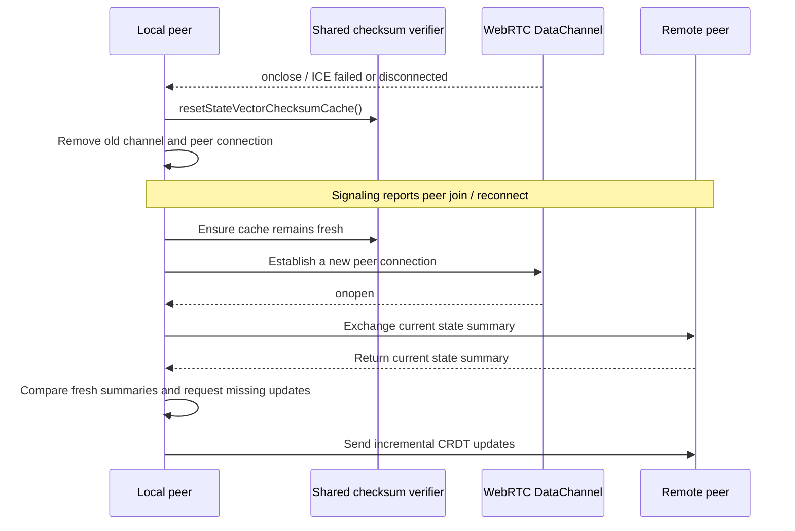

# CRDT State-Vector Checksum Reset Protocol

## Purpose

A checksum cached for one peer connection must not be assumed valid after that connection closes. A reconnect is a new synchronization session: the local digest cache is invalidated and the peers must exchange fresh state summaries before relying on checksum equality.

The current implementation is in `src/lib/crdt/stateVectorChecksum.ts`, `src/components/crdt/StateChecksumVerifier.tsx`, and `src/hooks/useMeshDataChannels.ts`.

## Digest format and cache behavior

- The digest helper computes SHA-256 and returns a lowercase hexadecimal digest.
- Web Crypto is preferred where available; Node's `crypto` module is the fallback.
- The verifier memoizes exact payloads up to 64 bytes. Larger payloads are hashed directly rather than using a sampled key.
- The shared verifier exposes `resetStateVectorChecksumCache()`, which clears cached digests and cache statistics.
- This is a cache invalidation mechanism, not a replacement for validating the received CRDT update or state vector.

Do not describe this implementation as Adler-32 or CRC32: the current checksum implementation uses SHA-256.

## Connection lifecycle

The mesh hook resets the shared cache during peer cleanup and on data-channel close. When a signaling `peer-join` arrives, the old peer state is cleaned up before a fresh peer connection is established. The data channel's `onopen` event marks the channel active.

The state-summary exchange in the diagram describes the synchronization protocol expected after transport reconnection. The mesh hook itself handles transport lifecycle and cache invalidation; application-level state exchange is performed by the CRDT synchronization layer.

## Required reconnect sequence

1. Treat `onDisconnect`, `onclose`, ICE `disconnected`, and ICE `failed` as reasons to retire the affected peer session.
2. Clear the digest cache before accepting state from the replacement session.
3. Remove the old data channel and close the old `RTCPeerConnection`; do not reuse the prior channel's digest assumptions.
4. After the new channel opens, exchange current state-vector summaries.
5. Compare the fresh summaries and request missing updates. Apply updates through the CRDT provider so its merge semantics preserve local unmerged edits.
6. Recompute digests for the resulting exact state and only then use equality as an optimization signal.

A checksum mismatch is not permission to discard local state. It means the peers need to exchange or verify the relevant state/update data.

## Error and recovery matrix

| Condition | Interpretation | Recovery |
|---|---|---|
| Cache hit before disconnect | Digest was computed for an exact payload in this process | Safe only within the same active synchronization context |
| Peer disconnect / channel close | Previous session is no longer authoritative | Clear shared digest cache and retire the peer channel |
| ICE failure | Transport cannot be trusted to continue | Clean up peer; wait for a fresh signaling handshake |
| Reconnect with matching fresh digests | State summaries agree | Continue normal incremental sync |
| Reconnect with different digests | Peers may have missed updates or changed independently | Exchange missing updates; preserve both local and remote CRDT operations |
| Invalid or malformed state summary | Cannot establish state equality | Reject the summary, log a bounded diagnostic, and request a fresh summary |
| Repeated mismatch after update exchange | Possible stale transport, incompatible encoding, or corruption | Reinitialize synchronization from a trusted snapshot without silently deleting local edits |

## Operational and testing guidance

- Test cache reset on peer leave, data-channel close, ICE disconnect, and ICE failure.
- Verify a reconnect recomputes a digest instead of serving a previous cache hit.
- Test payloads above 64 bytes with different middle bytes to ensure they are not treated as equal through sampled cache keys.
- Test matching and mismatching SHA-256 digests.
- Verify that mismatch recovery preserves offline local edits.
- Avoid logging raw note content or secret material; log peer/session identifiers and outcome codes only.

## Implementation references

- `src/lib/crdt/stateVectorChecksum.ts`
- `src/components/crdt/StateChecksumVerifier.tsx`
- `src/hooks/useMeshDataChannels.ts`
- `docs/crdt/README.md`
