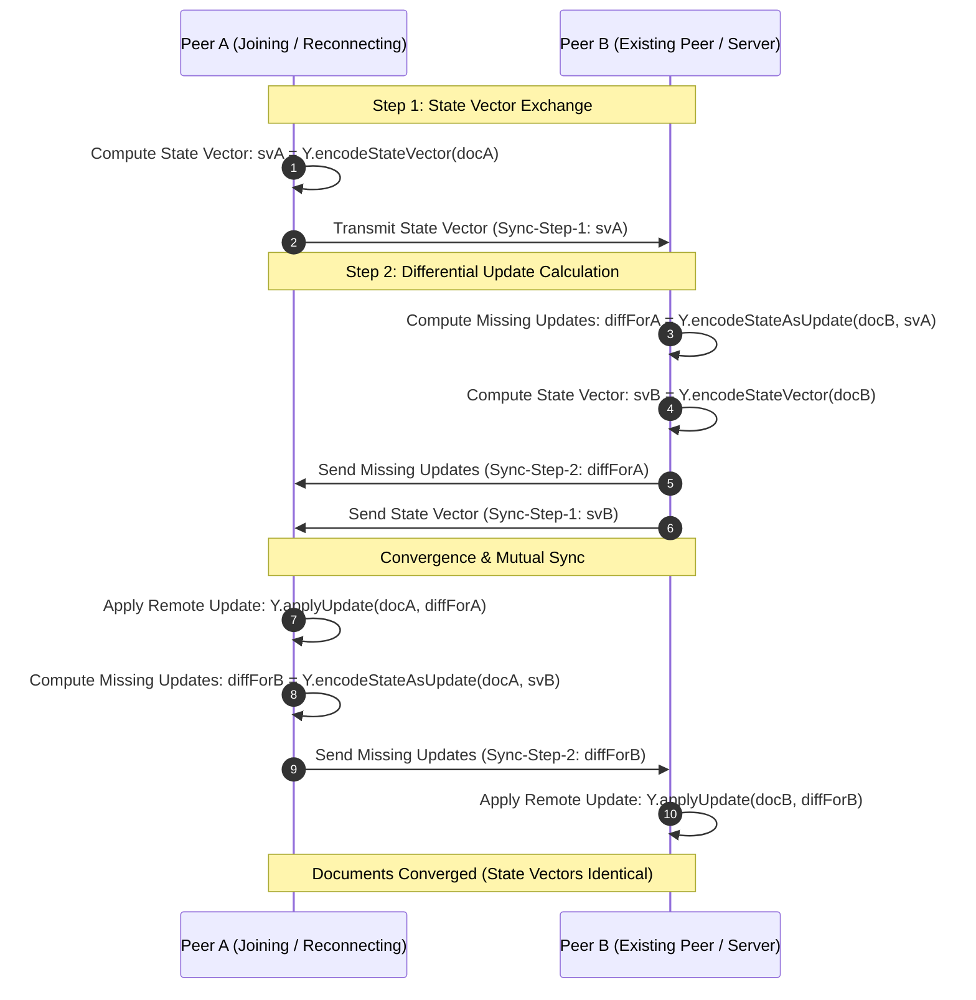
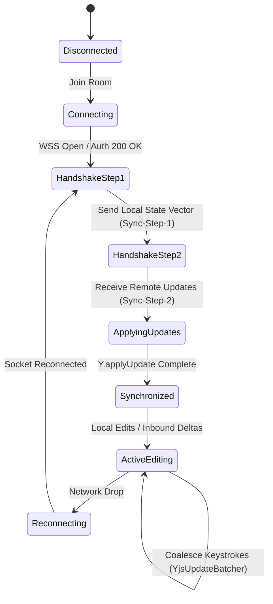

# Yjs State Vector Exchange & Differential Compaction Architecture

This specification documents the state-vector synchronization protocol, differential update computation, binary wire framing, and memory/history compaction architecture for collaborative rooms in WorkSphere.

All mechanisms described herein are verified against WorkSphere's Yjs 13.6.33 and `y-protocols` 1.0.7 integration (`src/lib/crdt/snapshotManager.ts`, `src/lib/crdt/yjsCompression.ts`, `src/components/sessions/Scratchpad.tsx`, `src/lib/crdt/awarenessCompactor.ts`, `src/core/crdt/AwarenessProtocol.ts`, and `src/workers/partykitRoom.ts`).

---

## 1. Overview and Architecture

### 1.1 Why Yjs for Collaborative State
WorkSphere allows distributed users to collaborate on interactive whiteboards, Monaco code editors, collaborative notes, and meeting scratchpads. Traditional operational transformation (OT) architectures require a central serialization server to sequence mutations. In contrast, Yjs is a Conflict-Free Replicated Data Type (CRDT) library that implements the YATA algorithm (Yet Another Transformation Approach).

Key characteristics include:
- **Zero-Lock Concurrency**: Multiple clients mutate state concurrently without acquiring exclusive distributed locks.
- **Deterministic Convergence**: Replicas that receive the same set of updates resolve to identical state regardless of delivery order, network interleaving, or packet delay.
- **Compact Binary Serialization**: State vectors and differential updates are serialized to variable-length binary byte arrays (`Uint8Array`) using `lib0` varuint encoding.

### 1.2 Yjs Core Primitives
- **`Y.Doc`**: The top-level replicated document holding shared data types (`Y.Map`, `Y.Array`, `Y.Text`).
- **Operation ID**: Every inserted item is assigned a coordinate tuple $\text{ID}(client, clock)$, where $client$ is a unique 53-bit client identifier and $clock$ is a monotonic counter starting at 0.
- **State Vector (`Y.encodeStateVector`)**: A compact map of `{ clientId: clock }` representing the highest contiguous clock observed for each client ID in the document.
- **Document Update (`Y.encodeStateAsUpdate`)**: A self-contained binary payload containing operations, deletion sets, and causal metadata.
- **Awareness Protocol**: An ephemeral, state-based presence protocol separate from durable document operations.

### 1.3 Where Yjs is Integrated in WorkSphere
WorkSphere integrates Yjs across multiple subsystems:
1. **Interactive Whiteboard & Canvas (`src/hooks/useMeshCanvasWhiteboard.ts`)**:
   - Shared `Y.Array<Y.Map<unknown>>` for whiteboard shapes and strokes.
   - P2P WebRTC data channels for low-latency mesh updates and PartyKit WebSocket fallback.
2. **Encrypted Meeting Scratchpad (`src/components/sessions/Scratchpad.tsx`)**:
   - `Y.Text` document with end-to-end encryption (AES-GCM-256) and explicit `sync-step-1` / `sync-step-2` state-vector exchange.
3. **Monaco Collaborative Editor & Snapshot Manager (`src/lib/crdt/snapshotManager.ts`)**:
   - Automatic background checkpointing, differential update batching, snapshot consolidation, and delta journal pruning.
4. **PartyKit Edge Rooms (`src/workers/partykitRoom.ts`)**:
   - Server-side Yjs document persistence with periodic PostgreSQL/REST snapshot persistence (`SNAPSHOT_INTERVAL_MS = 60_000`).

### 1.4 State Synchronization Flow
The following sequence diagram illustrates the two-step state-vector handshake between two peers:



---

## 2. State Vector Exchange — Sync Step 1

### 2.1 Role of `Y.encodeStateVector(doc)`
The state vector summarizes which operations a replica has already integrated. Rather than transmitting the entire document history or all operations, a client calls:
```typescript
const localStateVector: Uint8Array = Y.encodeStateVector(doc);
```
Internally, `Y.encodeStateVector` iterates over the document's transaction store and outputs a binary dictionary:
$$\text{StateVector} = \{ \text{clientId}_1 \mapsto \text{clock}_1, \; \text{clientId}_2 \mapsto \text{clock}_2, \; \dots, \; \text{clientId}_k \mapsto \text{clock}_k \}$$

### 2.2 Key Properties
- **Compactness**: For a room with 10 collaborators, a state vector is typically under 100 bytes, even if the document contains megabytes of drawing strokes or text lines.
- **Not a Content Snapshot**: A state vector contains **no document content**, no deleted text, and no canvas properties. It is purely a version frontier.
- **Half-Open Convention**: WorkSphere adheres to the Yjs half-open convention: clock $k$ in the vector indicates the replica has received all operations up to clock $k - 1$, and expects operation $k$ next.

### 2.3 Illustrative Exchange Example
Suppose Peer A and Peer B have edited a shared scratchpad:
- **Peer A** created operations `Client 1: [0..15]` and `Client 2: [0..8]`.
  State Vector $SV_A = \{ 1 \mapsto 16, \; 2 \mapsto 9 \}$.
- **Peer B** created operations `Client 1: [0..10]` and `Client 3: [0..4]`.
  State Vector $SV_B = \{ 1 \mapsto 11, \; 3 \mapsto 5 \}$.

When Peer A connects to Peer B:
1. Peer A sends $SV_A$ to Peer B in a `sync-step-1` message.
2. Peer B inspects $SV_A$ against its own store:
   - Client 1: Peer B has up to clock 10; Peer A has up to clock 15. Peer B needs operations from Peer A.
   - Client 2: Peer B has none; Peer A has up to clock 8. Peer B needs operations from Peer A.
   - Client 3: Peer B has up to clock 4; Peer A has none. Peer A needs operations from Peer B.
3. Peer B sends $SV_B$ to Peer A and returns the differential update for Client 3.

---

## 3. Differential Update Computation — Sync Step 2

### 3.1 Role of `Y.encodeStateAsUpdate(doc, remoteStateVector)`
When a replica receives a remote state vector, it computes the exact subset of operations that the remote peer is missing:
```typescript
const differentialUpdate: Uint8Array = Y.encodeStateAsUpdate(doc, remoteStateVector);
```

### 3.2 Computation Mechanics
- **Targeted Diffing**: Yjs scans its internal item structures. Any item whose clock is $\ge$ the clock specified in `remoteStateVector` for that client (or any client not present in `remoteStateVector`) is serialized into the update buffer.
- **Deletion Sets Included**: If an item known to the remote peer was deleted locally, Yjs includes the corresponding deletion set so the remote peer deletes the item upon applying the update.
- **Zero Full-Copy Overhead**: If the remote peer is completely up to date, `Y.encodeStateAsUpdate(doc, remoteStateVector)` returns an empty update (0 bytes of payload).

### 3.3 Receiver Application with `Y.applyUpdate`
Upon receiving the differential binary packet:
```typescript
Y.applyUpdate(doc, differentialUpdate, origin);
```
- `origin`: An optional tag (e.g., `"remote"`, `"snapshot-recovery"`, `"mesh"`) passed to `doc.on('update')` listeners so the application avoids rebroadcasting remote updates back to their source.
- `Y.applyUpdate` inserts missing items, resolves concurrent edits deterministically using client IDs as tie-breakers, and updates the local state vector.

---

## 4. Message Wire Format Breakdown

WorkSphere implements two verified wire formats for Yjs synchronization, plus a reference standard for future extensions:

### 4.1 Encrypted Scratchpad Transport Format (`src/components/sessions/Scratchpad.tsx`)
In the collaborative scratchpad, messages travel over PartyKit WebSockets wrapped in JSON envelopes with AES-GCM-256 encrypted binary payloads:

#### Sync-Step-1 Envelope
Transmitted upon socket connection:
```json
{
  "type": "sync-step-1",
  "clientId": "client_session_uuid",
  "payload": {
    "ciphertext": "base64_encrypted_bytes...",
    "iv": "base64_iv_12_bytes..."
  }
}
```
*Decrypted payload:* Raw `Y.encodeStateVector(doc)` bytes.

#### Sync-Step-2 Envelope
Transmitted in response to `sync-step-1`:
```json
{
  "type": "sync-step-2",
  "targetClientId": "client_session_uuid",
  "payload": {
    "ciphertext": "base64_encrypted_bytes...",
    "iv": "base64_iv_12_bytes..."
  }
}
```
*Decrypted payload:* Compressed Yjs wire frame containing `Y.encodeStateAsUpdate(doc, remoteVector)`.

### 4.2 Compressed Binary Wire Codec (`src/lib/crdt/yjsCompression.ts`)
WorkSphere applies a binary framing protocol to all document updates prior to encryption or WebRTC mesh transmission:

#### V2 Wire Frame (`encodeYjsWirePayload` / `decodeYjsWirePayload`)
```
 0                   1                   2                   3
 0 1 2 3 4 5 6 7 8 9 0 1 2 3 4 5 6 7 8 9 0 1 2 3 4 5 6 7 8 9 0 1
+-+-+-+-+-+-+-+-+-+-+-+-+-+-+-+-+-+-+-+-+-+-+-+-+-+-+-+-+-+-+-+-+
|       0x59 ('Y')      |       0x5A ('Z')      |   0x02 (v2)   |
+-+-+-+-+-+-+-+-+-+-+-+-+-+-+-+-+-+-+-+-+-+-+-+-+-+-+-+-+-+-+-+-+
|  Codec Byte   |             Payload Data ...                  |
| (0x00 or 0x01)|       (Raw or Deflate-Raw Compressed)         |
+-+-+-+-+-+-+-+-+-+-+-+-+-+-+-+-+-+-+-+-+-+-+-+-+-+-+-+-+-+-+-+-+
```
- **Magic Prefix**: `[0x59, 0x5a, 0x02]` (`YZ\x02`).
- **Codec Byte**:
  - `0x00` (`WireCodec.RAW`): Uncompressed raw Yjs update bytes.
  - `0x01` (`WireCodec.DEFLATE_RAW`): Deflated via native browser `CompressionStream("deflate-raw")`.
- **Threshold**: Compressed only when payload $\ge 128\text{ bytes}$ (`MIN_COMPRESSIBLE_BYTES`) and compressed length is smaller than original.
- **Safety Ceiling**: Decoded output is hard-capped at $10\text{ MB}$ (`MAX_DECODED_BYTES = 10 * 1024 * 1024`) to protect against decompression bombs.

#### Legacy V1 LZ77 Packet (`compressYjsUpdate` / `decompressYjsUpdate`)
- **Magic Header**: `[0x59, 0x5a, 0x43, 0x01]` (`YZC\x01`).
- **Header Length**: 4 bytes magic + 4 bytes Big-Endian uncompressed size.
- **Encoding**: Token `0x80` denotes match tag `[0x80, matchLength, offsetHigh, offsetLow]`; literal `0x80` escaped as `[0x80, 0x00]`.

---

## 5. Synchronization Lifecycle



### 5.1 Joining and Initial Handshake
1. **Connection Establishment**: Client connects to PartyKit room or WebRTC mesh.
2. **Step 1 Transmission**: Client sends its local state vector via `sync-step-1`. If fresh client, vector is empty (`new Uint8Array(0)`).
3. **Step 2 Response**: Remote peer computes `Y.encodeStateAsUpdate(doc, remoteVector)` and transmits missing changes.
4. **Integration**: Receiver calls `Y.applyUpdate(doc, delta, "remote")`.

### 5.2 Concurrent Mutations During Sync
Because Yjs updates are strictly monotonic and associative, updates produced locally while `sync-step-2` is in-flight do not cause races. When remote updates land, Yjs merges them seamlessly without overwriting local mutations.

### 5.3 Keystroke Coalescing (`createYjsUpdateBatcher`)
High-frequency edits (typing) produce updates of ~20 bytes. Encryption and JSON framing overhead would dwarf the payload. `createYjsUpdateBatcher` coalesces typing bursts using `Y.mergeUpdates`:
- **Leading Edge**: The first update after idle is sent immediately.
- **Trailing Burst**: Subsequent edits within $400\text{ ms}$ (`batchWindowMs = 400`) are accumulated and merged into a single update.
- **Max Delay**: Capped at $1,200\text{ ms}$ (`maxDelayMs = 1200`) to guarantee interactivity.

---

## 6. Garbage Collection and History Compaction

A critical distinction must be maintained between **Yjs Document GC** and **Storage Delta Compaction**:

| Concept | Scope | Mechanism | Impact |
| :--- | :--- | :--- | :--- |
| **Yjs Document GC** | In-Memory `Y.Doc` | `doc.gc = true` (Yjs built-in) | Reclaims content of deleted items; replaces item payloads with metadata tombstones. |
| **Storage Compaction** | Storage / Journal | `SnapshotManager.compact()` | Replaces $N$ incremental deltas with a single consolidated baseline snapshot. |
| **Awareness Cleanup** | Presence Map | `AwarenessCompactor.compactSweep()` | Evicts disconnected peer presences past 30s TTL; does **not** touch document state. |
| **Undo Retention** | Local Client | `Y.UndoManager` | Retains local mutation history for undo/redo; clears on room exit. |

### 6.1 Yjs Document Garbage Collection (`doc.gc = true`)
- When an item is deleted in Yjs, it cannot simply be erased immediately because other replicas might still send operations referencing its ID.
- With `doc.gc = true` (default in WorkSphere's `SnapshotManager`), Yjs strips the deleted item's content while keeping its item coordinate struct as a tombstone.
- Tombstones preserve causal links while releasing memory associated with deleted text, shape properties, or canvas nodes.

### 6.2 Storage Delta Compaction Danger
> [!CAUTION]
> Deleting historical update logs without a validated baseline snapshot causes **permanent data corruption**. If a reconnecting client provides a state vector older than the oldest retained update, and no baseline snapshot exists, the server cannot compute the missing delta, leaving the client permanently partitioned.

---

## 7. Differential Compaction Strategy

WorkSphere's `SnapshotManager` (`src/lib/crdt/snapshotManager.ts`) implements an atomic snapshot consolidation engine for long-running rooms:

### 7.1 Compaction Parameters & Defaults
- **Operation Threshold (`DEFAULT_SNAPSHOT_OP_THRESHOLD`)**: 500 operations.
- **Checkpoint Interval (`DEFAULT_SNAPSHOT_INTERVAL_MS`)**: 10 minutes (`600,000 ms`).
- **Compression Algorithm**: LZ77 (`compressYjsUpdate`) or Gzip (`compressYjsGzip`).
- **Compression Threshold (`compressionThresholdBytes`)**: 256 bytes.
- **Room Key Prefix**: `crdt:whiteboard:<roomId>`.

### 7.2 The Differential Compaction Algorithm
```
┌─────────────────────────────────────────────────────────────────┐
│                    SnapshotManager.compact()                    │
└─────────────────────────────────────────────────────────────────┘
                               │
                               ▼
        1. Flush In-Memory Deltas to Storage (`flushDeltas`)
           Record sequence boundary: `flushedThroughSeq`
                               │
                               ▼
        2. Evaluate State Vector Drift
           `currentStateVector = Y.encodeStateVector(doc)`
           Is `currentStateVector == lastStateVector`?
           ├── Yes ──► Load existing snapshot; skip re-encoding;
           │           Purge deltas through `flushedThroughSeq`
           └── No  ──► Proceed to Step 3
                               │
                               ▼
        3. Compute Incremental or Full Snapshot
           Has previous checkpoint (`lastStateVector`)?
           ├── Yes ──► `diffUpdate = Y.encodeStateAsUpdate(doc, lastStateVector)`
           │           Merge with prior snapshot: `Y.mergeUpdates([prev, diffUpdate])`
           └── No  ──► `uncompressedUpdate = Y.encodeStateAsUpdate(doc)`
                               │
                               ▼
        4. Checksum & Compress
           `checksum = computeSnapshotChecksum(uncompressedUpdate)` (FNV-1a 64-bit)
           Optionally compress update and stateVector
                               │
                               ▼
        5. Atomically Persist StoredSnapshot
           `storage.saveSnapshot(snapshot)`
           Update local checkpoint: `this.lastStateVector = currentStateVector`
                               │
                               ▼
        6. Acquire AsyncRWLock Exclusive Write Lock
           `releaseWrite = await gcLock.acquireWrite()`
                               │
                               ▼
        7. Safely Purge Superseded Deltas
           `storage.deleteDeltasThrough(roomId, flushedThroughSeq)`
           Release lock: `releaseWrite()`
                               │
                               ▼
        8. Decrement Operation Counter (`opsSinceSnapshot`)
```

### 7.3 Concurrency Control with AsyncRWLock (#9166)
In JavaScript runtimes, asynchronous functions yield execution at every `await`. Without concurrency control:
1. Client A initiates `recover()` and yields while reading deltas from storage.
2. Background timer triggers `compact()`, which generates a snapshot and immediately deletes deltas from storage.
3. Client A resumes, attempts to read the deleted delta, and throws a decoder failure.

**Solution in WorkSphere:**
- `recover()` acquires a shared read lock:
  ```typescript
  const releaseRead = await this.gcLock.acquireRead();
  try {
    const deltas = await this.storage.listDeltas(this.roomId);
    for (const delta of deltas) { Y.applyUpdate(this.doc, delta.update); }
  } finally {
    releaseRead();
  }
  ```
- `compact()` acquires an exclusive write lock prior to delta deletion:
  ```typescript
  const releaseWrite = await this.gcLock.acquireWrite();
  try {
    await this.storage.deleteDeltasThrough(this.roomId, flushedThroughSeq);
  } finally {
    releaseWrite();
  }
  ```

---

## 8. Ephemeral Awareness vs Document State

A common source of confusion in collaborative systems is conflating Yjs document updates with Awareness protocol updates.

```
+------------------------------------+------------------------------------+
| Yjs CRDT Document State            | Ephemeral Awareness State          |
+------------------------------------+------------------------------------+
| Durable mutations (text, shapes)   | Ephemeral presence (cursors, focus)|
| Persistent in PostgreSQL/Redis/IDB | Never persisted to long-term disk  |
| Monotonic state vector clock       | Wall-clock timestamp + sequence    |
| Replicas must retain history       | Decays automatically on disconnect |
| Pruning requires snapshot baseline | Evicted via 30s TTL heartbeat sweep|
+------------------------------------+------------------------------------+
```

### 8.1 Awareness State Schema (`src/core/crdt/AwarenessProtocol.ts`)
```typescript
export interface PeerPresenceState {
  username: string;
  avatar: string | null;
  deskId?: string | null;
  focusTimer?: FocusTimerState | null;
  cursor?: { x: number; y: number } | null;
  status: "active" | "idle" | "focusing";
  lastActiveAt: number;
}
```

### 8.2 Awareness Compaction & Tombstone GC (`src/lib/crdt/awarenessCompactor.ts`)
- **Heartbeat Timeout (`heartbeatTimeoutMs`)**: 30 seconds (`30,000 ms`).
- **Tombstone Retention (`tombstoneRetentionMs`)**: 10 seconds (`10,000 ms`).
- **Auto Sweep Interval (`autoSweepIntervalMs`)**: 15 seconds (`15,000 ms`).
- **Max Client Ceiling (`maxClientsLimit`)**: 1,000 clients.

When a peer disconnects or fails to send a heartbeat within 30 seconds:
1. `compactSweep()` marks the peer entry as a tombstone (`state: null`).
2. After 10 seconds, the tombstone is purged completely from memory.
3. Incoming awareness frames with clocks $\le$ existing recorded clocks are discarded (`staleUpdatesRejected`).

---

## 9. Failure Modes and Recovery

| Failure Scenario | Impact | WorkSphere Recovery Mechanism |
| :--- | :--- | :--- |
| **Peer Disconnect Mid-Sync** | Partial update applied or socket dropped. | Socket reconnects; triggers fresh `sync-step-1`. Yjs convergence guarantees duplicate updates are idempotent no-ops. |
| **Corrupted Snapshot Payload** | Decoder throws error during room load. | FNV-1a checksum validation detects mismatch; throws `SnapshotIntegrityError`; system falls back to raw deltas. |
| **Corrupted Delta Frame** | Single delta in journal contains invalid bytes. | `recover()` catches checksum mismatch, logs warning, skips corrupt delta, and continues replaying subsequent deltas. |
| **Lagging Client Behind Baseline** | Client reconnects after days offline; its vector is behind compacted baseline. | `isStateVectorBehind(clientVector, baseline.stateVector)` detects lag; server sends full baseline snapshot update. |
| **Decompression Bomb Attack** | Malicious payload claiming huge uncompressed size. | `yjsCompression.ts` hard-caps decoded payload at $10\text{ MB}$ (`MAX_DECODED_BYTES`). Rejects with `YjsWireError`. |

---

## 10. Security and Operational Considerations

### 10.1 Authentication & Tenancy
- **Room Authorization**: PartyKit edge workers verify Clerk JWTs during WebSocket upgrade (`Sec-WebSocket-Protocol` or `Authorization: Bearer`).
- **Tenancy Boundary**: Rooms enforce `workspaceId` checks to ensure users cannot connect to unauthorized room IDs (`ws-loc-*`, `canvas-*`).

### 10.2 Cryptographic Isolation (E2EE Scratchpads)
- Scratchpad documents are encrypted end-to-end using AES-GCM-256 (`src/components/sessions/Scratchpad.tsx`).
- PartyKit servers route encrypted payloads without possessing the session decryption key (`cryptoKeyRef`).
- Updates are compressed with `encodeYjsWirePayload` **before** encryption, because encrypted ciphertext has maximum entropy and cannot be compressed.

### 10.3 Observability & Telemetry
- **Compression Telemetry (`src/lib/crdt/compressionTelemetry.ts`)**: Tracks compression ratio, uncompressed bytes, compressed bytes, and duration in milliseconds.
- **Checksum Verification (`computeSnapshotChecksum`)**: Fast 64-bit FNV-1a hash calculated in both Node.js and browser environments for integrity telemetry.
- **Sanitized Logging**: Log messages report room IDs, operation sequences, and byte lengths; document contents and personal text are strictly excluded from logs.

---

## 11. References

- [Snapshot Manager Implementation](../../src/lib/crdt/snapshotManager.ts)
- [Binary Wire Codec & Compression Utility](../../src/lib/crdt/yjsCompression.ts)
- [Scratchpad E2EE Sync-Step-1/2 Component](../../src/components/sessions/Scratchpad.tsx)
- [Awareness Compactor Engine](../../src/lib/crdt/awarenessCompactor.ts)
- [Awareness Protocol Wrapper](../../src/core/crdt/AwarenessProtocol.ts)
- [PartyKit Collaborative Room Server](../../src/workers/partykitRoom.ts)
- [Ephemeral Awareness Compaction Runbook](./AWARENESS_VECTOR_COMPACTION.md)
- [CRDT Documentation Hub](./README.md)
- [Real-Time Collaborative Sync Architecture](../COLLABORATIVE_SYNC.md)
