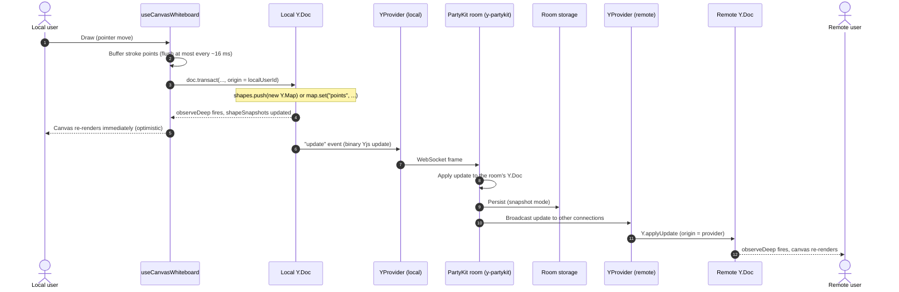
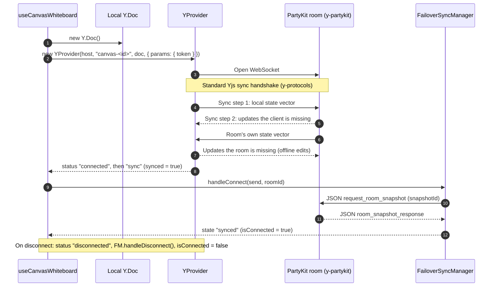

# Collaborative Whiteboard Architecture (Yjs + PartyKit)

How the collaborative canvas whiteboard keeps every participant's drawing in sync: where state lives, how a local stroke reaches other users, how concurrent edits are merged, what the server persists, and how document size and garbage collection behave.

This guide is a diagram-first overview written from the code in `src/hooks/useCanvasWhiteboard.ts`, `src/hooks/useMeshCanvasWhiteboard.ts`, `src/lib/edge/failoverSync.ts`, `party/server.ts` and the installed `y-partykit` package. It complements, and links to, the more detailed documents:

- [CRDT_CANVAS_WHITEBOARD_GUIDE.md](../CRDT_CANVAS_WHITEBOARD_GUIDE.md) – schema, undo, awareness and review checklist in depth
- [CRDT_REALTIME_SYNC_PROTOCOL.md](../CRDT_REALTIME_SYNC_PROTOCOL.md) – sync protocol, state vectors, transport summary
- [COLLABORATIVE_SYNC.md](../COLLABORATIVE_SYNC.md) – PartyKit connection lifecycle and Yjs encoding
- [YJS_CRDT_COMPRESSION.md](../YJS_CRDT_COMPRESSION.md) – binary compression and delta sync (scratchpad notes)
- [state-based-resolution.md](./state-based-resolution.md) – a separate vector-clock CRDT engine (not what the whiteboard hook uses; see [Known gaps](#8-known-gaps-and-things-to-verify))

When a detail here differs from an older document, the code is the source of truth.

## Contents

1. [Components](#1-components)
2. [The shared document](#2-the-shared-document)
3. [Sequence: one edit, end to end](#3-sequence-one-edit-end-to-end)
4. [Sequence: connecting and reconnecting](#4-sequence-connecting-and-reconnecting)
5. [Conflict resolution](#5-conflict-resolution)
6. [Document size optimization](#6-document-size-optimization)
7. [Garbage collection and persistence rules](#7-garbage-collection-and-persistence-rules)
8. [Known gaps and things to verify](#8-known-gaps-and-things-to-verify)

---

## 1. Components

| Piece               | File                                             | Role                                                                                              |
| ------------------- | ------------------------------------------------ | ------------------------------------------------------------------------------------------------- |
| Client hook         | `src/hooks/useCanvasWhiteboard.ts`               | Creates the `Y.Doc`, connects the provider, applies local edits, maintains undo/redo and presence |
| Mesh variant        | `src/hooks/useMeshCanvasWhiteboard.ts`           | Same document, plus a peer-to-peer WebRTC data-channel path                                       |
| Provider            | `y-partykit/provider` (`YProvider`)              | Sends and receives Yjs updates over a WebSocket to the room                                       |
| Room server         | `party/server.ts` (`main` in `partykit.json`)    | Handles `canvas-<id>` rooms, delegating the Yjs protocol and persistence to `y-partykit`          |
| Multi-region server | `party/multiRegionServer.ts`                     | A second server implementation that also calls `y-partykit`'s `onConnect` for canvas rooms        |
| Failover manager    | `src/lib/edge/failoverSync.ts`                   | Requests a full room snapshot after a reconnect or failover                                       |
| Canvas UI           | `src/components/whiteboard/CanvasWhiteboard.tsx` | Renders shapes and cursors from the hook's state                                                  |

The room id is `canvas-<canvasId>`. The PartyKit host comes from `NEXT_PUBLIC_PARTYKIT_URL`, defaulting to `127.0.0.1:1999` for local development. The hook sends the user's Clerk token as a `token` connection parameter; how the server uses it for canvas rooms is handled in `onConnect` in `party/server.ts` and is not covered here.

---

## 2. The shared document

All drawing state lives in one top-level Yjs array on the `Y.Doc`:

```
Y.Doc
└── "shapes": Y.Array<Y.Map>
    └── each shape is a Y.Map with keys:
        id, type, points, color, width, opacity, userId,
        deleted, deletedAt, updatedAt, clock
```

- `type` is one of `pen`, `eraser`, `rect`, `circle`, `line`, `sticky`.
- `points` is a plain number array (`[x1, y1, x2, y2, ...]`) stored as one value.
- `deleted`, `deletedAt`, `updatedAt` and `clock` implement the app's own delete and ordering rules (see [section 5](#5-conflict-resolution)).
- **Awareness** (cursor position, name, colour, `active` or `idle` status) is not part of the document. It uses Yjs awareness, which is ephemeral and never persisted.

The UI never reads the `Y.Array` directly. The hook subscribes with `shapes.observeDeep(...)`, rebuilds a plain `ShapeData[]` (skipping shapes that are deleted), and publishes it as `shapeSnapshots` React state.

---

## 3. Sequence: one edit, end to end



Notes on the steps:

- **Local first.** The local user sees their stroke immediately; the network is only needed for others to see it.
- **Throttling (step 2).** Stroke points are collected in a buffer and dispatched to the document at about 60 fps (`THROTTLE_INTERVAL_MS = 16`, issue #4918). `flushStrokeBuffer` writes the buffered points when the stroke ends.
- **Origins.** Every local transaction is tagged with the local user id. The `Y.UndoManager` only tracks that origin (`trackedOrigins`, `captureTimeout: 500` ms), so undo reverts only the local user's own edits and never a collaborator's. A separate local history (`localUndoStackRef`, `localRedoStackRef`) records add, update, delete and clear actions.
- **No echo loop.** Updates received from the provider are applied with the provider as their origin, not the local user id, so they are not re-sent and are not added to the local undo stack.
- **Read-only users.** `party/server.ts` passes `readOnly: isViewer` to `y-partykit`, which drops incoming updates from viewers. Viewers still receive everyone else's updates.

---

## 4. Sequence: connecting and reconnecting



- **Offline edits are not lost.** A `Y.Doc` keeps accepting local edits while the connection is down. On reconnect the handshake sends everything the room is missing, and Yjs merges it. Nothing is replayed from a separate queue for the whiteboard.
- **Failover snapshot.** `FailoverSyncManager` runs a small state machine (`idle`, `connecting`, `syncing_snapshot`, `synced`, `error`). After a (re)connect it sends a JSON `request_room_snapshot` over the same WebSocket and waits up to 3 seconds (`snapshotTimeoutMs`) for a `room_snapshot_response`. `isConnected` becomes `true` when the manager reports `synced`, or when the provider reports `sync` and no snapshot is pending.
- **Mesh path.** `useMeshCanvasWhiteboard` additionally receives updates from WebRTC data channels (`useMeshDataChannels`), decompresses them and applies them with the origin `"mesh"`. See [WEBRTC_MESH_CRDT_SYNC_SPECIFICATION.md](../WEBRTC_MESH_CRDT_SYNC_SPECIFICATION.md).

---

## 5. Conflict resolution

Two layers resolve concurrent edits.

**Layer 1: Yjs.** Each shape is a `Y.Map`, so edits to different properties of the same shape (for example one user changes colour while another changes width) both survive. Two edits to the _same_ property are resolved deterministically by Yjs (the same winner on every client, independent of arrival order). Concurrent `shapes.push` calls from different users both appear; the array order is the same everywhere.

**Layer 2: app-level clocks and soft deletes.** On top of Yjs the hook adds rules in `addShape`, `applyShapePoints`, `updateShape` and `deleteShape`:

- Each write stamps `updatedAt` and `clock` with `Date.now()`.
- A delete does not remove the shape. It sets `deleted: true` and records `deletedAt`.
- A write to a deleted shape is only accepted when its clock is **later** than the delete clock (`!isDeleted || now > delClock`), which allows "edit after delete" to bring a shape back.
- `applyShapePoints` ignores a write that is older than the shape's current `clock`.
- When rendering, a shape is shown if it is not deleted, or its `updatedAt` is later than its delete clock.
- `clearCanvas` marks every shape as deleted in one transaction. It is undoable through the local `clear` history action.

Because the clocks come from each client's own `Date.now()`, the outcome of "delete versus edit" depends on how closely client clocks agree (see [Known gaps](#8-known-gaps-and-things-to-verify)).

---

## 6. Document size optimization

| Technique                    | Where                                                               | Effect                                                                             |
| ---------------------------- | ------------------------------------------------------------------- | ---------------------------------------------------------------------------------- |
| Point buffering              | `strokeBufferRef`, `flushStrokeBuffer`, `THROTTLE_INTERVAL_MS = 16` | Caps stroke writes at roughly 60 per second instead of one per pointer event       |
| Binary updates               | Yjs update encoding (via `y-partykit`)                              | Updates are compact binary frames; only the change is sent, not the whole document |
| Incremental sync             | State vector handshake                                              | A reconnecting client receives only what it is missing                             |
| Snapshot persistence         | `persist: { mode: "snapshot" }` in `party/server.ts`                | The room stores one document snapshot instead of an ever-growing update log        |
| Ephemeral presence           | Yjs awareness                                                       | Cursors and participant status never enter the document or storage                 |
| Compression for mesh traffic | Data-channel payloads are decompressed before `Y.applyUpdate`       | See [YJS_CRDT_COMPRESSION.md](../YJS_CRDT_COMPRESSION.md)                          |

What is **not** optimized today: the `shapes` array only grows (shapes are soft-deleted, never removed), and a stroke's `points` array is replaced as a whole on every flush. Both are covered in [section 8](#8-known-gaps-and-things-to-verify).

---

## 7. Garbage collection and persistence rules

Three independent mechanisms are involved. Mixing them up is the usual source of confusion.

### Yjs garbage collection (`gc`)

Yjs can discard the _content_ of deleted items (for example an overwritten map value or a removed array element) and keep only a tiny tombstone, so the document stays small. It is enabled by default on a plain `Y.Doc`.

- **Client:** the hook creates `new Y.Doc()` without options, so client documents use the Yjs default.
- **Server:** `party/server.ts` calls `y-partykit` with `gc: false`, with the comment that y-partykit requires GC to be off when persisting. In `y-partykit`, `gc` defaults to `!persist` (off whenever persistence is enabled), so this is also the library's own behaviour.

Consequence: the room's copy of the document keeps the content of deleted and overwritten items.

### Persistence mode (`persist`)

| Setting                         | Where                            | Meaning                                                                                                                                                                    |
| ------------------------------- | -------------------------------- | -------------------------------------------------------------------------------------------------------------------------------------------------------------------------- |
| `persist: { mode: "snapshot" }` | `party/server.ts` (canvas rooms) | Stores a full snapshot of the document in room storage. The type definitions label this the recommended mode.                                                              |
| `persist: true`                 | `party/whiteboard.ts`            | A deprecated alias for `{ mode: "history" }` in `y-partykit` 0.0.33. That file is not referenced by `partykit.json`; see [Known gaps](#8-known-gaps-and-things-to-verify). |

In history mode, `y-partykit` keeps an update log and compacts it when the number of updates exceeds `maxUpdates` or the total size exceeds `maxBytes` (and there is more than one update). The library defaults are `MAX_BYTES = 1e7` (about 10 MB) and `MAX_UPDATES = Number.MAX_SAFE_INTEGER`, i.e. effectively unlimited updates. These limits belong to history mode; the canvas rooms use snapshot mode. How often a snapshot is written is internal to `y-partykit` and was not verified for this guide.

### Application-level tombstones

The app never removes a shape from `shapes`. Deleting sets `deleted: true`, and `clearCanvas` does the same for every shape. These are live `Y.Map` entries, so Yjs garbage collection cannot reclaim them even on a client with `gc` enabled. There is currently no purge or archive path for deleted shapes.

**Rules of thumb for contributors**

- To remove a shape permanently (for example a "compact board" feature), delete it from the `Y.Array` inside a transaction. Plain soft-deletion will not reduce size.
- Keep new per-shape fields small; every field is stored for every shape for the lifetime of the board.
- Do not put cursors, selections or other transient state in the document; use awareness.
- If you change persistence options, re-check the `gc` interaction described above.

---

## 8. Known gaps and things to verify

These are observations from reading the code while writing this guide. They are not confirmed bugs; each is worth a quick check.

1. **`party/whiteboard.ts` appears unused.** `partykit.json` sets `main` to `party/server.ts` and the client hook does not select a named party, so canvas rooms are served by `server.ts` (snapshot persistence, `gc: false`). `whiteboard.ts` still contains `persist: true`, and older diagrams (for example in `CRDT_CANVAS_WHITEBOARD_GUIDE.md`) show `persist: true`; the running configuration is `persist: { mode: "snapshot" }`.
2. **Boards only grow.** Shapes are soft-deleted and never removed, and `clearCanvas` only marks them deleted. With persistence on, the room's document and snapshot keep growing with every shape ever drawn.
3. **Stroke points are rewritten wholesale.** `applyShapePoints` calls `map.set("points", points.slice())` with the full array on every flush. Each call supersedes the previous array. With `gc: false` on the server, the superseded arrays should be retained, so stored size could grow with stroke length times the number of flushes. Worth measuring the snapshot size of a board with long strokes; an append-only structure for points would avoid the copies.
4. **Client clocks decide delete-versus-edit.** The `clock`, `updatedAt` and `deletedAt` values come from each client's `Date.now()`. Skew between devices can flip whether an edit or a delete wins.
5. **Snapshot response wiring.** `FailoverSyncManager` expects a `room_snapshot_response` message. `party/server.ts` and `party/multiRegionServer.ts` handle `request_room_snapshot`, but in the hook's setup code reviewed for this guide no call forwards incoming `room_snapshot_response` messages to the manager. Check what happens when the 3 second snapshot timeout fires.
6. **A second Yjs server path.** `party/multiRegionServer.ts` also calls `y-partykit`'s `onConnect` for canvas rooms. Its persistence and `gc` options were not reviewed here.
7. **Two different conflict models in the docs.** `state-based-resolution.md` describes a vector-clock, state-based CRDT engine with causal tombstone garbage collection. The whiteboard hook does not use it; it uses Yjs plus the `clock` fields described in [section 5](#5-conflict-resolution).
