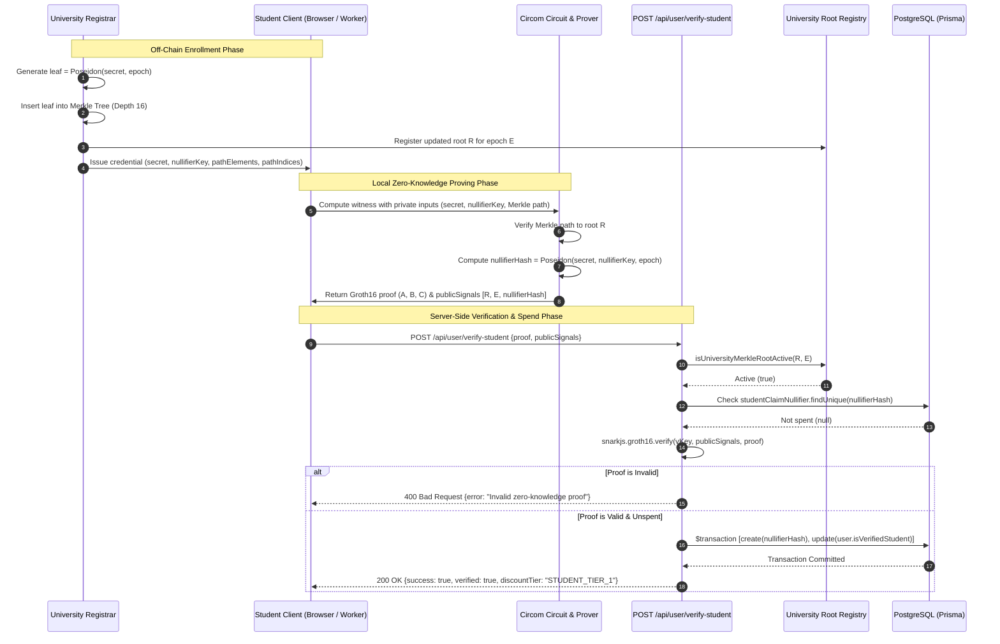

# End-to-End Cryptographic Verification Specification for Student Discount Zero-Knowledge Proofs

**Specification Document:** `docs/crypto/STUDENT_ZKP_VERIFICATION_SPEC.md`
**Reference Circom Circuits:**
- [`circuits/student_access_pass.circom`](../../circuits/student_access_pass.circom) (3-signal circuit: root, epoch, nullifierHash)
- [`circuits/student_membership.circom`](../../circuits/student_membership.circom) (2-signal circuit: root, epoch)
**Reference API Routes & Verifiers:**
- [`src/app/api/user/verify-student/route.ts`](../../src/app/api/user/verify-student/route.ts)
- [`src/lib/zkp/studentMembership.ts`](../../src/lib/zkp/studentMembership.ts)
- [`src/lib/crypto/zkNullifierVerifier.ts`](../../src/lib/crypto/zkNullifierVerifier.ts)
- [`src/components/student/StudentDiscountVerification.tsx`](../../src/components/student/StudentDiscountVerification.tsx)
**Tests:**
- [`src/__tests__/zkp/studentAccessPass.test.ts`](../../src/__tests__/zkp/studentAccessPass.test.ts)
- [`src/__tests__/zkp/studentMembershipProof.test.ts`](../../src/__tests__/zkp/studentMembershipProof.test.ts)
- [`src/__tests__/components/StudentDiscountVerification.test.tsx`](../../src/__tests__/components/StudentDiscountVerification.test.tsx)
**Target Issue:** #8625

---

## 1. Overview

The WorkSphere Student Discount Zero-Knowledge Proof (ZKP) system enables enrolled university students to claim workspace discounts and verified student credentials anonymously. By combining Circom-based arithmetic constraint circuits with Groth16 zero-knowledge arguments of knowledge over the BN254 (alt_bn128) elliptic curve, students can mathematically prove active enrollment under an accredited university Merkle root without disclosing their student ID, real name, email address, or academic record.

### Privacy Objectives
- **Zero-Knowledge Identity Protection:** The student's private identity secret ($s$) and derivation key ($k$) are never transmitted over the network or revealed to WorkSphere verifiers.
- **Selective Disclosure:** Only public validity commitments (Merkle root $R$, academic epoch $E$, and anonymized nullifier hash $N$) are published.
- **Double-Claim Prevention (Replay Resistance):** Each student possesses an epoch-bound deterministic nullifier hash $N = \text{Poseidon}(s, k, E)$. Submitting the same credential twice within the same academic epoch triggers an atomic database uniqueness rejection without deanonymizing the claimant.
- **Unlinkability Across Epochs:** Because nullifiers incorporate the academic epoch $E$, nullifier hashes generated for epoch $E_1$ (e.g. 2026) cannot be correlated with nullifiers generated for epoch $E_2$ (e.g. 2027) by third-party observers.

---

## 2. System Architecture

The cryptographic architecture spans four discrete trust domains:

```mermaid
flowchart TD
    subgraph Accredited University / Credential Issuer
        Issuer[University Registrar / Identity Provider]
        MTree[(University Merkle Tree)]
    end

    subgraph Student Client Device
        Secret[Student Identity Secret: s]
        NKey[Nullifier Derivation Key: k]
        WitnessGen[snarkjs / WASM Witness Calculator]
        Prover[Groth16 Prover over BN254]
    end

    subgraph WorkSphere Verification Edge
        API[POST /api/user/verify-student]
        RootCheck[University Root Registry: isUniversityMerkleRootActive]
        SnarkVerifier[snarkjs.groth16.verify]
        VKey[(student_access_pass_vkey.json)]
    end

    subgraph Persistence Layer
        DB[(PostgreSQL / Prisma)]
        NullifierTable[StudentClaimNullifier: unique nullifierHash]
        UserTable[User: isVerifiedStudent flag]
    end

    Issuer -->|Enrollment Leaf: Poseidon s, E| MTree
    MTree -.->|Merkle Sibling Path: pathElements, pathIndices| Student Client Device
    Secret & NKey & MTree --> WitnessGen
    WitnessGen --> Prover
    Prover -->|Proof A, B, C + publicSignals| API
    API --> RootCheck
    API --> VKey
    VKey --> SnarkVerifier
    API -->|Atomic Transaction: P2002 Guard| DB
    DB --> NullifierTable
    DB --> UserTable
```

### Components and Roles
1. **Credential Issuer (University Authority):** Computes student leaf commitments $C = \text{Poseidon}(s, E)$ and publishes the Merkle root $R$ to the active university registry.
2. **Student Client (Worker / Browser):** Computes witness and Groth16 proof locally inside an isolated Web Worker (`zkpWorker.ts`) using `student_membership.wasm` and `student_membership.zkey`.
3. **Groth16 Verifier (API Handler):** Validates the cryptographic proof $\pi = (A, B, C)$ and public signals against the pinned verification key.
4. **Nullifier Ledger:** Prisma PostgreSQL database holding `StudentClaimNullifier` table with unique constraint on `nullifierHash`.

---

## 3. Credential Issuance Flow

Credential issuance in WorkSphere follows an off-chain registrar commitment model:
1. **Enrollment Commitment:** The university registrar issues the student a cryptographically secure 253-bit scalar identity secret $s \in \mathbb{F}_r$.
2. **Leaf Construction:** For academic year epoch $E$ (e.g. `2026`), the enrollment leaf is formed via 2-input Poseidon hashing:
   $$\text{Leaf} = \text{Poseidon}_2(s, E)$$
3. **Merkle Membership Path:** The leaf is inserted into a depth-16 binary Merkle tree capable of holding up to $2^{16} = 65,536$ student enrollments per institution. The student receives their sibling path hashes $\vec{P} \in \mathbb{F}_r^{16}$ and position direction bits $\vec{I} \in \{0, 1\}^{16}$.
4. **Root Publication:** The university updates its root $R$, which is registered in WorkSphere's accredited root table via `isUniversityMerkleRootActive(root, epoch)`.

---

## 4. Circom Circuit Specification

The repository provides two production Circom templates under `circuits/`:

### A. Primary Production Circuit: `student_access_pass.circom`
- **File:** `circuits/student_access_pass.circom`
- **Template:** `StudentAccessPass(levels = 16)`
- **Constraint Count:** Approximately 8,800 R1CS constraints.
- **Signals:**
  - **Public Inputs:** `root`, `epoch`, `nullifierHash`
  - **Private Inputs:** `secret`, `nullifierKey`, `pathElements[16]`, `pathIndices[16]`

```circom
// DualMux Selector Bit Constraint:
s * (1 - s) === 0;
out[0] <== (in[1] - in[0]) * s + in[0];
out[1] <== (in[0] - in[1]) * s + in[1];

// Nullifier Hash Integrity Constraint:
component nullifierHasher = Poseidon(3);
nullifierHasher.inputs[0] <== secret;
nullifierHasher.inputs[1] <== nullifierKey;
nullifierHasher.inputs[2] <== epoch;
nullifierHash === nullifierHasher.out;

// Leaf Commitment Integrity:
component leafHasher = Poseidon(2);
leafHasher.inputs[0] <== secret;
leafHasher.inputs[1] <== epoch;

// Merkle Root Accumulation:
root === currentHash[levels];
```

### Public Signal Vector Layout (`StudentAccessPass`)

| Index | Signal Name | Visibility | Field Type | Semantic Meaning | Validation Rule |
|:---:|:---|:---:|:---:|:---|:---|
| `[0]` | `root` | Public | $\mathbb{F}_r$ scalar string | Active University Merkle Root | Verified in `isUniversityMerkleRootActive(root, epoch)` |
| `[1]` | `epoch` | Public | Scalar string (int) | Academic Year Epoch (e.g. `2026`) | Checked against active registration window |
| `[2]` | `nullifierHash` | Public | $\mathbb{F}_r$ scalar string | Unique anonymized spend nullifier | Replay check in `StudentClaimNullifier.findUnique` |

> [!IMPORTANT]
> The public signal array order generated by Circom and snarkjs is strictly:
> `publicSignals[0] = root`, `publicSignals[1] = epoch`, `publicSignals[2] = nullifierHash`.
> The verifier in `src/app/api/user/verify-student/route.ts` parses this exact ordering, with backward-compatibility fallbacks for epoch position length.

### B. Membership-Only Circuit: `student_membership.circom`
- **File:** `circuits/student_membership.circom`
- **Template:** `StudentMembership(16)`
- **Public Signals:** `[0] = root`, `[1] = epoch`
- Used for zero-knowledge venue access gates where nullifiers are not spent (read-only membership checks).

---

## 5. Cryptographic Primitives and Parameters

1. **Curve:** **BN254** (also known as `alt_bn128` or `bn128`), a pairing-friendly elliptic curve with equation $y^2 = x^3 + 3$ over $\mathbb{F}_q$.
   - **Scalar Field Modulus ($r$):**
     $$r = 21888242871839275222246405745257275088548364400416034343698204186575808495617$$
   - **Base Field Modulus ($q$):**
     $$q = 21888242871839275222246405745257275088696311157297823662689037894645226208583$$
2. **Proving Scheme:** **Groth16** (Groth 2016).
   - Proof structure: $\pi = (A \in \mathbb{G}_1, B \in \mathbb{G}_2, C \in \mathbb{G}_1)$.
   - Pairing verification equation:
     $$e(A, B) = e(\alpha, \beta) \cdot e\left(\sum_{i=0}^l x_i \cdot \frac{\beta u_i(x) + \alpha v_i(x) + w_i(x)}{\gamma}, \gamma\right) \cdot e(C, \delta)$$
3. **Hash Primitive:** **Poseidon Hash** (StarkWare / Grassi et al.).
   - Optimized for algebraic circuits over BN254 with minimal constraint footprint (approx. 240 constraints for $t=3$, 300 constraints for $t=4$).
   - Used for leaf hashing ($t=3$, 2 inputs) and nullifier hashing ($t=4$, 3 inputs).

---

## 6. Verification Key Generation and Setup Pipeline

The setup ceremony script is defined in `scripts/compile-membership-zkp.sh`:

```bash
# 1. Compile Circom to R1CS and WASM
npx circom2 circuits/student_access_pass.circom --r1cs --wasm --sym -o build/

# 2. Phase 1 Powers of Tau (bn128, 2^14 power ceremony)
npx snarkjs powersoftau new bn128 14 build/pot14_0000.ptau -v
npx snarkjs powersoftau contribute build/pot14_0000.ptau build/pot14_0001.ptau \
  --name="worksphere" -e="$(openssl rand -hex 32)"
npx snarkjs powersoftau prepare phase2 build/pot14_0001.ptau build/pot14_final.ptau

# 3. Phase 2 Circuit-Specific Groth16 Setup
npx snarkjs groth16 setup build/student_access_pass.r1cs build/pot14_final.ptau build/student_pass_0000.zkey
npx snarkjs zkey contribute build/student_pass_0000.zkey public/zkp/student_access_pass.zkey \
  --name="worksphere" -e="$(openssl rand -hex 32)"

# 4. Export JSON Verification Key
npx snarkjs zkey export verificationkey public/zkp/student_access_pass.zkey public/zkp/student_access_pass_vkey.json
```

### Verification Key Integrity & Pinning
- **Storage Path:** Pinned at `public/zkp/student_access_pass_vkey.json` and `public/zkp/student_membership_vkey.json`.
- **Runtime Resolution:** `src/app/api/user/verify-student/route.ts` selects the verification key dynamically based on `publicSignals.length`:
  - `length === 3` $\to$ loads `student_access_pass_vkey.json`
  - `length === 2` $\to$ loads `student_membership_vkey.json`
  - Fallback $\to$ loads legacy `verification_key.json`

---

## 7. Client-Side Proof Generation Flow

Client-side execution is handled by `StudentDiscountVerification.tsx` and background worker `src/workers/zkpWorker.ts`:

1. **Credential Retrieval:** The student inputs or loads their credentials (identity secret $s$, nullifier key $k$, Merkle proof elements and indices).
2. **Worker Dispatch:** Proving computation is spawned in a non-blocking dedicated Web Worker to prevent UI lockup.
3. **Execution via `snarkjs.groth16.fullProve`:**
   ```ts
   const { proof, publicSignals } = await snarkjs.groth16.fullProve(
     {
       root: merkleProof.root,
       epoch: "2026",
       nullifierHash: computedNullifier,
       secret: userSecret,
       nullifierKey: userNullifierKey,
       pathElements: merkleProof.siblings,
       pathIndices: merkleProof.pathIndices,
     },
     "/zkp/student_access_pass.wasm",
     "/zkp/student_access_pass.zkey"
   );
   ```
4. **Client Caching:** Successful proofs are indexed into browser localStorage under key `worksphere-zkp-verified` with a 24-hour TTL (`ZKP_CACHE_TTL_MS = 86,400,000`).

---

## 8. Server-Side Proof Verification Flow

The verification endpoint is hosted at `POST /api/user/verify-student`:

1. **Authentication Check:** Requires authenticated user session via Clerk (`await auth()`). Returns `401 Unauthorized` if unauthenticated.
2. **Payload Parsing:** Accepts JSON object with `{ proof, publicSignals, root?, epoch?, nullifierHash? }`.
3. **Scalar Field Validation:** Implicitly validated by snarkjs during pairing calculation. Inputs exceeding scalar modulus $r$ cause immediate rejection.
4. **University Root Verification:**
   ```ts
   const isRootActive = await isUniversityMerkleRootActive(root, epoch);
   if (!isRootActive) {
     return NextResponse.json({ error: "Invalid or inactive university Merkle root" }, { status: 400 });
   }
   ```
5. **Nullifier Uniqueness Check:** Checks `prisma.studentClaimNullifier.findUnique({ where: { nullifierHash } })`. If present, aborts with HTTP `409 Conflict` (`NULLIFIER_ALREADY_SPENT`).
6. **Cryptographic Proof Check:**
   ```ts
   const isValid = await snarkjs.groth16.verify(vKey, publicSignals, proof);
   if (!isValid) return NextResponse.json({ error: "Invalid zero-knowledge proof" }, { status: 400 });
   ```
7. **Atomic State Persistence:** Executes an atomic database transaction:
   ```ts
   await prisma.$transaction([
     prisma.studentClaimNullifier.create({
       data: { nullifierHash, epoch: Number(epoch) || 2026 },
     }),
     prisma.user.update({
       where: { id: userId },
       data: { isVerifiedStudent: true },
     }),
   ]);
   ```

---

## 9. Nullifier and Replay Prevention

- **Mathematical Derivation:**
  $$\text{nullifierHash} = \text{Poseidon}_3(\text{secret}, \text{nullifierKey}, \text{epoch})$$
- **Scope:** Epoch-bound and identity-bound. A student can only produce one valid nullifier per academic year epoch.
- **Storage Representation:** Standard relational database table (`student_claim_nullifiers`):
  ```prisma
  model StudentClaimNullifier {
    id            String   @id @default(uuid())
    nullifierHash String   @unique
    epoch         Int
    createdAt     DateTime @default(now())

    @@index([epoch])
  }
  ```
- **Concurrency & Race Condition Handling:**
  If two requests with the identical `nullifierHash` execute concurrently:
  1. Both pass the initial `findUnique` check.
  2. The database engine enforces the `@unique` constraint during `prisma.studentClaimNullifier.create`.
  3. The losing request throws a `P2002` Prisma unique constraint error, caught by the handler and returned as HTTP `409 Conflict`.

---

## 10. End-to-End Sequence Diagram



---

## 11. Failure Modes and Security Considerations

| Failure Mode | Trigger Condition | System Behavior & Defense | HTTP Status |
|:---|:---|:---|:---:|
| **Forged Proof** | Attacker tampers with proof $A, B, C$ | `snarkjs.groth16.verify` fails pairing equation | `400 Bad Request` |
| **Inactive Merkle Root** | Student presents credential from unaccredited or expired root | `isUniversityMerkleRootActive` returns `false` | `400 Bad Request` |
| **Replay / Double Claim** | Student or attacker submits previously spent nullifier | `studentClaimNullifier.findUnique` or DB `P2002` catches collision | `409 Conflict` |
| **Concurrent Race** | Parallel requests with same nullifier | Database serializes write; second commit triggers unique constraint exception | `409 Conflict` |
| **Out of Memory Prover** | Mobile client has $< 512\text{ MB}$ WebAssembly RAM | `StudentDiscountVerification.tsx` catches worker OOM; prompts server fallback | Client Handled |
| **Missing Verification Key** | Key JSON file absent from server disk | Explicit `fs.existsSync` check returns error before verification | `500 Server Error` |
| **Scalar Modulus Overflow** | Public signal string exceeds $r$ | Snarkjs BigInt scalar parser throws during pairing check | `400 Bad Request` |

---

## 12. Security Assumptions and Limitations

1. **Trusted Setup Assumption:** Security relies on the Powers of Tau ceremony. In the repository, `scripts/compile-membership-zkp.sh` executes a local Phase 2 contribution. Production deployments must transition to a publicly audited multi-party trusted setup ceremony (e.g. Hermez / Perpetual Powers of Tau).
2. **University Root Authenticity:** The verifier trusts `isUniversityMerkleRootActive`. Compromise of university admin keys could allow rogue root injection.
3. **Absence of In-Circuit Revocation:** The circuit verifies inclusion under root $R$. Real-time credential revocation requires either rotating root $R$ or tracking non-membership accumulators.
4. **Client Device Security:** The student's private `secret` and `nullifierKey` reside on the client device during proving; a compromised client OS can exfiltrate these scalars.

---

## 13. Developer Setup and Reproducibility

### Circuit Compilation & Key Generation
```bash
# Compile student access pass circuit
npx circom2 circuits/student_access_pass.circom --r1cs --wasm --sym -o build/

# Generate development zkey using 2^14 Powers of Tau
npx snarkjs groth16 setup build/student_access_pass.r1cs circuits/build/pot14_final.ptau build/pass_0000.zkey
npx snarkjs zkey contribute build/pass_0000.zkey public/zkp/student_access_pass.zkey \
  --name="dev" -e="0123456789abcdef0123456789abcdef0123456789abcdef0123456789abcdef"

# Export verification key
npx snarkjs zkey export verificationkey public/zkp/student_access_pass.zkey public/zkp/student_access_pass_vkey.json
```

### Running Test Suites
```bash
# Execute Jest circuit & access pass unit tests
npx jest src/__tests__/zkp/studentAccessPass.test.ts src/__tests__/zkp/studentMembershipProof.test.ts --forceExit

# Execute UI verification component tests
npx jest src/__tests__/components/StudentDiscountVerification.test.tsx --forceExit
```

---

## 14. Source References

- **Circom Circuits:**
  - [`circuits/student_access_pass.circom`](../../circuits/student_access_pass.circom)
  - [`circuits/student_membership.circom`](../../circuits/student_membership.circom)
- **API Endpoints & Handlers:**
  - [`src/app/api/user/verify-student/route.ts`](../../src/app/api/user/verify-student/route.ts)
  - [`src/lib/zkp/studentMembership.ts`](../../src/lib/zkp/studentMembership.ts)
  - [`src/lib/zkp/nullifierLedger.ts`](../../src/lib/zkp/nullifierLedger.ts)
- **Client Prover Components:**
  - [`src/components/student/StudentDiscountVerification.tsx`](../../src/components/student/StudentDiscountVerification.tsx)
  - [`src/hooks/useZkpStudentProof.ts`](../../src/hooks/useZkpStudentProof.ts)
- **Database Schema:**
  - `prisma/schema.prisma` (`model StudentClaimNullifier`, `model User`)
- **Compilation Scripts:**
  - [`scripts/compile-membership-zkp.sh`](../../scripts/compile-membership-zkp.sh)
  - [`scripts/bench-student-access-pass.mjs`](../../scripts/bench-student-access-pass.mjs)
