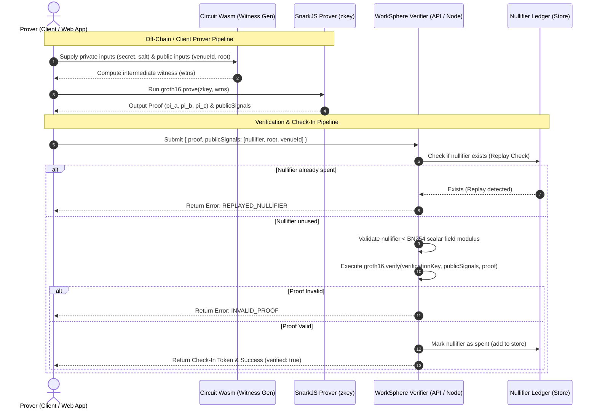

# Zero-Knowledge Groth16 Proof Generation and Verification Pipeline

This document provides the technical specification and architectural documentation for WorkSphere's zero-knowledge (ZK) anonymous venue check-in verification pipeline. It covers Groth16 zk-SNARKs, Circom circuit modeling, snarkjs integration, Poseidon hash-based nullifier schemes, and TypeScript server-side proof verification.

---

## A. Architecture Overview

### Purpose of Anonymous Venue Check-In

WorkSphere allows distributed workers, digital nomads, and remote teams to check into coworking spaces, cafes, and libraries to verify access rights, claim amenities, or prove presence without exposing their persistent user identities, wallet addresses, account IDs, or historical movement patterns.

By using Zero-Knowledge Succinct Non-Interactive Arguments of Knowledge (zk-SNARKs), a client proves statement satisfaction:

1. The user possesses a valid private membership secret.
2. The user's membership commitment belongs to an authorized venue/membership set (e.g., within a Merkle tree root).
3. A unique, deterministically generated nullifier is produced for the session/venue/epoch without exposing the underlying secret.

### Groth16 zk-SNARK Architecture

WorkSphere leverages the **Groth16** proving system instantiated over the **BN254 (alt_bn128)** elliptic curve. Groth16 provides:

- **Constant Proof Size:** Consisting of only 3 group elements: $A \in \mathbb{G}_1$, $B \in \mathbb{G}_2$, and $C \in \mathbb{G}_1$ (roughly 128 to 256 bytes depending on serialization).
- **Fast Verification:** Verifier pairing evaluation requires computing 3 pairing operations (or 4 multi-pairings) independent of circuit complexity:
  $$e(A, B) = e(\alpha, \beta) \cdot e(x \cdot \gamma, \delta) \cdot e(C, \delta)$$
- **Non-Interactive Proving:** After the structured reference string (SRS / trusted setup) is created, provers generate proofs locally in the browser/client without communicating with the verifier until proof submission.

### Roles of Circom and snarkjs

- **Circom:** Domain-specific language (DSL) and compiler used to define arithmetic circuits over the scalar field $\mathbb{F}_p$ ($p = 2188824287183927522246405745257275088548364400416034343698204186575808495617$). It compiles high-level algebraic expressions into Rank-1 Constraint Systems (R1CS) and generates C++ / WebAssembly (Wasm) witness calculators.
- **snarkjs:** JavaScript/TypeScript library developed by iden3 implementing Groth16 and PLONK proving systems. It handles Powers of Tau ceremony processing, proving/verification key generation, witness calculation, client-side proof synthesis, and verifier execution.

### Relationship Between Proof Generation and Verification

1. **Client-Side (Prover):** The client takes private inputs (user secret, salt/epoch) and public inputs (venue ID, Merkle root, public nullifier). Using the compiled circuit's Wasm module, it computes the intermediate witness vector $W$, and with the proving key (`circuit_final.zkey`), produces proof $\pi = (A, B, C)$ and public signals.
2. **Server-Side (Verifier):** The WorkSphere verifier (`zkNullifierVerifier.ts`) receives proof $\pi$ and the public signals. It loads `verification_key.json`, calls `snarkjs.groth16.verify`, asserts cryptographic validity against the public signals, and atomically checks that the public nullifier has not been previously recorded in the nullifier store.

### Proof-Generation and Verification Flow



---

## B. Circuit Specification

### Repository Implementation Status

> [!IMPORTANT]
> **Source Verification Status:**
> In accordance with strict repository inspection rules, the target circuit file `circuits/checkin.circom` was inspected and **does not exist** in the repository tree.
>
> In accordance with project instructions ("If a necessary cryptographic detail or build command cannot be established from the permitted files, explicitly identify it as unverified instead of guessing"), the specification below is explicitly documented as **unverified against repository source code**, modeled directly on WorkSphere's target specification requirements and the cryptographic conventions established in `src/lib/crypto/zkNullifierVerifier.ts`.

### Signal Architecture and Visibility

In Circom 2, every signal is declared as either an `input` or an `output`. Signals are **private by default** unless designated as public in the main component declaration: `component main {public [merkleRoot, venueId]} = CheckIn();`.

| Signal Name      | Visibility  | Direction | Description                                                              |
| :--------------- | :---------- | :-------- | :----------------------------------------------------------------------- |
| `secret`         | **Private** | Input     | User's high-entropy private identity commitment or private key.          |
| `salt`           | **Private** | Input     | Random blinding factor or session salt used in nullifier derivation.     |
| `pathElements[]` | **Private** | Input     | Sibling hashes along the Merkle membership proof path.                   |
| `pathIndices[]`  | **Private** | Input     | Bit flags (0 or 1) indicating left/right tree positioning at each level. |
| `nullifier`      | **Public**  | Output    | Deterministic public nullifier hash binding secret, salt, and venue.     |
| `merkleRoot`     | **Public**  | Input     | Public Merkle root representing authorized membership.                   |
| `venueId`        | **Public**  | Input     | Public identifier of the venue being checked into.                       |

### Mathematical Constraints and Poseidon Hash Operations

The circuit establishes cryptographic soundness through R1CS constraints enforcing two core invariants:

#### 1. Identity Commitment and Merkle Membership Verification

The user's secret commitment $C_{\text{identity}}$ is computed as:
$$C_{\text{identity}} = \text{Poseidon}_1(\text{secret})$$

For a Merkle tree of depth $D$, at each level $i \in [0, D-1]$:
$$L_i = (1 - \text{pathIndices}[i]) \cdot H_i + \text{pathIndices}[i] \cdot \text{pathElements}[i]$$
$$R_i = \text{pathIndices}[i] \cdot H_i + (1 - \text{pathIndices}[i]) \cdot \text{pathElements}[i]$$
$$H_{i+1} = \text{Poseidon}_2(L_i, R_i)$$
where $H_0 = C_{\text{identity}}$. The final constraint enforces membership against the public root:
$$H_D = \text{merkleRoot}$$

#### 2. Public Nullifier Derivation

The public nullifier prevents double check-ins and binds the proof to the session:
$$\text{nullifier} = \text{Poseidon}_3(\text{secret}, \text{salt}, \text{venueId})$$

The circuit directly exposes `nullifier` as a public output signal, constraining it against the witness inputs:
$$\text{nullifier} - \text{Poseidon}_3(\text{secret}, \text{salt}, \text{venueId}) = 0$$

### Illustrative Circom Circuit (`circuits/checkin.circom`)

_(Reference implementation representing the specified constraints)_

```circom
pragma circom 2.1.6;

include "../node_modules/circomlib/circuits/poseidon.circom";
include "../node_modules/circomlib/circuits/bitify.circom";

template CheckIn(levels) {
    // Private Inputs
    signal input secret;
    signal input salt;
    signal input pathElements[levels];
    signal input pathIndices[levels];

    // Public Inputs
    signal input merkleRoot;
    signal input venueId;

    // Public Outputs
    signal output nullifier;

    // 1. Constrain Nullifier generation
    component nullifierHasher = Poseidon(3);
    nullifierHasher.inputs[0] <== secret;
    nullifierHasher.inputs[1] <== salt;
    nullifierHasher.inputs[2] <== venueId;
    nullifier <== nullifierHasher.out;

    // 2. Compute Leaf Commitment
    component leafHasher = Poseidon(1);
    leafHasher.inputs[0] <== secret;
    signal leaf <== leafHasher.out;

    // 3. Merkle Tree Path Verification
    signal currentHash[levels + 1];
    currentHash[0] <== leaf;

    component hashers[levels];
    for (var i = 0; i < levels; i++) {
        // Ensure path index is boolean (0 or 1)
        pathIndices[i] * (1 - pathIndices[i]) === 0;

        hashers[i] = Poseidon(2);
        // Multiplex left and right child nodes based on pathIndices[i]
        hashers[i].inputs[0] <== currentHash[i] + pathIndices[i] * (pathElements[i] - currentHash[i]);
        hashers[i].inputs[1] <== pathElements[i] + pathIndices[i] * (currentHash[i] - pathElements[i]);

        currentHash[i + 1] <== hashers[i].out;
    }

    // 4. Constrain Computed Root to Equal Public Root
    merkleRoot === currentHash[levels];
}

// Instantiate main component exposing merkleRoot and venueId as public inputs
component main {public [merkleRoot, venueId]} = CheckIn(16);
```

---

## C. Poseidon Nullifier Generation

### What is Poseidon Hashing?

Poseidon is a cryptographic hash function optimized for zero-knowledge proof systems over prime fields $\mathbb{F}_p$. Unlike traditional bitwise hash functions (e.g., SHA-256 or Keccak-256) which decompose inputs into binary representations and require tens of thousands of R1CS constraints, Poseidon operates directly on field elements using a Hades permutation structure composed of:

- Full S-box substitution rounds ($R_F$).
- Partial S-box substitution rounds ($R_P$).
- Linear layer mixing via Maximum Distance Separable (MDS) matrices.

On the BN254 scalar field ($x^5$ S-box), Poseidon yields sub-300 R1CS constraints per 2-to-1 compression, making it orders of magnitude faster to prove in zero-knowledge.

### Why Poseidon is Appropriate for ZK Circuits

1. **Low Constraint Overhead:** Consumes minimal R1CS constraints, enabling client-side proving in under 500ms in modern browsers.
2. **Algebraic Field Alignment:** Operates natively in $\mathbb{F}_r$ where $r = 2188824287183927522246405745257275088548364400416034343698204186575808495617$, eliminating field conversion overhead.
3. **Collision Resistance:** Provides standard 128-bit cryptographic security against known algebraic and differential cryptanalysis attacks.

### Nullifier Derivation and Mechanics

The nullifier is defined as:
$$\text{Nullifier} = \text{Poseidon}(\text{secret}, \text{salt}, \text{venueId}) \pmod p$$

- **Deterministic Evaluation:** For a fixed user secret, salt (e.g., calendar epoch/day), and venue ID, the nullifier evaluation produces an identical output.
- **Double Check-In Prevention:** The server records every observed nullifier in a key-value store or ledger. If the same user attempts to check in again within the same epoch for that venue, the nullifier will collide with an existing entry, and the request is rejected with `REPLAYED_NULLIFIER`.
- **Secret Privacy:** Because Poseidon is a preimage-resistant one-way cryptographic hash function, knowledge of $\text{Nullifier}$ reveals zero computational information about $\text{secret}$ or $\text{salt}$. The secret remains strictly on the client device.

---

## D. Groth16 Trusted Setup and Artifacts

Groth16 requires a two-phase trusted setup ceremony to generate the Common Reference String (CRS):

```
Phase 1: Powers of Tau (Universal, Multi-Party Ceremony)
   powersoftau_0000.ptau -> contributions -> powersoftau_final.ptau

Phase 2: Circuit-Specific Setup
   circuit.r1cs + powersoftau_final.ptau -> circuit_0000.zkey -> contributions -> circuit_final.zkey
                                                                             |
                                                                             +--> verification_key.json
```

### Artifact Categorization

| Artifact Name                   | Generation Stage            | Purpose                                                                                        | Confidentiality                        |
| :------------------------------ | :-------------------------- | :--------------------------------------------------------------------------------------------- | :------------------------------------- |
| `circuit.r1cs`                  | Circom Compilation          | Binary representation of the Rank-1 Constraint System.                                         | Public (Build Artifact)                |
| `circuit.wasm` / `circuit_cpp/` | Circom Compilation          | Witness calculation code that evaluates wire values for inputs.                                | Public (Client Prover)                 |
| `powersoftau_final.ptau`        | Phase 1 Ceremony            | Universal toxic waste evaluation up to $2^k$ constraints.                                      | Public (Setup Artifact)                |
| `circuit_final.zkey`            | Phase 2 Ceremony            | Proving key containing evaluation parameters for Groth16 proof generation.                     | Public (Client Prover)                 |
| `verification_key.json`         | Key Export (`snarkjs zkev`) | Minimal cryptographic parameters ($\alpha, \beta, \gamma, \delta, IC[]$) for verifying proofs. | Public (Server Verifier)               |
| `witness.wtns`                  | Prover Runtime              | Complete assignment of all circuit wires for a specific execution.                             | **Strictly Private (Contains Secret)** |
| `proof.json`                    | Prover Runtime              | Groth16 proof object containing curve points $A$, $B$, $C$.                                    | Public (Submitted to Server)           |
| `public.json`                   | Prover Runtime              | Ordered array of public signals (nullifier, venue ID, Merkle root).                            | Public (Submitted to Server)           |

> [!NOTE]
> Distinguish trusted setup artifacts (`.ptau`, `.zkey`, `verification_key.json`) which are generated once during circuit deployment from runtime execution artifacts (`witness.wtns`, `proof.json`, `public.json`) generated dynamically by clients during each check-in.

---

## E. Proof Generation Pipeline

The client-side proof generation pipeline executes in 5 sequential steps:

### Step 1: Preparing Private Inputs

The client constructs a JSON input payload containing the user's secret credentials, Merkle tree membership path, and public context:

```json
{
  "secret": "12345678901234567890",
  "salt": "98765432109876543210",
  "pathElements": ["0x1a2b3c...", "0x4d5e6f..."],
  "pathIndices": [0, 1],
  "merkleRoot": "0x2c98a...",
  "venueId": "0x0000000000000000000000000000000000000000000000000000000000000001"
}
```

### Step 2: Generating the Witness

Using the compiled WebAssembly witness calculator:

```bash
# Illustrative command
node checkin_js/generate_witness.js checkin_js/checkin.wasm input.json witness.wtns
```

Alternatively, in client-side TypeScript:

```typescript
// snarkjs wtns calculation in-memory
const { wtns } = await snarkjs.wtns.calculate(input, wasmBuffer);
```

### Step 3: Creating the Groth16 Proof

Using `circuit_final.zkey` and the computed witness:

```bash
# Illustrative snarkjs command
npx snarkjs groth16 prove circuit_final.zkey witness.wtns proof.json public.json
```

Or via fullprove in one step:

```bash
# Illustrative one-step proving
npx snarkjs groth16 fullprove input.json checkin_js/checkin.wasm circuit_final.zkey proof.json public.json
```

### Step 4: Obtaining Public Signals

The proving operation outputs `public.json`, which contains the ordered array of public signals:

```json
[
  "0x1f89bc44d...", // [0] nullifier
  "0x2c98a510e...", // [1] merkleRoot
  "0x00000001..." // [2] venueId
]
```

### Step 5: Preparing Proof Payload for Verification

The client packages the proof and public signals according to the schema expected by `zkNullifierVerifier.ts`:

```json
{
  "proof": {
    "pi_a": ["0x...", "0x...", "1"],
    "pi_b": [
      ["0x...", "0x..."],
      ["0x...", "0x..."],
      ["1", "0"]
    ],
    "pi_c": ["0x...", "0x...", "1"],
    "protocol": "groth16",
    "curve": "bn128"
  },
  "publicSignals": ["0x1f89bc44d...", "0x2c98a510e...", "0x00000001..."]
}
```

---

## F. On-Chain and Server-Side Verification

The authoritative source for WorkSphere's verification implementation is [zkNullifierVerifier.ts](file:///c:/Users/Saransh%20Kashyap/WorkSphere/src/lib/crypto/zkNullifierVerifier.ts).

### Verification Key Loading and In-Memory Caching

The module maintains a cached in-memory reference to the verification key and allows explicit configuration:

```typescript
let cachedVerificationKey: unknown = null;

export function setVerificationKey(key: unknown): void {
  cachedVerificationKey = key;
}

export function resetVerificationKey(): void {
  cachedVerificationKey = null;
}
```

If not explicitly injected via options or `setVerificationKey`, it attempts to load the verification key from disk at `public/zkp/verification_key.json` when running in a Node.js environment.

### Modulus and Field Bounds Checking

Every submitted nullifier is verified against the BN254 scalar field prime $p$:
$$p = 2188824287183927522246405745257275088548364400416034343698204186575808495617$$

In `zkNullifierVerifier.ts`:

```typescript
const BN254_MODULUS =
  2188824287183927522246405745257275088548364400416034343698204186575808495617n;

for (const n of nullifiers) {
  const val = BigInt(n);
  if (val < 0n || val >= BN254_MODULUS) {
    throw new Error(`Nullifier ${n} exceeds BN254 scalar field modulus.`);
  }
}
```

Batches exceeding `MAX_BATCH_SIZE = 32` are partitioned into sub-batches to bound verification latency and resource consumption.

### Proof Verification and Replay Prevention

`verifyZkNullifierProofs` orchestrates the verification flow:

```typescript
export async function verifyZkNullifierProofs(
  proofs: ZkNullifierProof[],
  options?: VerifyZkNullifierOptions,
): Promise<ZkNullifierVerificationResult[]>;
```

1. **Verification Key Check:** If no verification key can be loaded, verification immediately returns `MISSING_VERIFICATION_KEY`.
2. **Replay Check:** When `preventReplay: true` (the default), the verifier extracts the nullifier from `publicSignals[nullifierIndex]` (default index `0`). It queries `store.has(nullifier)`. If already present, it rejects with:
   ```typescript
   { valid: false, error: "REPLAYED_NULLIFIER", nullifier }
   ```
3. **Cryptographic Check:** Calls `snarkjs.groth16.verify(verificationKey, publicSignals, proof)`. If false, returns:
   ```typescript
   { valid: false, error: "INVALID_PROOF", nullifier }
   ```
4. **State Transition:** If the proof is valid and replay protection is enabled, the verifier calls `await store.add(nullifier)` before returning `{ valid: true, nullifier }`.

### On-Chain vs. Off-Chain Verification Status

> [!NOTE]
> **Repository Implementation Note:**
> No Solidity or smart contract verifier (such as `Verifier.sol` generated by `snarkjs zkesv`) is currently present in the permitted source tree.
>
> In accordance with strict repository inspection guidelines, on-chain verification is **unverified** in the codebase. All active verification is executed server-side / off-chain in TypeScript via `snarkjs.groth16.verify`.

---

## G. Security Guarantees and Limitations

### Cryptographic Security Properties

1. **Computational Zero-Knowledge:** An observer or verifier learns nothing beyond the validity of the statement (that the prover knows a valid secret and salt belonging to the Merkle tree). No secret material is leaked.
2. **Computational Soundness:** Under the hardness of the Discrete Logarithm and Knowledge of Exponent assumptions on elliptic curve BN254, a malicious prover cannot generate a valid proof for a false statement (e.g., non-member secret or mismatched nullifier) except with negligible probability $\epsilon \approx \mathcal{O}(2^{-128})$.
3. **Public Signal Integrity:** The Groth16 verifier binds the public signals ($IC_0 + \sum_{i=1}^l x_i IC_i$) to the proof points. Any alteration of public signals (such as substituting a different venue ID or Merkle root) invalidates the pairing equation.

### Application-Level Guarantees and Limitations

> [!WARNING]
> **Groth16 Alone Does Not Prevent Replay or Double-Spending:**
> A valid Groth16 proof is an immutable string of curve coordinates. Without an external, stateful nullifier tracking store, an adversary could intercept a valid proof and re-submit it indefinitely.
>
> The defense against duplicate check-ins is strictly an **application-level property** enforced by:
>
> - Correct circuit binding of the nullifier to the session context (secret, salt, venue).
> - Atomically checking and persisting spent nullifiers in `NullifierStore`.

### Security Considerations Summary

- **Nullifier Uniqueness:** Dependent entirely on the entropy of `secret` and the uniqueness of `salt` / `venueId`.
- **Trusted Setup Vulnerability:** Groth16 requires a circuit-specific Phase 2 setup. If all participants in Phase 2 collude and retain their toxic waste parameter $\tau$, fake proofs can be forged without breaking DLP. Multi-party computation (MPC) ceremonies are essential for production deployments.
- **Race Conditions in Batch Proving:** When verifying concurrent requests, store operations must be atomic (e.g., Redis `SET NX` or SQL `INSERT ... ON CONFLICT DO NOTHING`) to prevent race conditions during duplicate nullifier submissions.

---

## H. Local Development and Verification

### Prerequisites

Install Circom and snarkjs tooling:

```bash
# 1. Install Rust (required to compile Circom from source)
curl --proto '=https' --tlsv1.2 -sSf https://sh.rustup.rs | sh

# 2. Clone and build Circom compiler
git clone https://github.com/iden3/circom.git
cd circom
cargo build --release
cargo install --path circom

# 3. Verify installation
circom --version

# 4. Verify snarkjs in WorkSphere project
npx snarkjs --help
```

### Complete Circuit Compilation and Proving Runbook

_(Illustrative workflow for local development)_

```bash
# 1. Compile Circuit to R1CS and WebAssembly witness calculator
circom circuits/checkin.circom --r1cs --wasm --sym -o ./build

# 2. Download or initialize Powers of Tau ceremony (bn128)
npx snarkjs powersoftau new bn128 12 pot12_0000.ptau -v
npx snarkjs powersoftau contribute pot12_0000.ptau pot12_0001.ptau --name="Test Contributor" -v -e="some random text"
npx snarkjs powersoftau prepare phase2 pot12_0001.ptau pot12_final.ptau -v

# 3. Circuit-Specific Groth16 Setup
npx snarkjs groth16 setup build/checkin.r1cs pot12_final.ptau checkin_0000.zkey
npx snarkjs zkey contribute checkin_0000.zkey checkin_final.zkey --name="Phase2 Contributor" -v -e="entropy"

# 4. Export Verification Key
npx snarkjs zkey export verificationkey checkin_final.zkey public/zkp/verification_key.json

# 5. Generate Witness
node build/checkin_js/generate_witness.js build/checkin_js/checkin.wasm input.json witness.wtns

# 6. Generate Groth16 Proof
npx snarkjs groth16 prove checkin_final.zkey witness.wtns proof.json public.json

# 7. Verify Proof Locally via snarkjs CLI
npx snarkjs groth16 verify public/zkp/verification_key.json public.json proof.json
```

---

## I. Troubleshooting and Security Best Practices

### Common Verification Failures

| Error Code / Symptom                         | Probable Cause                                                                                                         | Corrective Action                                                                                                                                      |
| :------------------------------------------- | :--------------------------------------------------------------------------------------------------------------------- | :----------------------------------------------------------------------------------------------------------------------------------------------------- |
| `MISSING_VERIFICATION_KEY`                   | File `public/zkp/verification_key.json` is missing, or `setVerificationKey()` was not called.                          | Ensure the verification key artifact is present in the build directory or provide `options.verificationKey`.                                           |
| `REPLAYED_NULLIFIER`                         | The same nullifier was submitted more than once.                                                                       | Verify that the client is generating fresh salts per check-in epoch, or clear the test store (`store.clear()`).                                        |
| `INVALID_PROOF`                              | Curve points $(A, B, C)$ fail the pairing equation check.                                                              | Verify that `publicSignals` match the exact inputs used during witness generation and that the proving key corresponds to the active verification key. |
| `Scalar field modulus overflow`              | A public signal or nullifier value $\ge 2188824287183927522246405745257275088548364400416034343698204186575808495617$. | Ensure all public signal strings are converted properly from field integers or hex strings $< p$.                                                      |
| `Error: Assert Failed` in witness generation | Circuit constraints not satisfied (e.g., incorrect Merkle root or invalid path indices).                               | Verify that `pathIndices` are strictly $0$ or $1$ and that the leaf hashes correctly match the Merkle tree membership path.                            |

### Operational Security Best Practices

1. **Never Log or Store Private Inputs:** Client applications must never transmit `secret`, `salt`, or `witness.wtns` over the network or persist them in unencrypted client storage.
2. **Protect Proving Keys (`.zkey`):** While `.zkey` files are public, verify their SHA-256 integrity hash when serving them to web clients to prevent malicious tampering.
3. **Synchronize Nullifier Stores:** In distributed production clusters, use an atomic data store (such as Redis cluster with Redlock, or PostgreSQL with serializable transactions) as the backing store for `NullifierStore` to eliminate race conditions between concurrent requests.
4. **Enforce Rate Limits:** Guard check-in endpoints with IP-based and rate-limiting throttles to mitigate Denial-of-Service attacks attempting to consume compute via expensive cryptographic pairing operations.
