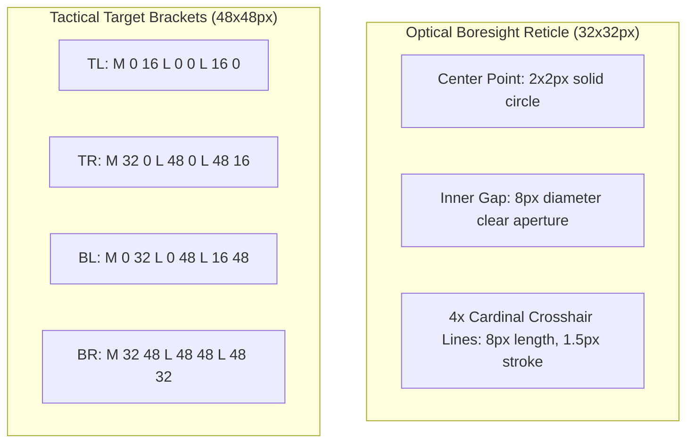

# Cockpit HUD Design System Specification & Asset Guidelines

This document establishes the official visual architecture, design tokens, geometry standards, chamfer bevel specifications, typography scales, SVG construct libraries, and accessibility guidelines for the **Fighter Jet Cockpit Heads-Up Display (HUD)** system across WorkSphere.

---

## 1. Executive Summary & Design Philosophy

The Cockpit HUD Design System translates military-standard avionics ergonomics (MIL-STD-1787C) and high-energy tactical interfaces into responsive web and WebXR viewports. Built on an assertive aesthetic of precision vectors, glowing monochromatic phosphor accents, geometric corner chamfers, and monospaced telemetry readouts, the interface delivers maximum situational awareness under extreme sensory loads.

```
       +-----------------------------------------------------------+
       | [030°]                  [000° N]                  [330°]  |  <- Heading Tape
       |                           |                               |
       |  +--                                                 --+  |  <- Corner Bracket
       |  |                                                     |  |
 [ALT] |  |         --- -10°                     -10° ---       |  | [SPD]
 1420m |  |                     -- 00° --                       |  | 420kt
       |  |                      ---   ---                      |  |
       |  |                     |   +   |                       |  |  <- Boresight Reticle
       |  |                      ---   ---                      |  |
       |  |         --- +10°                     +10° ---       |  |  <- Pitch Rungs
       |  |                                                     |  |
       |  +--                                                 --+  |
       |                   [RADAR SWEEP ACTIVE]                    |  <- Tactical Status
       +-----------------------------------------------------------+
```

---

## 2. Geometry & Structural Construct Dimensions

HUD framing uses hard $45^\circ$ cut chamfers and targeted corner brackets rather than standard curved rounded borders.

### 2.1 Corner Brackets & Chamfer Bevels

```
       16px
  +-----------+
  |           |
  |   +-------+
  |   |
  |   | 16px
  |   |
  +---+
```

- **Corner Bracket Arm Length:** $16\text{ px}$ to $24\text{ px}$.
- **Bracket Stroke Thickness:** $1.5\text{ px}$ (Fine) to $2.5\text{ px}$ (Emphasized).
- **Chamfer Angles:** Standard $45^\circ$ diagonal cut ($`clip-path: polygon(...)`$):
  ```css
  /* 45-degree chamfered card container */
  clip-path: polygon(
    0 12px,
    12px 0,
    calc(100% - 12px) 0,
    100% 12px,
    100% calc(100% - 12px),
    calc(100% - 12px) 100%,
    12px 100%,
    0 calc(100% - 12px)
  );
  ```

### 2.2 Tactical Reticle & Crosshair Dimensions



---

## 3. Typography Scale & Font Pairings

HUD typography strictly prioritizes instantaneous scannability, fixed character widths, and high legibility through HUD phosphor glows.

| Role | Font Family | Weight | Size (Desktop / Mobile) | Tracking / Letter Spacing | Example Use Case |
| :--- | :--- | :--- | :--- | :--- | :--- |
| **Primary Display** | `Orbitron`, sans-serif | Bold (700) | $20\text{ px}$ / $16\text{ px}$ | `+0.1em` (`tracking-widest`) | Mode headers, Master Cautions |
| **Telemetry & Data**| `JetBrains Mono`, monospace | Medium (500) | $13\text{ px}$ / $11\text{ px}$ | `+0.05em` (`tracking-wider`) | Altitude, Speed, Compass Bearings |
| **Micro Labels** | `JetBrains Mono`, monospace | Bold (700) | $10\text{ px}$ / $9\text{ px}$ | `+0.15em` (`uppercase`) | Coordinates, Sensor Status, UTC time |

### Font Loading Definition

```css
@import url("https://fonts.googleapis.com/css2?family=JetBrains+Mono:wght@400;500;700&family=Orbitron:wght@600;700;900&display=swap");

.font-hud-display {
  font-family: "Orbitron", -apple-system, BlinkMacSystemFont, sans-serif;
  letter-spacing: 0.1em;
}

.font-hud-mono {
  font-family: "JetBrains Mono", monospace;
  font-feature-settings: "zero", "tnum";
}
```

---

## 4. SVG Construct Library & Code Snippets

### 4.1 Boresight Crosshair Component

```tsx
export function HUDCrosshair({ className = "w-8 h-8 text-emerald-400" }: { className?: string }) {
  return (
    <svg viewBox="0 0 32 32" fill="none" xmlns="http://www.w3.org/2000/svg" className={className}>
      {/* Central Aiming Dot */}
      <circle cx="16" cy="16" r="1.5" fill="currentColor" />
      {/* Inner Ring Reticle */}
      <circle cx="16" cy="16" r="6" stroke="currentColor" strokeWidth="1.2" strokeDasharray="3 2" />
      {/* Cardinal Tics */}
      <line x1="16" y1="2" x2="16" y2="8" stroke="currentColor" strokeWidth="1.5" />
      <line x1="16" y1="24" x2="16" y2="30" stroke="currentColor" strokeWidth="1.5" />
      <line x1="2" y1="16" x2="8" y2="16" stroke="currentColor" strokeWidth="1.5" />
      <line x1="24" y1="16" x2="30" y2="16" stroke="currentColor" strokeWidth="1.5" />
    </svg>
  );
}
```

### 4.2 Corner Bracket Frame

```tsx
export function HUDCornerFrame({ children, className = "" }: { children: React.ReactNode; className?: string }) {
  return (
    <div className={`relative p-4 bg-zinc-950/80 border border-emerald-500/20 text-emerald-400 ${className}`}>
      {/* Top Left Bracket */}
      <svg className="absolute -top-[2px] -left-[2px] w-4 h-4 text-emerald-400" viewBox="0 0 16 16" fill="none">
        <path d="M0 16 V 0 H 16" stroke="currentColor" strokeWidth="2.5" />
      </svg>
      {/* Top Right Bracket */}
      <svg className="absolute -top-[2px] -right-[2px] w-4 h-4 text-emerald-400" viewBox="0 0 16 16" fill="none">
        <path d="M0 0 H 16 V 16" stroke="currentColor" strokeWidth="2.5" />
      </svg>
      {/* Bottom Left Bracket */}
      <svg className="absolute -bottom-[2px] -left-[2px] w-4 h-4 text-emerald-400" viewBox="0 0 16 16" fill="none">
        <path d="M0 0 V 16 H 16" stroke="currentColor" strokeWidth="2.5" />
      </svg>
      {/* Bottom Right Bracket */}
      <svg className="absolute -bottom-[2px] -right-[2px] w-4 h-4 text-emerald-400" viewBox="0 0 16 16" fill="none">
        <path d="M16 0 V 16 H 0" stroke="currentColor" strokeWidth="2.5" />
      </svg>
      {children}
    </div>
  );
}
```

### 4.3 Radar Sweep Ring

```tsx
export function HUDRadarSweep({ radius = 64 }: { radius?: number }) {
  return (
    <div
      className="relative rounded-full border border-emerald-500/30 overflow-hidden"
      style={{ width: radius * 2, height: radius * 2 }}
    >
      {/* Concentric distance rings */}
      <div className="absolute inset-4 rounded-full border border-dashed border-emerald-500/20" />
      <div className="absolute inset-8 rounded-full border border-emerald-500/15" />
      {/* Radar sweep beam */}
      <div className="absolute inset-0 bg-[conic-gradient(from_0deg,transparent_0deg,transparent_300deg,rgba(16,185,129,0.35)_360deg)] animate-[spin_4s_linear_infinite] motion-reduce:hidden" />
      <div className="absolute inset-0 flex items-center justify-center">
        <div className="w-1.5 h-1.5 rounded-full bg-emerald-400 shadow-[0_0_8px_#34d399]" />
      </div>
    </div>
  );
}
```

---

## 5. Glow Filter Standards & CSS Shader Effects

HUD elements achieve high-visibility luminescence using balanced multi-layer drop shadows and bloom filters rather than heavy raster blurs:

```css
/* High-Visibility Phosphor HUD Glows */
.hud-glow-subtle {
  text-shadow: 0 0 6px rgba(16, 185, 129, 0.45);
  filter: drop-shadow(0 0 4px rgba(16, 185, 129, 0.3));
}

.hud-glow-intense {
  text-shadow: 0 0 2px #fff, 0 0 10px #10b981, 0 0 20px #059669;
  filter: drop-shadow(0 0 8px rgba(16, 185, 129, 0.75));
}
```

---

## 6. Accessibility & Contrast Guidelines for Glowing UIs

Luminescent interfaces risk accessibility issues without strict contrast bounds and motion suppression:

1. **Photometric Contrast (WCAG 2.1 AA):** All HUD green symbology must maintain at least a **4.5:1** contrast ratio against dark backgrounds. `#00FF66` or `#34D399` over deep obsidian (`#04100C` / `#09090B`) yields a contrast ratio exceeding **12:1**.
2. **Photosensitivity & Flash Limits:** No animated radar sweeps or warning strobe badges may flash at frequencies between $3\text{ Hz}$ and $50\text{ Hz}$ (WCAG Guideline 2.3.1).
3. **Reduced Motion Adaptation:** When `prefers-reduced-motion: reduce` is active:
   - Radar sweeps freeze into a static reticle bearing marker.
   - Blinking caution alerts remain solid red/amber without pulsation.
   - Screen horizon rotation transitions instantly without tweening delay.
4. **Color-Blind Fallbacks:** Every tactical alert (Target Locked, Connection Warning, High G) combines chromatic green/amber/red indicators with dedicated alphanumeric callout badges (`[LOC]`, `[WARN]`, `[DISC]`).
