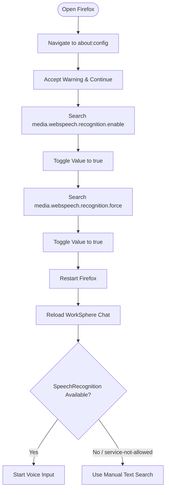
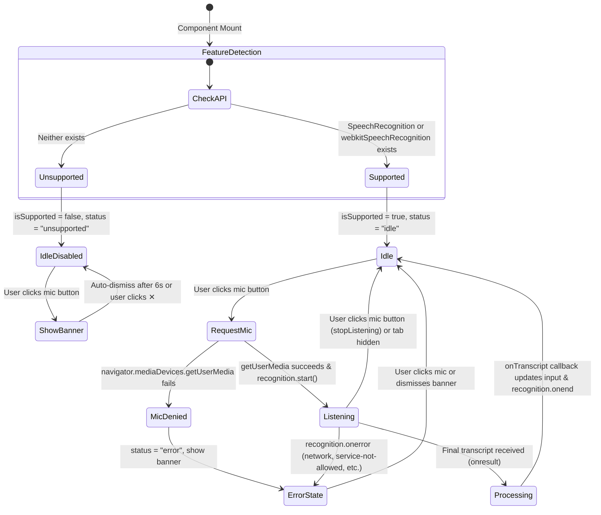

# Web Speech API Browser Compatibility & Voice Input Troubleshooting Guide

## Overview

WorkSphere integrates hands-free voice search within the nomad venue discovery assistant (`src/components/chat/ChatMessages.tsx`) powered by the custom React hook `useSpeechRecognition` (`src/hooks/useSpeechRecognition.ts`). This allows remote workers and digital nomads to dictate natural-language queries (e.g., _"Find a quiet cafe with fast WiFi and outdoor seating near me"_) without manually typing on desktop or mobile keyboards.

The voice search feature leverages the **Web Speech API (`SpeechRecognition` / `webkitSpeechRecognition`)** to capture spoken audio, stream audio frames to speech recognition services, and emit recognized text transcripts directly into the query input field.

### Speech Recognition vs. Speech Synthesis

WorkSphere utilizes two distinct specifications under the Web Speech API umbrella:

- **Speech Recognition (`SpeechRecognition` / `webkitSpeechRecognition` via `useSpeechRecognition.ts`)**: Converts input audio captured from the user's microphone into textual search queries (**Speech-to-Text / STT**).
- **Speech Synthesis (`window.speechSynthesis` and `SpeechSynthesisUtterance` via `useSpeechSynthesis.ts`)**: Converts assistant text responses and venue details into synthetic speech output (**Text-to-Speech / TTS**).

```mermaid
flowchart LR
    subgraph STT [Speech Recognition (useSpeechRecognition)]
        Mic[Microphone Hardware] --> MediaCapture[navigator.mediaDevices.getUserMedia]
        MediaCapture --> SpeechRecEngine[SpeechRecognition Engine]
        SpeechRecEngine --> TextTranscript[Query Text Transcript]
        TextTranscript --> ChatInput[ChatMessages Input Field]
    end

    subgraph TTS [Speech Synthesis (useSpeechSynthesis)]
        AssistantResponse[Assistant Response Text] --> Utterance[SpeechSynthesisUtterance]
        Utterance --> SynthEngine[window.speechSynthesis]
        SynthEngine --> AudioOutput[Speakers / Headphones]
    end
```

> [!NOTE]
> Speech synthesis (`window.speechSynthesis`) is widely supported across almost all modern browsers (including Firefox and Safari). In contrast, **speech recognition (`SpeechRecognition`)** depends on browser vendor engine support and cloud or on-device acoustic recognition models. Consequently, browser compatibility for voice input is significantly more restricted.

---

## 1. Browser Compatibility Matrix

Speech recognition capabilities vary substantially across browser vendors, operating systems, desktop distributions, and runtime security contexts.

| Browser Engine / Client                    | Speech Recognition API Availability | Vendor Prefix / Constructor                     | Configuration Required                                | Known Platform Limitations                                                                                                               | WorkSphere Voice Input Availability                                  |
| :----------------------------------------- | :---------------------------------- | :---------------------------------------------- | :---------------------------------------------------- | :--------------------------------------------------------------------------------------------------------------------------------------- | :------------------------------------------------------------------- |
| **Google Chrome (Desktop / Android)**      | Available out-of-the-box            | `webkitSpeechRecognition` / `SpeechRecognition` | None (standard microphone prompt)                     | Relies on Google cloud speech services. Requires active internet connection in most builds.                                              | **Supported**                                                        |
| **Microsoft Edge (Chromium)**              | Available out-of-the-box            | `webkitSpeechRecognition` / `SpeechRecognition` | None (standard microphone prompt)                     | Uses Microsoft cloud speech recognition endpoints. Requires network connectivity.                                                        | **Supported**                                                        |
| **Mozilla Firefox (Stable Desktop)**       | Disabled by default                 | `SpeechRecognition`                             | Must enable `about:config` preferences                | Backend recognition service is disabled or unconfigured in standard releases; Linux builds frequently lack native engine bindings.       | **Unavailable by default** (see Firefox Flags)                       |
| **Mozilla Firefox (Nightly / Developer)**  | Experimental toggle                 | `SpeechRecognition`                             | Must enable `about:config` preferences                | Service endpoints may reject requests with `service-not-allowed` if Mozilla recognition endpoints are unreachable.                       | **Experimental** (Requires manual flag activation)                   |
| **Mozilla Firefox on Linux**               | Disabled / Absent                   | `SpeechRecognition`                             | Flag activation + PulseAudio / PipeWire configuration | Often lacks Mozilla speech service integration; sandboxed packages (Snap/Flatpak) may restrict socket and audio access.                  | **Unavailable / High failure rate**                                  |
| **Apple Safari (macOS / iOS / iPadOS)**    | Available                           | `webkitSpeechRecognition`                       | None (system permission prompt)                       | Requires user gesture activation; iOS Safari aggressively pauses continuous recognition on tab blur or screen lock.                      | **Supported** (via `webkitSpeechRecognition`)                        |
| **Chromium-based (Brave, Opera, Vivaldi)** | Varies by vendor                    | `webkitSpeechRecognition`                       | Google Services toggle in privacy settings            | Brave disables Google speech recognition services by default for privacy reasons; calls fail unless Google services toggle is turned on. | **Conditionally Supported** (Fails if vendor blocks Google services) |

> [!IMPORTANT]
> Browser vendor support for speech recognition is not universal or static. API presence depends on browser architecture version, operating system audio drivers, sandbox restrictions, and vendor cloud service availability.

---

## 2. Firefox Configuration Flags

In standard Mozilla Firefox releases and Nightly channels, the Web Speech Recognition API is disabled by default. Firefox separates speech synthesis (enabled by default) from speech recognition.

To experiment with speech recognition in Firefox, two internal configuration preferences exist in `about:config`:

### Flag 1: `media.webspeech.recognition.enable`

- **Preference Name:** `media.webspeech.recognition.enable`
- **Default Value:** `false`
- **Purpose:** Controls whether the `window.SpeechRecognition` constructor interface is exposed to web page JavaScript runtimes. When `false`, `"SpeechRecognition" in window` evaluates to `false`, causing WorkSphere to detect the browser as unsupported.

#### Step-by-Step Configuration Workflow:

1. Launch your Mozilla Firefox browser.
2. In the browser address bar, type `about:config` and press `Enter`.
3. When prompted with _"Proceed with Caution"_ or _"Accept the Risk and Continue"_, click **Accept the Risk and Continue**.
4. In the **Search preference name** input box, enter:
   ```text
   media.webspeech.recognition.enable
   ```
5. If the preference is set to `false`, double-click the preference or click the **Toggle** button (arrow icon) on the right to set its value to `true`.
6. Restart Mozilla Firefox to ensure the runtime engine initializes the speech recognition interface.

---

### Flag 2: `media.webspeech.recognition.force`

- **Preference Name:** `media.webspeech.recognition.force`
- **Default Value:** `false`
- **Purpose:** Forces the speech recognition engine to register as active and available, bypassing certain build-time or platform checks.

#### Configuration Workflow:

1. In the `about:config` search bar, enter:
   ```text
   media.webspeech.recognition.force
   ```
2. Double-click or click **Toggle** to set `media.webspeech.recognition.force` to `true`.
3. Restart Firefox.



### Critical Limitations & Caveats:

> [!WARNING]
>
> - **No Guarantee of Backend Recognition:** Setting these preferences exposes the DOM interface (`window.SpeechRecognition`), but Firefox relies on external or operating-system speech services. If Mozilla's recognition backend service is unreachable, deprecated, or unconfigured in your build, recognition requests will immediately trigger an error event with `error: "service-not-allowed"`.
> - **Build & Distribution Inconsistencies:** Linux distributions and ESR (Extended Support Release) builds of Firefox may completely omit the underlying speech recognition compilation flags, rendering `about:config` flags non-functional.
> - **No Programmatic Access:** Web applications and JavaScript runtimes cannot read, inspect, or modify `about:config` preferences due to browser sandbox security boundaries.
> - **Security Notice:** Do not disable browser sandbox protections, certificate validation, or operating-system audio isolation to make speech recognition work.

---

## 3. Linux Browser Troubleshooting

Linux desktop environments present unique architectural challenges for Web Speech recognition due to audio server routing, sandboxed packaging formats, and omitted proprietary codecs or cloud service API keys.

### 1. Browser Build and Packaging Differences

- **Snap / Flatpak Sandboxing:** Sandboxed Firefox or Chromium packages installed via Snap (`snap install firefox`) or Flatpak (`flatpak install flathub org.mozilla.firefox`) isolate the browser from the host audio server.
  - Verify that the sandbox has microphone device access permissions enabled.
  - For Flatpak, verify permissions using Flatseal or via terminal:
    ```bash
    flatpak info --show-permissions org.mozilla.firefox
    ```
- **Distro Maintained Builds:** Many distribution packages (e.g., Debian, Ubuntu, Fedora) compile Chromium and Firefox with external speech service API keys omitted to comply with free software guidelines.

### 2. Linux Desktop Audio Subsystems (PulseAudio & PipeWire)

- Ensure your active microphone is properly designated as the default recording source in **PipeWire** (`pipewire-pulse`) or **PulseAudio**:
  - Test recording via ALSA / PulseAudio tools:
    ```bash
    arecord -l
    ```
  - Open your desktop sound mixer (`pavucontrol` or GNOME / KDE System Settings) and inspect the **Recording** tab while triggering voice search. Verify that the browser process is actively capturing audio levels from the intended input hardware.

### 3. Secure Context Requirement

The Web Speech API and `navigator.mediaDevices.getUserMedia` are restricted exclusively to **Secure Contexts (`isSecureContext === true`)**:

- The application must be served over `https://` or `http://localhost` / `http://127.0.0.1`.
- Accessing WorkSphere over a local network IP (e.g., `http://192.168.1.100:3000`) without TLS will cause the browser to block media capture immediately with a `SecurityError`.

---

## 4. WorkSphere Graceful Degradation Architecture

WorkSphere is engineered to handle absent speech recognition APIs and permission failures gracefully. The application guarantees that **manual text input is never blocked, disabled, or degraded** when voice recognition is unavailable.

### Implementation Mapping (`src/hooks/useSpeechRecognition.ts` & `src/components/chat/ChatMessages.tsx`)

| Trigger Event / Runtime Condition                                          | Implementation State (`status`)               | UI Behavior in `ChatMessages.tsx`                                                                                           | Fallback / User Experience                                                                                                                                                                                                                                        |
| :------------------------------------------------------------------------- | :-------------------------------------------- | :-------------------------------------------------------------------------------------------------------------------------- | :---------------------------------------------------------------------------------------------------------------------------------------------------------------------------------------------------------------------------------------------------------------- |
| `SpeechRecognition` and `webkitSpeechRecognition` missing from `window`    | `status: "unsupported"`, `isSupported: false` | Voice button rendered with disabled styling (`cursor-not-allowed opacity-60`). Clicking button triggers amber alert banner. | Amber banner: _"Voice input is not supported in this browser. Please use Chrome, Edge, or enable speech recognition in Firefox (about:config → media.webspeech.recognition.enable)."_ Banner auto-dismisses after 6 seconds. Text search remains 100% functional. |
| User clicks mic button when unsupported                                    | `status: "unsupported"`                       | Trigger banner function invoked (`setShowVoiceBanner(true)`).                                                               | Surfaces warning banner without crashing or resetting typed query.                                                                                                                                                                                                |
| Microphone permission denied by user (`getUserMedia` throws)               | `status: "error"`, `errorMessage` set         | Warning banner rendered with specific error message. Button reverts from pulse state to idle.                               | Error banner: _"Microphone access was denied. Please allow microphone permissions in your browser settings."_                                                                                                                                                     |
| Speech recognition `onerror` with `"not-allowed"` or `"permission-denied"` | `status: "error"`                             | Active media tracks released (`releaseMediaTracks()`). Banner displayed.                                                    | Displays microphone access denied warning banner.                                                                                                                                                                                                                 |
| Speech recognition `onerror` with `"service-not-allowed"`                  | `status: "error"`                             | Active media tracks stopped immediately. Banner displayed.                                                                  | Banner: _"Voice input is not supported in this browser. Please use Chrome, Edge, or enable the required Firefox feature."_                                                                                                                                        |
| Speech recognition `onerror` with `"network"`                              | `status: "error"`                             | Media tracks released. Banner displayed.                                                                                    | Banner: _"A network error occurred during voice recognition. Please check your connection."_                                                                                                                                                                      |
| Speech recognition `onerror` with `"no-speech"`                            | `status: "error"`                             | Media tracks released. Banner displayed.                                                                                    | Banner: _"No speech was detected. Please try again."_                                                                                                                                                                                                             |
| Window/tab loses visibility (`visibilitychange` / `document.hidden`)       | `status: "idle"`                              | Aborts active recognition (`recognitionRef.current.abort()`) and cleans up media tracks.                                    | Prevents background audio capturing and battery drain.                                                                                                                                                                                                            |
| Component unmounts                                                         | Teardown                                      | `mediaStream.getTracks().forEach(track => track.stop())`                                                                    | Ensures microphone indicator hardware LED turns off immediately.                                                                                                                                                                                                  |



---

## 5. Microphone Permission & Device Troubleshooting

### Understanding Two-Stage Permissions in WorkSphere

WorkSphere's `useSpeechRecognition` hook executes a robust two-stage verification process:

1. **Direct Media Stream Check:** Calls `navigator.mediaDevices.getUserMedia({ audio: true })` before initiating recognition. This ensures the physical microphone hardware is available, accessible, and not locked by another OS process.
2. **Recognition API Stream Handshake:** Instantiates the browser's native `SpeechRecognition` engine, which registers browser-level audio capture and interacts with vendor speech services.

### Browser-Specific Permission Management

#### Google Chrome / Microsoft Edge

1. Click the **Site Settings / Tune** icon (or padlock) situated on the left side of the address bar.
2. Locate **Microphone** in the permissions list.
3. If set to **Block**, change it to **Allow**.
4. If the permission prompt does not appear, navigate to `chrome://settings/content/microphone` (or `edge://settings/content/microphone`) and verify that **Sites can ask to use your microphone** is enabled and WorkSphere is not listed under blocked origins.
5. Reload the page (`Ctrl + R` or `Cmd + R`).

#### Mozilla Firefox

1. Click the permission icon (sliders or microphone with cross) to the left of the address bar.
2. Under **Permissions**, look for **Use the Microphone**.
3. Clear the **Blocked** or **Blocked Temporarily** status by clicking the `✕` next to it.
4. Reload the page and click the microphone icon in WorkSphere to trigger the permission prompt again. Select your microphone and click **Allow**.

#### Apple Safari (macOS)

1. Open **Safari > Settings > Websites > Microphone**.
2. Locate the WorkSphere domain and change the dropdown selection from **Deny** to **Allow** (or **Ask**).
3. Reload the tab.

### Common Error Codes & Diagnostic Causes

| Error Name                        | Source Layer                                  | Root Cause Explanation                                                                                                            | Practical Resolution                                                                                   |
| :-------------------------------- | :-------------------------------------------- | :-------------------------------------------------------------------------------------------------------------------------------- | :----------------------------------------------------------------------------------------------------- |
| `NotAllowedError` / `not-allowed` | `getUserMedia` or `SpeechRecognition.onerror` | The user denied microphone permission, or the OS privacy settings block the browser from accessing microphone hardware.           | Open browser site permissions and toggle microphone to "Allow"; inspect system-level privacy settings. |
| `NotFoundError`                   | `getUserMedia`                                | No physical microphone device was detected by the operating system.                                                               | Connect a working microphone or headset; verify that audio input devices are detected in OS settings.  |
| `NotReadableError`                | `getUserMedia`                                | The microphone hardware is already monopolized by another software application (e.g., Zoom, Teams, OBS) or driver error occurred. | Close competing audio applications; restart browser.                                                   |
| `SecurityError`                   | Browser Security Engine                       | The page is not loaded within a Secure Context (`isSecureContext === false`).                                                     | Serve over `https://` or `localhost`.                                                                  |
| `service-not-allowed`             | `SpeechRecognition.onerror`                   | The browser's speech recognition network service is blocked, offline, or disabled (very common in Firefox and Brave).             | Use Chrome or Edge, or adjust Brave Shields / privacy toggles to allow Google Speech Services.         |
| `no-speech`                       | `SpeechRecognition.onerror`                   | The microphone was open, but no audible speech was captured before recognition timed out.                                         | Speak clearly into the microphone, check input gain levels, or reposition the microphone.              |
| `network`                         | `SpeechRecognition.onerror`                   | The browser failed to communicate with the cloud speech recognition backend.                                                      | Check internet connectivity, proxy settings, firewall rules, or DNS resolution.                        |

### Operating System Microphone Privacy Settings

#### Windows 10 / 11:

1. Open **Settings > Privacy & Security > Microphone**.
2. Verify that **Microphone access** is toggled to **On**.
3. Verify that **Let desktop apps access your microphone** and **Let apps access your microphone** are toggled to **On** for your browser.

#### macOS:

1. Open **System Settings > Privacy & Security > Microphone**.
2. Verify that your browser (Google Chrome, Firefox, Microsoft Edge, or Safari) is toggled to **On**.
3. If disabled, toggle it on and restart the browser.

#### Linux (PipeWire / PulseAudio):

1. Launch `pavucontrol` (PulseAudio Volume Control).
2. Switch to the **Configuration** tab and verify your audio input profile is active (not set to "Off").
3. Switch to the **Input Devices** tab and ensure the microphone is not muted and the volume meter responds to voice.

---

## 6. Developer & Maintainer Diagnostics

### Console Feature-Detection Script

To diagnose browser speech capabilities directly, open your browser developer tools (`F12` or `Ctrl + Shift + I` / `Cmd + Option + I`), paste the snippet into the **Console**, and press `Enter`:

```javascript
(() => {
  const SpeechRecognition =
    window.SpeechRecognition || window.webkitSpeechRecognition;

  const diagnostics = {
    speechRecognitionAvailable: Boolean(SpeechRecognition),
    constructorName: SpeechRecognition ? SpeechRecognition.name : null,
    secureContext: window.isSecureContext,
    mediaDevicesAvailable: Boolean(
      navigator.mediaDevices && navigator.mediaDevices.getUserMedia,
    ),
    protocol: window.location.protocol,
    userAgent: navigator.userAgent,
  };

  console.group("WorkSphere Voice Input Diagnostics");
  console.table(diagnostics);

  if (!diagnostics.secureContext) {
    console.warn(
      "WARNING: Page is not running in a Secure Context. Voice input requires HTTPS or localhost.",
    );
  }
  if (!diagnostics.speechRecognitionAvailable) {
    console.warn(
      "WARNING: SpeechRecognition is not exposed in window. Check browser support or about:config flags.",
    );
  }
  console.groupEnd();
})();
```

#### Diagnostic Output Interpretation:

- `speechRecognitionAvailable: true`: Confirms that the browser exposes the speech recognition interface. Note: This does **not** prove that the vendor recognition backend service is reachable or functional.
- `secureContext: false`: Explains why `getUserMedia` or speech recognition fails immediately.
- `mediaDevicesAvailable: false`: Indicates an archaic browser environment or an insecure context blocking media device enumeration.

### Maintainer Issue Triage Checklist

When triaging user bug reports regarding voice search, maintainers should collect:

- [ ] **Browser Name and Version:** (e.g., Firefox 132.0, Chrome 130.0.6723.70)
- [ ] **Operating System & Architecture:** (e.g., Ubuntu 24.04 LTS x86_64, Windows 11 23H2, macOS Sequoia 15.1)
- [ ] **Package Format (if Linux):** (Native deb/rpm, Snap, Flatpak)
- [ ] **Secure Context Verification:** Is the application served on `https://` or `localhost`?
- [ ] **Browser Console Errors:** Capture any `ISpeechRecognitionErrorEvent` code (`not-allowed`, `service-not-allowed`, `network`, `no-speech`).
- [ ] **Diagnostic Script Output:** Output of the diagnostic console table above.
- [ ] **Physical Microphone Test:** Does the microphone record audio in other web apps (such as `https://webbrowsertools.com/test-microphone/`)?

> [!CAUTION]
> Maintainers and users must never attach raw audio files, speech recordings, or personal data to GitHub issues or bug tracking reports.

---

## 7. Known Platform Limitations & Architectural Realities

1. **Vendor Cloud Backend Dependencies:**
   In Chromium and Chrome, the Web Speech API transmits compressed audio chunks to Google's speech recognition servers. As a result, voice input does not work in completely air-gapped or offline environments, even if the microphone hardware functions properly.
2. **Firefox Upstream Recognition Service Architecture:**
   While Firefox implements the Web Speech API DOM interface when flags are enabled, Mozilla does not operate an active, ubiquitous, high-throughput cloud speech recognition service comparable to Google Cloud Speech. Enabling the preference frequently leads to `service-not-allowed` errors on production web apps.
3. **Privacy-Focused Chromium Derivatives:**
   Browsers such as Brave explicitly disable Google services by default to protect user telemetry. Users on Brave must permit Google services in browser settings to utilize the native Web Speech API.
4. **Linux Audio Routing Complexity:**
   Hardware enumeration differences between ALSA, PulseAudio, and PipeWire sound servers can cause `getUserMedia` to select a silent monitor loopback or disabled input node rather than the physical microphone.

---

## 8. User Troubleshooting Quick-Checklist

If you encounter issues with voice search in WorkSphere, follow this sequential checklist:

1. **Confirm Browser Compatibility:** Ensure you are using Google Chrome, Microsoft Edge, or Safari. If using Firefox, read the [Firefox Configuration Flags](#2-firefox-configuration-flags) section above.
2. **Verify Secure Context:** Ensure the URL starts with `https://` or `http://localhost`. Voice input is disabled by web security standards on unencrypted connections.
3. **Inspect Site Microphone Permissions:** Look for the lock or tune icon in the browser address bar and verify **Microphone** is set to **Allow**.
4. **Verify OS Privacy Permissions:** Ensure Windows, macOS, or Linux has not blocked microphone access for your browser application.
5. **Check Hardware Selection & Volume:** Ensure your microphone is plugged in, unmuted, and receiving input in your operating system's sound settings.
6. **Reload and Retry:** Refresh the browser tab to clear any stuck audio capture locks or previous permission denials.
7. **Use Manual Text Search:** If voice input remains unavailable in your browser environment, type your query directly into the search field. All venue search, semantic filtering, clustering, and map interactions remain 100% operational.
