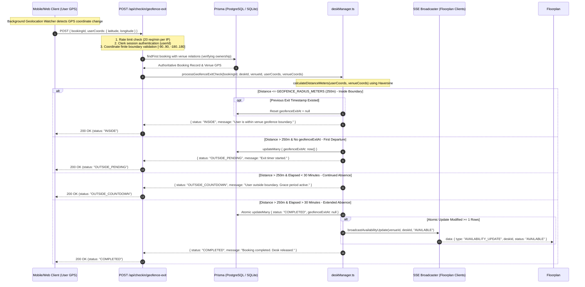

# Geofence-Based Desk Check-Out & Exit Workflow

## 1. Executive Summary & Problem Space

In shared workspaces, hot-desk venues, and flexible coworking hubs managed by WorkSphere, a recurring operational challenge is the **"ghost desk" problem**:

- Users reserve and check in to a desk, work for a few hours, and depart the venue without explicitly tapping "Check Out" in the mobile or web application.
- The seat remains marked as `OCCUPIED` or `CHECKED_IN` in the database, blocking other nomads from reserving it even though the physical desk is vacant.
- Venue owners suffer from under-reported capacity turnover, and coworkers are turned away by artificial scarcity.

To solve this without burdening users with manual check-out friction, WorkSphere provides an **automated, geofence-based desk check-out and exit workflow**. Implemented across [`src/lib/geo/geofence.ts`](../../src/lib/geo/geofence.ts), [`src/lib/reservations/deskManager.ts`](../../src/lib/reservations/deskManager.ts), and the telemetry ingestion route [`src/app/api/checkin/geofence-exit/route.ts`](../../src/app/api/checkin/geofence-exit/route.ts), this system:

1. Continuously evaluates client geolocation telemetry against an authoritative venue geofence perimeter (`GEOFENCE_RADIUS_METERS = 250`).
2. Calculates exact geodesic distances using the spherical Haversine formula (`calculateDistanceMeters`).
3. Implements a durable, database-backed 30-minute absence grace period (`geofenceExitAt`) to prevent accidental check-outs caused by brief coffee breaks or temporary GPS drift.
4. Atomically marks the booking as `COMPLETED` upon extended absence and immediately releases the desk to the venue inventory.
5. Dispatches real-time Server-Sent Events (`broadcastAvailabilityUpdate`) to active floorplan map clients, updating desk status to `AVAILABLE` without page refreshes.

---

## 2. End-to-End Geofence Exit Lifecycle



---

## 3. Geofence Perimeter & Haversine Distance Calculation

### 3.1 The 250-Meter Geofence Radius (`GEOFENCE_RADIUS_METERS`)

Defined in [`src/lib/geo/geofence.ts`](../../src/lib/geo/geofence.ts), the system establishes an authoritative boundary radius:

```typescript
export const GEOFENCE_RADIUS_METERS = 250;
```

#### Why 250 Meters?

- **Urban Canyon Jitter**: Multipath GPS reflections from high-rise buildings and indoor atriums routinely introduce $30\text{m}$ to $100\text{m}$ of positional inaccuracy. A tighter radius ($< 100\text{m}$) would trigger false departure alarms while the coworker is simply sitting near the back of a large building.
- **Micro-Mobility & Venue Environs**: A 250m perimeter accommodates short excursions within the venue's immediate campus (e.g., visiting an adjoining courtyard, stepping outside for a brief phone call, or visiting a ground-floor cafe).

### 3.2 Haversine Geodesic Distance Formula (`calculateDistanceMeters`)

The distance between the client's current GPS coordinates $(\phi_1, \lambda_1)$ and the venue's authoritative coordinates $(\phi_2, \lambda_2)$ is calculated using the spherical Haversine formula on a mean Earth radius of $R = 6{,}371{,}000\text{ meters}$:

$$\Delta\phi = (\phi_2 - \phi_1) \cdot \frac{\pi}{180}, \quad \Delta\lambda = (\lambda_2 - \lambda_1) \cdot \frac{\pi}{180}$$

$$a = \sin^2\left(\frac{\Delta\phi}{2}\right) + \cos\left(\phi_1 \cdot \frac{\pi}{180}\right) \cdot \cos\left(\phi_2 \cdot \frac{\pi}{180}\right) \cdot \sin^2\left(\frac{\Delta\lambda}{2}\right)$$

$$c = 2 \cdot \operatorname{atan2}\left(\sqrt{a}, \sqrt{1 - a}\right)$$

$$d = R \cdot c$$

In TypeScript ([`src/lib/geo/geofence.ts`](../../src/lib/geo/geofence.ts)):

```typescript
export function calculateDistanceMeters(
  coord1: Coordinates,
  coord2: Coordinates,
): number {
  const R = 6371e3; // Earth radius in meters
  const lat1Rad = (coord1.latitude * Math.PI) / 180;
  const lat2Rad = (coord2.latitude * Math.PI) / 180;
  const deltaLat = ((coord2.latitude - coord1.latitude) * Math.PI) / 180;
  const deltaLon = ((coord2.longitude - coord1.longitude) * Math.PI) / 180;

  const a =
    Math.sin(deltaLat / 2) * Math.sin(deltaLat / 2) +
    Math.cos(lat1Rad) *
      Math.cos(lat2Rad) *
      Math.sin(deltaLon / 2) *
      Math.sin(deltaLon / 2);

  const c = 2 * Math.atan2(Math.sqrt(a), Math.sqrt(1 - a));
  return R * c;
}
```

---

## 4. Ingestion Endpoint Architecture (`/api/checkin/geofence-exit`)

The telemetry endpoint [`src/app/api/checkin/geofence-exit/route.ts`](../../src/app/api/checkin/geofence-exit/route.ts) provides robust defense-in-depth:

### 4.1 Rate Limiting & Client Throttling

To protect the backend from rogue device GPS loops, requests are throttled per IP:

- Maximum 20 requests per 60-second sliding window (`RATE_LIMIT_MAX = 20`, `RATE_LIMIT_WINDOW = 60000ms`).
- Returns `HTTP 429 Too Many Requests` when breached.

### 4.2 Authentication & Ownership Verification

- Verifies session tokens using Clerk (`const { userId } = await auth()`).
- Rejects unauthenticated calls with `HTTP 401 Unauthorized`.
- Queries the database for the active booking filtering by **both** `id: bookingId` and `userId`. This ensures malicious actors cannot spoof geofence exits for other members.

### 4.3 Coordinate Sanitization

The endpoint enforces strict boundary assertions:

- Latitude must be finite and within $[-90, 90]$.
- Longitude must be finite and within $[-180, 180]$.
- Returns `HTTP 400 Bad Request` if coordinates are non-numeric, `NaN`, or out of bounds.

### 4.4 Authoritative Venue Coordinate Derivation

Client telemetry payloads must **never** be trusted to provide venue coordinates. Instead, the endpoint extracts authoritative venue coordinates directly from the database relation:

```typescript
const venueCoords = {
  latitude: booking.venue.latitude,
  longitude: booking.venue.longitude,
};
const deskId = booking.seatId || "unassigned";
const venueId = booking.venueId;
```

---

## 5. State Machine & Extended Absence Automation (`deskManager.ts`)

The core business logic resides in `processGeofenceExitCheck` within [`src/lib/reservations/deskManager.ts`](../../src/lib/reservations/deskManager.ts).

```
+-------------------------------------------------------------------------------------------------+
|                                 processGeofenceExitCheck Decision Flow                          |
+-------------------------------------------------------------------------------------------------+
                                                 |
                                  +--------------v-------------+
                                  | Calculate Distance (Meters)|
                                  +--------------+-------------+
                                                 |
                        +------------------------+------------------------+
                        |                                                 |
             Distance <= 250m                                      Distance > 250m
                        |                                                 |
         +--------------v-------------+                    +--------------v-------------+
         | Status: INSIDE             |                    | Check booking.geofenceExitAt|
         | Reset geofenceExitAt = null|                    +--------------+-------------+
         +----------------------------+                                   |
                                                 +------------------------+------------------------+
                                                 |                                                 |
                                           geofenceExitAt is NULL                        geofenceExitAt is SET
                                                 |                                                 |
                                  +--------------v-------------+                    +--------------v-------------+
                                  | Status: OUTSIDE_PENDING    |                    | Calculate Elapsed Time:    |
                                  | Persist Exit Timestamp:    |                    | now - geofenceExitAt       |
                                  | geofenceExitAt = now()     |                    +--------------+-------------+
                                  +----------------------------+                                   |
                                                                          +------------------------+------------------------+
                                                                          |                                                 |
                                                                Elapsed <= 30 mins                                Elapsed > 30 mins
                                                                          |                                                 |
                                                           +--------------v-------------+                    +--------------v-------------+
                                                           | Status: OUTSIDE_COUNTDOWN  |                    | Status: COMPLETED          |
                                                           | Return remaining seconds   |                    | Atomic updateMany:         |
                                                           +----------------------------+                    | status = "COMPLETED"       |
                                                                                                             | geofenceExitAt = null      |
                                                                                                             +--------------+-------------+
                                                                                                                            |
                                                                                                             +--------------v-------------+
                                                                                                             | Trigger SSE Broadcast:     |
                                                                                                             | "AVAILABILITY_UPDATE"      |
                                                                                                             | deskId -> "AVAILABLE"      |
                                                                                                             +----------------------------+
```

### 5.1 The 30-Minute Grace Period (`DURATION_THRESHOLD_MS`)

```typescript
const DURATION_THRESHOLD_MS = 30 * 60 * 1000; // 30 minutes
```

A user departing the 250m perimeter does not immediately lose their desk. Instead:

1. **Timestamp Persistence**: The instant departure is observed, `geofenceExitAt` is persisted in the database.
2. **Crash & Restart Resilience**: Because the timestamp is recorded durably in PostgreSQL / Prisma rather than stored in ephemeral server memory, background worker restarts or serverless function recycles never lose track of active departure timers.
3. **Graceful Re-Entry**: If the user returns within the 30-minute window (e.g., returning from lunch), `distance <= GEOFENCE_RADIUS_METERS` triggers, resetting `geofenceExitAt = null` and restoring full active status.

### 5.2 Atomic State Transitions & Concurrency Safeguards

When elapsed absence exceeds 30 minutes, the desk must be released. To prevent race conditions from concurrent telemetry pings, `deskManager.ts` uses an atomic `updateMany` conditional:

```typescript
const updateResult = await prisma.booking.updateMany({
  where: {
    id: bookingId,
    status: { in: ["CONFIRMED", "PENDING", "CHECKED_IN"] },
  },
  data: {
    status: "COMPLETED",
    geofenceExitAt: null,
  },
});

// Broadcast real-time availability via SSE ONLY if this atomic transaction succeeded
if (updateResult.count > 0) {
  broadcastAvailabilityUpdate(venueId, deskId, "AVAILABLE");
}
```

Using `updateResult.count > 0` guarantees that if two requests arrive simultaneously, exactly one transaction succeeds in completing the booking and triggering the SSE broadcast.

---

## 6. Server-Sent Events (SSE) Real-Time Availability Broadcasts

When a desk is auto-released, all floorplan displays and booking maps viewing that venue must immediately reflect the newly freed desk without polling.

### 6.1 SSE Registry & Broadcast Mechanism

In [`src/lib/reservations/deskManager.ts`](../../src/lib/reservations/deskManager.ts):

```typescript
const sseClients = new Set<ReadableStreamDefaultController>();

export function registerSseClient(controller: ReadableStreamDefaultController) {
  sseClients.add(controller);
}

export function unregisterSseClient(
  controller: ReadableStreamDefaultController,
) {
  sseClients.delete(controller);
}

export function broadcastAvailabilityUpdate(
  venueId: string,
  deskId: string,
  status: string,
) {
  const payload = JSON.stringify({
    type: "AVAILABILITY_UPDATE",
    venueId,
    deskId,
    status,
    timestamp: Date.now(),
  });
  for (const client of sseClients) {
    try {
      client.enqueue(new TextEncoder().encode(`data: ${payload}\n\n`));
    } catch {
      sseClients.delete(client); // Evict closed or disconnected client streams
    }
  }
}
```

### 6.2 SSE Message Wire Format

Connected clients receive standard `text/event-stream` formatted messages:

```http
data: {"type":"AVAILABILITY_UPDATE","venueId":"venue_indiranagar_01","deskId":"desk_b4","status":"AVAILABLE","timestamp":1764151200000}

```

Client-side map components listening on the SSE stream update the corresponding SVG desk node from `occupied` (red) to `available` (green), allowing other nomads in the space to reserve the seat instantly.
