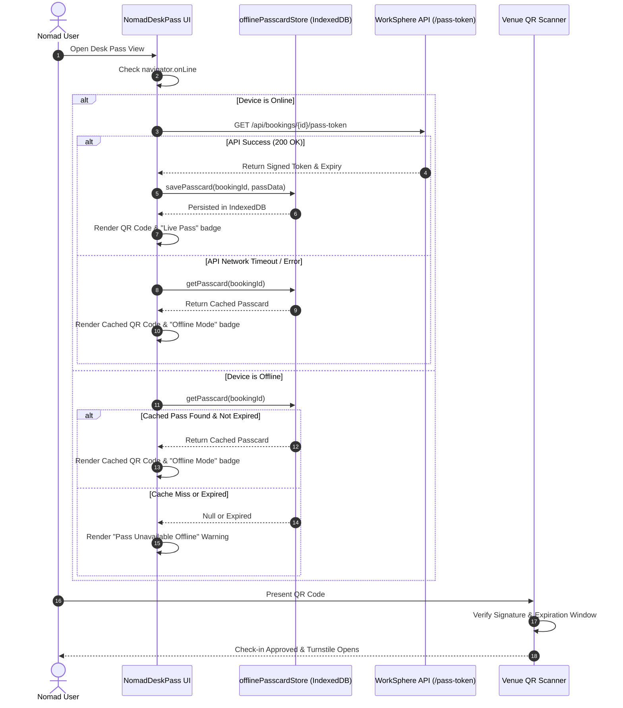

# NomadDeskPass: Offline QR Check-in & Passcard Architecture

## 1. Overview & System Scope

The `NomadDeskPass` component (`src/components/bookings/NomadDeskPass.tsx`) provides an interactive digital access passcard for coworking spaces, hot desks, and nomad hubs within WorkSphere. It renders dynamic booking metadata, venue check-in instructions, and cryptographically signed QR codes designed for rapid physical venue access.

To support digital nomads traveling through venues with spotty connectivity, basement facilities, or dead zones, `NomadDeskPass` pairs with `offlinePasscardStore.ts` using IndexedDB storage. This ensures valid passcards remain accessible and scannable offline, while offering native PNG snapshot exports via `html-to-image`.

> [!NOTE]
> **Implementation Scope Distinction:**
> - **Existing Implemented Behavior:** React passcard UI rendering, QR code generation using signed JWT payloads, online fetch calls to check-in token endpoints, client-side caching of active passcards in IndexedDB via `offlinePasscardStore.ts`, offline detection fallback, and PNG generation using `html-to-image`.
> - **Proposed Enhancements:** Background web worker periodic pre-fetching for expiring offline tokens, biometric unlock prior to pass reveal, and NFC hardware tap emulation.

---

## 2. Signed Check-In QR Code Generation

The check-in QR code encodes a compact, cryptographically signed token rather than raw booking IDs, preventing forgery, replay attacks, or unauthorized check-in generation:

1. **Payload Structure:**
   - `bookingId`: Unique reservation identifier.
   - `venueId`: ID of the host coworking location.
   - `userId`: Verified nomad account identifier.
   - `seatNumber` / `deskId`: Reserved workstation designation.
   - `exp`: Short-lived Unix timestamp expiration.
   - `nonce`: Unique single-use challenge token.
2. **Signature Verification:**
   - Tokens are signed on the WorkSphere backend using an asymmetric private key (e.g., Ed25519 or ES256).
   - Venue scanners or tablet check-in kiosks verify the cryptographic signature locally or against an edge cache using the corresponding public key.
3. **QR Code Rendering:**
   - Rendered using an SVG or Canvas QR generator configured with high error correction (`ErrorCorrectionLevel: 'M'` or `'H'`) to ensure scannability across cracked phone screens, variable lighting, and glare.

---

## 3. Token Retrieval & Offline Storage Architecture

### 3.1 Online Token Retrieval Flow
When `NomadDeskPass` mounts or when the user navigates to their active booking:
1. The component checks network connectivity (`navigator.onLine`).
2. An API request is dispatched to `/api/bookings/[bookingId]/pass-token`.
3. Upon receiving the fresh signed token payload and expiration timestamps:
   - The QR code updates with the latest token.
   - The component dispatches the updated passcard data to `offlinePasscardStore.ts`.
   - The record is written to the local IndexedDB database under the `passcards` object store.

### 3.2 Offline Storage via `offlinePasscardStore.ts`
- **Engine:** Client-side IndexedDB with structured versioning.
- **Key Schema:** Keyed by `bookingId`, indexed by `venueId`, `date`, and `expiresAt`.
- **Cached Record Structure:**
  ```typescript
  export interface CachedPasscard {
    bookingId: string;
    venueName: string;
    venueAddress: string;
    deskIdentifier: string;
    checkInWindow: {
      start: string;
      end: string;
    };
    signedToken: string;
    tokenExpiresAt: number;
    cachedAt: number;
    qrSvgData?: string;
  }
  ```
- **Storage Lifecycle:** When a user is offline or the network request fails (`FetchError` or timeout), `NomadDeskPass` queries `offlinePasscardStore.getPasscard(bookingId)`. If a cached pass is available and unexpired, it renders the passcard with an offline indicator banner.

---

## 4. Sequence Diagram: Online vs. Offline Fallback

The following Mermaid sequence diagram outlines the operational decision tree between online token synchronization and offline IndexedDB fallback retrieval:



---

## 5. PNG Export Mechanics via `html-to-image`

To accommodate nomads who prefer storing their passcard in their local photo gallery or digital wallet backup:
1. **Target Capture Container:**
   - The passcard container is bound to a React `ref` (`passcardContainerRef`).
2. **Export Execution:**
   - When the user taps "Save to Gallery / Export PNG", `toPng(passcardContainerRef.current)` is invoked from `html-to-image`.
   - The canvas rendering applies a fixed device pixel ratio scale multiplier (`pixelRatio: 2` or `3`) to guarantee high-resolution rendering suitable for scanners.
   - Visual web-only elements (e.g., interactive flip buttons, tooltip helpers) are filtered out using the `filter` option.
3. **Download Trigger:**
   - Converts the resulting data URL to a blob or triggers a programmatic anchor download (`passcard-[bookingId].png`).

---

## 6. Security Model & Short-Lived Token Boundaries

### 6.1 Token Lifetimes & Expiration
- Passcard tokens carry an expiration timestamp (`exp`) aligned to the reservation booking window plus an ingress grace period (e.g., valid from 30 minutes before booking start until booking end).
- Once the expiration timestamp passes, both the client UI and the venue scanner reject the pass.

### 6.2 Cryptographic Boundaries
- **Asymmetric Signature:** The client device only holds the signed token string; private signing keys are strictly maintained within the backend key management service (KMS).
- **Tamper Evidence:** Any client-side manipulation of `bookingId`, `seatNumber`, or `exp` invalidates the cryptographic signature, causing scanner rejection.
- **Replay & Sharing Mitigation:**
  - Nonces and short validity windows restrict unauthorized token forwarding.
  - The offline pass is tied to device-local IndexedDB storage; clear-cache actions evict expired passes.

---

## 7. Failure Scenarios, Storage Responsibilities & Limitations

### 7.1 Failure Scenarios & Mitigations
- **Cache Miss While Offline:** If a user attempts to open a passcard for the first time while offline without prior synchronization, no cached record exists. The component displays an explicit guidance banner instructing the user to reconnect.
- **IndexedDB Quota or Private Browsing Blocking:** In strict incognito or low-storage environments where IndexedDB transactions fail, the pass falls back to memory caching for the active session and notifies the user to export the PNG passcard.
- **Clock Drift:** If the client device's system clock deviates significantly from true UTC, offline expiration validation may prematurely flag a pass as expired or active. The venue scanner's authoritative clock acts as the ultimate gatekeeper.

### 7.2 Implemented vs. Proposed Comparison

| Feature | Status | Description |
| :--- | :--- | :--- |
| Signed QR Code Generation | **Implemented** | Generates verifiable QR codes containing signed booking payloads. |
| Offline Cache via IndexedDB | **Implemented** | Caches active passcards locally in `offlinePasscardStore.ts`. |
| PNG Snapshot Export | **Implemented** | Exports high-DPI passcard images via `html-to-image`. |
| Automatic Online/Offline Toggle | **Implemented** | Listens to online/offline network events and adjusts status badges. |
| Background Periodic Sync Worker | **Proposed** | Service Worker background sync for auto-refreshing passes before entry. |
| Apple Wallet / Google Wallet Pass | **Proposed** | Native `.pkpass` and Google Wallet pass file generation. |
