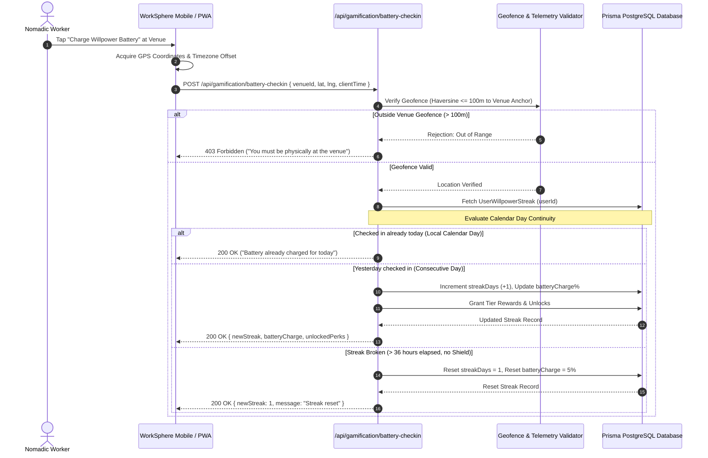

# Willpower Battery System: Streak Gamification & Reward Architecture

## 1. Executive Summary & Concept Overview

The **Willpower Battery System** is WorkSphere's core habit-formation and retention engine, drawing thematic inspiration from the Green Lantern Corps Central Power Battery.

Nomadic workers, remote freelancers, and digital creators often struggle with consistency and isolation. The Willpower Battery transforms daily coworking attendance into an interactive progression system. Each consecutive day a worker arrives, verifies their presence, and completes focused work sessions at partner venues, energy flows into their personal **Willpower Battery** widget.

As attendance streaks grow, the battery advances from a dim, dormant state to blazing emerald luminescence, unlocking tactical perks, custom 3D whiteboard construct shapes, priority booking windows, and discounted coworking passes.

---

## 2. Streak Validation Logic & Attendance Lifecycle

To ensure fairness across global timezones without allowing fraudulent check-in manipulation, streak progression follows a strict cryptographic and geofenced verification pipeline.



### 2.1 Calendar Day Normalization & Grace Windows

- **User Local Day Boundaries**: Streaks are calculated using the user's localized IANA timezone (e.g., `America/Los_Angeles`, `Asia/Tokyo`) rather than raw UTC midnight. A check-in between `00:00` and `23:59` local time satisfies that calendar day.
- **36-Hour Grace Window**: To accommodate international travel and late-night arrivals across the International Date Line, the system provides a 36-hour grace cutoff before resetting an unmaintained streak.
- **Weekend Shield Perk**: Workers can toggle an optional "Weekend Shield" that preserves streak integrity on Saturdays and Sundays for workers who observe dedicated rest days.

---

## 3. Daily Streak Milestones & Reward Tiers (Day 1 through Day 30+)

The battery gauge spans five distinct energetic tiers, scaling from a dim $5\%$ initial spark to $100\%$ full charge and transcendent $120\%$ overcharge states:

| Streak Days     | Battery %     | Tier Name                           | Visual Battery Effects                                    | Unlocked Perks & Privileges                                        |
| :-------------- | :------------ | :---------------------------------- | :-------------------------------------------------------- | :----------------------------------------------------------------- |
| **Day 0**       | `0%`          | **Dormant**                         | Dim translucent glass, no glow, dark charcoal core        | Basic app features; standard booking rates                         |
| **Day 1 - 2**   | `5% - 15%`    | **Spark Initiate**                  | Faint green core pulse; $2\text{px}$ emerald outer border | Welcome badge; Community feed check-in status                      |
| **Day 3 - 6**   | `20% - 35%`   | **Cadet Lantern**                   | Continuous emerald aura; internal ambient bubbles         | $5\%$ cafe food/beverage discount vouchers                         |
| **Day 7**       | `40%`         | **Sector Guardian** _(Milestone)_   | Glowing concentric rings; emerald lens flare flash        | **Unlocked:** Custom Hexagon Hard-Light construct in Whiteboard    |
| **Day 8 - 13**  | `45% - 65%`   | **Emerald Veteran**                 | Plasma arc filaments connecting top & bottom poles        | $10\%$ off hot desk hourly rates; 1 Free Guest Pass                |
| **Day 14**      | `70%`         | **Honor Guard** _(Milestone)_       | Dynamic particle sparks; rhythmic breathing glow          | **Unlocked:** Tactical Flight-Path Marker HUD skin in AR mode      |
| **Day 15 - 20** | `75% - 85%`   | **Corps Vanguard**                  | High-intensity core bloom; volumetric caustic waves       | Free 1-hour quiet phone booth reservation daily                    |
| **Day 21**      | `90%`         | **Willpower Master** _(Milestone)_  | Prismatic edge refractions; golden-green lens flare       | **Unlocked:** Flight Lead callsign badge in Coworking Circle       |
| **Day 22 - 29** | `92% - 98%`   | **Prime Sentinel**                  | Blinding emerald battery core; lightning plasma arcs      | $15\%$ monthly WorkHop pass discount; VIP Lounge access            |
| **Day 30+**     | `100% - 120%` | **Ion Transcendence** _(Legendary)_ | Overcharged white-hot center; corona flares; emerald aura | **Unlocked:** Free Day Pass; Legendary Ring Construct avatar frame |

---

## 4. Database Schema: `UserWillpowerStreak` Model

The Prisma schema persists continuous attendance telemetry, battery charge levels, and shield balances:

```prisma
model UserWillpowerStreak {
  id                    String    @id @default(cuid())
  userId                String    @unique
  user                  User      @relation(fields: [userId], references: [id], onDelete: Cascade)

  // Current active streak counters
  currentStreakDays     Int       @default(0)
  longestStreakDays     Int       @default(0)
  totalCheckinsCount    Int       @default(0)

  // Battery charge percentage (0.0 to 120.0)
  batteryChargePercent  Float     @default(0.0)
  currentTier           String    @default("DORMANT") // DORMANT, SPARK, CADET, GUARDIAN, VETERAN, MASTER, ION

  // Timestamp telemetry
  lastCheckinAt         DateTime?
  lastCheckinVenueId    String?
  timezone              String    @default("UTC")

  // Shield inventory & recovery
  weekendShieldsCount   Int       @default(1)
  freezeStreakUntil     DateTime?

  createdAt             DateTime  @default(now())
  updatedAt             DateTime  @updatedAt

  @@index([userId, currentStreakDays])
  @@index([currentTier])
}
```

---

## 5. Production SVG Battery Level Asset Specification

The battery widget is rendered using scalable vector graphics (`viewBox="0 0 120 180"`), featuring an outer aerospace casing, translucent glass containment vessel, and a dynamic linear gradient fill modulated by the current battery charge percentage.

```
       [ Top Conduction Cap: 40x12 ]
              ┌───────────┐
              │  [TOP]    │
         ┌────┴───────────┴────┐
         │ ┌─────────────────┐ │
         │ │                 │ │
         │ │  GLASS CHAMBER  │ │
         │ │                 │ │
         │ │ ~ ~ ~ ~ ~ ~ ~ ~ │ │ <--- Dynamic Liquid Plasma Level (0% to 100%)
         │ │ [GREEN PLASMA]  │ │
         │ │                 │ │
         │ └─────────────────┘ │
         └────┬───────────┬────┘
              │  [BASE]   │
              └───────────┘
       [ Bottom Energy Pedestal: 60x14 ]
```

### 5.1 Reusable React SVG Component

```tsx
import React from "react";

interface WillpowerBatteryProps {
  chargePercent: number; // 0 to 100 (or up to 120 for overcharge)
  size?: number;
  className?: string;
  isOvercharged?: boolean;
}

export function WillpowerBattery({
  chargePercent = 0,
  size = 180,
  className = "",
  isOvercharged = false,
}: WillpowerBatteryProps) {
  // Clamped fill height: glass chamber is 110px tall (y = 35 to y = 145)
  const clamped = Math.max(0, Math.min(100, chargePercent));
  const fillHeight = (clamped / 100) * 110;
  const fillY = 145 - fillHeight;

  return (
    <svg
      viewBox="0 0 120 180"
      width={size * (120 / 180)}
      height={size}
      className={`select-none drop-shadow-[0_0_15px_rgba(16,185,129,0.5)] ${className}`}
      aria-label={`Willpower Battery: ${Math.round(chargePercent)}% charged`}
      role="img"
    >
      <defs>
        {/* Plasma Liquid Gradient */}
        <linearGradient
          id="emeraldPlasmaGrad"
          x1="0%"
          y1="100%"
          x2="0%"
          y2="0%"
        >
          <stop offset="0%" stopColor="#064e3b" />
          <stop offset="50%" stopColor="#10b981" />
          <stop offset="90%" stopColor="#34d399" />
          <stop offset="100%" stopColor="#ecfdf5" />
        </linearGradient>

        {/* Outer Casing Metallic Gradient */}
        <linearGradient id="casingGrad" x1="0%" y1="0%" x2="100%" y2="0%">
          <stop offset="0%" stopColor="#1e293b" />
          <stop offset="50%" stopColor="#334155" />
          <stop offset="100%" stopColor="#0f172a" />
        </linearGradient>

        {/* Hard-Light Glow Filter */}
        <filter id="emeraldGlow" x="-20%" y="-20%" width="140%" height="140%">
          <feGaussianBlur stdDeviation="4" result="blur" />
          <feComposite in="SourceGraphic" in2="blur" operator="over" />
        </filter>
      </defs>

      {/* 1. Top Electrode Cap */}
      <rect
        x="42"
        y="10"
        width="36"
        height="12"
        rx="4"
        fill="url(#casingGrad)"
        stroke="#10b981"
        strokeWidth="1.5"
      />

      {/* 2. Outer Glass Containment Chamber */}
      <rect
        x="20"
        y="24"
        width="80"
        height="130"
        rx="16"
        fill="#02140f"
        stroke="#10b981"
        strokeWidth="2"
        opacity="0.9"
      />

      {/* 3. Liquid Energy Plasma Fill */}
      {clamped > 0 && (
        <rect
          x="24"
          y={fillY}
          width="72"
          height={fillHeight}
          rx="12"
          fill="url(#emeraldPlasmaGrad)"
          filter="url(#emeraldGlow)"
          className="transition-all duration-700 ease-out"
        />
      )}

      {/* 4. Translucent Specular Highlight Reflection */}
      <path
        d="M 28 32 L 28 140 Q 28 144 32 144 L 34 144 Q 32 144 32 140 L 32 32 Z"
        fill="#ffffff"
        opacity="0.25"
      />

      {/* 5. Center Power Ring Insignia Outline */}
      <circle
        cx="60"
        cy="89"
        r="14"
        fill="none"
        stroke="#a7f3d0"
        strokeWidth="2"
        opacity="0.6"
      />
      <circle
        cx="60"
        cy="89"
        r="6"
        fill="#ecfdf5"
        opacity={clamped > 50 ? "0.8" : "0.2"}
      />

      {/* 6. Bottom Pedestal Mount */}
      <rect
        x="32"
        y="156"
        width="56"
        height="14"
        rx="4"
        fill="url(#casingGrad)"
        stroke="#10b981"
        strokeWidth="1.5"
      />
    </svg>
  );
}
```

---

## 6. Anti-Fraud & Physical Presence Verification

To prevent unauthorized remote streak claiming (e.g., GPS spoofing, headless bot scripting), check-ins must satisfy three verification gates:

1. **Precision Geofencing Radius**: Check-in latitude and longitude must fall within $100\text{ meters}$ of the registered venue coordinates.
2. **Session Dwell Duration**: The full battery charge bonus is awarded only after the user remains connected to venue telemetry or active inside the workspace for at least **45 minutes**.
3. **Idempotency Guard**: Re-submitting check-ins on the same calendar day returns the current streak state without double-charging the battery.
