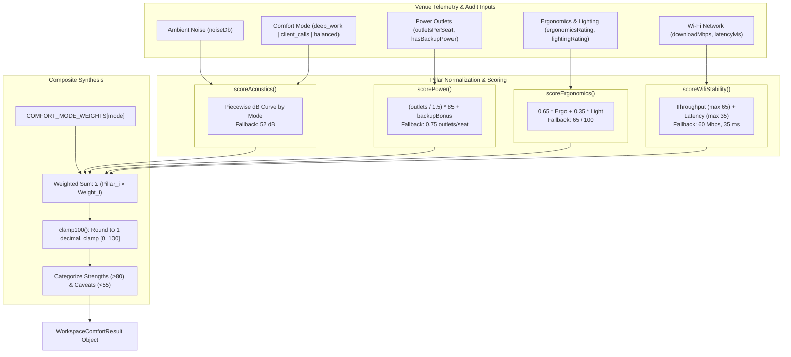

# Workspace Comfort Scoring Model & API Reference

## 1. Overview

WorkSphere provides real-time workspace recommendation, venue discovery, and seat booking across global coworking hubs, cafes, and libraries. To assist remote professionals, digital nomads, and distributed teams in selecting environments suited to their work needs, WorkSphere implements a multi-dimensional **Workspace Comfort Scoring Model**.

The comfort scoring engine evaluates physical and digital workspace conditions across four core pillars:
1. **Acoustic Comfort & Ambient Noise:** Sound pressure levels (dB) optimized for focused concentration or verbal collaboration.
2. **Power Outlet Availability:** Electrical socket availability relative to seating capacity and power infrastructure backup.
3. **Seating Ergonomics & Lighting:** Physical posture support and illumination quality derived from crowdsourced reviews and venue audits.
4. **Network & Wi-Fi Stability:** Connection throughput and round-trip latency critical for cloud workflows and real-time audio/video communication.

### Score Range & Qualitative Tiers

All individual pillar scores and composite comfort scores are normalized and clamped to a deterministic **0 to 100** scale, rounded to one decimal place:

| Score Range | Comfort Tier | Operational Meaning | Typical Venue Characteristics |
| :--- | :--- | :--- | :--- |
| **80.0 – 100.0** | **Optimal / High Comfort** | Environment exceeds productivity thresholds for deep work or client interactions. | Ergonomic task seating, $\le 45\text{ dB}$ noise floor, dedicated desk power outlets, and fiber Wi-Fi. |
| **55.0 – 79.9** | **Adequate / Moderate Comfort** | Standard commercial workspace suitable for general administrative and laptop tasks. | Standard commercial chairs, $46\text{--}65\text{ dB}$ conversational acoustics, shared table outlets. |
| **0.0 – 54.9** | **Basic / Low Comfort** | Environment exhibits significant ergonomic, acoustic, or electrical constraints. | Hard stools, $> 65\text{ dB}$ loud or erratic noise, sparse or missing outlets, or unstable Wi-Fi. |

The composite comfort score dynamically adapts its weighting coefficients according to the user's selected **Workspace Comfort Mode**:
- `deep_work`: Prioritizes silent acoustics and quiet concentration.
- `client_calls`: Prioritizes low-latency Wi-Fi and moderate conversational acoustic masking.
- `balanced`: Provides an equal distribution across acoustics, power, ergonomics, and Wi-Fi.

---

## 2. Scoring Architecture

The comfort scoring pipeline operates as a deterministic, pure-function evaluation engine implemented in [`src/lib/venues/workspaceComfortScorer.ts`](file:///c:/Users/Saransh%20Kashyap/WorkSphere/src/lib/venues/workspaceComfortScorer.ts).

### Data Flow Pipeline



### Mathematical Formulation

Given an input vector $\mathbf{x} = (\text{noiseDb}, \text{outletsPerSeat}, \text{hasBackupPower}, \text{ergonomicsRating}, \text{lightingRating}, \text{downloadMbps}, \text{latencyMs})$ and mode $M \in \{\text{deep\_work}, \text{client\_calls}, \text{balanced}\}$:

1. **Pillar Sub-scores:**
   $$S_{\text{acoustics}} = f_{\text{acoustics}}(\text{noiseDb}, M)$$
   $$S_{\text{power}} = f_{\text{power}}(\text{outletsPerSeat}, \text{hasBackupPower})$$
   $$S_{\text{ergonomics}} = f_{\text{ergonomics}}(\text{ergonomicsRating}, \text{lightingRating})$$
   $$S_{\text{wifi}} = f_{\text{wifi}}(\text{downloadMbps}, \text{latencyMs})$$

2. **Composite Score:**
   $$S_{\text{raw}} = \sum_{p \in \mathcal{P}} w_{p}(M) \cdot S_{p}$$
   Where $\mathcal{P} = \{\text{acoustics}, \text{power}, \text{ergonomics}, \text{wifi}\}$ and $\sum_{p \in \mathcal{P}} w_p(M) = 1.0$.

3. **Clamping & Precision Function:**
   $$\operatorname{clamp100}(v) = \begin{cases}
   50.0 & \text{if } v \notin \mathbb{R} \text{ or } \operatorname{isNaN}(v) \\
   \min\left(100.0, \max\left(0.0, \frac{\lfloor 10 \cdot v + 0.5 \rfloor}{10}\right)\right) & \text{otherwise}
   \end{cases}$$

---

## 3. Seating Ergonomics Score

The ergonomics scoring function evaluates the physical posture support and optical comfort of a venue by combining user and auditor ratings for seating and illumination.

### Input Parameters

| Parameter | Type | Valid Domain | Fallback Value | Source / Interpretation |
| :--- | :--- | :--- | :--- | :--- |
| `ergonomicsRating` | `number \| null \| undefined` | $[0.0, 5.0]$ or $[0.0, 100.0]$ | `65.0` | Chair adjustability, lumbar support, desk height. |
| `lightingRating` | `number \| null \| undefined` | $[0.0, 5.0]$ or $[0.0, 100.0]$ | `65.0` | Natural daylight, glare reduction, task lighting. |

### Normalization Logic (`normalizeRatingTo100`)

Ratings submitted on a standard $1\text{--}5$ star scale are linearly mapped to a $0\text{--}100$ point scale. Ratings already on a $0\text{--}100$ scale are preserved:

$$\operatorname{normalizeRatingTo100}(v, \text{fallback}) = \begin{cases}
\text{fallback} & \text{if } v \notin \mathbb{R} \text{ or } \operatorname{isNaN}(v) \\
0.0 & \text{if } v < 0 \\
\operatorname{clamp100}\left(\frac{v}{5} \times 100\right) & \text{if } 0 \le v \le 5 \\
\operatorname{clamp100}(v) & \text{if } v > 5
\end{cases}$$

### Ergonomics Synthesis Formula

The combined ergonomics pillar score weights physical seating at $65\%$ and task illumination at $35\%$:

$$S_{\text{ergonomics}} = \operatorname{clamp100}\left(S_{\text{ergo\_norm}} \times 0.65 + S_{\text{light\_norm}} \times 0.35\right)$$

### Worked Numerical Example

A coworking venue has an ergonomics rating of $4.5$ stars and a lighting rating of $4.0$ stars:
1. Normalize ergonomics: $\frac{4.5}{5} \times 100 = 90.0$
2. Normalize lighting: $\frac{4.0}{5} \times 100 = 80.0$
3. Weighted combination:
   $$S_{\text{ergonomics}} = \operatorname{clamp100}(90.0 \times 0.65 + 80.0 \times 0.35) = \operatorname{clamp100}(58.5 + 28.0) = 86.5$$

---

## 4. Power Outlet Availability Score

The power availability score calculates electrical charging access across seats, accounting for dedicated sockets and uninterruptible power supply (UPS) / backup generator infrastructure.

### Input Parameters

| Parameter | Type | Valid Domain | Fallback Value | Source / Interpretation |
| :--- | :--- | :--- | :--- | :--- |
| `outletsPerSeat` | `number \| null \| undefined` | $[0.0, \infty)$ | `0.75` | Total available charging sockets divided by seating capacity. |
| `hasBackupPower` | `boolean \| null \| undefined` | `true \| false` | `false` | Venue equipped with generator or battery backup system. |

### Scoring & Saturation Behavior

- **Saturation Threshold:** Power capacity saturates at **$1.5$ outlets per seat**, which awards the maximum base score of $85.0$ points.
- **Base Score Calculation:**
  $$S_{\text{outlet\_base}} = \min\left(85.0, \frac{\operatorname{outletsPerSeat}}{1.5} \times 85.0\right)$$
- **Backup Power Bonus:** Venues with verified backup power (`hasBackupPower === true`) receive an additive bonus of $+15.0$ points. Venues without backup power receive $+0.0$ points.
- **Clamping:** The final sum is clamped to $[0.0, 100.0]$.

$$S_{\text{power}} = \operatorname{clamp100}\left(\min\left(85.0, \frac{\max(0, \text{outletsPerSeat})}{1.5} \times 85.0\right) + (\text{hasBackupPower} ? 15 : 0)\right)$$

### Worked Numerical Examples

#### Scenario A: High Outlet Density with Backup Power
- Seating positions: $50$
- Available AC/USB-C outlets: $75$ ($\text{outletsPerSeat} = \frac{75}{50} = 1.5$)
- Backup generator: Yes (`hasBackupPower = true`)
- Calculation:
  $$S_{\text{outlet\_base}} = \min\left(85.0, \frac{1.5}{1.5} \times 85.0\right) = 85.0$$
  $$S_{\text{power}} = \operatorname{clamp100}(85.0 + 15.0) = 100.0$$

#### Scenario B: Limited Outlets without Backup Power
- Seating positions: $100$
- Available outlets: $60$ ($\text{outletsPerSeat} = \frac{60}{100} = 0.6$)
- Backup generator: No (`hasBackupPower = false`)
- Calculation:
  $$S_{\text{outlet\_base}} = \min\left(85.0, \frac{0.6}{1.5} \times 85.0\right) = \min(85.0, 34.0) = 34.0$$
  $$S_{\text{power}} = \operatorname{clamp100}(34.0 + 0) = 34.0$$

---

## 5. Acoustic Comfort Score

Acoustic comfort is derived from ambient equivalent continuous sound pressure levels ($L_{\text{eq}}$) measured in A-weighted decibels ($\text{dBA}$). The scoring response is non-linear and varies according to the active `WorkspaceComfortMode`.

### Input Parameters & Fallbacks

| Parameter | Type | Valid Domain | Fallback Value |
| :--- | :--- | :--- | :--- |
| `noiseDb` | `number \| null \| undefined` | $[0.0, 140.0]$ | `52.0` |

If `noiseDb` is missing, `NaN`, or non-finite, the model falls back to $52.0\text{ dB}$ (typical ambient cafe background level). If `noiseDb < 0`, the score returns $0.0$.

### Piecewise Threshold Functions

#### 1. `deep_work` Mode
Designed for high-concentration programming, research, and writing where ambient noise is detrimental:
$$S_{\text{acoustics}}^{(\text{deep\_work})} = \begin{cases}
100.0 & \text{if } \text{dB} \le 45 \\
\operatorname{clamp100}(100.0 - (\text{dB} - 45) \times 2.5) & \text{if } 45 < \text{dB} \le 55 \\
\operatorname{clamp100}(75.0 - (\text{dB} - 55) \times 3.0) & \text{if } 55 < \text{dB} \le 75 \\
\operatorname{clamp100}(15.0 - (\text{dB} - 75)) & \text{if } \text{dB} > 75
\end{cases}$$

#### 2. `client_calls` Mode
Optimized for voice calls and client meetings. Dead-silent environments ($<35\text{ dB}$) are penalized due to lack of conversational acoustic masking, while louder environments ($>58\text{ dB}$) degrade intelligibility:
$$S_{\text{acoustics}}^{(\text{client\_calls})} = \begin{cases}
\operatorname{clamp100}(95.0 - (35 - \text{dB}) \times 1.5) & \text{if } \text{dB} < 35 \\
95.0 & \text{if } 35 \le \text{dB} \le 58 \\
\operatorname{clamp100}(95.0 - (\text{dB} - 58) \times 3.5) & \text{if } 58 < \text{dB} \le 72 \\
\operatorname{clamp100}(46.0 - (\text{dB} - 72) \times 2.0) & \text{if } \text{dB} > 72
\end{cases}$$

#### 3. `balanced` Mode
Standard daily workflow balance:
$$S_{\text{acoustics}}^{(\text{balanced})} = \begin{cases}
95.0 & \text{if } \text{dB} \le 50 \\
\operatorname{clamp100}(95.0 - (\text{dB} - 50) \times 2.5) & \text{if } 50 < \text{dB} \le 65 \\
\operatorname{clamp100}(57.5 - (\text{dB} - 65) \times 2.5) & \text{if } \text{dB} > 65
\end{cases}$$

### Numerical Comparison Across Modes

| Ambient Noise ($\text{dB}$) | `deep_work` Score | `client_calls` Score | `balanced` Score |
| :--- | :--- | :--- | :--- |
| **$30\text{ dB}$ (Whisper quiet library)** | **$100.0$** | $87.5$ | $95.0$ |
| **$42\text{ dB}$ (Quiet study zone)** | **$100.0$** | $95.0$ | $95.0$ |
| **$50\text{ dB}$ (Moderate coffee shop background)** | $87.5$ | $95.0$ | $95.0$ |
| **$60\text{ dB}$ (Lively cafe / conversational hub)** | $60.0$ | $88.0$ | $70.0$ |
| **$70\text{ dB}$ (Busy lunch rush / loud espresso bar)** | $30.0$ | $53.0$ | $45.0$ |
| **$80\text{ dB}$ (Construction / high street traffic)** | $10.0$ | $30.0$ | $20.0$ |

---

## 6. Composite Scoring Formula & Weighting Coefficients

The composite comfort score synthesizes all four pillars using fixed, mode-specific weighting coefficients.

### Weighting Coefficients Matrix (`COMFORT_MODE_WEIGHTS`)

| Pillar | Key in Breakdown | `deep_work` | `client_calls` | `balanced` |
| :--- | :--- | :--- | :--- | :--- |
| **Acoustics** | `acousticsScore` | **$0.35$** ($35\%$) | **$0.25$** ($25\%$) | **$0.25$** ($25\%$) |
| **Power Access** | `powerScore` | **$0.25$** ($25\%$) | **$0.20$** ($20\%$) | **$0.25$** ($25\%$) |
| **Ergonomics & Lighting**| `ergonomicsScore`| **$0.25$** ($25\%$) | **$0.15$** ($15\%$) | **$0.25$** ($25\%$) |
| **Wi-Fi Stability** | `wifiScore` | **$0.15$** ($15\%$) | **$0.40$** ($40\%$) | **$0.25$** ($25\%$) |
| **Sum of Weights** | | **$1.00$** ($100\%$) | **$1.00$** ($100\%$) | **$1.00$** ($100\%$) |

> [!NOTE]
> The coefficients are strictly normalized such that $\sum w = 1.00$ across all three modes.

### Network Pillar Formula (`scoreWifiStability`)

The fourth constituent pillar, Wi-Fi stability, combines download speed ($65\%$ max) and latency ($35\%$ max):
- Speed Component: $S_{\text{speed}} = \min\left(65.0, \frac{\max(0, \text{downloadMbps})}{150.0} \times 65.0\right)$
- Latency Component:
  $$S_{\text{latency}} = \begin{cases}
  35.0 & \text{if } \text{latencyMs} \le 20 \\
  0.0 & \text{if } \text{latencyMs} \ge 180 \\
  \frac{180 - \text{latencyMs}}{160} \times 35.0 & \text{if } 20 < \text{latencyMs} < 180
  \end{cases}$$
- $S_{\text{wifi}} = \operatorname{clamp100}(S_{\text{speed}} + S_{\text{latency}})$
- Fallbacks: $\text{downloadMbps} = 60.0$, $\text{latencyMs} = 35.0$.

### Strengths and Caveats Tagging Rules

The result generator dynamically assigns qualitative metadata tags based on individual pillar performance:

- **Strengths (Score $\ge 80.0$):**
  - `acousticsScore >= 80` $\to$ `"Quiet & focus-friendly acoustics"`
  - `powerScore >= 80` $\to$ `"Abundant power & backup support"`
  - `ergonomicsScore >= 80` $\to$ `"Ergonomic seating & task lighting"`
  - `wifiScore >= 80` $\to$ `"High-throughput, low-latency WiFi"`
- **Caveats (Score $< 55.0$):**
  - `acousticsScore < 55` $\to$ `"High ambient noise for focus"`
  - `powerScore < 55` $\to$ `"Limited power outlets per seat"`
  - `ergonomicsScore < 55` $\to$ `"Basic seating / lighting comfort"`
  - `wifiScore < 55` $\to$ `"Unstable or slow WiFi connection"`

---

## 7. Community Telemetry & Confidence Decay

WorkSphere collects both automated IoT telemetry and crowdsourced community check-ins. When aggregating historical noise and environmental readings, temporal freshness is critical.

### Acoustic Moving Average & Outlier Filtering

In WorkSphere's real-time acoustic telemetry aggregator ([`src/lib/telemetry/noiseAggregator.ts`](file:///c:/Users/Saransh%20Kashyap/WorkSphere/src/lib/telemetry/noiseAggregator.ts)), new incoming sound level readings undergo Hampel outlier rejection followed by an Exponential Moving Average (EMA) with a decay smoothing factor $\alpha = 0.15$:

$$\bar{L}_{k} = \alpha \cdot L_{\text{new}} + (1 - \alpha) \cdot \bar{L}_{k-1} = 0.15 \cdot L_{\text{new}} + 0.85 \cdot \bar{L}_{k-1}$$

### Session & Telemetry Decay Constant

WorkSphere's time-decay model for community reports and session memory ([`src/__tests__/agents/MemoryAgent.test.ts`](file:///c:/Users/Saransh%20Kashyap/WorkSphere/src/__tests__/agents/MemoryAgent.test.ts) and [`src/core/agents/memory/GraphMemory.ts`](file:///c:/Users/Saransh%20Kashyap/WorkSphere/src/core/agents/memory/GraphMemory.ts)) follows an exponential decay formulation:

$$C(t) = C_0 \cdot e^{-\lambda \cdot \Delta t}$$

Where:
- $C_0$: Initial confidence or base relevance ($1.0$ for fresh verified telemetry).
- $\Delta t$: Age of the telemetry report in elapsed hours ($\Delta t = \frac{t_{\text{current}} - t_{\text{report}}}{3600 \times 1000}$).
- $\lambda$: Telemetry decay rate constant.
- **Half-Life:** With a standard half-life of $7\text{ days}$ ($168\text{ hours}$):
  $$\lambda = \frac{\ln(2)}{168} \approx 0.004126\text{ hr}^{-1}$$

| Report Age ($\Delta t$) | Confidence Multiplier ($C$) | Interpretation |
| :--- | :--- | :--- |
| **$0\text{ hours}$ (Fresh telemetry)** | $1.000$ ($100\%$) | Full confidence weight applied to metrics. |
| **$24\text{ hours}$ ($1\text{ day}$)** | $0.906$ ($90.6\%$) | Minor confidence decay; highly reliable. |
| **$72\text{ hours}$ ($3\text{ days}$)** | $0.743$ ($74.3\%$) | Moderate decay; supplemented with venue defaults. |
| **$168\text{ hours}$ ($7\text{ days}$)** | $0.500$ ($50.0\%$) | Half-life threshold; confidence halved. |
| **$336\text{ hours}$ ($14\text{ days}$)** | $0.250$ ($25.0\%$) | Telemetry stale; falls back toward static venue profile. |

> [!IMPORTANT]
> **Implementation Status Note:**
> In the current codebase (`src/lib/venues/workspaceComfortScorer.ts`), `evaluateWorkspaceComfort()` evaluates instantaneous snapshot inputs directly. Time-decay weighting is implemented in the upstream telemetry ingestion workers (`noiseAggregator.ts`, `GraphMemory.ts`) prior to generating comfort inputs. The comfort scoring function itself operates deterministically without mutating scores based on report age.

---

## 8. API Response Schema

WorkSphere exposes comfort score breakdowns as part of the venue intelligence and detail API endpoints (`GET /api/venues/[venueId]`).

### TypeScript Definitions

From [`src/lib/venues/workspaceComfortScorer.ts`](file:///c:/Users/Saransh%20Kashyap/WorkSphere/src/lib/venues/workspaceComfortScorer.ts):

```typescript
export type WorkspaceComfortMode = 'deep_work' | 'client_calls' | 'balanced';

export interface WorkspaceComfortInput {
  venueId: string;
  noiseDb?: number | null;
  outletsPerSeat?: number | null;
  hasBackupPower?: boolean | null;
  ergonomicsRating?: number | null;
  lightingRating?: number | null;
  downloadMbps?: number | null;
  latencyMs?: number | null;
  mode?: WorkspaceComfortMode;
}

export interface ComfortPillarBreakdown {
  acousticsScore: number;
  powerScore: number;
  ergonomicsScore: number;
  wifiScore: number;
}

export interface WorkspaceComfortResult {
  venueId: string;
  mode: WorkspaceComfortMode;
  overallScore: number;
  breakdown: ComfortPillarBreakdown;
  strengths: string[];
  caveats: string[];
}
```

### JSON Schema & Field Descriptions

| Field | Data Type | Nullable / Optional | Description |
| :--- | :--- | :--- | :--- |
| `venueId` | `string` | **No** | Unique identifier of the target venue. |
| `mode` | `string` | **No** | Comfort mode used (`"deep_work"`, `"client_calls"`, or `"balanced"`). Defaults to `"balanced"`. |
| `overallScore` | `number` | **No** | Composite comfort score on $[0.0, 100.0]$, rounded to 1 decimal place. |
| `breakdown.acousticsScore` | `number` | **No** | Acoustic comfort sub-score $[0.0, 100.0]$. |
| `breakdown.powerScore` | `number` | **No** | Electrical outlet availability and backup power sub-score $[0.0, 100.0]$. |
| `breakdown.ergonomicsScore`| `number` | **No** | Combined seating ergonomics and illumination sub-score $[0.0, 100.0]$. |
| `breakdown.wifiScore` | `number` | **No** | Network speed and latency sub-score $[0.0, 100.0]$. |
| `strengths` | `string[]` | **No** | List of human-readable strength tags for pillars scoring $\ge 80.0$. |
| `caveats` | `string[]` | **No** | List of warning/caveat tags for pillars scoring $< 55.0$. |

### Example JSON Response Payload

```json
{
  "venueId": "hub-central-01",
  "mode": "deep_work",
  "overallScore": 87.1,
  "breakdown": {
    "acousticsScore": 100.0,
    "powerScore": 100.0,
    "ergonomicsScore": 90.0,
    "wifiScore": 30.5
  },
  "strengths": [
    "Quiet & focus-friendly acoustics",
    "Abundant power & backup support",
    "Ergonomic seating & task lighting"
  ],
  "caveats": [
    "Unstable or slow WiFi connection"
  ]
}
```

---

## 9. Worked End-to-End Examples

The following worked numerical examples reflect exact calculations executed by the test suite and source code.

### Example A: Fresh Telemetry (High Comfort Coworking Hub)

#### Input Vector
- `venueId`: `"venue-tech-collective"`
- `mode`: `"deep_work"`
- `noiseDb`: $42.0\text{ dB}$ (Library-quiet zone)
- `outletsPerSeat`: $1.5$ (One dedicated socket plus auxiliary per desk)
- `hasBackupPower`: `true`
- `ergonomicsRating`: $4.5\text{ / }5.0$
- `lightingRating`: $4.5\text{ / }5.0$
- `downloadMbps`: $35.0\text{ Mbps}$
- `latencyMs`: $110.0\text{ ms}$

#### Step-by-Step Calculation

1. **Acoustic Sub-Score (`deep_work`):**
   - Since $\text{noiseDb} \le 45$, $S_{\text{acoustics}} = 100.0$.
2. **Power Sub-Score:**
   - Outlet base: $\min(85.0, (1.5 / 1.5) \times 85.0) = 85.0$
   - Backup bonus: $+15.0$
   - $S_{\text{power}} = \operatorname{clamp100}(85.0 + 15.0) = 100.0$.
3. **Ergonomics Sub-Score:**
   - Ergonomics norm: $(4.5 / 5.0) \times 100 = 90.0$
   - Lighting norm: $(4.5 / 5.0) \times 100 = 90.0$
   - $S_{\text{ergonomics}} = \operatorname{clamp100}(90.0 \times 0.65 + 90.0 \times 0.35) = 90.0$.
4. **Wi-Fi Sub-Score:**
   - Speed component: $\min(65.0, (35.0 / 150.0) \times 65.0) = 15.1667$
   - Latency component: $((180 - 110) / 160) \times 35.0 = (70 / 160) \times 35.0 = 15.3125$
   - $S_{\text{wifi}} = \operatorname{clamp100}(15.1667 + 15.3125) = \operatorname{clamp100}(30.4792) = 30.5$.
5. **Composite Synthesis (`deep_work` Weights: $0.35, 0.25, 0.25, 0.15$):**
   $$\begin{aligned}
   S_{\text{raw}} &= (100.0 \times 0.35) + (100.0 \times 0.25) + (90.0 \times 0.25) + (30.5 \times 0.15) \\
   &= 35.0 + 25.0 + 22.5 + 4.575 \\
   &= 87.075 \\
   S_{\text{overall}} &= \operatorname{clamp100}(87.075) = \mathbf{87.1}
   \end{aligned}$$
6. **Tags:**
   - Strengths: `"Quiet & focus-friendly acoustics"`, `"Abundant power & backup support"`, `"Ergonomic seating & task lighting"`.
   - Caveats: `"Unstable or slow WiFi connection"`.

---

### Example B: Mode Shift Comparison (`client_calls`)

Taking the exact same venue inputs as Example A, but changing `mode` to `"client_calls"`:

1. **Acoustic Sub-Score (`client_calls`):**
   - For $35 \le \text{dB} \le 58$, $S_{\text{acoustics}} = 95.0$.
2. **Power Sub-Score:** $100.0$.
3. **Ergonomics Sub-Score:** $90.0$.
4. **Wi-Fi Sub-Score:** $30.5$.
5. **Composite Synthesis (`client_calls` Weights: $0.25, 0.20, 0.15, 0.40$):**
   $$\begin{aligned}
   S_{\text{raw}} &= (95.0 \times 0.25) + (100.0 \times 0.20) + (90.0 \times 0.15) + (30.5 \times 0.40) \\
   &= 23.75 + 20.0 + 13.5 + 12.2 \\
   &= 69.45 \\
   S_{\text{overall}} &= \operatorname{clamp100}(69.45) = \mathbf{69.4}
   \end{aligned}$$

*Analysis:* Due to the higher Wi-Fi weight ($40\%$) and reduced Wi-Fi performance, the comfort score appropriately drops from **$87.1$** in deep work to **$69.4$** for client calls.

---

### Example C: Balanced Hub Evaluation (`balanced` Mode)

From the unit test fixture `hub-det`:
- `mode`: `"balanced"`
- `noiseDb`: $48.0\text{ dB}$
- `outletsPerSeat`: $1.2$
- `hasBackupPower`: `true`
- `ergonomicsRating`: $4.0\text{ / }5.0$
- `lightingRating`: $4.0\text{ / }5.0$
- `downloadMbps`: $140.0\text{ Mbps}$
- `latencyMs`: $18.0\text{ ms}$

#### Calculation

1. **Acoustic Sub-Score:** For $\text{dB} \le 50$, $S_{\text{acoustics}} = 95.0$.
2. **Power Sub-Score:**
   - Outlet base: $(1.2 / 1.5) \times 85.0 = 0.8 \times 85.0 = 68.0$
   - Backup bonus: $+15.0$
   - $S_{\text{power}} = 68.0 + 15.0 = 83.0$.
3. **Ergonomics Sub-Score:**
   - Normalized ratings: $4.0 / 5.0 \times 100 = 80.0$
   - $S_{\text{ergonomics}} = 80.0 \times 0.65 + 80.0 \times 0.35 = 80.0$.
4. **Wi-Fi Sub-Score:**
   - Speed component: $(140.0 / 150.0) \times 65.0 = 60.6667$
   - Latency component: $\text{latencyMs} \le 20 \implies 35.0$
   - $S_{\text{wifi}} = \operatorname{clamp100}(60.6667 + 35.0) = \operatorname{clamp100}(95.6667) = 95.7$.
5. **Composite Synthesis (`balanced` Weights: $0.25, 0.25, 0.25, 0.25$):**
   $$\begin{aligned}
   S_{\text{raw}} &= 0.25 \times (95.0 + 83.0 + 80.0 + 95.7) \\
   &= 0.25 \times 353.7 = 88.425 \\
   S_{\text{overall}} &= \operatorname{clamp100}(88.425) = \mathbf{88.4}
   \end{aligned}$$
6. **Tags:**
   - Strengths: All 4 pillars score $\ge 80.0$:
     `"Quiet & focus-friendly acoustics"`, `"Abundant power & backup support"`, `"Ergonomic seating & task lighting"`, `"High-throughput, low-latency WiFi"`.
   - Caveats: None.

---

## 10. Limitations & Edge Cases

The implementation includes rigorous bounds checking and input sanitization to prevent runtime exceptions:

1. **Missing or `null` Values:**
   - Missing fields fall back to sensible defaults:
     - `noiseDb`: $52.0\text{ dB}$
     - `outletsPerSeat`: $0.75$
     - `hasBackupPower`: `false`
     - `ergonomicsRating`: $65.0$
     - `lightingRating`: $65.0$
     - `downloadMbps`: $60.0\text{ Mbps}$
     - `latencyMs`: $35.0\text{ ms}$
2. **`NaN` and `Infinity`:**
   - Filtered via `Number.isFinite()`. Non-finite numbers invoke the fallback default rather than propagating `NaN`.
3. **Negative Numbers:**
   - Negative decibel values return $0.0$.
   - Negative ratings return $0.0$.
   - Negative outlet counts are clamped to $0.0$ via `Math.max(0, ...)`.
4. **Zero Seating or Outlets:**
   - When `outletsPerSeat` is $0.0$, the power base score is $0.0$. If `hasBackupPower` is true, the score is $15.0$; otherwise, $0.0$.
5. **Extreme Environmental Noise:**
   - Noise levels exceeding $140\text{ dB}$ yield $0.0$ acoustic score and trigger the caveat `"High ambient noise for focus"`.
6. **Unimplemented Upstream Features:**
   - Dynamic decay weighting is handled upstream before calling `evaluateWorkspaceComfort()`.
   - Direct database joins for live crowd consensus (e.g. `VibeConsensusEngine`) do not alter the pure scoring function's mathematical constants.

---

## 11. References

- **Scoring Engine Implementation:** [`src/lib/venues/workspaceComfortScorer.ts`](file:///c:/Users/Saransh%20Kashyap/WorkSphere/src/lib/venues/workspaceComfortScorer.ts)
- **Scoring Unit Test Suite:** [`src/__tests__/lib/venues/workspaceComfortScorer.test.ts`](file:///c:/Users/Saransh%20Kashyap/WorkSphere/src/__tests__/lib/venues/workspaceComfortScorer.test.ts)
- **Acoustic Standards Specification:** [`docs/telemetry/ambient-noise-aggregation-standards.md`](file:///c:/Users/Saransh%20Kashyap/WorkSphere/docs/telemetry/ambient-noise-aggregation-standards.md)
- **Power Outlet Standards Guide:** [`docs/venues/POWER_OUTLET_STANDARDS.md`](file:///c:/Users/Saransh%20Kashyap/WorkSphere/docs/venues/POWER_OUTLET_STANDARDS.md)
- **Acoustic Telemetry Aggregator:** [`src/lib/telemetry/noiseAggregator.ts`](file:///c:/Users/Saransh%20Kashyap/WorkSphere/src/lib/telemetry/noiseAggregator.ts)
- **Memory & Telemetry Decay Suite:** [`src/__tests__/agents/MemoryAgent.test.ts`](file:///c:/Users/Saransh%20Kashyap/WorkSphere/src/__tests__/agents/MemoryAgent.test.ts)
