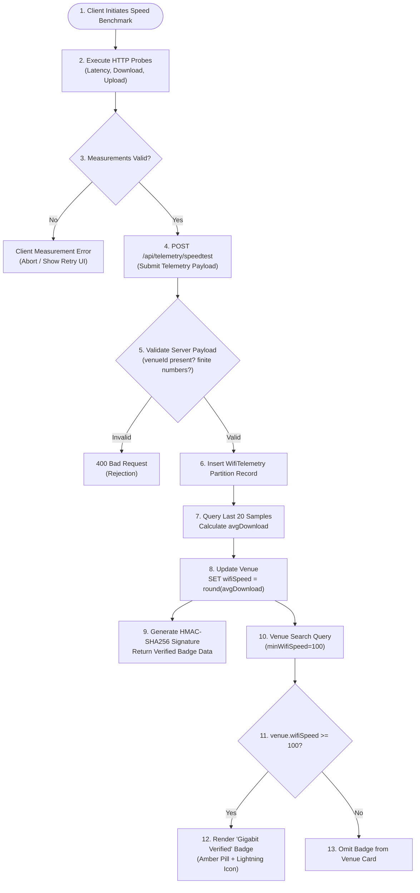

# Gigabit Verified WiFi Speed Validation Badge Criteria

> **Technical Reference & Operational Guide**  
> **Target Subsystems:** Venue Search & Filtering (`src/components/venues/VenueFilterBar.tsx`, `src/lib/venues/searchQuery.ts`, `src/app/api/venues/route.ts`), Venue Cards (`src/components/VenueCard.tsx`, `src/components/venues/VenueCard.tsx`), Telemetry Ingestion (`src/app/api/telemetry/speedtest/route.ts`, `src/app/api/telemetry/speedtest/upload/route.ts`), P2P Network Persistence (`src/app/api/network/speedtest/route.ts`), Benchmark Engine (`src/lib/wifi/speedBenchmarkEngine.ts`), and Zero-Knowledge Proof Verifier (`src/features/zkp/gigabitSpeedVerifier.ts`).  
> **Database Models:** `Venue` (`wifiSpeed`, `wifiQuality`), `WifiTelemetry` (`download`, `upload`, `latency`, `crowdLevel`, `timestamp`).  
> **Related Issues:** #9893 (Lightning WiFi & Gigabit Verified Badge), #10114 (Zero-Knowledge Proof Gigabit Verifier), #10101 (Specification & Criteria Documentation).

---

## 1. Overview

The **Gigabit Verified** badge is a performance indicator displayed on WorkSphere venue cards to assist remote workers, digital nomads, software engineers, and media creators who require reliable high-speed data transmission for cloud workloads, video conferencing, and heavy dataset sync.

### 1.1 Purpose of Verified Network Benchmarks
Nomadic workers frequently experience significant discrepancies between advertised ISP plan speeds ("Up to 1 Gbps fiber") and actual usable bandwidth. Factors such as access point saturation, router hardware limitations, bandwidth throttling, and physical distance degrade real-world network performance. Verified network benchmarks provide empirical evidence of network capacity based on real measurements collected inside the workspace.

### 1.2 Advertised Speed vs. Measured Network Performance
* **Advertised Speed:** The theoretical peak link rate contracted between the venue operator and their Internet Service Provider (ISP).
* **Measured Performance:** The throughput, round-trip latency, and packet loss observed by client devices running structured HTTP speed-test probes within the venue.

### 1.3 Telemetry Validation Role
WorkSphere uses client-side benchmark execution and telemetry ingestion endpoints to capture raw bandwidth metrics. Depending on the ingestion pathway:
1. **Crowdsourced Telemetry Pipeline:** Probes measure HTTP chunk transfer rates and persist running averages to the PostgreSQL `WifiTelemetry` table, recalculating the venue's `wifiSpeed` and `wifiQuality` rating (1–5 scale).
2. **Zero-Knowledge Proof (ZKP) Attestation (Issue #10114):** A Groth16 cryptographic circuit mathematically verifies multi-sample speed claims without exposing private telemetry, router IPs, or ISP metadata.

### 1.4 What the Badge Does and Does Not Guarantee
* **What it guarantees:** At the time of evaluation, the venue's recorded average network speed met or exceeded the threshold defined in the codebase (`wifiSpeed >= 100 Mbps` in current UI rendering; `> 1000 Mbps` under ZKP cryptographic verification).
* **What it does NOT guarantee:** Continuous unbroken uptime, zero throttling during peak local congestion, carrier-grade SLA guarantees, or coverage in unprobed seating areas of the venue.

---

## 2. Eligibility Criteria Checklist

To achieve and display the Gigabit Verified status, venues must satisfy the criteria outlined below. 

> [!IMPORTANT]
> **Implementation Status Distinctions:**
> * **Implemented (Active):** Currently enforced by the production UI and API routing (`wifiSpeed >= 100 Mbps`).
> * **Implemented (Cryptographic Circuit):** Enforced by the Groth16 circuit in `src/features/zkp/gigabitSpeedVerifier.ts` (`download > 1000 Mbps`, `packet loss < 0.1%`, 5 samples).
> * **Not Currently Implemented / Proposed:** Desired future requirements not yet wired into the primary UI badge display gate.

### 2.1 Criteria Checklist

- [x] **Primary Speed Threshold (UI Card Display):** Venue record contains `wifiSpeed >= 100` (or `amenities.wifiSpeed >= 100`) in Mbps (*Implemented* via Issue #9893).
- [x] **Search Query Filtering:** Matches queries where `minWifiSpeed=100` is present, filtering venues via `where: { wifiSpeed: { gte: 100 } }` (*Implemented* in `src/app/api/venues/route.ts`).
- [ ] **Strict Gigabit Speed Threshold (> 1000 Mbps):** Download bandwidth strictly greater than $1,000\text{ Mbps}$ (*Implemented in ZKP circuit* via `MIN_AVERAGE_DOWNLOAD_SPEED_MBPS = 1000`; *Not yet connected to UI card badge*).
- [ ] **Minimum Upload Speed:** Upload bandwidth threshold (*Not specified in current UI badge check*; optional in telemetry).
- [ ] **Maximum Latency Ceiling:** Round-trip latency ceiling (*Not enforced for UI badge*; telemetry tiering requires $\le 35\text{ ms}$ for `4K_CONFERENCING_CERTIFIED`).
- [ ] **Maximum Jitter Limit:** Packet arrival jitter ceiling (*Not enforced for UI badge*; benchmark engine tracks RFC 3550 jitter).
- [x] **Multi-Sample Benchmark Collection:** Minimum of 5 consecutive measurement samples (*Implemented in ZKP circuit* via `GIGABIT_SAMPLE_COUNT = 5`; telemetry pipeline computes rolling average over 20 recent records in `/api/telemetry/speedtest`).
- [x] **Packet Loss Constraint:** Packet loss strictly less than $0.1\%$ ($< 1,000\text{ ppm}$) (*Implemented in ZKP circuit* via `MAX_PACKET_LOSS_PERCENT = 0.1`).
- [ ] **Benchmark Freshness / Expiration Window:** Automatic downgrade or expiration of badge after 30/90 days (*Not currently implemented in database schema*).

### 2.2 Quantitative Threshold Table

| Metric | Required Threshold | Unit | Validation Behavior | Implementation Status |
|---|---|:---:|---|---|
| **Download Speed (UI Badge Gate)** | $\ge 100$ | Mbps | Evaluated against `venue.wifiSpeed` or `venue.amenities.wifiSpeed`. If $\ge 100$, badge renders. | **Implemented** (`src/components/VenueCard.tsx`) |
| **Search Filter Threshold** | $\ge 100$ | Mbps | Activated via `"⚡ 100+ Mbps"` filter chip; serializes `minWifiSpeed=100` to API. | **Implemented** (`src/components/venues/VenueFilterBar.tsx`) |
| **ZKP Circuit Average Download** | $> 1,000$ | Mbps | Scaled by 100 ($> 100,000$). Verified over 5 samples by `circuits/gigabit_speed_verifier.circom`. | **Implemented (ZKP Engine)** (`src/features/zkp/gigabitSpeedVerifier.ts`) |
| **ZKP Circuit Packet Loss** | $< 0.1\%$ | % (ppm) | Scaled in parts-per-million ($< 1,000\text{ ppm}$). Verified by Groth16 circuit. | **Implemented (ZKP Engine)** (`circuits/gigabit_speed_verifier.circom`) |
| **Minimum Upload Speed** | Not specified in current implementation | Mbps | Telemetry accepts upload speed, but UI badge does not filter on upload. (Recommended future requirement: $\ge 100\text{ Mbps}$). | **Not Implemented** |
| **Maximum Latency Ceiling** | Not specified in current implementation | ms | Telemetry records latency; certification endpoint flags $\le 35\text{ ms}$ as `4K_CONFERENCING_CERTIFIED`. UI badge does not evaluate latency. | **Not Implemented** |
| **Maximum Jitter Limit** | Not specified in current implementation | ms | `speedBenchmarkEngine.ts` records RFC 3550 jitter for stability penalty; UI badge does not evaluate jitter. | **Not Implemented** |
| **Required Measurement Samples** | $5$ (ZKP) / $20$ (Telemetry Rolling) | count | ZKP circuit requires 5 private measurement inputs. Telemetry computes rolling average over up to 20 records. | **Implemented** (`src/features/zkp/gigabitSpeedVerifier.ts`, `/api/telemetry/speedtest`) |
| **Measurement Freshness** | Not specified in current implementation | days | Telemetry records store timestamp (`DateTime @default(now())`). Expiration invalidation is not automated. | **Not Implemented** (Recommended: 90 days) |

---

## 3. Speed Test Validation and Aggregation

### 3.1 Test Initiation and Execution
Speed test measurements originate on the client device through [`SpeedBenchmarkRunner`](file:///c:/Users/Saransh%20Kashyap/WorkSphere-10101-worktree/src/lib/wifi/speedBenchmarkEngine.ts) or [`P2PBandwidthEstimator`](file:///c:/Users/Saransh%20Kashyap/WorkSphere-10101-worktree/src/core/network/P2PBandwidthEstimator.ts).

1. **Latency & Jitter Probes:**
   The runner issues zero-payload sequential `HEAD` requests to `/api/telemetry/speedtest`.
   - Round-trip time (RTT) is recorded per probe.
   - Inter-packet arrival jitter is calculated following RFC 3550:
     $$D(i, j) = (R_j - S_j) - (R_i - S_i)$$
     $$J_i = J_{i-1} + \frac{|D(i, j)| - J_{i-1}}{16}$$
2. **Download Throughput Measurement:**
   The runner streams deterministic binary payloads from `/api/telemetry/speedtest?chunkSize=...` (chunk sizes range from $1\text{ KB}$ to $10\text{ MB}$, defaulting to $2\text{ MB}$):
   $$\text{Download Mbps} = \frac{\text{Bytes Received} \times 8}{(\text{Duration in ms} / 1000) \times 1,000,000}$$
3. **Upload Throughput Measurement:**
   The client transmits a pseudo-random buffer payload via `POST /api/telemetry/speedtest/upload`:
   $$\text{Upload Mbps} = \frac{\text{Bytes Sent} \times 8}{(\text{Duration in ms} / 1000) \times 1,000,000}$$

### 3.2 Aggregation Logic
WorkSphere applies two distinct aggregation mechanisms:

#### A. Database Rolling Average (`/api/telemetry/speedtest`)
When benchmark results are submitted to `/api/telemetry/speedtest`, the route queries the latest 20 telemetry entries for the target venue:
```ts
const recentTelemetries = await prisma.wifiTelemetry.findMany({
  where: { venueId },
  orderBy: { timestamp: "desc" },
  take: 20,
});

const avgDownload =
  recentTelemetries.reduce((acc, r) => acc + r.download, 0) /
  (recentTelemetries.length || 1);
```
The computed `avgDownload` is written directly to `prisma.venue.update({ where: { id: venueId }, data: { wifiSpeed: Math.round(avgDownload) } })`.

#### B. Zero-Knowledge Circuit Aggregation (`gigabitSpeedVerifier.ts`)
For cryptographic verification, 5 individual `NetworkMeasurement` records are aggregated in the Circom circuit:
$$\text{Sum} = \sum_{i=0}^{4} \text{downloadSpeedsScaled}[i]$$
$$\text{Average} = \frac{\text{Sum}}{5}$$
The circuit enforces:
$$\text{Average} > 100,000 \quad (\text{representing } 1,000\text{ Mbps})$$
$$\text{packetLossPpm}[i] < 1,000 \quad \forall i \in \{0, \dots, 4\} \quad (\text{representing } < 0.1\%)$$

---

## 4. Telemetry Ingestion Pipeline

The telemetry pipeline processes client-side network measurements into persistent database state and cryptographic attestation.

```mermaid
flowchart TD
    subgraph Client["1. Client Measurement (Browser / Worker)"]
        PROBE["speedBenchmarkEngine.ts / P2PBandwidthEstimator"]
        ZKP_RUNNER["gigabitSpeedVerifier.ts (Web Worker / SnarkJS)"]
    end

    subgraph Gateways["2. Ingestion Endpoints"]
        EP_TEL["POST /api/telemetry/speedtest\n(Benchmark Ingestion & HMAC Badge)"]
        EP_UP["POST /api/telemetry/speedtest/upload\n(Upload Sink Buffer)"]
        EP_NET["POST /api/network/speedtest\n(P2P Speedtest Persistence)"]
        EP_VEN["POST /api/venues/[venueId]/telemetry\n(Crowdsourced Queue Ingestion)"]
    end

    subgraph Storage["3. Persistence & Database"]
        PRISMA_WT[("Prisma: WifiTelemetry\n(raw telemetry records)")]
        PRISMA_V[("Prisma: Venue\n(wifiSpeed, wifiQuality)")]
    end

    subgraph UI["4. Presentation Layer"]
        FILTER["VenueFilterBar.tsx\n(minWifiSpeed=100)"]
        CARD["VenueCard.tsx\n(Gigabit Verified Badge)"]
    end

    PROBE -->|Chunk Probes| EP_TEL
    PROBE -->|Upload Bytes| EP_UP
    PROBE -->|Persist Result| EP_TEL
    PROBE -->|P2P Persistence| EP_NET
    PROBE -->|Session Telemetry| EP_VEN

    EP_TEL -->|Create Partition Record| PRISMA_WT
    EP_TEL -->|Compute 20-Sample Average| PRISMA_V
    EP_TEL -->|Issue HMAC Signature| HMAC_BADGE["HMAC Attestation: WS-WIFI-XXXX"]

    PRISMA_V -->|wifiSpeed >= 100| FILTER
    PRISMA_V -->|wifiSpeed >= 100| CARD

    ZKP_RUNNER -.->|ZK Proof Verification (Issue #10114)| ZK_VERIFY["Verified Commitment Poseidon(venueIdHash, salt)"]
```

### 4.1 Ingestion Endpoints Breakdown

1. **`POST /api/telemetry/speedtest`**
   - **Role:** Ingests complete benchmark results, appends records to `WifiTelemetry`, computes rolling 20-sample `avgDownload`, updates `Venue.wifiSpeed`, and returns an HMAC-SHA256 signed attestation badge code (`WS-WIFI-...`).
2. **`POST /api/telemetry/speedtest/upload`**
   - **Role:** High-throughput sink endpoint that reads `req.arrayBuffer()`, discards the body, and returns `{ success: true, bytesReceived, receivedAt }` to compute upload bandwidth without database writes.
3. **`POST /api/network/speedtest`**
   - **Role:** Ingests P2P speed test results (`downloadSpeedMbps`, `uploadSpeedMbps`, `latencyMs`, `jitterMs`) and returns an updated venue network health score:
     $$\text{venueHealthScore} = \min\left(100, \frac{\text{downloadSpeedMbps}}{100} \times 100\right)$$
4. **`POST /api/venues/[venueId]/telemetry`**
   - **Role:** Crowdsourced background ingestion route protected by Clerk user authentication (`auth()`), enqueuing telemetry into Redis (`worksphere:telemetry:queue`) or the in-memory batching pipeline.

---

## 5. Venue Owner Benchmark Submission

### 5.1 Current Implementation Status
* **Automated Client Submissions:** Any signed-in user or venue visitor can execute the speed test benchmark through `ProofOfBandwidthModal` or the test runner, which submits measurements directly to `/api/telemetry/speedtest`.
* **Dedicated Venue Owner Portal:** WorkSphere does not currently have a dedicated, owner-exclusive "Submit Gigabit Certification" dashboard form.
* **Owner Association Verification:** Venue ownership is established via `venue.ownerId` (managed through `/api/venues/claim` and `/api/venues/managed`). However, speed test telemetry ingestion currently allows submissions for any valid `venueId`.

### 5.2 Recommended Future Owner Workflow
To prevent spoofing and establish a formal owner audit trail, the following workflow is recommended:
1. Owner signs in to the Venue Management dashboard (`/dashboard` or `/venues/managed`).
2. Verification confirms `venue.ownerId === user.id`.
3. Owner initiates an authenticated speed verification session or uploads a signed ZKP attestation bundle generated by `gigabitSpeedVerifier.ts`.
4. The system validates that the client IP matches the venue's known geographic coordinates or BSSID before updating the badge status.

---

## 6. API Payload Examples

### 6.1 Telemetry Ingestion Endpoint: `POST /api/telemetry/speedtest`

#### Request Headers
```http
POST /api/telemetry/speedtest HTTP/1.1
Host: worksphere.app
Content-Type: application/json
```

#### Request Payload
```json
{
  "venueId": "cly10101venue0001xyz",
  "downloadMbps": 142.8,
  "uploadMbps": 88.4,
  "latencyMs": 14.2,
  "jitterMs": 2.1,
  "crowdLevel": "moderate",
  "userId": "user_2test10101abc"
}
```

#### Payload Field Specifications

| Field | Type | Required | Description |
|---|---|:---:|---|
| `venueId` | `string` | **Yes** | Valid venue CUID matching an existing `Venue` record in the database. |
| `downloadMbps` | `number` | **Yes** | Measured download speed in Mbps (numeric, finite). |
| `uploadMbps` | `number` | **Yes** | Measured upload speed in Mbps (numeric, finite). |
| `latencyMs` | `number` | **Yes** | Unloaded or average round-trip latency in milliseconds. |
| `jitterMs` | `number` | No | RFC 3550 inter-packet arrival delay variation in milliseconds (defaults to `0`). |
| `crowdLevel` | `string` | No | Observed occupancy level (`"empty"`, `"low"`, `"moderate"`, `"busy"`, `"packed"`). Default: `"moderate"`. |
| `userId` | `string` | No | Clerk user ID of the submitting tester. |

#### Successful Response (`200 OK`)
```json
{
  "success": true,
  "message": "Proof-of-Bandwidth verified and recorded",
  "telemetryId": "cly10101telemetry0002abc",
  "verifiedBadge": {
    "badgeCode": "WS-WIFI-A1B2C3D4E5F67890",
    "venueId": "cly10101venue0001xyz",
    "downloadMbps": 143,
    "uploadMbps": 88,
    "latencyMs": 14,
    "jitterMs": 2,
    "certifiedAt": "2026-11-24T16:00:00.000Z",
    "tier": "4K_CONFERENCING_CERTIFIED"
  }
}
```

#### Validation Error Response (`400 Bad Request`)
```json
{
  "error": "Missing venueId"
}
```

---

### 6.2 Proposed ZKP Attestation Endpoint: `POST /api/venues/[venueId]/zkp-gigabit-verify`

*(Specification for Issue #10114 integration)*

#### Request Payload
```json
{
  "venueId": "cly10101venue0001xyz",
  "proof": {
    "pi_a": [
      "0x1234567890abcdef...",
      "0xabcdef1234567890...",
      "1"
    ],
    "pi_b": [
      ["0x1111...", "0x2222..."],
      ["0x3333...", "0x4444..."],
      ["1", "0"]
    ],
    "pi_c": [
      "0x5555...",
      "0x6666...",
      "1"
    ]
  },
  "publicSignals": [
    "100000",
    "1000",
    "0x29a7b...commitment"
  ]
}
```

#### Successful Response (`200 OK`)
```json
{
  "success": true,
  "verified": true,
  "venueId": "cly10101venue0001xyz",
  "badge": "GIGABIT_ZKP_VERIFIED",
  "verifiedAt": "2026-11-24T16:05:00.000Z"
}
```

---

## 7. Gigabit Verified Badge Rendering

### 7.1 Component Implementations
The badge is rendered in two primary components:
1. **Primary Venue Card:** [`src/components/VenueCard.tsx`](file:///c:/Users/Saransh%20Kashyap/WorkSphere-10101-worktree/src/components/VenueCard.tsx#L933-L946)
2. **Lightweight Venue Card:** [`src/components/venues/VenueCard.tsx`](file:///c:/Users/Saransh%20Kashyap/WorkSphere-10101-worktree/src/components/venues/VenueCard.tsx#L76-L83)

### 7.2 Display Conditions
In `src/components/VenueCard.tsx`, the badge is rendered if and only if:
```tsx
{((typeof venue.wifiSpeed === "number" && venue.wifiSpeed >= 100) ||
  (typeof venue.amenities?.wifiSpeed === "number" &&
    venue.amenities.wifiSpeed >= 100)) && (
  <div className="flex items-center gap-2 mb-3">
    <span
      data-testid="gigabit-verified-badge"
      className="inline-flex items-center gap-1.5 px-2.5 py-0.5 rounded-full text-xs font-semibold bg-amber-50 text-amber-700 dark:bg-amber-950/50 dark:text-amber-300 border border-amber-200 dark:border-amber-800/60 shadow-xs"
    >
      <Zap className="w-3.5 h-3.5 fill-amber-500 text-amber-500 shrink-0" />
      <span>Gigabit Verified</span>
    </span>
  </div>
)}
```

In `src/components/venues/VenueCard.tsx`:
```tsx
{typeof wifiSpeed === "number" && wifiSpeed >= 100 && (
  <span
    data-testid="gigabit-verified-badge"
    className="inline-flex items-center gap-1.5 rounded-full border border-amber-200 bg-amber-50 px-2.5 py-1 text-xs font-semibold text-amber-700 dark:border-amber-800/60 dark:bg-amber-950/50 dark:text-amber-300"
  >
    <span>Gigabit Verified</span>
  </span>
)}
```

### 7.3 Badge States
* **Verified State:** Displayed when `wifiSpeed >= 100`. Features an amber-tinted pill (`bg-amber-50 text-amber-700 dark:bg-amber-950/50 dark:text-amber-300`), a yellow lightning icon (`<Zap className="fill-amber-500 text-amber-500" />`), and label text `"Gigabit Verified"`.
* **Unverified / Below Threshold State:** When `wifiSpeed < 100`, missing, or null, the badge is not rendered at all.
* **Pending / Failed States:** Not currently implemented as distinct badge variants. If verification data is missing or rejected, the component renders nothing.

---

## 8. Accessibility Requirements

### 8.1 Current Implementation Behavior
* **DOM Role and Test Identifier:** The badge element defines `data-testid="gigabit-verified-badge"`.
* **Visible Text:** Contains an explicit textual label `<span>Gigabit Verified</span>`. Screen readers parse and announce this text when navigating the venue card content.
* **Color and Contrast:** The amber color palette (`text-amber-700` on `bg-amber-50` in light mode, `text-amber-300` on `dark:bg-amber-950/50` in dark mode) satisfies WCAG AA contrast standards.
* **Iconography:** The decorative `<Zap />` icon is paired with visible text, avoiding reliance on iconography alone.

### 8.2 Recommended Accessibility Improvements
While the badge contains readable text, future iterations should incorporate:
1. `aria-label="Gigabit Verified: Network speed tested at 100+ Mbps"` to convey quantitative context to screen reader users.
2. `title="Tested download speed exceeds 100 Mbps based on verified network benchmarks"` for desktop hover tooltips.

---

## 9. Verification Lifecycle



---

## 10. Security, Privacy, and Limitations

### 10.1 Telemetry Privacy Safeguards
* **No Router IP Ingestion:** Telemetry ingestion routes (`/api/telemetry/speedtest`, `/api/venues/[venueId]/telemetry`) record only speed metrics, latency, crowd levels, and timestamps. Local router IPs (`192.168.x.x`), MAC addresses, and private gateway configurations are never captured or persisted.
* **Geographic Nonce Binding:** In the ZKP circuit (`gigabitSpeedVerifier.ts`), benchmark measurements are committed using Poseidon hashing:
  $$\text{venueNonceCommitment} = \text{Poseidon}(\text{venueIdHash}, \text{salt})$$
  This binds speed validation to a specific venue without revealing raw measurement timestamps or client network interfaces.

### 10.2 Server-Side vs. Client-Side Verification
* **Current Operational Behavior:** Verification is currently server-computed but client-reported. The server averages client-submitted numbers from `/api/telemetry/speedtest` without cryptographically proving the client's network interface physically achieved that throughput.
* **Tampering Risks:** Because the REST endpoint accepts arbitrary JSON numbers (`downloadMbps`), an attacker could craft synthetic requests with `downloadMbps: 500` to spoof badge eligibility.
* **Mitigation (Issue #10114):** Zero-Knowledge Proofs prevent synthetic spoofing by requiring Groth16 cryptographic proofs generated from raw chunk transfer timings validated against trusted verifier keys (`gigabit_speed_verifier_vkey.json`).

### 10.3 Historical Limitations
* **Name vs. Number Mismatch:** The badge is labeled **"Gigabit Verified"**, yet the active implementation threshold in `src/components/VenueCard.tsx` and `src/components/venues/VenueFilterBar.tsx` triggers at **$100\text{ Mbps}$** (`wifiSpeed >= 100`, mapped to `"⚡ 100+ Mbps"`).
* **Speed Degradation:** Network bandwidth can fluctuate dramatically depending on venue occupancy. A venue evaluated at $150\text{ Mbps}$ in the morning may drop to $15\text{ Mbps}$ during peak evening hours. The badge reflects recorded historical averages rather than guaranteed instantaneous throughput.
