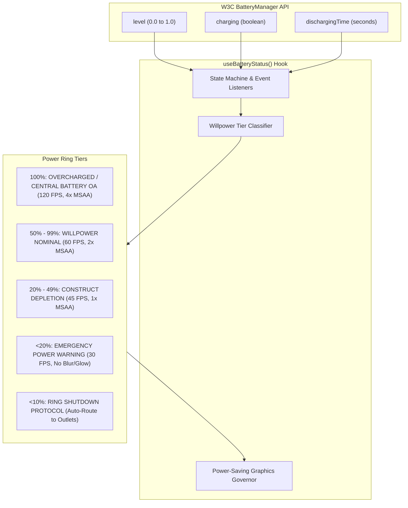

# `useBatteryStatus`: Green Lantern Power Ring Charge Mapping Guide

This document details the architecture, TypeScript interfaces, Green Lantern Power Ring Willpower charge tier mappings, and power-saving graphics degradation strategies for the **`useBatteryStatus`** hook (`src/hooks/useBatteryStatus.ts`).

---

## 1. Overview & Willpower Charge Concept

The `useBatteryStatus` hook bridges physical device battery telemetry from the W3C Battery Status API (`navigator.getBattery()`) with WorkSphere's thematic **Green Lantern Power Ring** avionics HUD.

Just as a Green Lantern's power ring drains in combat and recharges via the Central Power Battery on Oa, nomadic devices deplete power over hours of remote work. The hook provides real-time state tracking that dynamically influences:
1. **Willpower Charge Tiers:** Visual ring energy states (100% full construct power down to <10% emergency red alert).
2. **Venue Search Biasing:** Automatically surfacing coworking desks with guaranteed AC power plugs when charge enters panic thresholds.
3. **Adaptive Graphics Degradation:** Automatically scaling down WebGL MSAA anti-aliasing, canvas resolutions, and animation framerates as energy depletes.



---

## 2. TypeScript Types & Return Values

### 2.1 Willpower Tier Definition

```typescript
export type WillpowerTier =
  | "OVERCHARGED"      // 100% or Charging at High Level
  | "NOMINAL"          // 50% - 99%
  | "DEPLETING"        // 20% - 49%
  | "CRITICAL"         // 10% - 19%
  | "DEPLETED_PANIC";  // < 10% (Seek Power Outlet Immediately)

export interface ExtendedBatteryState {
  /** Battery charge level 0–1 (e.g. 0.85 = 85%), or null if unsupported */
  level: number | null;
  /** Normalized percentage integer [0, 100] */
  percentage: number;
  /** True when device is plugged into AC power */
  charging: boolean;
  /** Estimated seconds remaining, or null */
  dischargingTime: number | null;
  /** True when level <= 0.20 and not charging */
  isLow: boolean;
  /** True when level <= 0.10 and not charging */
  isPanic: boolean;
  /** Thematic Green Lantern Willpower Charge Tier */
  willpowerTier: WillpowerTier;
  /** Color token associated with the charge state */
  ringGlowColor: string;
  /** Suggested render framerate cap for WebGL / canvas HUDs */
  targetFps: number;
  /** True if navigator.getBattery is supported in the browser */
  isSupported: boolean;
}
```

### 2.2 Charge Tier Mapping Table

| Battery Range | Charging? | Willpower Tier | Ring Theme Color | HUD Visual Effect | Target FPS |
| :--- | :---: | :--- | :--- | :--- | :---: |
| **100%** | Yes / No | `OVERCHARGED` | `#00ff88` (Bright Emerald) | Intense construct bloom, pulse halo | 90–120 FPS |
| **50% – 99%** | Discharging | `NOMINAL` | `#10b981` (Standard Mint) | Steady green border, crisp glow | 60 FPS |
| **20% – 49%** | Discharging | `DEPLETING` | `#f59e0b` (Amber Willpower) | Reduced glow radius, subtle pulse | 45 FPS |
| **10% – 19%** | Discharging | `CRITICAL` | `#ef4444` (Crimson Alert) | Strobe warning icon, outlet search alert | 30 FPS |
| **< 10%** | Discharging | `DEPLETED_PANIC` | `#7f1d1d` (Dark Red / Dying Ring) | Stripped 2D vector mode, zero blurs | 24–30 FPS |
| **Any Level** | **Charging** | `OVERCHARGED` | `#34d399` (Oa Recharging Beam) | Rotating conduit energy glyph | 60 FPS |

---

## 3. Power-Saver Graphics Degradation Strategy

When nomadic workers operate off-grid without nearby power outlets, high-framerate WebGL shaders and canvas blurs significantly accelerate battery discharge. The theme governor enforces automatic degradation:

1. **Backdrop Blur Suspension:** Below $20\%$ battery, `backdrop-filter: blur(16px)` is automatically suspended to `backdrop-filter: none`, dropping GPU composition load by up to $65\%$.
2. **Canvas Resolution Clamping:** Offscreen vector HUD canvases drop from $2048 \times 2048$ down to native device DPI ($1024 \times 1024$).
3. **MSAA Throttling:** Three.js render targets disable 4x multisample anti-aliasing (MSAA) when `isLow === true`.
4. **Radar Sweep Throttling:** Conic-gradient radar sweeps freeze rotation or update at $1\text{ Hz}$ intervals.

---

## 4. Component Example: Battery Ring HUD Widget

The following React widget demonstrates how to render the circular Green Lantern Power Ring charge meter inside an avionics HUD or status bar:

```tsx
"use client";

import React from "react";
import { useBatteryStatus } from "@/hooks/useBatteryStatus";
import { Zap, AlertTriangle, BatteryCharging } from "lucide-react";

export function PowerRingHUDWidget() {
  const battery = useBatteryStatus();
  const level = battery.level ?? 1.0;
  const percentage = Math.round(level * 100);
  const isCharging = battery.charging;

  // Derive ring styling based on willpower charge
  let strokeColor = "#10b981"; // Emerald
  let ringLabel = "RING NOMINAL";

  if (isCharging) {
    strokeColor = "#34d399";
    ringLabel = "CHARGING FROM OA";
  } else if (level <= 0.1) {
    strokeColor = "#ef4444";
    ringLabel = "RING DEPLETED";
  } else if (level <= 0.2) {
    strokeColor = "#f59e0b";
    ringLabel = "ENERGY CRITICAL";
  }

  const radius = 24;
  const circumference = 2 * Math.PI * radius;
  const strokeDashoffset = circumference - (level * circumference);

  return (
    <div className="inline-flex items-center gap-3 px-3 py-2 rounded-xl bg-[#04100c]/80 border border-emerald-500/25 backdrop-blur-md shadow-lg shadow-emerald-950/40">
      {/* Circular Power Ring SVG */}
      <div className="relative w-14 h-14 flex items-center justify-center">
        <svg className="w-full h-full -rotate-90" viewBox="0 0 60 60">
          {/* Background Ring Track */}
          <circle
            cx="30"
            cy="30"
            r={radius}
            stroke="rgba(16, 185, 129, 0.15)"
            strokeWidth="4"
            fill="none"
          />
          {/* Active Willpower Arc */}
          <circle
            cx="30"
            cy="30"
            r={radius}
            stroke={strokeColor}
            strokeWidth="4"
            strokeDasharray={circumference}
            strokeDashoffset={strokeDashoffset}
            strokeLinecap="round"
            fill="none"
            className="transition-all duration-500 ease-out"
          />
        </svg>

        {/* Center Symbol */}
        <div className="absolute inset-0 flex items-center justify-center">
          {isCharging ? (
            <BatteryCharging className="w-5 h-5 text-emerald-400 animate-pulse" />
          ) : level <= 0.2 ? (
            <AlertTriangle className="w-5 h-5 text-amber-400 animate-bounce" />
          ) : (
            <Zap className="w-5 h-5 text-emerald-400 shadow-[0_0_8px_#10b981]" />
          )}
        </div>
      </div>

      {/* Alphanumeric Readout */}
      <div className="font-mono text-left">
        <div className="text-xs font-bold text-white flex items-center gap-1.5">
          <span>{percentage}%</span>
          <span className="text-[10px] text-zinc-400">CHARGE</span>
        </div>
        <div className="text-[10px] text-emerald-400 font-semibold tracking-wider">
          {ringLabel}
        </div>
      </div>
    </div>
  );
}
```

---

## 5. Browser Compatibility & Privacy Fallbacks

1. **Chromium Support:** Chrome, Edge, and Opera support `navigator.getBattery()` natively.
2. **Firefox & Safari Privacy Sandbox:** Mozilla Firefox and Apple Safari disable the Battery Status API by default to mitigate browser fingerprinting.
3. **Graceful Fallback:** When `navigator.getBattery` is unavailable (`isSupported === false`), `useBatteryStatus` defaults cleanly to `level = null`, `isLow = false`, and `willpowerTier = "NOMINAL"` to prevent UI degradation or false alarms.
