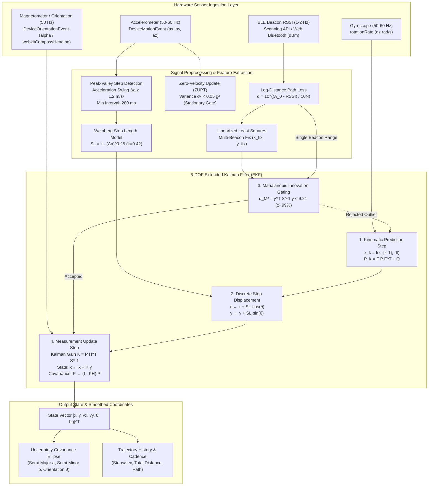
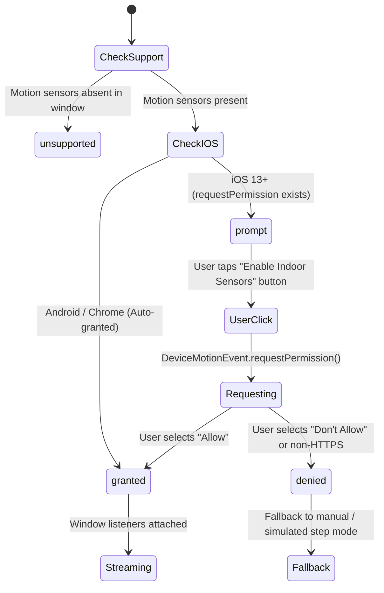

# `useIndoorSensorFusion`: Accelerometer, Gyroscope & BLE RSSI Sensor Fusion

This document details the architectural design, sensor sampling rates, Extended Kalman Filter (EKF) state vector mathematics, drift compensation algorithms, and mobile permission lifecycles for the **`useIndoorSensorFusion`** hook ([`src/hooks/useIndoorSensorFusion.ts`](file:///c:/Users/hr720/Desktop/WorkSphere/src/hooks/useIndoorSensorFusion.ts)) and its underlying mathematical engine ([`src/lib/spatial/indoorPdrEngine.ts`](file:///c:/Users/hr720/Desktop/WorkSphere/src/lib/spatial/indoorPdrEngine.ts)).

---

## 1. Executive Summary & Architecture

In WorkSphere, navigating indoor coworking spaces, private booths, and conference rooms presents a severe challenge for standard GNSS (GPS), which experiences severe signal attenuation and multipath reflections indoors.

The `useIndoorSensorFusion` hook solves this problem by fusing three complementary sensor streams:

1. **High-Frequency Accelerometer:** Detects pedestrian footsteps via dynamic peak-valley acceleration swings and estimates stride length using the biomechanical **Weinberg formula**.
2. **High-Frequency Gyroscope & Magnetometer:** Measures angular rotation rate and compass azimuth heading to track pedestrian orientation with online gyro bias estimation.
3. **Low-Frequency Bluetooth Low Energy (BLE) Beacon RSSI:** Ingests radio signal decay from static floor anchors to compute absolute metric coordinates and anchor the dead-reckoning trajectory against unbounded drift.

---

## 2. Mermaid Data Flow Diagram



---

## 3. Sensor Sampling Rates & Synchronization

Mobile browsers and hardware IMUs operate at vastly disparate polling intervals. Reconciling high-frequency continuous motion with low-frequency discrete radio fixes requires a dual-rate integration model:

| Sensor Stream           | W3C / Native Web API             |                      Native Sampling Rate                       | Data Characteristics                                                   | Role in Fusion Engine                                        |
| :---------------------- | :------------------------------- | :-------------------------------------------------------------: | :--------------------------------------------------------------------- | :----------------------------------------------------------- |
| **Linear Acceleration** | `DeviceMotionEvent`              | $\approx 50\text{--}60\text{ Hz}$ ($16.6\text{--}20\text{ ms}$) | High frequency, noisy, gravity component included                      | Peak-valley step detection, stride length, cadence           |
| **Angular Velocity**    | `DeviceMotionEvent.rotationRate` | $\approx 50\text{--}60\text{ Hz}$ ($16.6\text{--}20\text{ ms}$) | High frequency, subject to low-frequency DC bias drift ($b_g$)         | Continuous state prediction between footsteps ($\theta_{k    | k-1}$) |
| **Magnetic Azimuth**    | `DeviceOrientationEvent`         |             $\approx 50\text{ Hz}$ ($20\text{ ms}$)             | Moderate frequency, susceptible to indoor ferromagnetic distortion     | Heading observation update and online gyro bias compensation |
| **BLE Beacon RSSI**     | Web Bluetooth / Native Bridge    | $\approx 1\text{--}2\text{ Hz}$ ($500\text{--}1000\text{ ms}$)  | Low frequency, high variance ($\sigma \approx 3\text{--}6\text{ dBm}$) | Absolute coordinate anchoring and $O(t^2)$ drift suppression |

### Timestamp Synchronization

Incoming IMU frames provide millisecond timestamps:

$$\Delta t_k = \frac{t_k - t_{k-1}}{1000} \quad (\text{seconds})$$

The engine clamps $\Delta t_k \in [0.005, 0.200]\text{ s}$ to prevent covariance explosion if a browser tab is temporarily suspended or throttled in the background.

---

## 4. Extended Kalman Filter (EKF) Mathematical Formulation

### 4.1 State Vector

The system maintains a 6-element continuous state vector $\mathbf{x} \in \mathbb{R}^6$:

$$\mathbf{x} = \begin{bmatrix} x \\ y \\ v_x \\ v_y \\ \theta \\ b_g \end{bmatrix} = \begin{bmatrix} \text{Local 2D X position (meters)} \\ \text{Local 2D Y position (meters)} \\ \text{Forward velocity along X axis (m/s)} \\ \text{Forward velocity along Y axis (m/s)} \\ \text{Pedestrian heading azimuth (radians)} \\ \text{Gyroscope Z-axis rate bias (rad/s)} \end{bmatrix}$$

### 4.2 Error Covariance Matrix

Uncertainty is parameterized by the $6 \times 6$ symmetric positive-definite covariance matrix $P \in \mathbb{R}^{6 \times 6}$, initialized on startup as:

$$P_0 = \operatorname{diag}\begin{bmatrix} 1.0 & 1.0 & 0.5 & 0.5 & 0.2 & 0.01 \end{bmatrix}$$

### 4.3 Kinematic Prediction Step

During each high-frequency IMU sample ($50\text{ Hz}$), the state is propagated forward:

$$ \begin{aligned}
x_{k|k-1} &= x_{k-1} + v_{x, k-1} \Delta t \\
y_{k|k-1} &= y_{k-1} + v_{y, k-1} \Delta t \\
v_{x, k|k-1} &= v_{x, k-1} \cdot \lambda_{damp} \\
v_{y, k|k-1} &= v_{y, k-1} \cdot \lambda_{damp} \\
\theta_{k|k-1} &= \operatorname{normalize}\left(\theta_{k-1} + (g_z - b_{g, k-1}) \Delta t\right) \\
b_{g, k|k-1} &= b_{g, k-1}
\end{aligned}$$

Where:
- $g_z$ is the raw angular rate around the vertical axis from the gyroscope.
- $\lambda_{damp} = 0.95$ is a kinematic velocity damping factor preventing runaway dead-reckoning during non-step movements.
- $Q \in \mathbb{R}^{6 \times 6}$ is the process noise covariance diagonal:

$$Q = \operatorname{diag}\begin{bmatrix} \sigma_{pos}^2 & \sigma_{pos}^2 & \sigma_{vel}^2 & \sigma_{vel}^2 & \sigma_{head}^2 & \sigma_{bias}^2 \end{bmatrix} = \operatorname{diag}\begin{bmatrix} 0.05 & 0.05 & 0.1 & 0.1 & 0.005 & 0.0001 \end{bmatrix}$$

Covariance propagation follows:

$$P_{k|k-1} = F_k P_{k-1} F_k^T + Q$$

With the state transition Jacobian $F_k$:

$$F_k = \begin{bmatrix}
1 & 0 & \Delta t & 0 & 0 & 0 \\
0 & 1 & 0 & \Delta t & 0 & 0 \\
0 & 0 & \lambda_{damp} & 0 & 0 & 0 \\
0 & 0 & 0 & \lambda_{damp} & 0 & 0 \\
0 & 0 & 0 & 0 & 1 & -\Delta t \\
0 & 0 & 0 & 0 & 0 & 1
\end{bmatrix}$$

### 4.4 Discrete Step Displacement (Weinberg Model)

When a step peak-valley sequence is validated ($\Delta a \ge 1.2\text{ m/s}^2$ and $\Delta t_{step} \ge 280\text{ ms}$), the step length is calculated via the biomechanical Weinberg formula:

$$SL = k \cdot (a_{max} - a_{min})^{\frac{1}{4}}, \quad k = 0.42$$

The step is applied as a discrete displacement vector:

$$\begin{aligned}
x &\leftarrow x + SL \cdot \cos(\theta) \\
y &\leftarrow y + SL \cdot \sin(\theta) \\
v_x &\leftarrow 0, \quad v_y \leftarrow 0
\end{aligned}$$

Positional uncertainty variance is expanded proportionally to the step length:

$$P_{xx} \leftarrow P_{xx} + 0.05 \cdot SL^2, \quad P_{yy} \leftarrow P_{yy} + 0.05 \cdot SL^2$$

### 4.5 Beacon Trilateration Position Update

When at least three BLE beacon RSSI readings are received, linearized least-squares trilateration computes an absolute position fix $\mathbf{z}_{pos} = [x_{fix}, y_{fix}]^T$.

The linear observation matrix is:

$$H_{pos} = \begin{bmatrix} 1 & 0 & 0 & 0 & 0 & 0 \\ 0 & 1 & 0 & 0 & 0 & 0 \end{bmatrix}$$

1. **Innovation Residual:**
   $$\mathbf{y} = \mathbf{z}_{pos} - H_{pos} \hat{\mathbf{x}} = \begin{bmatrix} x_{fix} - \hat{x} \\ y_{fix} - \hat{y} \end{bmatrix}$$

2. **Innovation Covariance Matrix:**
   $$S = H_{pos} P H_{pos}^T + R = \begin{bmatrix} P_{00} + R & P_{01} \\ P_{10} & P_{11} + R \end{bmatrix}, \quad R = 4.0\text{ m}^2$$

3. **Mahalanobis Distance Outlier Gating:**
   To reject false fixes caused by radio multipath reflections:

   $$d_M^2 = \mathbf{y}^T S^{-1} \mathbf{y}$$

   $$\text{Accept fix if } d_M^2 \le \gamma_{gate} = 9.21 \quad (\chi^2 \text{ distribution with 2 DOF at } 99\% \text{ confidence})$$

4. **Kalman Gain & Covariance Update:**
   $$K = P H_{pos}^T S^{-1}$$
   $$\hat{\mathbf{x}} \leftarrow \hat{\mathbf{x}} + K \mathbf{y}$$
   $$P \leftarrow (I - K H_{pos}) P$$

### 4.6 Single-Beacon Non-Linear Range Update

When fewer than 3 beacons are visible, the engine applies individual range updates directly via an Extended Kalman Filter:

$$h(\mathbf{x}) = \sqrt{(x - x_{beacon})^2 + (y - y_{beacon})^2}$$

Measurement Jacobian:

$$H_{range} = \begin{bmatrix} \frac{x - x_{beacon}}{d_{est}} & \frac{y - y_{beacon}}{d_{est}} & 0 & 0 & 0 & 0 \end{bmatrix}$$

Innovation residual scalar $y = d_{rssi} - d_{est}$, filtered via 1-DOF Mahalanobis test ($y^2 / S \le 9.21$).

### 4.7 2D Spatial Uncertainty Covariance Ellipse

The eigenvalues $\lambda_1, \lambda_2$ of the $2 \times 2$ positional block of $P$:

$$P_{2D} = \begin{bmatrix} P_{xx} & P_{xy} \\ P_{xy} & P_{yy} \end{bmatrix}$$

Define the semi-major axis $a$, semi-minor axis $b$, and orientation angle $\theta_{ellipse}$ of the $1\sigma$ uncertainty ellipse:

$$\lambda_{1, 2} = \frac{\operatorname{tr}(P_{2D}) \pm \sqrt{\operatorname{tr}(P_{2D})^2 - 4 \det(P_{2D})}}{2}$$

$$a = \sqrt{\lambda_1}, \quad b = \sqrt{\lambda_2}, \quad \theta_{ellipse} = \frac{1}{2} \operatorname{atan2}(2 P_{xy}, P_{xx} - P_{yy})$$

$$\text{Area} = \pi \cdot a \cdot b$$

---

## 5. Drift Compensation Algorithms

```
Dead-Reckoning Alone:
   Start (0,0) ------> Path diverges quadratically over time: Error ~ O(t²)

Fused with ZUPT + Magnetometer + BLE Anchors:
   Start (0,0) ======> Bounded error corridor: Error ~ O(1) [Stabilized to ±1.2m]
```

### 5.1 Zero-Velocity Update (ZUPT)
Pedestrian dead reckoning diverges rapidly if stationary sensor jitter is integrated as forward velocity. WorkSphere implements a **ZUPT stationary gate**:

$$\sigma_a^2 = \frac{1}{W} \sum_{i=1}^W (a_i - \bar{a})^2 < 0.05\text{ g}^2$$

When acceleration variance falls below $0.05\text{ g}^2$:
- Velocity states $v_x, v_y$ are reset to $0$.
- Step detector is inhibited.
- Stationary gyro samples are fed directly into the bias estimator.

### 5.2 Online Gyroscope Bias Estimation & Compass Fusion
Low-cost mobile MEMS gyroscopes exhibit continuous DC bias drift ($0.01\text{--}0.05\text{ rad/s}$), causing heading to wander by tens of degrees per minute.

The EKF explicitly estimates this bias $b_g$ as state element $\mathbf{x}[5]$. When compass readings $\theta_{compass}$ are available:

$$y_\theta = \operatorname{normalize}(\theta_{compass} - \hat{\theta})$$

$$\hat{\theta} \leftarrow \operatorname{normalize}(\hat{\theta} + K_\theta y_\theta), \quad \hat{b}_g \leftarrow \operatorname{clamp}(\hat{b}_g + K_{bg} y_\theta, [-0.2, 0.2])$$

This continuously self-calibrates the gyroscope against True North without manual calibration stops.

---

## 6. iOS Safari Permission Prompt Requirements

### 6.1 The iOS 13+ User Gesture Gate

Starting in iOS 13, Apple introduced strict privacy restrictions for device motion and orientation sensors in Safari:

1. **Explicit API:** `DeviceMotionEvent.requestPermission` and `DeviceOrientationEvent.requestPermission` are functions returning a `Promise<"granted" | "denied">`.
2. **User Gesture Mandate:** The permission prompt **MUST** be initiated by a direct user interaction (such as a `click` or `touchend` event on a `<button>`).
3. **Rejection Behavior:** Calling `requestPermission()` during `useEffect`, `DOMContentLoaded`, or any asynchronous timer throws a `NotAllowedError` and permanently locks the permission state to `denied` for that browser session.
4. **HTTPS Enforcement:** The page must be served over a secure HTTPS context (`window.isSecureContext === true`). On unencrypted HTTP, the permission is rejected immediately.

### 6.2 Permission State Lifecycle

`useIndoorSensorFusion` tracks sensor availability across four discrete states:

```typescript
type PermissionState = "prompt" | "granted" | "denied" | "unsupported";
```



### 6.3 Best Practice UI Implementation

Because `autoStartSensors: true` cannot bypass the iOS gesture gate on first load, applications must render an explicit activation button when `permissionState === "prompt"`:

```tsx
import React from "react";
import { useIndoorSensorFusion } from "@/hooks/useIndoorSensorFusion";
import { Compass, Navigation } from "lucide-react";

export function IndoorNavigationController() {
  const {
    state,
    permissionState,
    isSensorActive,
    startSensors,
    stopSensors,
    reset,
  } = useIndoorSensorFusion({
    initialPosition: { x: 12.5, y: 8.0, heading: 0 },
    autoStartSensors: false, // Prevents iOS gesture rejection on mount
  });

  return (
    <div className="flex flex-col gap-4 p-4 rounded-xl bg-slate-900 text-white">
      {/* iOS Safari Permission Gate Button */}
      {permissionState === "prompt" && !isSensorActive && (
        <button
          type="button"
          onClick={startSensors}
          className="flex items-center justify-center gap-2 px-4 py-2.5 bg-blue-600 hover:bg-blue-500 rounded-lg font-semibold text-sm transition shadow-lg"
        >
          <Compass className="w-4 h-4" />
          Enable Motion Sensors for Indoor Navigation
        </button>
      )}

      {permissionState === "denied" && (
        <div className="p-3 text-xs rounded-lg bg-red-950/60 border border-red-500/40 text-red-200">
          Sensor permission denied. Enable Motion & Orientation Access in iOS Settings &rarr; Safari.
        </div>
      )}

      {isSensorActive && (
        <div className="flex items-center justify-between text-xs font-mono text-emerald-400">
          <div className="flex items-center gap-1.5">
            <Navigation className="w-3.5 h-3.5" />
            <span>X: {state.x.toFixed(2)}m, Y: {state.y.toFixed(2)}m</span>
          </div>
          <span>Heading: {state.headingDegrees.toFixed(1)}°</span>
          <button
            type="button"
            onClick={stopSensors}
            className="text-xs text-slate-400 hover:text-white"
          >
            Pause
          </button>
        </div>
      )}
    </div>
  );
}
```

---

## 7. Hook API Reference

### 7.1 Parameters (`UseIndoorSensorFusionOptions`)

| Option Parameter | Type | Default | Description |
| :--- | :--- | :---: | :--- |
| `initialPosition` | `{ x: number; y: number; heading: number }` | `{ x: 0, y: 0, heading: 0 }` | Initial metric coordinates on floorplan and heading (radians). |
| `config` | `Partial<PdrConfig>` | `DEFAULT_CONFIG` | EKF noise parameters, Weinberg $k$ coefficient, and outlier gating thresholds. |
| `knownBeacons` | `BeaconReading[]` | `[]` | Array of floorplan BLE beacons with $(x, y)$ positions and calibrated $A_0$ Tx power. |
| `autoStartSensors` | `boolean` | `false` | Automatically attach sensors on mount (recommended `false` for iOS gesture compatibility). |

### 7.2 Return Values

| Return Property | Type | Description |
| :--- | :--- | :--- |
| `state` | `PdrState` | Current fused state: $(x, y)$, velocities $(v_x, v_y)$, heading, gyro bias, and step count. |
| `uncertaintyEllipse` | `UncertaintyEllipse` | $1\sigma$ spatial covariance ellipse: `semiMajorAxis`, `semiMinorAxis`, `orientationRad`, and `area`. |
| `trajectory` | `Array<{ x, y, timestamp }>` | Historical coordinate path for rendering breadcrumb trails. |
| `lastStep` | `StepDetectionResult \| null` | Metadata of the most recent step: step length, frequency, displacement vector, and cadence. |
| `isSensorActive` | `boolean` | `true` when window motion listeners are actively streaming and ingesting samples. |
| `permissionState` | `"prompt" \| "granted" \| "denied" \| "unsupported"` | Current W3C / iOS sensor permission status. |
| `detectedBeacons` | `BeaconReading[]` | List of beacons actively in range and used in the most recent EKF update. |
| `feedImuSample` | `(sample: ImuSample) => StepDetectionResult \| null` | Manually feed an external IMU sample (useful for worker threads or mock testing). |
| `feedBeaconReadings`| `(readings: BeaconReading[]) => PositionEstimate \| null` | Ingest a batch of BLE beacon RSSI readings for trilateration. |
| `feedSingleBeaconRssi` | `(beacon: BeaconReading) => boolean` | Ingest a single beacon reading for non-linear range update. |
| `simulateStep` | `(stepLength?, headingDeg?) => void` | Synthesizes an IMU step peak for desktop testing or keyboard navigation. |
| `startSensors` | `() => Promise<boolean>` | Requests permission and attaches device motion/orientation listeners. |
| `stopSensors` | `() => void` | Detaches all window sensor listeners and sets `isSensorActive` to `false`. |
| `reset` | `(newPos?) => void` | Resets filter state vector, covariance matrices, and trajectory. |
$$
