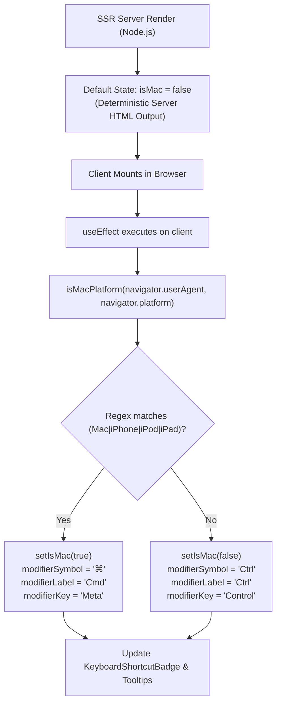

# `usePlatformModifier`: OS Platform Detection, SSR Hydration Safety & Keyboard Badges

This document details the architecture, operating system detection algorithm, Server-Side Rendering (SSR) hydration safety patterns, and integration recipes for the **`usePlatformModifier`** React hook ([`src/hooks/usePlatformModifier.ts`](file:///c:/Users/admin/Desktop/workfere/src/hooks/usePlatformModifier.ts)).

---

## 1. Executive Summary & Design Goals

WorkSphere provides keyboard-driven interactions across its workspace search, command palette, chatbot drawers, and desk reservation flows.

Different operating systems utilize different modifier keys:
- **macOS / iOS:** The primary modifier key is **Command** (`MetaKey`), represented visually by the **⌘** symbol or `"Cmd"`.
- **Windows / Linux / ChromeOS:** The primary modifier key is **Control** (`CtrlKey`), represented visually by `"Ctrl"`.

Naive client-side detection (such as evaluating `navigator.platform` during module import or initial component render) introduces two severe failure modes:
1. **Server-Side Rendering (SSR) Hydration Mismatch:** Node.js servers rendering HTML lack `navigator` or `window`, producing HTML with `"Ctrl"` or empty strings. If a client running macOS evaluates `navigator` synchronously during first render, React throws hydration mismatch warnings (`Warning: Text content did not match`).
2. **User-Agent Client Hints Deprecation:** Legacy `navigator.platform` is frozen in modern browsers (often returning generic strings like `"MacIntel"` or `"Win32"`). Modern browsers require dual evaluation of `navigator.userAgentData?.platform` and regex matching against `navigator.userAgent`.

`usePlatformModifier` resolves these challenges by combining:
1. **SSR Hydration Safety:** Guarantees deterministic server rendering with a safe fallback (`isMac = false`), deferring platform binding to a client-side `useEffect`.
2. **Dual-Check OS Detection:** Evaluates both modern `userAgentData.platform` and fallback `userAgent` strings for macOS, iPhone, iPod, and iPad.
3. **Comprehensive Formatting Helpers:** Provides convenience formatters (`formatShortcut`, `getAriaKeyshortcuts`) for accessible ARIA attributes and visual badge rendering.



---

## 2. Hook API Reference

### 2.1 Hook Signature

```typescript
function usePlatformModifier(): UsePlatformModifierReturn;
```

### 2.2 Return Object Structure (`UsePlatformModifierReturn`)

| Property | Type | Description | macOS / iOS Output | Windows / Linux Output |
| :--- | :--- | :--- | :---: | :---: |
| **`isMac`** | `boolean` | `true` if client environment is running macOS, iOS, or iPadOS. | `true` | `false` |
| **`modifierSymbol`** | `string` | Visual Unicode symbol for the primary platform modifier key. | `"⌘"` | `"Ctrl"` |
| **`modifierLabel`** | `string` | Short text label for the primary modifier key. | `"Cmd"` | `"Ctrl"` |
| **`modifierKey`** | `string` | Native DOM KeyboardEvent `event.key` identifier. | `"Meta"` | `"Control"` |
| **`formatShortcut`** | `(key: string, options?) => string` | Formats a key combo (e.g. `"⌘K"` vs `"Ctrl + K"`). | `"⌘K"` or `"Cmd + K"` | `"Ctrl + K"` |
| **`getAriaKeyshortcuts`**| `(key: string) => string` | Returns W3C standard `aria-keyshortcuts` string supporting both keys. | `"Control+K Meta+K"` | `"Control+K Meta+K"` |

---

## 3. Platform Detection Mechanics & SSR Hydration Safety

### 3.1 Pure Function Detection (`isMacPlatform`)

The detection logic is encapsulated in a pure, testable helper:

```typescript
export function isMacPlatform(userAgent?: string, platform?: string): boolean {
  if (typeof window === "undefined" && !userAgent && !platform) {
    return false; // Server environment fallback
  }
  const ua = userAgent || (typeof navigator !== "undefined" ? navigator.userAgent : "");
  const plat = platform || (typeof navigator !== "undefined" ? (navigator as any).userAgentData?.platform || navigator.platform : "");
  return /(Mac|iPhone|iPod|iPad)/i.test(ua) || /(Mac|iPhone|iPod|iPad)/i.test(plat);
}
```

### 3.2 Hydration Safety Pattern

To prevent Next.js hydration errors:
```typescript
export function usePlatformModifier() {
  // 1. Initialize with deterministic default matching server render
  const [isMac, setIsMac] = useState(false);

  // 2. Update state only after DOM hydration on the client
  useEffect(() => {
    setIsMac(isMacPlatform());
  }, []);

  const modifierSymbol = isMac ? "⌘" : "Ctrl";
  const modifierLabel = isMac ? "Cmd" : "Ctrl";
  const modifierKey = isMac ? "Meta" : "Control";

  // ...
}
```
Because initial state on both the server and client starts at `isMac = false`, React produces matching initial HTML. Once the component mounts on a Mac, the `useEffect` triggers a seamless client update to `⌘` without hydration warnings.

---

## 4. Integration with `KeyboardShortcutBadge`

WorkSphere's [`KeyboardShortcutBadge.tsx`](file:///c:/Users/admin/Desktop/workfere/src/components/ui/KeyboardShortcutBadge.tsx) consumes `usePlatformModifier` to render clean keyboard hints across search bars and menus.

### 4.1 Component Implementation Overview

```tsx
import React from "react";
import { usePlatformModifier } from "@/hooks/usePlatformModifier";

export interface KeyboardShortcutBadgeProps {
  shortcut: string;
  useSymbol?: boolean;
  className?: string;
  size?: "xs" | "sm" | "md";
  variant?: "default" | "subtle" | "dark";
}

export function KeyboardShortcutBadge({
  shortcut,
  useSymbol = true,
  className = "",
  size = "xs",
  variant = "default",
}: KeyboardShortcutBadgeProps) {
  const { isMac, modifierSymbol, modifierLabel } = usePlatformModifier();

  // On macOS with useSymbol: "⌘"
  // On macOS with text: "Cmd"
  // On Windows/Linux: "Ctrl"
  const modifier = isMac && useSymbol ? modifierSymbol : isMac ? modifierLabel : "Ctrl";

  return (
    <kbd
      data-testid="keyboard-shortcut-badge"
      className="inline-flex items-center justify-center gap-1 font-mono font-semibold rounded border select-none ..."
      aria-label={`Shortcut: ${isMac ? "Command" : "Control"} plus ${shortcut}`}
    >
      <span>{modifier}</span>
      {(!isMac || !useSymbol) && <span className="opacity-60">+</span>}
      <span className="uppercase">{shortcut}</span>
    </kbd>
  );
}
```

### 4.2 Practical Usage Example: Global Search Bar Trigger

```tsx
"use client";

import React, { useEffect } from "react";
import { Search } from "lucide-react";
import { KeyboardShortcutBadge } from "@/components/ui/KeyboardShortcutBadge";
import { usePlatformModifier, openCommandPalette } from "@/hooks/usePlatformModifier";

export function GlobalSearchTrigger() {
  const { isMac, getAriaKeyshortcuts } = usePlatformModifier();

  // Global keyboard listener listening for Cmd+K (Mac) or Ctrl+K (Win/Linux)
  useEffect(() => {
    const handleKeyDown = (e: KeyboardEvent) => {
      const isModifierPressed = isMac ? e.metaKey : e.ctrlKey;
      if (isModifierPressed && e.key.toLowerCase() === "k") {
        e.preventDefault();
        openCommandPalette();
      }
    };

    window.addEventListener("keydown", handleKeyDown);
    return () => window.removeEventListener("keydown", handleKeyDown);
  }, [isMac]);

  return (
    <button
      type="button"
      onClick={openCommandPalette}
      aria-keyshortcuts={getAriaKeyshortcuts("K")}
      className="flex items-center justify-between w-64 px-3 py-1.5 text-xs text-zinc-500 bg-zinc-50 dark:bg-zinc-900 border border-zinc-200 dark:border-zinc-800 rounded-xl hover:border-zinc-300 dark:hover:border-zinc-700 transition-colors"
    >
      <div className="flex items-center gap-2">
        <Search className="w-3.5 h-3.5 text-zinc-400" />
        <span>Search venues or desks...</span>
      </div>

      {/* Renders ⌘K on macOS and Ctrl+K on Windows */}
      <KeyboardShortcutBadge shortcut="k" size="xs" variant="default" />
    </button>
  );
}
```

---

## 5. Event Dispatch Utilities

In addition to modifier detection, `usePlatformModifier.ts` exports application-wide custom event dispatchers for keyboard navigation:

```typescript
import { openCommandPalette, toggleChatbot } from "@/hooks/usePlatformModifier";

// Opens global command palette (worksphere:open-command-palette)
openCommandPalette();

// Toggles AI assistant drawer (worksphere:toggle-chatbot)
toggleChatbot();
```

---

## 6. Accessibility & Testing Considerations

- **Screen Reader Announcements (`aria-keyshortcuts`):** Use `getAriaKeyshortcuts("K")` to supply W3C-compliant `"Control+K Meta+K"` attributes to interactive controls.
- **Unit Testing Mock:** When writing unit tests with Jest / React Testing Library, mock `navigator.userAgent` or `navigator.platform` before rendering:
  ```typescript
  Object.defineProperty(navigator, "userAgent", {
    value: "Mozilla/5.0 (Macintosh; Intel Mac OS X 10_15_7)",
    configurable: true,
  });
  ```
