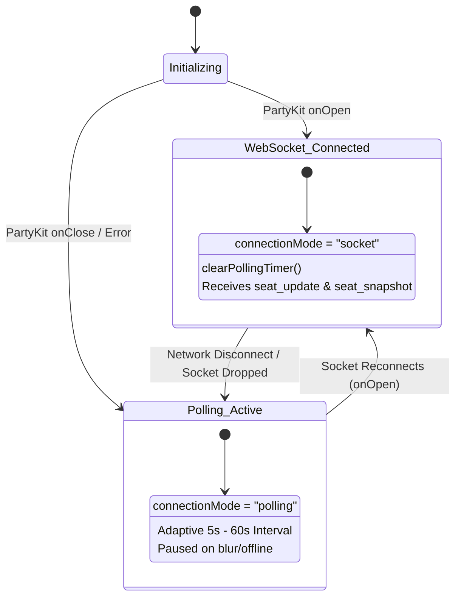

# `useSeatAvailability`: Polling Intervals, Backoff Strategy & WebSocket Handoff

This document details the architecture, configuration parameters, asynchronous lifecycle, exponential backoff mechanics, and WebSocket handoff patterns of the **`useSeatAvailability`** React hook ([`src/hooks/useSeatAvailability.ts`](file:///c:/Users/admin/Desktop/workfere/src/hooks/useSeatAvailability.ts)).

---

## 1. Executive Summary & Design Goals

In WorkSphere, real-time desk and seating availability is critical for remote workers seeking open coworking tables, library seats, and quiet pods. Displaying live occupancy requires low latency while preventing unnecessary resource consumption.

`useSeatAvailability` accomplishes this by providing:
1. **Primary Real-Time Transport (PartyKit WebSocket):** Connects to the dedicated `seat-availability` room to stream live check-ins, check-outs, and room snapshots.
2. **Automatic Polling Fallback:** Transitions seamlessly to HTTP polling when the WebSocket is closed, disconnected, or during network transitions.
3. **Adaptive Exponential Backoff:** Dynamically increases the polling interval ($5\text{s} \to 10\text{s} \to 20\text{s} \to \dots \to 60\text{s}$) when seat occupancy remains unchanged, reducing server load.
4. **Instant Event Reset:** Immediately resets the backoff timer back to $5\text{s}$ upon seat count change, window refocus, tab unblur (`visibilitychange`), or manual refetch.
5. **Background & Offline Throttling:** Pauses all active polling timers when `document.visibilityState === "hidden"` or `navigator.onLine === false` to preserve battery and client memory.
6. **Offline Queue Syncing:** Integrates with IndexedDB (`queueOfflineCheckIn`) to hold pending check-ins made while offline and auto-syncs them via `/api/sync` when connectivity is restored.

```mermaid
flowchart TD
    Mount["Component Mounts with useSeatAvailability"] --> SocketInit["Initialize PartyKit WebSocket (seat-availability)"]
    
    SocketInit --> SocketStatus{"WebSocket Connected?"}
    
    SocketStatus -->|Connected (Open)| LiveMode["Mode: 'socket'<br/>Listen to 'seat_update' & 'seat_snapshot'<br/>Cancel Polling Timers"]
    SocketStatus -->|Disconnected / Closed| FallbackMode["Mode: 'polling'<br/>Start Polling Loop (/api/venues/:id/check-in)"]
    
    FallbackMode --> VisibilityCheck{"Tab Visible & Online?"}
    VisibilityCheck -->|Hidden or Offline| PauseTimer["Pause Timers (Save Battery & Data)"]
    VisibilityCheck -->|Visible & Online| ExecutePoll["Execute Fetch (AbortController Signal)"]
    
    ExecutePoll --> CountChange{"Seat Count Changed?"}
    CountChange -->|Yes (or First Poll)| ResetBackoff["Reset to initialIntervalMs (5s)"]
    CountChange -->|No (Stable)| DoubleBackoff["Multiply: interval * backoffFactor (up to maxIntervalMs 60s)"]
    
    ResetBackoff --> NextTimer["Schedule setTimeout(executePoll, currentIntervalMs)"]
    DoubleBackoff --> NextTimer
    
    NextTimer --> SocketReconnect{"WebSocket Reconnected?"}
    SocketReconnect -->|Yes| LiveMode
    SocketReconnect -->|No| FallbackMode
```

---

## 2. Hook API Reference

### 2.1 Hook Signature

```typescript
function useSeatAvailability(
  options?: UseSeatAvailabilityOptions
): UseSeatAvailabilityResult;
```

### 2.2 Configuration Options (`UseSeatAvailabilityOptions`)

| Option Parameter | Type | Default | Description |
| :--- | :--- | :---: | :--- |
| `venueId` | `string \| null` | `undefined` | Target venue ID to track single-venue availability and trigger targeted polling. |
| `capacity` | `number` | `8` | Default total seat capacity for occupancy status calculation when not provided by backend. |
| `fallbackPolling` | `boolean` | `true` | Enables or disables the automated HTTP polling fallback when WebSocket is unavailable. |
| `initialIntervalMs` | `number` | `5000` | Starting polling interval in milliseconds ($5\text{s}$). Used on fresh polls and after changes. |
| `maxIntervalMs` | `number` | `60000` | Maximum ceiling for exponential backoff in milliseconds ($60\text{s}$). |
| `backoffFactor` | `number` | `2` | Multiplier applied to the interval when successive polls report unchanged counts. |
| `enabled` | `boolean` | `true` | Master flag to pause/resume all socket connections and polling routines. |
| `fetcher` | `(venueId: string) => Promise<...>` | `defaultFetch` | Custom async fetcher function returning `{ count, capacity?, status? }`. |
| `onAvailabilityChange` | `(availability: SeatAvailability) => void` | `undefined` | Callback invoked whenever occupancy count or status transitions for the tracked venue. |

### 2.3 Return Object Structure (`UseSeatAvailabilityResult`)

| Property | Type | Description |
| :--- | :--- | :--- |
| `availability` | `Record<string, SeatAvailability>` | Map of all tracked venue IDs to their current `SeatAvailability` objects. |
| `venueAvailability` | `SeatAvailability \| null` | Convenience accessor for the single venue passed via `options.venueId`. |
| `getAvailability` | `(venueId: string) => SeatAvailability` | Helper method returning availability for any venue ID, with a safe `"green"` fallback. |
| `checkIn` | `(venueId: string, capacity?: number) => void` | Checks into a venue. Emits socket event or queues into IndexedDB if offline. |
| `checkOut` | `() => void` | Checks out of the currently checked-in venue. |
| `checkedInVenueId` | `string \| null` | Venue ID the current user is checked into, or `null`. |
| `isConnected` | `boolean` | `true` when the PartyKit WebSocket connection is live and active. |
| `isPolling` | `boolean` | `true` when the fallback HTTP polling loop is actively scheduling requests. |
| `connectionMode` | `"socket" \| "polling" \| "disconnected"` | Current active transport mode. |
| `currentIntervalMs` | `number` | Current polling interval delay in milliseconds (useful for diagnostic badges). |
| `refetch` | `() => Promise<void>` | Manually triggers an immediate poll and resets the exponential backoff timer. |
| `resetBackoff` | `() => void` | Resets `currentIntervalMs` back to `initialIntervalMs` without firing an immediate fetch. |

---

## 3. Data Structures & Occupancy Computation

### 3.1 `SeatAvailability`

```typescript
export type SeatStatus = "green" | "yellow" | "red";

export interface SeatAvailability {
  venueId: string;
  count: number;       // Current occupied seats
  capacity: number;    // Maximum seat capacity
  status: SeatStatus;  // Occupancy traffic-light indicator
}
```

### 3.2 Occupancy Ratio & Status Logic

Status thresholds are computed deterministically via `computeSeatStatus(count, capacity)`:

$$\text{Occupancy Ratio} = \frac{\text{count}}{\text{capacity}}$$

| Occupancy Ratio | Status | Semantic Meaning | Recommended UI Treatment |
| :---: | :---: | :--- | :--- |
| $\text{Ratio} < 0.60$ | `"green"` | Ample seating available | Emerald badge / open ring |
| $0.60 \le \text{Ratio} < 1.00$ | `"yellow"` | Filling quickly (limited seats) | Amber warning badge |
| $\text{Ratio} \ge 1.00$ | `"red"` | At or over full capacity | Rose badge / waitlist button |

---

## 4. Exponential Backoff & Polling Lifecycle

### 4.1 Backoff Progression

When `fallbackPolling` is active, the polling interval adapts dynamically based on occupancy volatility:

$$\text{Interval}_{k+1} = \min\left(\text{maxIntervalMs}, \text{round}\left(\text{Interval}_k \times \text{backoffFactor}\right)\right)$$

With default parameters (`initialIntervalMs: 5000`, `maxIntervalMs: 60000`, `backoffFactor: 2`):

```
Poll #1 (Initial): 5,000ms (5s)
Poll #2 (No change): 10,000ms (10s)
Poll #3 (No change): 20,000ms (20s)
Poll #4 (No change): 40,000ms (40s)
Poll #5 (No change): 60,000ms (60s - Max cap reached)
Poll #N (No change): 60,000ms (Continues at 60s)
```

### 4.2 Cache Invalidation & Timer Reset Triggers

The hook immediately resets the interval back to `initialIntervalMs` ($5\text{s}$) upon any of the following events:
1. **Occupancy Delta:** When `result.count !== prevCountRef.current`.
2. **Tab Visibility Return:** When the user switches back to the tab (`document.visibilityState === "visible"`).
3. **Window Focus:** User focuses the browser window (`window.addEventListener("focus")`).
4. **Network Reconnection:** Browser comes online (`window.addEventListener("online")`).
5. **Manual Invalidation:** Component calls `refetch()`.

---

## 5. WebSocket Handoff & Seamless Fallback

### 5.1 Connection State Matrix



1. **Socket Open (`onOpen`):** Sets `isConnected = true`, clears any running polling timer (`clearPollingTimer()`), and switches `connectionMode` to `"socket"`.
2. **Socket Closed (`onClose`):** Sets `isConnected = false`. If a target `venueId` exists and `fallbackPolling: true`, starts the adaptive polling loop.
3. **Sequence & Epoch Ordering:** Message updates carry `epoch` and `sequenceId` headers to prevent stale out-of-order socket packets from overriding recent state.

---

## 6. Sample Integration Snippet

### Desk Reservation Card with Live Availability & Diagnostics

```tsx
"use client";

import React from "react";
import { Users, Wifi, AlertCircle, RefreshCw } from "lucide-react";
import { useSeatAvailability } from "@/hooks/useSeatAvailability";

interface DeskCardProps {
  venueId: string;
  venueName: string;
}

export function DeskReservationCard({ venueId, venueName }: DeskCardProps) {
  const {
    venueAvailability,
    connectionMode,
    currentIntervalMs,
    checkIn,
    checkOut,
    checkedInVenueId,
    refetch,
  } = useSeatAvailability({
    venueId,
    initialIntervalMs: 5000,
    maxIntervalMs: 60000,
    backoffFactor: 2,
    onAvailabilityChange: (updated) => {
      console.log(`[Seat Update] Venue ${updated.venueId}: ${updated.count}/${updated.capacity}`);
    },
  });

  const count = venueAvailability?.count ?? 0;
  const capacity = venueAvailability?.capacity ?? 8;
  const status = venueAvailability?.status ?? "green";
  const isCheckedIn = checkedInVenueId === venueId;

  const statusBadgeColor = {
    green: "bg-emerald-500/10 text-emerald-600 border-emerald-500/20",
    yellow: "bg-amber-500/10 text-amber-600 border-amber-500/20",
    red: "bg-rose-500/10 text-rose-600 border-rose-500/20",
  }[status];

  return (
    <div className="rounded-2xl border border-zinc-200 dark:border-zinc-800 bg-white dark:bg-zinc-900 p-5 shadow-sm space-y-4">
      {/* Header */}
      <div className="flex items-start justify-between">
        <div>
          <h3 className="font-bold text-zinc-900 dark:text-zinc-100">{venueName}</h3>
          <div className="flex items-center gap-2 mt-1">
            <span
              className={`inline-flex items-center px-2 py-0.5 rounded-full text-xs font-semibold border ${statusBadgeColor}`}
            >
              {status === "red" ? "Fully Occupied" : status === "yellow" ? "Filling Fast" : "Seats Available"}
            </span>
            <span className="text-xs text-zinc-400">
              {count} / {capacity} Seats Taken
            </span>
          </div>
        </div>

        {/* Transport Diagnostic Indicator */}
        <div className="text-right flex flex-col items-end gap-1">
          <div className="flex items-center gap-1.5 text-[11px] font-mono text-zinc-400">
            <span
              className={`w-2 h-2 rounded-full ${
                connectionMode === "socket"
                  ? "bg-emerald-500 animate-pulse"
                  : connectionMode === "polling"
                    ? "bg-amber-500"
                    : "bg-rose-500"
              }`}
            />
            <span className="capitalize">{connectionMode}</span>
          </div>
          {connectionMode === "polling" && (
            <span className="text-[10px] text-zinc-400 font-mono">
              Next poll: {currentIntervalMs / 1000}s
            </span>
          )}
        </div>
      </div>

      {/* Progress Bar */}
      <div className="w-full bg-zinc-100 dark:bg-zinc-800 h-2 rounded-full overflow-hidden">
        <div
          className={`h-full transition-all duration-500 ${
            status === "red" ? "bg-rose-500" : status === "yellow" ? "bg-amber-500" : "bg-emerald-500"
          }`}
          style={{ width: `${Math.min(100, (count / capacity) * 100)}%` }}
        />
      </div>

      {/* Actions */}
      <div className="flex items-center gap-3 pt-2">
        {isCheckedIn ? (
          <button
            type="button"
            onClick={checkOut}
            className="flex-1 py-2 px-4 rounded-xl text-xs font-bold bg-rose-500 hover:bg-rose-600 text-white transition-colors"
          >
            Check Out
          </button>
        ) : (
          <button
            type="button"
            onClick={() => checkIn(venueId)}
            disabled={status === "red"}
            className="flex-1 py-2 px-4 rounded-xl text-xs font-bold bg-blue-600 hover:bg-blue-700 disabled:bg-zinc-300 dark:disabled:bg-zinc-800 text-white transition-colors"
          >
            {status === "red" ? "Capacity Reached" : "Check In to Seat"}
          </button>
        )}

        <button
          type="button"
          onClick={() => void refetch()}
          title="Refresh Availability"
          aria-label="Refresh Availability"
          className="p-2 rounded-xl border border-zinc-200 dark:border-zinc-800 text-zinc-500 hover:text-zinc-700 dark:hover:text-zinc-300 transition-colors"
        >
          <RefreshCw className="w-4 h-4" />
        </button>
      </div>
    </div>
  );
}
```

---

## 7. Best Practices & Troubleshooting

1. **Avoid Zero or Negative Intervals:** Always maintain `initialIntervalMs >= 1000` to prevent saturating client event loops and backend API gateways.
2. **Provide Stable Callbacks:** When passing `onAvailabilityChange` or custom `fetcher`, wrap them with `useCallback` to avoid unnecessary teardowns of the polling timer.
3. **Clean Teardown:** The hook automatically aborts any in-flight HTTP requests using `AbortController` and releases event listeners on component unmount.
