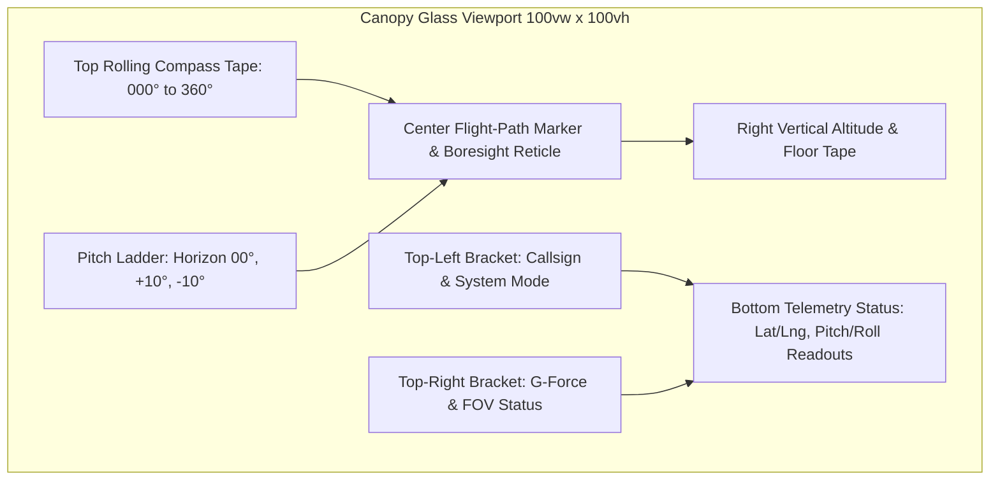

# Tactical Avionics HUD & Boresight Component Specifications

## 1. Overview & Purpose

This document establishes the official design system, geometric parameters, SVG viewport coordinates, font hierarchies, and tactical color tokens for Heads-Up Display (HUD) and augmented reality components across WorkSphere (including `AerospaceHUDOverlay.tsx`, `CockpitHUD`, `SeatARPointer.tsx`, and `ARScene.tsx`).

Standardizing these parameters ensures visual consistency, optic legibility across dynamic camera feeds, and seamless scaling across mobile AR viewpoints and desktop tactical monitors.

---

## 2. Component Anatomy & Viewport Grids

### 2.1 Boresight & Flight-Path Marker (FPM) Anatomy

The Boresight crosshair represents the aircraft/camera mechanical boresight axis, while the Flight-Path Marker (FPM) / Velocity Vector symbol indicates the instantaneous trajectory vector.

```
                           [ Top Fin (Fin Height: 8px) ]
                                        │
                                        │  (x: 20, y: 7) -> (x: 20, y: 15)
                                        │
   [ Left Wing (12px) ]           ┌───────────┐            [ Right Wing (12px) ]
 ───────────────────────┤        │ (cx: 20,  │        ├────────────────────────
(x: 3, y: 20) -> (x: 15, y: 20)  │  cy: 20)  │  (x: 25, y: 20) -> (x: 37, y: 20)
                                 │  r: 5px   │
                                  └───────────┘
                           [ Center Reticle Circle ]
```

#### SVG Viewport Coordinates (`viewBox="0 0 40 40"`)

| Element           | SVG Primitive | Geometric Coordinates             | Stroke Width  | Purpose                    |
| :---------------- | :------------ | :-------------------------------- | :------------ | :------------------------- |
| **Center Optic**  | `<circle />`  | `cx="20" cy="20" r="5"`           | `1.8px`       | Central visual focal point |
| **Left Wing**     | `<line />`    | `x1="3" y1="20" x2="15" y2="20"`  | `1.8px`       | Roll & horizontal leveling |
| **Right Wing**    | `<line />`    | `x1="25" y1="20" x2="37" y2="20"` | `1.8px`       | Roll & horizontal leveling |
| **Vertical Fin**  | `<line />`    | `x1="20" y1="7" x2="20" y2="15"`  | `1.8px`       | Upward pitch orientation   |
| **Boresight Dot** | `<circle />`  | `cx="20" cy="20" r="1.2"`         | `none` (fill) | Mechanical optical center  |

---

### 2.2 Complete Tactical HUD Layout Architecture



---

## 3. Geometric Parameters & Chamfer Standards

To evoke modern aerospace canopies (F-22 Raptor, F-35 Lightning II) and Green Lantern hard-light construct geometry, all tactical containers adhere to strict geometric dimensions:

```
    Chamfer Width (12px)
        ◄──────►
 (0, 12) ┌──────┐ (12, 0)
         │       \─────────────────────────────────────┐ (W-12, 0)
         │                                              \
         │                 Tactical Container            │ (W, 12)
         │                                               │
         │                                               │
         │                                               │ (W, H-12)
         │                                              /
 (0, H-12)└──────┐                                     ┌┘ (W-12, H)
                 \─────────────────────────────────────┘
```

### 3.1 Chamfer Polygon Standard

Containers with aerospace chamfers utilize CSS `clip-path`:

```css
/* Standard 12px 45-degree chamfered tactical container */
clip-path: polygon(
  12px 0%,
  calc(100% - 12px) 0%,
  100% 12px,
  100% calc(100% - 12px),
  calc(100% - 12px) 100%,
  12px 100%,
  0% calc(100% - 12px),
  0% 12px
);
```

### 3.2 Dimensional Specification Matrix

| Component Parameter             | Metric Value | Tailwind Class Equivalent     | Description                          |
| :------------------------------ | :----------- | :---------------------------- | :----------------------------------- |
| **Boresight Outer Ring Radius** | `24px`       | `w-12 h-12`                   | Acquisition boundary                 |
| **Boresight Inner Ring Radius** | `5px`        | `w-2.5 h-2.5`                 | Exact trajectory reticle             |
| **Minor Tick Stroke Width**     | `1.0px`      | `w-[1px]` or `stroke-[1]`     | 5° angle / 0.5m elevation increments |
| **Major Tick Stroke Width**     | `1.8px`      | `w-[1.8px]` or `stroke-[1.8]` | 30° heading / 2.0m floor markers     |
| **Critical Reticle Stroke**     | `2.5px`      | `stroke-[2.5]`                | Target lock & arrival beacons        |
| **Corner Bracket Length**       | `16px`       | `w-4 h-4`                     | HUD framing borders                  |
| **Chamfer Cutout Depth**        | `12px`       | `polygon(...)`                | 45° angled corners                   |
| **Pitch Ladder Rung Length**    | `48px`       | `w-12`                        | Horizontal rung length               |
| **Pitch Ladder Gap**            | `64px`       | `w-16`                        | Central boresight clearance corridor |

---

## 4. Tactical Color Tokens & Variable Mappings

WorkSphere utilizes three primary tactical HUD themes: **Emerald** (Primary / Lantern Hard-Light), **Amber** (Caution / High-Noise Warnings), and **Cyan** (Subsea / Network Telemetry).

```css
:root {
  /* ------------------------------------------------------------------------ */
  /* 1. Tactical Emerald Palette (Primary / Green Lantern Hard-Light)         */
  /* ------------------------------------------------------------------------ */
  --color-lantern-emerald-base: #02140f; /* Deep dark canopy base */
  --color-lantern-emerald-deep: #064e3b; /* Shadowed construct fill */
  --color-lantern-emerald: #10b981; /* Standard HUD stroke & text */
  --color-lantern-emerald-bright: #34d399; /* Active reticle highlight */
  --color-lantern-emerald-core: #ecfdf5; /* Specular optic center */
  --glow-lantern-emerald: 0 0 12px rgba(16, 185, 129, 0.65);

  /* ------------------------------------------------------------------------ */
  /* 2. Tactical Amber Palette (Caution / Transients / High Occupancy)        */
  /* ------------------------------------------------------------------------ */
  --color-hud-amber-base: #1c1103; /* Deep warning backing */
  --color-hud-amber-deep: #78350f; /* Shadowed warning border */
  --color-hud-amber: #f59e0b; /* Cautionary stroke & ticks */
  --color-hud-amber-bright: #fbbf24; /* Warning highlight */
  --color-hud-amber-core: #fffbeb; /* Critical warning flash */
  --glow-hud-amber: 0 0 12px rgba(245, 158, 11, 0.65);

  /* ------------------------------------------------------------------------ */
  /* 3. Tactical Cyan Palette (Telemetry / Sensors / WebXR Hit-Test)         */
  /* ------------------------------------------------------------------------ */
  --color-hud-cyan-base: #021820; /* Deep telemetry background */
  --color-hud-cyan-deep: #0e7490; /* Secondary telemetry accents */
  --color-hud-cyan: #06b6d4; /* Sensor grid lines & markers */
  --color-hud-cyan-bright: #22d3ee; /* Active raycast hit indicator */
  --color-hud-cyan-core: #ecfeff; /* High-intensity beam center */
  --glow-hud-cyan: 0 0 12px rgba(6, 182, 212, 0.65);
}
```

---

## 5. Typography Hierarchy

HUD avionics require monospace, tabular-figure typography to prevent numerical character jitter as headings, altitudes, and coordinates rapidly update.

```
┌────────────────────────────────────────────────────────────────────────┐
│ ORBITRON SEMIBOLD 14PX (LETTER-SPACING: 0.12EM)                        │
│ SECTOR 2814 // TACTICAL CANOPY HUD                                     │
├────────────────────────────────────────────────────────────────────────┤
│ JetBrains Mono Bold 12px (Tabular Figures)                             │
│ HDG 042° · ALT +1.8m · FL 02                                           │
├────────────────────────────────────────────────────────────────────────┤
│ JetBrains Mono Regular 9px (Muted Telemetry)                           │
│ SENSOR FUSION: NOMINAL · SLERP 4D ACTIVE · FOV: 74°                    │
└────────────────────────────────────────────────────────────────────────┘
```

### 5.1 Font Stack Hierarchy Table

| Level              | Font Family      | Weight           | Size   | Letter Spacing | Purpose                                       |
| :----------------- | :--------------- | :--------------- | :----- | :------------- | :-------------------------------------------- |
| **Tactical Title** | `Orbitron`       | `700` (Bold)     | `16px` | `0.14em`       | Major sector clearance & status headers       |
| **Status Tag**     | `Orbitron`       | `600` (SemiBold) | `11px` | `0.10em`       | Subsystem mode badges (`RADAR 3D`, `LOCKED`)  |
| **Primary Value**  | `JetBrains Mono` | `700` (Bold)     | `13px` | `0.05em`       | Heading degrees, altitude meters, dB readings |
| **Secondary Unit** | `JetBrains Mono` | `500` (Medium)   | `10px` | `0.02em`       | Units labels (`°`, `m`, `dB(A)`, `FL`)        |
| **Telemetry Line** | `JetBrains Mono` | `400` (Regular)  | `9px`  | `0.02em`       | Sensor status, latency, frame rates           |

### 5.2 CSS Implementation

```css
/* Monospace figures ensuring uniform column widths during numeric changes */
.hud-tabular {
  font-family:
    "JetBrains Mono", ui-monospace, SFMono-Regular, Menlo, Monaco, Consolas,
    monospace;
  font-variant-numeric: tabular-nums;
  font-feature-settings:
    "tnum" 1,
    "zero" 1;
}

.hud-tactical-header {
  font-family:
    "Orbitron",
    -apple-system,
    BlinkMacSystemFont,
    sans-serif;
  text-transform: uppercase;
  letter-spacing: 0.12em;
}
```

---

## 6. Dark Mode & High-Contrast Mode Guidelines

Avionics interfaces must remain legible whether projected over sunlit windows, dim coffee shops, or high-contrast accessibility environments.

### 6.1 Standard Dark Mode (Default)

- **Glass Transparency**: Backing panels use `rgba(2, 20, 15, 0.85)` with `backdrop-filter: blur(8px)`.
- **Bloom Shadows**: Elements use soft glowing drop-shadows: `filter: drop-shadow(0 0 6px rgba(16, 185, 129, 0.8))`.
- **Vignette Border**: Subtle corner vignette with `rgba(16, 185, 129, 0.1)` edge tint.

### 6.2 High-Contrast Mode (`forced-colors` / WCAG AAA)

When high-contrast mode is active (`data-contrast="high"` or `@media (forced-colors: active)`):

1. **Glow Elimination**: Box shadows and drop-shadow bloom filters are set to `none` to eliminate halo blur around fine numbers.
2. **Stroke Width Multiplication**:
   - Minor ticks: Increase from `1.0px` to `1.8px`.
   - Major reticles: Increase from `1.8px` to `2.8px`.
3. **Pure Solid Backing**: Replace translucent panels with `rgba(0, 0, 0, 0.98)` solid black backgrounds.
4. **Luminance Maximization**:
   - Emerald token swaps from `#10b981` to pure high-contrast mint `#00ff88`.
   - Amber token swaps from `#f59e0b` to high-contrast neon yellow `#ffea00`.
   - Cyan token swaps from `#06b6d4` to high-contrast electric cyan `#00e5ff`.

```css
@media (prefers-contrast: more) {
  :root {
    --color-lantern-emerald: #00ff88;
    --color-hud-amber: #ffea00;
    --color-hud-cyan: #00e5ff;
    --glow-lantern-emerald: none;
    --glow-hud-amber: none;
    --glow-hud-cyan: none;
  }

  .hud-panel {
    background-color: #000000 !important;
    border-width: 2px !important;
  }
}
```

### 6.3 Reduced Motion Standards (`prefers-reduced-motion`)

- When the user enables reduced motion, rolling tape translations and pulse rings (`animate-pulse`, `animate-ping`) are disabled.
- Compass heading and altitude tapes snap discretely to the nearest 5°/1m interval without continuous sub-pixel sliding animations.

---

## 7. Reusable React SVG Component Template

```tsx
import React from "react";

interface BoresightReticleProps {
  className?: string;
  size?: number;
  isLocked?: boolean;
}

export function BoresightReticle({
  className = "",
  size = 40,
  isLocked = false,
}: BoresightReticleProps) {
  const strokeColor = isLocked
    ? "var(--color-hud-amber)"
    : "var(--color-lantern-emerald)";

  return (
    <svg
      viewBox="0 0 40 40"
      width={size}
      height={size}
      className={`drop-shadow-[0_0_8px_rgba(16,185,129,0.8)] ${className}`}
      fill="none"
      stroke={strokeColor}
      strokeWidth="1.8"
      strokeLinecap="round"
      aria-label={isLocked ? "Target Acquired" : "Boresight Reticle"}
    >
      {/* Central Ring */}
      <circle cx="20" cy="20" r="5" />

      {/* Horizontal Flight Wings */}
      <line x1="3" y1="20" x2="15" y2="20" />
      <line x1="25" y1="20" x2="37" y2="20" />

      {/* Vertical Orientation Fin */}
      <line x1="20" y1="7" x2="20" y2="15" />

      {/* Center Optical Point */}
      <circle cx="20" cy="20" r="1.2" fill={strokeColor} stroke="none" />
    </svg>
  );
}
```
