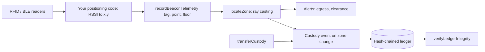
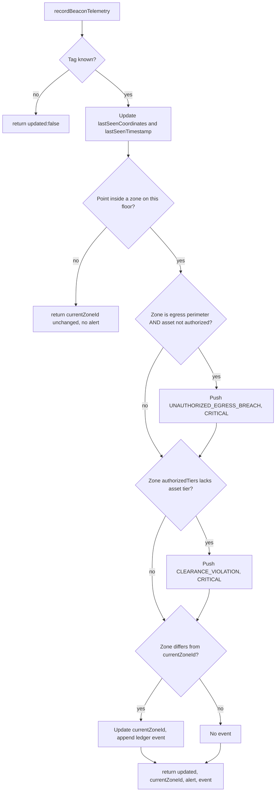
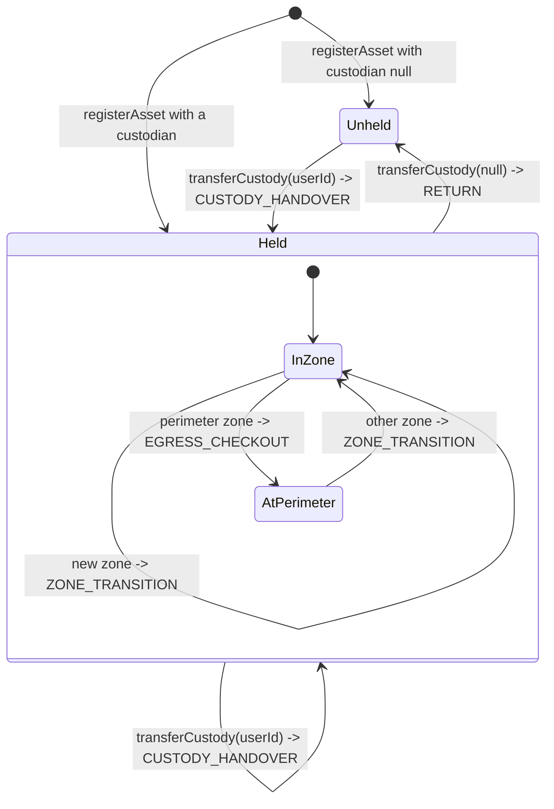
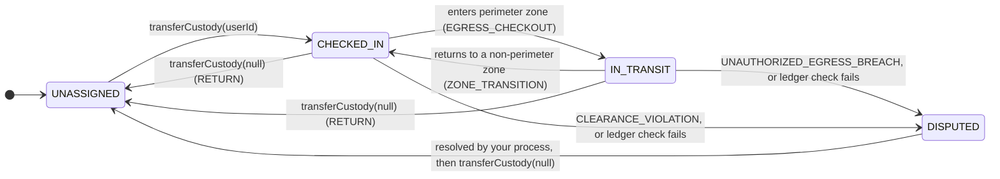
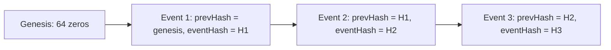

# AssetGeofenceLedger: RFID geofencing, custody transitions and the audit ledger

This guide explains how `AssetGeofenceLedger` turns RFID beacon sightings into zone locations, security alerts and a hash-chained custody history.

- **Source:** [`src/core/inventory/AssetGeofenceLedger.ts`](../../src/core/inventory/AssetGeofenceLedger.ts)
- **Tests:** [`src/__tests__/inventory/AssetGeofenceLedger.test.ts`](../../src/__tests__/inventory/AssetGeofenceLedger.test.ts)
- **Export:** `src/core/index.ts` re-exports everything from the module.

The class is a **pure, in-memory engine**. It has no database, no network code, no timers and no reader driver. Your integration code feeds it zones, assets and position updates, and it returns events and alerts. Everything below describes the code as it is today. Several things the feature name suggests (GeoJSON input, RSSI triangulation, a dispute state) are **not** part of this class; [section 4](#4-beacon-telemetry-rssi-and-proximity-thresholds) and [section 6](#6-custody-lifecycle) say exactly where the boundary lies, and [section 10](#10-current-limitations) lists every gap in one place.

## Contents

1. [Overview and terminology](#1-overview-and-terminology)
2. [Data model](#2-data-model)
3. [Geofence boundaries](#3-geofence-boundaries)
4. [Beacon telemetry, RSSI and proximity thresholds](#4-beacon-telemetry-rssi-and-proximity-thresholds)
5. [Telemetry processing and security alerts](#5-telemetry-processing-and-security-alerts)
6. [Custody lifecycle](#6-custody-lifecycle)
7. [Tamper-evident audit ledger](#7-tamper-evident-audit-ledger)
8. [Event and alert schema reference](#8-event-and-alert-schema-reference)
9. [Integration example](#9-integration-example)
10. [Current limitations](#10-current-limitations)
11. [Troubleshooting](#11-troubleshooting)
12. [Testing](#12-testing)

---

## 1. Overview and terminology

| Term                 | Meaning in this code                                                                                         |
| -------------------- | ------------------------------------------------------------------------------------------------------------ |
| **Zone**             | A `GeofenceZone`: a named 2D polygon on one floor, such as a venue room, a storage locker or a quiet zone.   |
| **Egress perimeter** | A zone with `isEgressPerimeter: true`, such as a turnstile or exit gate. Entering it means leaving the site. |
| **Asset**            | An `AssetEntity`: a tracked physical item carrying one RFID tag.                                             |
| **Custodian**        | The user ID currently responsible for an asset, or `null` when nobody is.                                    |
| **Clearance tier**   | `STANDARD`, `RESTRICTED` or `AIR_GAPPED`. A zone lists which tiers may be inside it.                         |
| **Telemetry**        | One sighting of a tag: tag ID, `(x, y)` coordinates and a floor number.                                      |
| **Custody event**    | An entry in the append-only ledger, linked to the previous entry by a SHA-256 hash.                          |
| **Alert**            | A `SecurityAlert` kept in a separate list. Alerts are **not** part of the hash chain.                        |

The flow of data:



---

## 2. Data model

### Zone

```ts
interface GeofenceZone {
  zoneId: string;
  name: string;
  polygonBoundary: Point2D[]; // { x: number; y: number }[]
  floorNumber: number;
  authorizedTiers: SecurityClearanceTier[];
  isEgressPerimeter: boolean;
}
```

### Asset

```ts
interface AssetEntity {
  assetId: string;
  name: string;
  category:
    "COMPUTE_HARDWARE" | "PERIPHERAL" | "SPECIALIZED_TOOL" | "FURNITURE";
  rfidTagEpId: string; // tag ID used to look the asset up
  currentCustodianUserId: string | null;
  currentZoneId: string; // starting zone you register; updated by telemetry
  securityClearanceTier: SecurityClearanceTier;
  isAuthorizedForEgress: boolean;
  lastSeenCoordinates: Point2D;
  lastSeenTimestamp: number; // ms epoch
}
```

### Registration and read APIs

| Method                           | Behavior                                                                                                              |
| -------------------------------- | --------------------------------------------------------------------------------------------------------------------- |
| `registerZone(zone)`             | Stores a shallow copy keyed by `zoneId`. Registering the same ID again replaces the zone but keeps its list position. |
| `registerAsset(asset)`           | Stores a shallow copy and maps `rfidTagEpId` to `assetId`.                                                            |
| `getAsset(id)` / `getZone(id)`   | Return a shallow copy, or `undefined`.                                                                                |
| `authorizeEgress(assetId, bool)` | Sets `isAuthorizedForEgress`. Does nothing for an unknown asset (no error).                                           |
| `getSecurityAlerts()`            | Copy of the alert list, oldest first.                                                                                 |
| `getCustodyHistory(assetId?)`    | The ledger, or only one asset's events. The array is a copy, but the event objects inside are the live ones.          |

The constructor takes no arguments. `registerAsset` does not check that `currentZoneId` names a registered zone.

---

## 3. Geofence boundaries

### Polygon format

`polygonBoundary` is a plain list of vertices in order around the shape, in your venue's local coordinate system (any consistent unit, such as metres from a floor-plan origin).

- Each vertex is `{ x, y }`. There is no latitude/longitude handling.
- Use **at least 3 vertices**; fewer returns "outside" for every point.
- **Do not repeat the first vertex at the end.** The class closes the ring itself. A repeated closing vertex is harmless but unnecessary.
- Zones are **flat per floor**. A zone belongs to exactly one `floorNumber`, and a point is only tested against zones on the floor you pass in.
- Concave and rotated shapes work. Self-intersecting shapes give odd-even results.

Example: a 100 x 100 room on floor 2, and an exit gate on floor 1 that marks the building perimeter.

```ts
ledger.registerZone({
  zoneId: "zone-fablab-1",
  name: "Hardware Fabrication Lab",
  floorNumber: 2,
  isEgressPerimeter: false,
  authorizedTiers: ["STANDARD", "RESTRICTED", "AIR_GAPPED"],
  polygonBoundary: [
    { x: 0, y: 0 },
    { x: 100, y: 0 },
    { x: 100, y: 100 },
    { x: 0, y: 100 },
  ],
});

ledger.registerZone({
  zoneId: "zone-exit-gate",
  name: "Building Main Turnstiles",
  floorNumber: 1,
  isEgressPerimeter: true,
  authorizedTiers: ["STANDARD", "RESTRICTED"],
  polygonBoundary: [
    { x: 200, y: 0 },
    { x: 250, y: 0 },
    { x: 250, y: 50 },
    { x: 200, y: 50 },
  ],
});
```

### Modeling rooms, lockers and quiet zones

The class has no zone "kind". All three are just zones, and the behavior you want comes from two fields:

| Use case                          | How to model it                                                                                                          |
| --------------------------------- | ------------------------------------------------------------------------------------------------------------------------ |
| **Venue room**                    | A polygon around the room, `isEgressPerimeter: false`, with every tier that may be inside in `authorizedTiers`.          |
| **Storage locker / cage**         | A small polygon, usually with only the tiers allowed to store items there. Entering with another tier raises an alert.   |
| **Quiet zone or restricted area** | A polygon whose `authorizedTiers` is narrow, such as `['AIR_GAPPED']`. Other tiers entering raise `CLEARANCE_VIOLATION`. |
| **Site exit**                     | A polygon over the doorway or turnstile with `isEgressPerimeter: true`.                                                  |

### Using GeoJSON data

The ledger does not read GeoJSON. If your floor plans are stored as GeoJSON `Polygon` features, convert the outer ring before registering. A GeoJSON ring repeats its first coordinate at the end, and coordinates are `[x, y]` (`[longitude, latitude]` for geographic data), so drop the last point and map each pair:

```ts
import type {
  GeofenceZone,
  Point2D,
} from "@/core/inventory/AssetGeofenceLedger";

function ringToPolygon(ring: number[][]): Point2D[] {
  const open = ring.slice(0, -1); // drop the repeated closing coordinate
  return open.map(([x, y]) => ({ x, y }));
}

// feature.geometry.type === 'Polygon' -> use coordinates[0] (outer ring)
const polygonBoundary = ringToPolygon(feature.geometry.coordinates[0]);
```

Holes (inner rings) and `MultiPolygon` are not supported: register one zone per outer ring. For geographic coordinates, project to a local metric system first if you need distances in metres; point-in-polygon itself works in any planar system.

### Point-in-polygon: how a point is placed in a zone

`isPointInPolygon(point, polygon)` uses the **ray-casting (even-odd) rule**: cast a ray from the point to the right and count how many polygon edges it crosses. An odd count means inside.

`locateZone(point, floorNumber)` walks the registered zones **in registration order** and returns the first zone on that floor that contains the point, or `null`.

Behavior worth knowing:

- **Overlapping zones:** the first registered zone wins. A zone registered later never matches inside the overlap. Register more specific zones (a locker inside a room) **before** the larger zone that contains them.
- **Points exactly on an edge** are classified inconsistently by the even-odd rule. For a square from (0,0) to (100,100), points on the left and bottom edges and the lower-left corner count as inside, while points on the right and top edges and the upper-right corner count as outside. Do not design zones whose correctness depends on exact-edge readings; leave a margin or let neighboring zones share a gap.
- **No hysteresis.** A tag hovering around a boundary can flip between zones on consecutive readings and write an event each time. Smooth positions upstream if your readers are noisy.

---

## 4. Beacon telemetry, RSSI and proximity thresholds

**This class does not process RSSI.** `recordBeaconTelemetry` takes coordinates that your own code has already computed. There is no signal-strength input, no path-loss model, no multi-reader trilateration and no proximity threshold in `AssetGeofenceLedger.ts`.

```ts
recordBeaconTelemetry(
  rfidTagEpId: string,
  coordinates: Point2D,   // already resolved x, y
  floorNumber: number,
  currentTime: number = Date.now()
)
```

The normal pipeline is therefore:

1. Readers or BLE beacons report an **RSSI** (received signal strength, in dBm) per tag.
2. **Your positioning layer** turns the readings from several readers into one `(x, y)` estimate.
3. Your code calls `recordBeaconTelemetry` with that estimate and the floor the readers sit on.

For orientation, the commonly used approach in step 2 is the log-distance path-loss model, which converts one reading to a distance, followed by trilateration over three or more readers at known positions:

```text
distance = 10 ^ ((txPowerAt1m - rssi) / (10 * pathLossExponent))
```

`txPowerAt1m` and `pathLossExponent` (about 2 in free space, higher indoors) must be calibrated per site. RSSI is noisy, so most deployments average or filter several readings before estimating a position. None of this is implemented or configured here; the constants and any proximity threshold belong to your positioning code.

What the ledger does with a reading:

| Situation                                        | Result                                                                                                                                                   |
| ------------------------------------------------ | -------------------------------------------------------------------------------------------------------------------------------------------------------- |
| Unknown `rfidTagEpId`                            | Returns `{ updated: false }`. Nothing is stored and no alert is raised.                                                                                  |
| Known tag, point is inside no zone on that floor | `lastSeenCoordinates` and `lastSeenTimestamp` are updated; `currentZoneId` is unchanged; returns `{ updated: true, currentZoneId }`. No event, no alert. |
| Known tag, point inside a zone                   | Checks run as described in [section 5](#5-telemetry-processing-and-security-alerts).                                                                     |
| Wrong floor number                               | Treated like "inside no zone" if no zone on that floor contains the point.                                                                               |

### Lost beacons

`SecurityAlertType` includes `'LOST_BEACON_TIMEOUT'`, but **nothing in the class creates it**. The class only records `lastSeenTimestamp`. If you want a lost-beacon alert, run your own watchdog that compares `getAsset(id).lastSeenTimestamp` with the current time and decides what "lost" means for your site.

---

## 5. Telemetry processing and security alerts

For a known tag whose point falls inside a zone, `recordBeaconTelemetry` runs these steps in order:



### The two alerts

| Alert                        | Condition                                                               | Severity   |
| ---------------------------- | ----------------------------------------------------------------------- | ---------- |
| `UNAUTHORIZED_EGRESS_BREACH` | The zone is an egress perimeter and `isAuthorizedForEgress` is `false`. | `CRITICAL` |
| `CLEARANCE_VIOLATION`        | The zone's `authorizedTiers` does not include the asset's tier.         | `CRITICAL` |

Details that affect integrations:

- **Alerts fire on every reading, not only on zone changes.** A tag that stays inside a perimeter zone raises a new `UNAUTHORIZED_EGRESS_BREACH` with each ping, while the custody event is written only on the first one. Deduplicate in your alert consumer if that is too noisy.
- **Both alerts can fire for the same reading.** Both are pushed to the alert list, but the `alert` field in the return value holds only the **last** one created (the clearance violation). Read `getSecurityAlerts()` if you need every alert.
- **Alerts are checked against the zone, not the transition.** They do not need `oldZone !== newZone`.
- `WARNING` severity exists in the type but is never used.
- Authorizing egress with `authorizeEgress(id, true)` removes the egress alert. It does not remove the `EGRESS_CHECKOUT` event, which is written whenever an asset **enters** a perimeter zone from a different zone.

### Zone-change events

When the detected zone differs from `currentZoneId`, the asset's zone is updated and an event is appended with the custodian unchanged (`fromCustodian` and `toCustodian` are both the current custodian):

| Detected zone type | `eventType`       |
| ------------------ | ----------------- |
| Egress perimeter   | `EGRESS_CHECKOUT` |
| Any other zone     | `ZONE_TRANSITION` |

---

## 6. Custody lifecycle

### What the code tracks

The class has **no asset status field** and no `UNASSIGNED`, `IN_TRANSIT`, `CHECKED_IN` or `DISPUTED` values. Custody is the pair of facts every asset carries:

1. **Who holds it:** `currentCustodianUserId` (`null` means nobody).
2. **Where it is:** `currentZoneId`.

Two operations change them, and each writes a ledger event:

| Operation                               | Changes                   | `eventType`                                             |
| --------------------------------------- | ------------------------- | ------------------------------------------------------- |
| `transferCustody(assetId, userId)`      | custodian set to `userId` | `CUSTODY_HANDOVER`                                      |
| `transferCustody(assetId, null)`        | custodian cleared         | `RETURN`                                                |
| `recordBeaconTelemetry` into a new zone | zone                      | `ZONE_TRANSITION`, or `EGRESS_CHECKOUT` for a perimeter |

`transferCustody` throws `Asset <id> not found` for an unknown asset. It records the event even if the new custodian equals the old one, and it checks no permissions: authorizing who may hand over an asset is up to the caller.



The zone movement (the nested states) happens in both `Held` and `Unheld`, because telemetry does not depend on the custodian. It is drawn once for readability.

### Mapping to the lifecycle names used in the project

The project's documentation uses the names `UNASSIGNED`, `IN_TRANSIT`, `CHECKED_IN` and `DISPUTED` for the custody lifecycle. They are **a way of reading the data above**, not values stored by the class. This table says which facts correspond to each name, so you can derive them in your application:

| Lifecycle name | How to derive it from this class                                                                                                                    | Event that enters it                  |
| -------------- | --------------------------------------------------------------------------------------------------------------------------------------------------- | ------------------------------------- |
| `UNASSIGNED`   | `currentCustodianUserId === null`                                                                                                                   | `RETURN`                              |
| `IN_TRANSIT`   | A custodian is set and the asset's latest event is `EGRESS_CHECKOUT` (it is at or has crossed a perimeter)                                          | `EGRESS_CHECKOUT`                     |
| `CHECKED_IN`   | A custodian is set and the asset sits in a non-perimeter zone after a `CUSTODY_HANDOVER` or `ZONE_TRANSITION`                                       | `CUSTODY_HANDOVER`, `ZONE_TRANSITION` |
| `DISPUTED`     | **No equivalent state.** The closest signals are an unauthorized-egress or clearance alert, or `verifyLedgerIntegrity()` returning `isValid: false` | alert raised, or ledger check fails   |



This second diagram is a **derived view**. The `DISPUTED` state and the transitions out of it are application-level decisions; the class itself only raises the alert or reports the failed check. Persist your own status field if you need disputes to be a durable state.

---

## 7. Tamper-evident audit ledger

Every custody event is appended to an in-memory array and linked to the one before it, so changing an old entry breaks every hash after it.



### How an event hash is built

`eventHash` is a SHA-256 hex digest (64 characters) of this colon-joined string:

```text
eventId:assetId:fromCustodian:toCustodian:fromZone:toZone:eventType:timestamp:prevHash
```

A `null` custodian is written as the text `null`. The first event uses `prevHash` of 64 zeros.

`eventId` has the form `custody_evt_<timestamp>_<n>`, where `n` is the event's 1-based position in the whole ledger.

### Verification

`verifyLedgerIntegrity()` walks the ledger from the start and checks, for each event, that:

1. its `prevHash` equals the previous event's `eventHash` (or the genesis hash for the first), and
2. its recomputed hash equals its stored `eventHash`.

It returns `{ isValid: true, eventCount }`, or `{ isValid: false, eventCount, brokenEventId }` naming the **first** broken event.

### What the chain does and does not protect

| It detects                                                                | It does not detect                                                                                                                         |
| ------------------------------------------------------------------------- | ------------------------------------------------------------------------------------------------------------------------------------------ |
| Editing any hashed field of an event (custodians, zones, type, timestamp) | **Deleting the newest events.** Removing the tail leaves a shorter, still-valid chain.                                                     |
| Editing a stored `prevHash` or `eventHash` without recomputing the rest   | **Rewriting the whole chain.** SHA-256 here has no secret key and no signature, so anyone who can write the data can recompute every hash. |
| Reordering or removing an event from the middle                           | Changes to data that is not hashed: coordinates, floor, alerts, and the asset record itself.                                               |

To make the ledger tamper-evident against someone with write access, store the latest `eventHash` somewhere they cannot reach (a separate system, a signed checkpoint) and compare it during audits.

---

## 8. Event and alert schema reference

### `CustodyTransitionEvent`

| Field           | Type               | Notes                                                               |
| --------------- | ------------------ | ------------------------------------------------------------------- |
| `eventId`       | `string`           | `custody_evt_<timestamp>_<n>`; `n` counts all ledger events.        |
| `assetId`       | `string`           |                                                                     |
| `fromCustodian` | `string \| null`   | Custodian before the event.                                         |
| `toCustodian`   | `string \| null`   | Custodian after the event. Equal to `fromCustodian` on zone events. |
| `fromZone`      | `string`           | Zone ID before the event.                                           |
| `toZone`        | `string`           | Zone ID after the event. Equal to `fromZone` on custody events.     |
| `eventType`     | `CustodyEventType` | See below.                                                          |
| `timestamp`     | `number`           | Milliseconds since epoch; the `currentTime` you passed in.          |
| `prevHash`      | `string`           | 64 hex characters.                                                  |
| `eventHash`     | `string`           | 64 hex characters.                                                  |

| `eventType`        | Written by                              | Custodian fields | Zone fields           |
| ------------------ | --------------------------------------- | ---------------- | --------------------- |
| `ZONE_TRANSITION`  | Telemetry entering a non-perimeter zone | unchanged        | old zone to new zone  |
| `EGRESS_CHECKOUT`  | Telemetry entering a perimeter zone     | unchanged        | old zone to new zone  |
| `CUSTODY_HANDOVER` | `transferCustody(id, userId)`           | old to new       | both the current zone |
| `RETURN`           | `transferCustody(id, null)`             | old to `null`    | both the current zone |

### `SecurityAlert`

| Field       | Type                      | Notes                                                                                                                   |
| ----------- | ------------------------- | ----------------------------------------------------------------------------------------------------------------------- |
| `alertId`   | `string`                  | `alert_egress_<time>_<random>` or `alert_clearance_<time>_<random>`. The suffix is random, so IDs are not reproducible. |
| `alertType` | `SecurityAlertType`       | `UNAUTHORIZED_EGRESS_BREACH`, `CLEARANCE_VIOLATION` (`LOST_BEACON_TIMEOUT` is declared but never emitted).              |
| `assetId`   | `string`                  |                                                                                                                         |
| `zoneId`    | `string`                  | The zone the tag was detected in.                                                                                       |
| `severity`  | `'CRITICAL' \| 'WARNING'` | Always `CRITICAL` today.                                                                                                |
| `timestamp` | `number`                  | The `currentTime` of the reading.                                                                                       |
| `message`   | `string`                  | Human-readable text including the asset name, ID and zone name.                                                         |

### Return value of `recordBeaconTelemetry`

| Field           | Present when                                                |
| --------------- | ----------------------------------------------------------- |
| `updated`       | Always. `false` only for an unknown tag.                    |
| `currentZoneId` | The tag is known.                                           |
| `alert`         | At least one alert was created for this reading (last one). |
| `event`         | The zone changed on this reading.                           |

---

## 9. Integration example

```ts
import { AssetGeofenceLedger } from "@/core/inventory/AssetGeofenceLedger";

const ledger = new AssetGeofenceLedger();

ledger.registerZone({
  zoneId: "zone-lab",
  name: "Hardware Lab",
  floorNumber: 2,
  isEgressPerimeter: false,
  authorizedTiers: ["STANDARD", "RESTRICTED", "AIR_GAPPED"],
  polygonBoundary: [
    { x: 0, y: 0 },
    { x: 100, y: 0 },
    { x: 100, y: 100 },
    { x: 0, y: 100 },
  ],
});
ledger.registerZone({
  zoneId: "zone-gate",
  name: "Main Turnstiles",
  floorNumber: 1,
  isEgressPerimeter: true,
  authorizedTiers: ["STANDARD", "RESTRICTED"],
  polygonBoundary: [
    { x: 200, y: 0 },
    { x: 250, y: 0 },
    { x: 250, y: 50 },
    { x: 200, y: 50 },
  ],
});

ledger.registerAsset({
  assetId: "asset-vr-001",
  name: "VR Dev Kit",
  category: "COMPUTE_HARDWARE",
  rfidTagEpId: "rfid_tag_998877",
  currentCustodianUserId: "user-engineer-1",
  currentZoneId: "zone-lab",
  securityClearanceTier: "RESTRICTED",
  isAuthorizedForEgress: false,
  lastSeenCoordinates: { x: 50, y: 50 },
  lastSeenTimestamp: Date.now(),
});

// 1. Hand the asset to another person.
ledger.transferCustody("asset-vr-001", "user-researcher-2"); // CUSTODY_HANDOVER

// 2. The tag is read at the turnstiles without egress authorization.
const result = ledger.recordBeaconTelemetry(
  "rfid_tag_998877",
  { x: 225, y: 25 },
  1,
);
// result.alert.alertType === 'UNAUTHORIZED_EGRESS_BREACH'
// result.event.eventType === 'EGRESS_CHECKOUT'

// 3. Audit the chain.
ledger.verifyLedgerIntegrity(); // { isValid: true, eventCount: 2 }
```

---

## 10. Current limitations

These describe the code today. They matter if the ledger guards real equipment.

1. **No RSSI, triangulation or proximity thresholds.** Positions must be computed before calling the class ([section 4](#4-beacon-telemetry-rssi-and-proximity-thresholds)).
2. **No GeoJSON support.** Only flat `{ x, y }` vertex lists; no holes, no `MultiPolygon`, no coordinate reference systems.
3. **No status or dispute state.** Custody is the custodian plus the zone; `DISPUTED` and similar states must be derived or stored by the application ([section 6](#6-custody-lifecycle)).
4. **`LOST_BEACON_TIMEOUT` and `WARNING` are never produced.**
5. **Repeated alerts.** A tag that stays in a violating zone raises a new alert on every reading.
6. **Only the last alert is returned** from `recordBeaconTelemetry` when two fire together.
7. **Zone checks ignore hysteresis and boundary edge cases**, so noisy readings near an edge can generate repeated zone-change events.
8. **Egress authorization is sticky.** `isAuthorizedForEgress` stays `true` after a `RETURN`; reset it yourself with `authorizeEgress(id, false)`.
9. **Alerts are not in the hash chain**, and the chain does not cover coordinates or floor.
10. **The chain has no key, signature or external anchor**, so tail deletion and full rewrites are not detected ([section 7](#7-tamper-evident-audit-ledger)).
11. **Field values containing `:`** are joined without escaping in the hash input, so avoid colons in asset, zone and user IDs.
12. **`getCustodyHistory` returns the live event objects.** Mutating a returned event modifies the ledger, which `verifyLedgerIntegrity` will then report as broken.
13. **In-memory only.** State is lost on restart, and the class has no persistence, locking or multi-process coordination.
14. **No input validation.** Registration does not check that `currentZoneId` exists, that polygons have enough vertices, or that IDs are unique across entity types.

---

## 11. Troubleshooting

| Symptom                                                | Likely cause                                                                       | What to check                                                                  |
| ------------------------------------------------------ | ---------------------------------------------------------------------------------- | ------------------------------------------------------------------------------ |
| `recordBeaconTelemetry` returns `{ updated: false }`   | `rfidTagEpId` was never registered with `registerAsset`.                           | Compare the tag ID from the reader with the registered `rfidTagEpId`.          |
| Zone never changes, `currentZoneId` stays the same     | The point is outside every polygon on that floor, or the floor number is wrong.    | Call `locateZone(point, floor)` directly and print the result.                 |
| Asset lands in the "wrong" zone                        | Overlapping zones: the first registered one wins.                                  | Register the smaller zone before the one that contains it.                     |
| Many `ZONE_TRANSITION` events in a few seconds         | Noisy positions near a boundary.                                                   | Smooth or debounce positions before calling the ledger.                        |
| Same `UNAUTHORIZED_EGRESS_BREACH` repeated             | Alerts fire on every reading in the zone.                                          | Deduplicate by `assetId` and `zoneId` in your consumer.                        |
| Alert in `getSecurityAlerts()` missing from the return | Two alerts fired; only the last is returned.                                       | Read the full alert list.                                                      |
| `verifyLedgerIntegrity()` reports a broken event       | An event object was edited, possibly through the array from `getCustodyHistory()`. | Treat returned events as read-only. `brokenEventId` names the first bad entry. |
| `transferCustody` throws `Asset <id> not found`        | The `assetId` was never registered.                                                | Use the asset ID, not the RFID tag ID.                                         |
| `authorizeEgress` has no visible effect                | The asset ID is unknown; the call is silently ignored.                             | Check the ID with `getAsset`.                                                  |

---

## 12. Testing

Run the existing tests for this class:

```bash
npx jest src/__tests__/inventory/AssetGeofenceLedger.test.ts
```

They cover point-in-polygon placement, locating a zone by floor, egress and clearance alerts, authorized egress, custody handover and return, and tamper detection on the hash chain.

This file is documentation and does not change runtime behavior. Before opening a PR for edits to it, run the checks in [CONTRIBUTING.md](../../CONTRIBUTING.md#7-pr-pre-flight-checklist) that apply to your change, and `npx prettier --check docs/iot/ASSET_GEOFENCE_LEDGER.md`.
