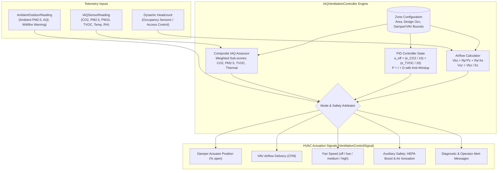
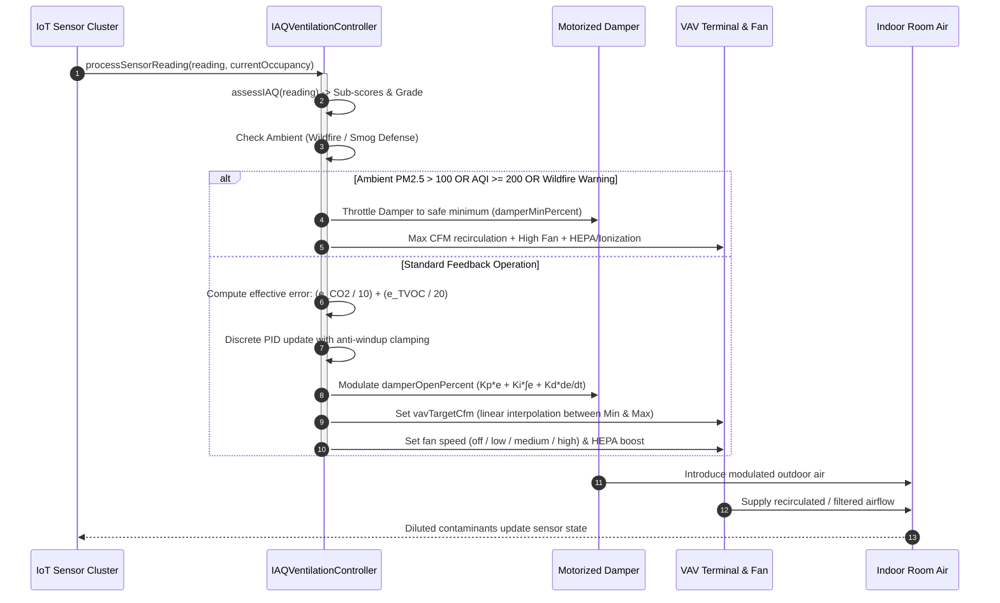

# IAQ Ventilation Control Feedback Loop & ASHRAE 62.1 Reference Guide

This document provides technical documentation for the Indoor Air Quality (IAQ) and Heating, Ventilation, and Air Conditioning (HVAC) feedback controller implemented in [`IAQVentilationController.ts`](../../src/core/iot/IAQVentilationController.ts).

It covers multi-pollutant sensor telemetry processing, composite IAQ grading, closed-loop PID control dynamics, motorized damper and Variable Air Volume (VAV) modulation, emergency wildfire/smog override protections, and alignment with the ASHRAE Standard 62.1 commercial ventilation framework.

---

## 1. Overview

### 1.1 Purpose
The `IAQVentilationController` class in [`src/core/iot/IAQVentilationController.ts`](../../src/core/iot/IAQVentilationController.ts) automates indoor air quality management and mechanical ventilation in commercial and coworking spaces. It maintains occupant safety, cognitive comfort, and energy efficiency by continuously modulating outdoor air intake dampers and supply fan speeds in response to real-time indoor contaminant accumulation and outdoor environmental conditions.

### 1.2 Scope & Responsibilities
- **Zone Registration & Architectural Profiling**: Tracks per-zone geometric volume, floor area, design occupancy, target contaminant limits, diffuser distribution effectiveness ($E_z$), and mechanical damper/fan flow bounds.
- **Sensor Telemetry Aggregation**: Processes multi-pollutant telemetry ($\text{CO}_2$, $\text{PM}_{2.5}$, $\text{PM}_{10}$, TVOC, temperature, and relative humidity) into sub-scores and a normalized 0–100 composite index.
- **Dynamic Demand-Controlled Ventilation (DCV)**: Computes dynamic outdoor airflow rates ($V_{oz}$) using ASHRAE 62.1 Ventilation Rate Procedure equations based on real-time headcount.
- **Closed-Loop PID Damper & VAV Modulation**: Employs proportional-integral-derivative control with anti-windup clamping to adjust motorized damper percentage and target supply airflow (CFM).
- **Automated Purge & Life Safety Defense**: Initiates emergency high-ventilation purge cycles on severe indoor contaminant spikes, and activates Wildfire Defense Mode (throttling outdoor air intake to minimum life safety stops and maximizing internal HEPA recirculation) during hazardous ambient conditions.

### 1.3 System Overview: Sensors, Controller, and Actuators
The controller acts as the central software control node between building IoT sensor clusters and mechanical HVAC actuators:

```
[IoT Multi-Sensor Nodes]                  [Weather Station / Outdoor AQI]
 (CO2, PM2.5, TVOC, Temp, RH)              (Ambient PM2.5, PM10, AQI, Wildfire)
              │                                             │
              ▼                                             ▼
  ┌─────────────────────────────────────────────────────────────┐
  │                 IAQVentilationController                    │
  │  - Multi-Sensor Composite Scoring & AQI Assessment          │
  │  - ASHRAE 62.1-2022 Baseline / DCV Airflow Calculation      │
  │  - Closed-Loop Error Derivation (CO2 + TVOC)                │
  │  - Discrete-Time PID Control with Anti-Windup Clamping      │
  │  - Mode & Safety Arbitrator (Normal / DCV / Purge / Defense)│
  └──────────────────────────────┬──────────────────────────────┘
                                 │
         ┌───────────────────────┴───────────────────────┐
         ▼                                               ▼
[Motorized Damper Actuator]                     [VAV Terminal Box & AHU Fan]
 - Intake Aperture (0 - 100%)                    - Target Airflow Delivery (CFM)
 - Mechanical Safe Stops                         - Multi-Stage Fan Speed (Off/Low/Med/High)
                                                 - HEPA Filtration Boost & Ionization
```

---

## 2. System Architecture

### 2.1 Component Interaction
The software architecture maintains modular state tracking per registered building zone:



### 2.2 Core Interfaces & Data Contracts
The controller defines five primary TypeScript interfaces in [`src/core/iot/IAQVentilationController.ts`](../../src/core/iot/IAQVentilationController.ts#L9-L95):

1. **`IAQSensorReading`**: Telemetry packet emitted by indoor environmental multi-sensor nodes.
2. **`AmbientOutdoorReading`**: External telemetry from outdoor weather stations or municipal AQI feeds.
3. **`ZoneVentilationConfig`**: Physical parameters, target thresholds, and mechanical hardware limits per zone.
4. **`IAQAssessment`**: Diagnostic report containing composite score, qualitative grade, critical pollutant, compliance boolean, and airflow demand.
5. **`VentilationControlSignal`**: Actionable hardware command dispatched to motorized dampers, VAV boxes, and filtration units.

---

## 3. Sensor Inputs and Aggregation

### 3.1 Implemented Sensor Telemetry Table

| Sensor Parameter | Symbol | Source Field | Unit | Range / Constraints | Implemented Processing | Weight | Failure / Out-of-Range Handling |
| :--- | :--- | :--- | :--- | :--- | :--- | :--- | :--- |
| **Carbon Dioxide** | $\text{CO}_2$ | `reading.co2` | $\text{ppm}$ | Continuous $\ge 0$ | Piecewise linear grading; Error input to PID | **35%** | Scored down to 0 for $\ge 2000\text{ ppm}$; PID clips negative errors at 0 |
| **Fine Particulates** | $\text{PM}_{2.5}$ | `reading.pm25` | $\mu\text{g/m}^3$ | Continuous $\ge 0$ | Piecewise linear grading; HEPA boost & ionization triggers | **35%** | Scored down to 0 for $\ge 105.4\,\mu\text{g/m}^3$; triggers HEPA boost at $>25$, ionization at $>35$ |
| **Total Volatile Organic Compounds** | $\text{TVOC}$ | `reading.tvoc` | $\text{ppb}$ | Continuous $\ge 0$ | Piecewise linear grading; Error input to PID; Purge trigger | **20%** | Scored down to 0 for $\ge 1660\text{ ppb}$; PID clips negative errors at 0; Purge if $>1000$ |
| **Ambient Temperature** | $T$ | `reading.temperature` | $^\circ\text{C}$ | Continuous | Deviation penalty from $22^\circ\text{C}$ comfort center | **Combined 10%** (Thermal) | Penalized $6\text{ pts/}^\circ\text{C}$ for $T < 19$ or $T > 25$ (clamped at $\Delta 10^\circ\text{C}$) |
| **Relative Humidity** | $\text{RH}$ | `reading.humidity` | $\%$ | Continuous $0 - 100\%$ | Deviation penalty outside $30 - 60\%$ range | **Combined 10%** (Thermal) | Penalized $1.5\text{ pts/\%RH}$ outside $30 - 60\%$ (capped at 40 pts penalty) |
| **Coarse Particulates** | $\text{PM}_{10}$ | `reading.pm10` | $\mu\text{g/m}^3$ | Continuous $\ge 0$ | Accepted in telemetry; logged | **0%** (Unused in score) | No scoring penalty applied in current implementation |
| **Formaldehyde** | $\text{HCHO}$ | `reading.formaldehyde` | $\text{ppm}$ | Optional | Optional field in `IAQSensorReading` | **0%** (Unused) | Optional field; not evaluated in index calculation |

### 3.2 Exact Sub-Score Mathematical Formulations

#### 1. $\text{CO}_2$ Sub-Score ($S_{\text{CO}_2}$)
Evaluated against baseline ambient thresholds:
```math
S_{\text{CO}_2} = \begin{cases}
100 & \text{if } \text{CO}_2 \le 600 \\
100 - \left(\frac{\text{CO}_2 - 600}{200}\right) \times 15 & \text{if } 600 < \text{CO}_2 \le 800 \quad (100 \to 85) \\
85 - \left(\frac{\text{CO}_2 - 800}{200}\right) \times 20 & \text{if } 800 < \text{CO}_2 \le 1000 \quad (85 \to 65) \\
65 - \left(\frac{\text{CO}_2 - 1000}{500}\right) \times 35 & \text{if } 1000 < \text{CO}_2 \le 1500 \quad (65 \to 30) \\
\max\left(0,\, 30 - \left(\frac{\text{CO}_2 - 1500}{500}\right) \times 30\right) & \text{if } \text{CO}_2 > 1500 \quad (30 \to 0)
\end{cases}
```

#### 2. $\text{PM}_{2.5}$ Sub-Score ($S_{\text{PM}_{2.5}}$)
Aligned with EPA NAAQS 24-hour concentration tiers:
```math
S_{\text{PM}_{2.5}} = \begin{cases}
100 & \text{if } \text{PM}_{2.5} \le 12.0 \\
100 - \left(\frac{\text{PM}_{2.5} - 12.0}{23.4}\right) \times 30 & \text{if } 12.0 < \text{PM}_{2.5} \le 35.4 \quad (100 \to 70) \\
70 - \left(\frac{\text{PM}_{2.5} - 35.4}{20.0}\right) \times 30 & \text{if } 35.4 < \text{PM}_{2.5} \le 55.4 \quad (70 \to 40) \\
\max\left(0,\, 40 - \left(\frac{\text{PM}_{2.5} - 55.4}{50.0}\right) \times 40\right) & \text{if } \text{PM}_{2.5} > 55.4 \quad (40 \to 0)
\end{cases}
```

#### 3. $\text{TVOC}$ Sub-Score ($S_{\text{TVOC}}$)
Evaluated against volatile chemical concentration tiers:
```math
S_{\text{TVOC}} = \begin{cases}
100 & \text{if } \text{TVOC} \le 220 \\
100 - \left(\frac{\text{TVOC} - 220}{440}\right) \times 40 & \text{if } 220 < \text{TVOC} \le 660 \quad (100 \to 60) \\
\max\left(0,\, 60 - \left(\frac{\text{TVOC} - 660}{1000}\right) \times 60\right) & \text{if } \text{TVOC} > 660 \quad (60 \to 0)
\end{cases}
```

#### 4. Thermal Comfort Sub-Score ($S_{\text{Thermal}}$)
Ideal comfort window is $20^\circ\text{C} - 24^\circ\text{C}$ and $30\% - 60\%$ RH. Penalties apply outside this envelope:
```math
\Delta T = \begin{cases} 
\min(|\text{temperature} - 22|, 10) & \text{if } \text{temperature} < 19 \text{ or } \text{temperature} > 25 \\
0 & \text{otherwise}
\end{cases}
```
```math
\Delta \text{RH} = \begin{cases}
30 - \text{humidity} & \text{if } \text{humidity} < 30 \\
\text{humidity} - 60 & \text{if } \text{humidity} > 60 \\
0 & \text{otherwise}
\end{cases}
```
```math
S_{\text{Thermal}} = \max\left(0,\, \min\left(100,\, 100 - (\Delta T \times 6) - \min(\Delta \text{RH} \times 1.5, 40)\right)\right)
```

### 3.3 Composite IAQ Score & Grading
The composite index $I_{\text{IAQ}}$ is computed by linear scalar weighting, rounded to one decimal place:
```math
I_{\text{IAQ}} = \frac{\left\lfloor \left(0.35 \times S_{\text{CO}_2} + 0.35 \times S_{\text{PM}_{2.5}} + 0.20 \times S_{\text{TVOC}} + 0.10 \times S_{\text{Thermal}}\right) \times 10 + 0.5 \right\rfloor}{10}
```

#### Qualitative Grading Scale
The overall score maps to six categorical health grades:
- **`EXCELLENT`**: $I_{\text{IAQ}} \ge 90$
- **`GOOD`**: $75 \le I_{\text{IAQ}} < 90$
- **`MODERATE`**: $60 \le I_{\text{IAQ}} < 75$
- **`POOR`**: $45 \le I_{\text{IAQ}} < 60$
- **`UNHEALTHY`**: $30 \le I_{\text{IAQ}} < 45$
- **`HAZARDOUS`**: $I_{\text{IAQ}} < 30$

#### Critical Pollutant Identification
The controller ranks the four sub-scores:
$$\{S_{\text{CO}_2},\, S_{\text{PM}_{2.5}},\, S_{\text{TVOC}},\, S_{\text{Thermal}}\}$$
The parameter possessing the lowest numerical sub-score is identified as `criticalPollutant`.

---

## 4. Closed-Loop Ventilation Feedback

### 4.1 Continuous Feedback Cycle
The controller implements a negative feedback control loop executed on every sensor reading:



### 4.2 Control Cycle Step-by-Step
1. **Sampling & Telemetry Arrival**: Ingests `IAQSensorReading` with millisecond timestamp.
2. **Ambient Hazard Verification**: Checks external `latestAmbient` to prevent drawing hazardous outdoor air into the building.
3. **Operational Mode Selection**:
   - `WILDFIRE_DEFENSE`: If ambient AQI $\ge 200$, ambient $\text{PM}_{2.5} > 100\,\mu\text{g/m}^3$, or `wildfireWarning` is `true`.
   - `PURGE`: If indoor $\text{CO}_2 > 1400\text{ ppm}$ or $\text{TVOC} > 1000\text{ ppb}$.
   - `DEMAND_CONTROLLED`: If headcount is provided and `currentOccupancy < designOccupancy`.
   - `NORMAL`: Default occupied operation.
4. **Error Formulation**: Evaluates positive excursion above target setpoints for $\text{CO}_2$ and TVOC.
5. **PID Execution**: Computes proportional, integral (with windup limits), and derivative terms.
6. **Damper & VAV Output Generation**: Maps raw output to physical damper percentages and VAV CFM targets.
7. **Auxiliary Actuation Commands**: Activates multi-stage fan speeds, HEPA filtration boost, and air ionization.

---

## 5. PID Tuning and Mathematical Model

### 5.1 Gain Parameters & Configuration
Default PID gains defined in [`src/core/iot/IAQVentilationController.ts`](../../src/core/iot/IAQVentilationController.ts#L115-L122):

| Parameter | Identifier | Default Value | Implemented Units | Description |
| :--- | :--- | :--- | :--- | :--- |
| **Proportional Gain** | $K_p$ | `0.08` | $\% \text{ damper} / \text{error unit}$ | Immediate response to contaminant excursion |
| **Integral Gain** | $K_i$ | `0.015` | $\% \text{ damper} / (\text{error unit} \cdot \text{min})$ | Eliminates steady-state offset over time |
| **Derivative Gain** | $K_d$ | `0.04` | $\% \text{ damper} \cdot \text{s} / \text{error unit}$ | Dampens rapid transient spikes |
| **Anti-Windup Min** | `antiWindupMin` | `-30.0` | $\text{error units} \cdot \text{min}$ | Lower accumulator saturation clamp |
| **Anti-Windup Max** | `antiWindupMax` | `50.0` | $\text{error units} \cdot \text{min}$ | Upper accumulator saturation clamp |

Custom gains can be injected at initialization via `new IAQVentilationController(customGains)`.

### 5.2 Implemented PID Mathematical Formulation

#### 1. Effective Normalized Error ($e_{\text{eff}}$)
The controller derives a composite normalized error $e_{\text{eff}}$ driven primarily by $\text{CO}_2$ excursion with a secondary TVOC component:
```math
e_{\text{CO}_2}(t) = \max\left(0,\, \text{CO}_2(t) - \text{targetCo2}\right)
```
```math
e_{\text{TVOC}}(t) = \max\left(0,\, \text{TVOC}(t) - \text{targetTvoc}\right)
```
```math
e_{\text{eff}}(t) = \frac{e_{\text{CO}_2}(t)}{10.0} + \frac{e_{\text{TVOC}}(t)}{20.0}
```
*Note: Because deviations below setpoint are clamped to zero ($\max(0, \dots)$), the controller acts as a one-directional ventilation booster. Contaminant levels below setpoint produce zero error.*

#### 2. Sampling Interval ($\Delta t$)
```math
\Delta t = \max\left(1.0,\, \frac{t_{\text{current}} - t_{\text{last}}}{1000}\right) \quad [\text{seconds}]
```

#### 3. Proportional Term ($P(t)$)
```math
P(t) = K_p \times e_{\text{eff}}(t)
```

#### 4. Integral Term & Anti-Windup ($I(t)$)
The accumulator integrates error scaled per minute ($\Delta t / 60$):
```math
I_{\text{accum}}(t) = \text{clamp}\left(I_{\text{accum}}(t - \Delta t) + e_{\text{eff}}(t) \times \frac{\Delta t}{60},\, \text{antiWindupMin},\, \text{antiWindupMax}\right)
```
```math
I(t) = K_i \times I_{\text{accum}}(t)
```

#### 5. Derivative Term ($D(t)$)
Calculated using the rate of change of effective error per second:
```math
\frac{de_{\text{eff}}}{dt} = \frac{e_{\text{eff}}(t) - e_{\text{eff}}(t - \Delta t)}{\Delta t}
```
```math
D(t) = K_d \times \frac{de_{\text{eff}}}{dt}
```

#### 6. Raw & Clamped Damper Actuation Output
```math
u_{\text{raw}}(t) = \text{damperMinPercent} + P(t) + I(t) + D(t)
```
```math
\text{damperOpenPercent}(t) = \text{clamp}\left(\text{round}_{0.1}(u_{\text{raw}}(t)),\, \text{damperMinPercent},\, \text{damperMaxPercent}\right)
```

#### 7. State Reset Dynamics
Calling `controller.resetPID(zoneId)` zeroes out `integralError` and `lastError`, and resets `lastTimestamp` to `Date.now()`.

---

## 6. Damper Actuator Behavior

### 6.1 Mechanical Damper Range & Modulation
- **Range & Units**: Measured in percent open ($0.0\% - 100.0\%$).
- **Minimum Mechanical Stop (`damperMinPercent`)**: Guaranteed minimum opening (e.g. 15% or 20%) to maintain baseline building pressurization and continuous background air circulation.
- **Maximum Mechanical Stop (`damperMaxPercent`)**: Maximum permissible opening (defaults to 100%).
- **Modulation Characteristic**: Continuous analog modulation rounded to one decimal place ($0.1\%$).

### 6.2 Target VAV CFM Output Formulation
The controller translates damper opening percentage into target Variable Air Volume flow ($V_{\text{target}}$):
```math
\text{cfmRange} = \text{vavMaxCfm} - \text{vavMinCfm}
```
```math
V_{\text{scaled}} = \text{vavMinCfm} + \text{cfmRange} \times \left(\frac{\text{damperOpenPercent} - \text{damperMinPercent}}{\text{damperMaxPercent} - \text{damperMinPercent}}\right)
```
```math
\text{vavTargetCfm} = \max\left(V_{oz},\, \min\left(\text{vavMaxCfm},\, \text{round}(V_{\text{scaled}})\right)\right)
```
*Guarantee: $V_{\text{target}}$ is floor-clamped at the ASHRAE 62.1 required outdoor airflow ($V_{oz}$), ensuring that mechanical delivery never falls below the baseline life safety ventilation rate.*

### 6.3 Multi-Stage Fan Speed Staging
The supply fan speed is staged based on damper position and operating mode:
- **`high`**: `damperOpenPercent >= 80%` OR `mode === 'PURGE'` OR `mode === 'WILDFIRE_DEFENSE'`.
- **`medium`**: `45% <= damperOpenPercent < 80%` (when not in Purge/Wildfire).
- **`low`**: `damperOpenPercent < 45%` (when not in Purge/Wildfire).
- **`off`**: Unused in active control cycles (fans remain operating at minimum speed to maintain circulation).

### 6.4 Actuator Fail-Safe Behavior & Safety Limits
- **Wildfire Defense Override**: During hazardous outdoor conditions, outdoor air intake is constrained to $\max(10\%,\, \text{damperMinPercent})$, while internal VAV circulation is forced to `vavMaxCfm` to maximize indoor air filtration across HEPA filters.
- **Actuator Hardware Failures / Disconnections**: The controller outputs discrete control signals; physical actuator loss of power or signal loss must be handled by the building automation system (BAS) mechanical spring-return safety stops.

---

## 7. Safety Thresholds and Alert Actions

### 7.1 Comprehensive Thresholds & Regulatory Reference Table

| Parameter | Implemented Code Threshold | Recommended Operational Guidance | Trigger Condition | Severity | System Response / Mitigating Action |
| :--- | :--- | :--- | :--- | :--- | :--- |
| **Indoor $\text{CO}_2$** | $> 1400\text{ ppm}$ | $\le 800 - 1000\text{ ppm}$ (ASHRAE 62.1-1989 rule of thumb) | `reading.co2 > 1400` | **Critical** | Triggers `PURGE` mode; Fan speed `high`; HEPA filtration boost enabled; Warning alert logged |
| **Indoor $\text{CO}_2$** | $> \text{targetCo2}$ (e.g. 800) | $\le 800\text{ ppm}$ (Coworking baseline) | `reading.co2 > targetCo2` | **Warning** | Activates proportional-integral-derivative damper & VAV airflow modulation |
| **Indoor TVOC** | $> 1000\text{ ppb}$ | $\le 220 - 500\text{ ppb}$ (WHO / EPA IAQ guidance) | `reading.tvoc > 1000` | **Critical** | Triggers `PURGE` mode; Fan speed `high`; HEPA boost enabled; Warning alert logged |
| **Indoor TVOC** | $> 500\text{ ppb}$ | $\le 300\text{ ppb}$ | `reading.tvoc > 500` | **Moderate** | Activates electronic air ionization (`airIonizationActive = true`) |
| **Indoor TVOC** | $> 400\text{ ppb}$ | $\le 220\text{ ppb}$ | `reading.tvoc > 400` | **Elevated** | Activates HEPA filtration boost (`hepaFiltrationBoost = true`) |
| **Indoor $\text{PM}_{2.5}$** | $> 35\text{ }\mu\text{g/m}^3$ | $\le 12 - 15\text{ }\mu\text{g/m}^3$ (WHO 24h: 15; EPA: 35) | `reading.pm25 > 35` | **Moderate** | Activates electronic air ionization (`airIonizationActive = true`) |
| **Indoor $\text{PM}_{2.5}$** | $> 25\text{ }\mu\text{g/m}^3$ | $\le 12\text{ }\mu\text{g/m}^3$ (EPA NAAQS Annual) | `reading.pm25 > 25` | **Elevated** | Activates HEPA filtration boost (`hepaFiltrationBoost = true`) |
| **Outdoor $\text{PM}_{2.5}$** | $> 100\text{ }\mu\text{g/m}^3$ | $\le 35\text{ }\mu\text{g/m}^3$ (EPA 24-hr NAAQS) | `latestAmbient.pm25 > 100` | **Emergency** | Activates `WILDFIRE_DEFENSE`; Outdoor damper throttled to min stop; VAV max CFM; HEPA boost |
| **Outdoor AQI** | $\ge 200$ | $< 50$ (EPA AQI "Good") | `latestAmbient.aqi >= 200` | **Emergency** | Activates `WILDFIRE_DEFENSE`; Outdoor damper throttled to min stop; VAV max CFM; HEPA boost |
| **Wildfire Flag** | `true` | `false` | `latestAmbient.wildfireWarning` | **Emergency** | Activates `WILDFIRE_DEFENSE`; Alert message dispatched to building operators |
| **Indoor Temp** | $< 19^\circ\text{C}$ or $> 25^\circ\text{C}$ | $20^\circ\text{C} - 24^\circ\text{C}$ (ASHRAE 55 Thermal Comfort) | `temperature < 19 \|\| > 25` | **Informational** | Thermal comfort sub-score penalized ($6\text{ pts/}^\circ\text{C}$ deviation up to $10^\circ\text{C}$) |
| **Indoor Humidity**| $< 30\%$ or $> 60\%$ | $30\% - 60\%$ RH (ASHRAE 55 / 62.1 RH cap) | `humidity < 30 \|\| > 60` | **Informational** | Thermal comfort sub-score penalized ($1.5\text{ pts/\%RH}$ deviation up to $40\text{ pts}$) |
| **Damper Travel** | $\ge 80\%$ | Continuous modulation | `damperOpenPercent >= 80` | **Informational** | Upshifts supply fan speed to `high` |
| **Damper Travel** | $\ge 45\%$ | Continuous modulation | `damperOpenPercent >= 45` | **Informational** | Upshifts supply fan speed to `medium` |
| **Occupancy** | $< \text{designOccupancy}$| ASHRAE 62.1 Table 6-1 Design Occupancy | `currentOccupancy < designOccupancy`| **Optimization** | Enters `DEMAND_CONTROLLED` mode; Scales baseline airflow rate $V_{bz}$ dynamically |

---

## 8. ASHRAE 62.1 Considerations

### 8.1 Ventilation Rate Procedure (VRP) Mathematical Framework
Under **ANSI/ASHRAE Standard 62.1-2022** (*Ventilation for Acceptable Indoor Air Quality*, Section 6.2), the Ventilation Rate Procedure specifies zone outdoor airflow based on space type, occupancy, and distribution mechanics:

#### 1. Breathing Zone Outdoor Airflow ($V_{bz}$)
```math
V_{bz} = R_p \times P_z + R_a \times A_z
```
Where:
- $R_p$: Outdoor airflow rate required per person ($\text{CFM/person}$).
- $P_z$: Zone population (occupant count in the zone).
- $R_a$: Outdoor airflow rate required per unit floor area ($\text{CFM/ft}^2$).
- $A_z$: Net occupiable zone floor area ($\text{ft}^2$).

#### 2. Implemented Space Categories and Default Rates
Defined in [`IAQVentilationController.ASHRAE_RATES`](../../src/core/iot/IAQVentilationController.ts#L106-L112) matching ASHRAE 62.1-2022 Table 6-1:

| Space Category | $R_p$ ($\text{CFM/person}$) | $R_a$ ($\text{CFM/ft}^2$) | Typical Application |
| :--- | :--- | :--- | :--- |
| **`office`** | `5.0` | `0.06` | General open-plan workstations, private offices |
| **`conference`** | `5.0` | `0.06` | Meeting rooms, boardrooms |
| **`breakroom`** | `5.0` | `0.12` | Staff pantry, cafeteria, break areas |
| **`classroom`** | `10.0` | `0.12` | Training rooms, lecture spaces |
| **`corridor`** | `0.0` | `0.06` | Hallways, circulation corridors |

#### 3. Zone Air Distribution Effectiveness ($E_z$)
Air delivered by diffusers does not mix uniformly across occupied heights. To account for short-circuiting or stratification, the breathing zone airflow is adjusted:
```math
V_{oz} = \frac{V_{bz}}{E_z}
```
Where:
- $E_z = 1.0$: Typical ceiling supply of cool air with ceiling return (neutral/cooling mode).
- $E_z = 0.8$: Ceiling supply of warm air (heating mode with warm discharge into ceiling stratification).
- The controller clamps $E_z$ to a minimum of `0.1` (`Math.max(0.1, config.airDistributionEffectiveness)`) to prevent division by zero.

### 8.2 Demand-Controlled Ventilation (DCV)
Under ASHRAE 62.1 Section 6.2.6.1, ventilation systems may dynamically vary outdoor air intake below design airflow when occupancy drops:
- When real-time occupancy ($P_{\text{actual}}$) is provided via `currentOccupancy`, the controller evaluates:
  $$V_{bz} = R_p \times P_{\text{actual}} + R_a \times A_z$$
- The area component ($R_a \times A_z$) provides a permanent minimum outdoor airflow floor ensuring continuous dilution of building materials emissions even when $P_{\text{actual}} = 0$.

### 8.3 Important Limitations of $\text{CO}_2$ as an Air Quality Metric
There is a widespread industry misconception that ASHRAE 62.1 specifies an indoor $\text{CO}_2$ limit of 1000 ppm. **ASHRAE Standard 62.1 contains no indoor $\text{CO}_2$ concentration limit.**

Key engineering considerations:
1. **$\text{CO}_2$ as a Bioeffluent Surrogate Only**: Indoor $\text{CO}_2$ concentration reflects human metabolic respiration and ventilation rate relative to occupancy. It does not indicate the presence of chemical off-gassing, airborne particulates, carbon monoxide, or radon.
2. **The "Clean Air Trap" in Low Occupancy**: If an automated system relies exclusively on $\text{CO}_2$ for ventilation modulation, a sparsely populated space will have low $\text{CO}_2$ ($\sim 450 - 550\text{ ppm}$), causing dampers to throttle down. If new furnishings or paints are off-gassing high TVOCs or fine dust is present, occupants will be exposed to hazardous conditions despite "pristine" $\text{CO}_2$ readings.
3. **Multi-Pollutant Aggregation**: The controller mitigates this by incorporating TVOC directly into the PID error term:
   $$e_{\text{eff}} = \frac{e_{\text{CO}_2}}{10.0} + \frac{e_{\text{TVOC}}}{20.0}$$
   and monitoring $\text{PM}_{2.5}$ for HEPA filtration boosts.

### 8.4 Formal Compliance Disclaimer
> [!IMPORTANT]
> Execution of `IAQVentilationController` algorithms does not inherently grant or certify ASHRAE Standard 62.1 regulatory compliance.
> Full commercial compliance requires:
> 1. Comprehensive multi-zone system air-balancing calculations ($E_v$, system ventilation efficiency).
> 2. Certified commissioning (TAB — Testing, Adjusting, and Balancing) of physical AHUs and VAV boxes.
> 3. Minimum outdoor air intake monitoring at the central air handler.
> 4. Compliance with local municipal building and mechanical codes.
>
> In the code, `assessment.ashraeCompliance` is a boolean indicator representing whether local zone measurements satisfy:
> $$\text{CO}_2 \le \text{targetCo2} \quad \text{AND} \quad \text{PM}_{2.5} \le 35.4\,\mu\text{g/m}^3$$
> It serves as an operational diagnostic rather than an official regulatory compliance attestation.

---

## 9. Operational Scenarios

### Scenario 1: High Occupancy Conference Spike ($\text{CO}_2$ Elevation)
- **Preconditions**: Executive Boardroom (500 sq ft, design occupancy 20). 20 attendees arrive for a meeting.
- **Sensor Trajectory**: $\text{CO}_2$ rises from 450 ppm to 1100 ppm; TVOC remains baseline (150 ppb).
- **Controller Action**:
  - $e_{\text{CO}_2} = 1100 - 750 = 350\text{ ppm}$. Effective error $e_{\text{eff}} = 35.0$.
  - Proportional term drives damper position open: $P = 0.08 \times 35.0 = 2.8\%$.
  - Integral accumulation ramps up damper over subsequent sampling periods.
  - VAV target CFM modulates upward from baseline to deliver increased cooling and fresh outdoor air.
  - Fan speed upshifts to `medium` or `high` once damper reaches $45\%$ and $80\%$.

### Scenario 2: Severe Indoor Chemical Contaminant Spike (TVOC Purge)
- **Preconditions**: Custodial cleaning or paint touch-up in East Wing Open Office.
- **Sensor Trajectory**: TVOC spikes to 1200 ppb; $\text{CO}_2$ remains 650 ppm.
- **Controller Action**:
  - `reading.tvoc > 1000` triggers `PURGE` mode.
  - Diagnostic alert message logged: `"High indoor contaminant detected... Purge cycle initiated."`
  - Fan speed forces `high`.
  - HEPA boost activated (`hepaFiltrationBoost = true`).
  - Air ionization activated (`airIonizationActive = true` due to $\text{TVOC} > 500\text{ ppb}$).
  - Dampers open aggressively to flush volatile chemicals.

### Scenario 3: Wildfire Smoke Intrusion (Hazardous Ambient Air)
- **Preconditions**: Regional wildfire sends ambient $\text{PM}_{2.5}$ to $185\,\mu\text{g/m}^3$ and AQI to 235.
- **Controller Action**:
  - Controller evaluates `isWildfireDefense` as `true`.
  - Operational mode transitions to `WILDFIRE_DEFENSE`.
  - Damper throttled to minimum mechanical safety stop (`damperMinPercent` or 10%).
  - VAV target CFM surges to maximum (`vavMaxCfm = 1200\text{ CFM}`) to maximize indoor air recirculating cycles.
  - Fan speed forced to `high`.
  - HEPA boost and air ionization activated.
  - Prevents external smoke ingestion while aggressively cleaning indoor air.

### Scenario 4: Sensor Loss or Offline Telemetry
- **Preconditions**: Sensor node loses Wi-Fi/Zigbee connection.
- **Behavior**: The controller evaluates discrete synchronous calls. If telemetry stops arriving, no new control signals are generated. The physical BMS will maintain last commanded damper positions or revert to default failsafe stops.

---

## 10. Configuration and Tuning

### 10.1 Zone Configuration Options
When registering a zone via `controller.registerZone(config)`, the following fields configure behavior:

```typescript
export interface ZoneVentilationConfig {
    zoneId: string;                        // Unique identifier (e.g. 'zone-east-open-office')
    name: string;                          // Human-readable zone designation
    areaSqFt: number;                      // Floor area in square feet
    ceilingHeightFt?: number;              // Architectural ceiling height (optional)
    designOccupancy: number;               // Maximum design occupant headcount
    spaceType: SpaceCategory;              // 'office' | 'conference' | 'breakroom' | 'classroom' | 'corridor'
    targetCo2: number;                     // Target setpoint in ppm (e.g. 800)
    targetTvoc: number;                    // Target setpoint in ppb (e.g. 220)
    airDistributionEffectiveness: number;  // Ez: 1.0 (cooling/neutral ceiling), 0.8 (heating warm ceiling)
    damperMinPercent: number;              // Mechanical stop floor (e.g. 15%)
    damperMaxPercent: number;              // Maximum travel (e.g. 100%)
    vavMinCfm: number;                     // Minimum design VAV CFM delivery
    vavMaxCfm: number;                     // Maximum design VAV CFM delivery
}
```

### 10.2 PID Tuning Guidelines
Adjusting production PID gains must only be conducted during commissioning by qualified HVAC control engineers:
- **Higher $K_p$**: Increases responsiveness to rapid occupant arrival, but excessive values ($> 0.20$) cause actuator hunting, damper motor wear, and room temperature fluctuations.
- **Higher $K_i$**: Eliminates steady-state $\text{CO}_2$ buildup, but excessive values ($> 0.05$) cause overshoot and delayed closing when rooms empty.
- **Higher $K_d$**: Helps counteract sudden occupancy spikes, but noisy sensor data can cause erratic damper chatter. A digital low-pass filter should be applied to sensor telemetry before PID input.

---

## 11. Limitations and Future Improvements

Based on inspection of [`src/core/iot/IAQVentilationController.ts`](../../src/core/iot/IAQVentilationController.ts), the following technical limitations are identified:

1. **One-Way Error Modulation**:
   $e_{\text{CO}_2}$ and $e_{\text{TVOC}}$ clamp negative errors to zero ($\max(0, \dots)$). While this prevents contaminants from dropping ventilation below baseline, it prevents the PID controller from using negative proportional or derivative terms to smoothly recover dampers back to minimum position when contamination drops.
2. **Missing $\text{PM}_{10}$ and Formaldehyde in Scoring**:
   `reading.pm10` and `reading.formaldehyde` are defined in `IAQSensorReading` but omitted from the `assessIAQ` composite scoring algorithm.
3. **Absence of Rate-of-Change Damper Slew Limiting**:
   Output commands calculate instantaneous `damperOpenPercent`. Mechanical actuators benefit from slew-rate limiters (e.g., maximum $5\%$ travel per minute) to prevent mechanical stress and air turbulence noise.
4. **Calendar Synchronized Pre-Purging Integration**:
   A separate calendar-based purge controller exists in [`src/core/ventilation/IAQVentilationController.ts`](../../src/core/ventilation/IAQVentilationController.ts). Merging calendar reservation pre-purging with real-time IoT feedback PID control into a single unified orchestrator will provide complete end-to-end ventilation control.

---

## 12. References

1. **ANSI/ASHRAE Standard 62.1-2022**: *Ventilation for Acceptable Indoor Air Quality*. American Society of Heating, Refrigerating and Air-Conditioning Engineers, Atlanta, GA. [ASHRAE Standards](https://www.ashrae.org/technical-resources/standards-and-guidelines).
2. **ANSI/ASHRAE Standard 55-2020**: *Thermal Environmental Conditions for Human Occupancy*. [ASHRAE Standard 55](https://www.ashrae.org/technical-resources/standards-and-guidelines).
3. **U.S. Environmental Protection Agency (EPA)**: *Indoor Air Quality (IAQ) Standards & Guidelines*. [EPA IAQ](https://www.epa.gov/indoor-air-quality-iaq).
4. **EPA National Ambient Air Quality Standards (NAAQS)**: *Table of Historical and Current Particulate Matter ($PM_{2.5}$) Standards*. [EPA NAAQS](https://www.epa.gov/criteria-air-pollutants/naaqs-table).
5. **World Health Organization (WHO)**: *Global Air Quality Guidelines (2021 update) for Particulate Matter ($PM_{2.5}$ and $PM_{10}$)*. [WHO AQG](https://www.who.int/publications/i/item/9789240034228).
6. **Lawrence Berkeley National Laboratory (LBNL)**: *Demand-Controlled Ventilation Using $\text{CO}_2$ Sensors: Technical Evaluation and Guidelines*. [LBNL IAQ](https://indoor.lbl.gov).

---

## 13. Source Code References

- Primary Controller Implementation: [`src/core/iot/IAQVentilationController.ts`](../../src/core/iot/IAQVentilationController.ts)
- Comprehensive Unit Test Suite: [`src/__tests__/iot/IAQVentilationController.test.ts`](../../src/__tests__/iot/IAQVentilationController.test.ts)
- Calendar Reservation Pre-Purge Module: [`src/core/ventilation/IAQVentilationController.ts`](../../src/core/ventilation/IAQVentilationController.ts)
- Core IoT Export Index: [`src/core/iot/index.ts`](../../src/core/iot/index.ts)
