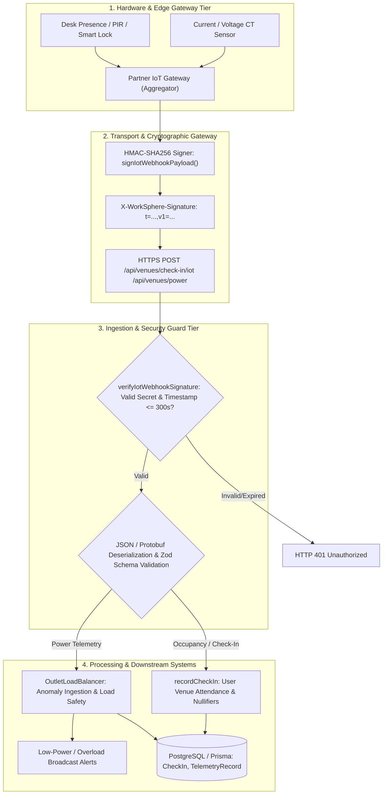
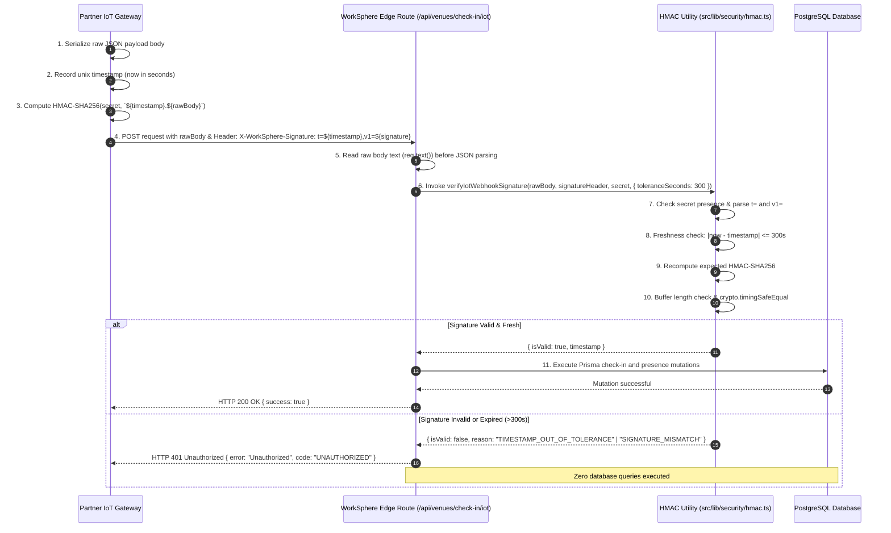

# Smart Desk Sensor Telemetry Payload Schemas and Protobuf Definitions

This technical specification documents WorkSphere's smart desk IoT telemetry ingestion architecture, JSON telemetry payload schemas, Protocol Buffers binary message contracts, HMAC-SHA256 webhook authentication, timestamp freshness boundaries, electrical power monitoring, and anomaly detection rules.

---

## 1. Overview and IoT Architecture

WorkSphere ingests high-frequency Internet of Things (IoT) sensor telemetry from smart desk hardware deployed across partner co-working locations, enterprise hubs, and flexible workstations. Sensors measure desk presence, physical check-ins, environmental comfort, and circuit electrical power metrics (voltage, current, wattage, power anomalies).

### 1.1 Ingestion and Authentication Pipeline

1. **Edge Telemetry Capture:** Smart desk microcontrollers (e.g., ESP32, Nordic nRF, or partner IoT gateways) poll pressure sensors, PIR occupancy detectors, smart locks, and current-sensing CT transformers.
2. **Gateway Dispatch:** The partner gateway batches readings and constructs JSON or Protobuf payload envelopes.
3. **Cryptographic Signing:** The gateway signs the exact request body using HMAC-SHA256 with a shared secret (`WORKSPHERE_IOT_WEBHOOK_SECRET`) and attaches signature headers (`X-WorkSphere-Signature: t=${timestamp},v1=${signature}`).
4. **Ingestion & Signature Verification:** WorkSphere's edge API routes (e.g., `/api/venues/check-in/iot`, `/api/venues/power`) verify the HMAC signature and timestamp freshness ($\pm 300\text{s}$) in constant time before performing database queries or payload deserialization.
5. **Processing & Anomaly Detection:** Verified power events are processed by `OutletLoadBalancer` (`src/core/sensors/OutletLoadBalancer.ts`) to detect electrical power spikes, circuit overloads, and offline drops. Verified presence events update the `CheckIn` database ledger (`prisma.checkIn`).

### 1.2 End-to-End IoT Pipeline Diagram



---

## 2. JSON Telemetry Payload Schemas

WorkSphere consumes telemetry payloads across two primary operational domains: smart lock / desk occupancy check-in and circuit electrical power monitoring.

### 2.1 Smart Lock & Desk Occupancy Check-In Schema

Implemented in `src/app/api/venues/check-in/iot/route.ts`:

#### Field Reference Table

| Field Name | Type | Required | Unit / Format | Validation Constraints | Description |
|---|:---:|:---:|:---:|---|---|
| `venueId` | `string` | **Yes** | UUID or Slug | Non-empty string; matches `Venue.id` or `Venue.placeId` | Identifies the physical co-working venue hosting the desk. |
| `userId` | `string` | **Yes** | String (CUID/UUID) | Non-empty string; references enrolled user | Identifies the checking-in user or active reservation owner. |
| `lockId` | `string` | No | String | Optional alphanumeric identifier | Hardware ID of the smart lock or desk latch controller. |
| `timestamp` | `number` | No | Unix seconds | Integer $> 0$ | Device-recorded timestamp of the physical latch / sensor event. |

#### Valid Occupancy / Check-In Example
```json
{
  "venueId": "cm3a1b2c30000abcde1234567",
  "userId": "user_2Ne9A8B7C6D5E4F3",
  "lockId": "desk-lock-north-04",
  "timestamp": 1732300000
}
```

---

### 2.2 Electrical Power & Circuit Load Telemetry Schema

Implemented across `src/app/api/venues/power/route.ts` and `src/core/sensors/OutletLoadBalancer.ts`:

#### Field Reference Table

| Field Name | Type | Required | Unit / Format | Validation Constraints | Description |
|---|:---:|:---:|:---:|---|---|
| `outletId` | `string` | **Yes** | String (e.g. `out-1`) | Non-empty string | Unique hardware outlet socket identifier. |
| `deskId` | `string` | No | String (e.g. `desk-A1`)| Optional string | Specific desk associated with this power outlet. |
| `circuitId` | `string` | No | String (e.g. `circ-1`)| Optional string | Circuit breaker branch powering the outlet. |
| `timestamp` | `number` | **Yes** | Epoch milliseconds | Positive integer | Timestamp of sensor power reading. |
| `status` | `string` | **Yes** | Enum | `"NORMAL"` \| `"SPIKE"` \| `"DROP"` | Anomaly classification emitted by edge gateway. |
| `movingAverage` | `number` | **Yes** | Watts ($W$) | Floating-point $\ge 0.0$ | Exponential moving average smoothed power consumption. |
| `rawDraw` | `number` | **Yes** | Watts ($W$) | Floating-point $\ge 0.0$ | Instantaneous active power draw recorded by CT coil. |

#### Valid Power Telemetry Batch Example
```json
{
  "telemetryBatch": [
    {
      "outletId": "out-desk-14B",
      "timestamp": 1732300000150,
      "status": "NORMAL",
      "movingAverage": 65.4,
      "rawDraw": 68.2
    },
    {
      "outletId": "out-desk-14C",
      "timestamp": 1732300000155,
      "status": "SPIKE",
      "movingAverage": 1740.0,
      "rawDraw": 1820.5
    }
  ],
  "queryDeskId": "desk-14C"
}
```

---

### 2.3 Malformed Payload Examples and Rejection Matrix

| Error Scenario | Malformed Payload Sample | WorkSphere Response | Rejection Reason |
|---|---|:---:|---|
| **Missing `venueId`** | `{"userId": "user-1", "lockId": "l-1"}` | `400 Bad Request` | `Missing required fields: venueId and userId are mandatory` |
| **Invalid Type** | `{"venueId": 12345, "userId": "user-1"}` | `400 Bad Request` | `VALIDATION_ERROR` (venueId must be string) |
| **Non-Existent Venue** | `{"venueId": "unknown-uuid", "userId": "user-1"}` | `404 Not Found` | `VENUE_NOT_FOUND` |
| **Corrupt JSON Syntax**| `{"venueId": "v-1", "userId": "u-1"` | `400 Bad Request` | `Invalid JSON payload` |

---

## 3. Protocol Buffers Definitions

WorkSphere supports high-throughput binary telemetry via Protocol Buffers (`proto3`). The canonical message definitions reside in [`proto/telemetry_events.proto`](../../proto/telemetry_events.proto) and are encoded/decoded dynamically by `src/party/binaryMessageBroker.ts` using `protobufjs`.

### 3.1 Implemented Protobuf Message Schema (`proto/telemetry_events.proto`)

```protobuf
syntax = "proto3";

package worksphere.telemetry;

enum EventType {
  UNKNOWN = 0;
  TELEMETRY = 1;
  PRESENCE = 2;
  CHAT = 3;
}

message TelemetryEvent {
  string venue_id = 1;
  string device_id = 2;
  string reading_type = 3;
  double value = 4;
  int64 timestamp = 5;
}

message PresenceEvent {
  string user_id = 1;
  string venue_id = 2;
  string status = 3;
  int64 last_active = 4;
}

message ChatEvent {
  string message_id = 1;
  string conversation_id = 2;
  string sender_id = 3;
  string content = 4;
  int64 timestamp = 5;
}

message WorkSphereEnvelope {
  EventType type = 1;
  int64 sequence_id = 2;
  oneof payload {
    TelemetryEvent telemetry = 3;
    PresenceEvent presence = 4;
    ChatEvent chat = 5;
  }
}
```

### 3.2 Proposed Smart Desk IoT Telemetry Extension (Reference Schema)

For dedicated smart desk electrical monitoring (voltage, current, power factor, and energy accumulation), the following schema is proposed as the canonical extension to `telemetry_events.proto`:

```protobuf
syntax = "proto3";

package worksphere.iot;

// Proposed canonical contract for smart desk IoT hardware integration
message DeskPowerTelemetry {
  string sensor_id = 1;          // Physical sensor / CT coil MAC or hardware UUID
  string desk_id = 2;            // Associated desk identifier (e.g., "desk-B1")
  string workspace_id = 3;       // Venue or workspace partition UUID
  int64 timestamp_ms = 4;        // Epoch timestamp in milliseconds
  double voltage_rms = 5;        // Root Mean Square voltage (V, e.g., 120.0 or 230.0)
  double current_amps = 6;       // Active AC current draw (A)
  double power_watts = 7;        // Real active power (W)
  double energy_wh = 8;          // Cumulative kilowatt-hour / watt-hour counter
  double power_factor = 9;       // Real/apparent power ratio (0.00 to 1.00)
  double frequency_hz = 10;      // Grid line frequency (e.g., 50.0 or 60.0 Hz)
}

message DeskOccupancyTelemetry {
  string sensor_id = 1;          // PIR / ToF / pressure sensor hardware ID
  string desk_id = 2;            // Target desk identifier
  string workspace_id = 3;       // Venue UUID
  int64 timestamp_ms = 4;        // Epoch timestamp in milliseconds
  bool is_occupied = 5;          // True = user present; False = vacant
  double confidence = 6;         // Sensor certainty ratio (0.0 to 1.0)
  int32 battery_pct = 7;         // Remaining battery level (0 to 100)
}
```

### 3.3 Protobuf Field Rules and Compatibility
- **Field Number Immutability:** Never reassign or change existing tag numbers (e.g., `venue_id = 1`). In protobuf wire encoding, field names are discarded and only tag numbers identify values.
- **Backward Compatibility:** All fields in `proto3` are optional by default. New metrics must receive incremented tag numbers (e.g., tag `11`, `12`).
- **Deprecation Policy:** Never delete fields from `.proto` files; mark them with `[deprecated = true]` or use `reserved` numbers and names to prevent future reuse.

---

## 4. HMAC-SHA256 Webhook Authentication

WorkSphere enforces strict cryptographic authenticity, integrity, and anti-tampering verification on all IoT webhook endpoints using **HMAC-SHA256** (`src/lib/security/hmac.ts`).

### 4.1 Specification & Header Format

- **HTTP Header:** `X-WorkSphere-Signature` (case-insensitive: `x-worksphere-signature`)
- **Header Value Layout:** `t=${timestamp},v1=${signature}`
- **Signing Input String:** `${timestamp}.${rawBody}`
- **Signature Algorithm:** `HMAC-SHA256(cleanSecret, "${timestamp}.${rawBody}")`
- **Digest Encoding:** Hexadecimal lowercase (`hex`)
- **Secret Normalization:** If the secret starts with `whsec_`, the prefix is sliced off before key derivation (`secret.slice(6)`).

### 4.2 Sequence of Signature Verification



---

## 5. Cryptographic Verification Code Examples

### 5.1 Partner-Side Signing Example (Node.js)

Partner gateways sending telemetry to WorkSphere should use the following pattern:

```javascript
import crypto from "crypto";

export function generatePartnerWebhookHeaders(rawBody, secret) {
  const timestamp = Math.floor(Date.now() / 1000); // Unix timestamp in seconds
  // Strip 'whsec_' prefix if present
  const cleanSecret = secret.startsWith("whsec_") ? secret.slice(6) : secret;

  // Compute HMAC over `${timestamp}.${rawBody}`
  const hmac = crypto.createHmac("sha256", cleanSecret);
  hmac.update(`${timestamp}.${rawBody}`);
  const signature = hmac.digest("hex");

  return {
    "Content-Type": "application/json",
    "X-WorkSphere-Signature": `t=${timestamp},v1=${signature}`,
  };
}

// Example usage:
const payload = JSON.stringify({
  venueId: "venue-sf-01",
  userId: "user_98765",
  lockId: "desk-lock-12",
  timestamp: Math.floor(Date.now() / 1000),
});

const headers = generatePartnerWebhookHeaders(payload, process.env.WORKSPHERE_IOT_WEBHOOK_SECRET);
```

### 5.2 WorkSphere-Side Ingestion Handler (Next.js Route)

Direct implementation from `src/app/api/venues/check-in/iot/route.ts`:

```typescript
import { NextRequest, NextResponse } from "next/server";
import { verifyIotWebhookSignature } from "@/lib/security/hmac";
import { apiError } from "@/lib/apiResponse";

export async function POST(req: NextRequest) {
  // CRITICAL: Preserve raw bytes before any JSON.parse calls
  const rawBody = await req.text();
  const signatureHeader =
    req.headers.get("x-worksphere-signature") ||
    req.headers.get("X-WorkSphere-Signature");
  const secret = process.env.WORKSPHERE_IOT_WEBHOOK_SECRET;

  const verification = verifyIotWebhookSignature(
    rawBody,
    signatureHeader,
    secret,
    { toleranceSeconds: 300 } // Enforce 5-minute freshness window
  );

  if (!verification.isValid) {
    return apiError("Unauthorized", 401, verification.reason || "UNAUTHORIZED");
  }

  // Safe to parse JSON only after cryptographic authentication succeeds
  const data = JSON.parse(rawBody);
  // Process verified data...
  return NextResponse.json({ success: true });
}
```

---

## 6. Timestamp Validation and Replay Protection

### 6.1 Freshness Tolerance Window

WorkSphere enforces an explicit 300-second (5 minute) tolerance window:

$$|t_{\text{server}} - t_{\text{webhook}}| \le 300\text{ seconds}$$

- **Past Timestamps ($>300\text{s}$ old):** Rejected with reason `TIMESTAMP_OUT_OF_TOLERANCE`. Prevents attackers from recording a valid signature and replaying it hours or days later.
- **Future Timestamps ($>300\text{s}$ into future):** Rejected to prevent clock-skewed credentials from expanding replay horizons.
- **Exact Boundary Values ($300\text{s}$):** Accepted cleanly.

### 6.2 Comparison of Security Layers

| Security Layer | Implementation in WorkSphere | Failure Behavior | Security Protection |
|---|---|---|---|
| **Constant-Time Comparison** | `crypto.timingSafeEqual` with buffer length check in `hmac.ts` | Immediate reject (`false`) if lengths differ | Prevents timing-based side-channel attacks on hex digests. |
| **Timestamp Freshness** | `Math.abs(nowSec - timestamp) > 300` in `hmac.ts` | HTTP 401 `TIMESTAMP_OUT_OF_TOLERANCE` | Limits replaying a captured payload to a 5-minute window. |
| **Idempotency Deduplication** | `prisma.checkIn.upsert` and unique event keys | Idempotent HTTP 200 response | Prevents duplicate billing or double check-in counts. |
| **Cryptographic Nullifiers** | `src/lib/crypto/zkNullifierVerifier.ts` (`VenueCheckInNullifier`) | Rejects duplicate nullifiers | Guarantees single-use privacy credentials for ZKP check-ins. |

---

## 7. Electrical Power Telemetry & Anomaly Detection

WorkSphere monitors co-working circuit health and desk load balance using the `OutletLoadBalancer` engine (`src/core/sensors/OutletLoadBalancer.ts`).

### 7.1 Implemented Anomaly Detection Rules

The `OutletLoadBalancer` processes `AnomalyReport` records and updates outlet and circuit health status:

| Anomaly State | Trigger Condition | Outlet State Assigned | Circuit Impact / Decision | Status |
|---|---|:---:|---|:---:|
| **`SPIKE`** | $W_{\text{load}} > 0.95 \times W_{\text{maxCapacity}}$ ($>95\%$ outlet capacity) | `CRITICAL` | Desk marked unsafe; users dynamically re-routed to alternative desks. | **Implemented** |
| **`SPIKE`** | $W_{\text{load}} \le 0.95 \times W_{\text{maxCapacity}}$ | `WARNING` | Monitored; circuit load checked against 1,500W safe threshold. | **Implemented** |
| **`DROP`** | Current/Wattage drops abruptly to 0 | `OFFLINE` | Desk marked unsafe (`isSafe = false`); reported as offline hardware. | **Implemented** |
| **`NORMAL`** | Nominal operating draw | `HEALTHY` | Desk power verified safe. | **Implemented** |
| **Circuit Overload** | $\sum W_{\text{circuit}} > 1,500\text{ W}$ on 15A/1800W circuit | Overloaded | Desk evaluated as unsafe; alternative desk suggested. | **Implemented** |

### 7.2 Recommended Electrical Metric Thresholds (Reference Guidelines)

For deployments incorporating voltage, frequency, and current CT sensors, the following industrial thresholds are recommended:

| Metric | Target Normal | Warning Threshold | Critical Alarm Threshold | Action |
|---|:---:|:---:|:---:|---|
| **RMS Voltage (120V Grid)** | $120\text{ V} \pm 5\%$ | $<110\text{ V}$ or $>128\text{ V}$ | $<102\text{ V}$ (Brownout) or $>135\text{ V}$ (Surge) | Cut power / Alert venue facilities |
| **RMS Voltage (230V Grid)** | $230\text{ V} \pm 5\%$ | $<210\text{ V}$ or $>245\text{ V}$ | $<195\text{ V}$ or $>255\text{ V}$ | Alert venue engineering |
| **Grid Frequency** | $50.0\text{ Hz}$ or $60.0\text{ Hz}$ | $\pm 0.5\text{ Hz}$ | $\pm 1.5\text{ Hz}$ | Flag utility instability |
| **Power Factor** | $0.90 - 1.00$ | $0.75 - 0.89$ | $<0.75$ | Check for noisy inductive loads (pumps/motors) |

---

## 8. Validation and Error Handling Reference

| HTTP Status | Error Code | Trigger Condition | Client Action |
|---|---|---|---|
| **`400 Bad Request`** | `VALIDATION_ERROR` | Missing `venueId`, `userId`, or malformed JSON payload. | Correct payload fields according to schema; do not retry unaltered. |
| **`401 Unauthorized`** | `MISSING_SECRET` | Server-side `WORKSPHERE_IOT_WEBHOOK_SECRET` environment variable unconfigured. | Check backend `.env` configuration. |
| **`401 Unauthorized`** | `MISSING_SIGNATURE_HEADER` | Request omitted `X-WorkSphere-Signature` header. | Include signed header `t=...,v1=...`. |
| **`401 Unauthorized`** | `INVALID_SIGNATURE_FORMAT` | Header missing `t=` or `v1=` components. | Re-format header string according to specification. |
| **`401 Unauthorized`** | `TIMESTAMP_OUT_OF_TOLERANCE` | Gateway clock drift exceeds 300 seconds. | Synchronize gateway clock using NTP (`pool.ntp.org`). |
| **`401 Unauthorized`** | `SIGNATURE_MISMATCH` | Computed HMAC does not match provided `v1` digest. | Verify shared secret and raw payload serialization. |
| **`404 Not Found`** | `VENUE_NOT_FOUND` | `venueId` does not match any registered venue. | Register venue before emitting telemetry. |
| **`500 Internal Error`** | `INTERNAL_ERROR` | Database or unhandled runtime failure. | Exponential backoff and retry. |

---

## 9. Security Best Practices for Partners

1. **Keep Secrets Out of Client Code:** Webhook secrets must never be embedded in mobile apps or public web frontends. Secrets belong exclusively in secure hardware security modules (HSM) or backend partner gateways.
2. **Never Modify Raw Body Post-Signing:** Gateways must generate the HMAC over the exact binary/UTF-8 bytes transmitted over the wire. Re-serializing or reformatting JSON between signing and sending breaks verification.
3. **Always Use HTTPS:** Webhooks must operate over TLS 1.3 to prevent man-in-the-middle tampering.
4. **Synchronize Clocks via NTP:** Keep partner edge devices within 1 second of UTC via NTP to prevent `TIMESTAMP_OUT_OF_TOLERANCE` errors.

---

## 10. Source References

- [`src/lib/security/hmac.ts`](../../src/lib/security/hmac.ts) — HMAC-SHA256 signing, timing-safe equality, and verification.
- [`src/app/api/venues/check-in/iot/route.ts`](../../src/app/api/venues/check-in/iot/route.ts) — Authenticated IoT smart lock check-in webhook endpoint.
- [`src/app/api/venues/power/route.ts`](../../src/app/api/venues/power/route.ts) — Bulk power telemetry ingestion and desk evaluation endpoint.
- [`src/core/sensors/OutletLoadBalancer.ts`](../../src/core/sensors/OutletLoadBalancer.ts) — Outlet power anomaly ingestion, load balancing, and threshold logic.
- [`proto/telemetry_events.proto`](../../proto/telemetry_events.proto) — Implemented Protocol Buffers schema for telemetry and envelopes.
- [`src/party/binaryMessageBroker.ts`](../../src/party/binaryMessageBroker.ts) — Protobuf encoding and decoding broker.
- [`src/__tests__/api/iotSignature.test.ts`](../../src/__tests__/api/iotSignature.test.ts) — HMAC verification unit and API integration tests.
