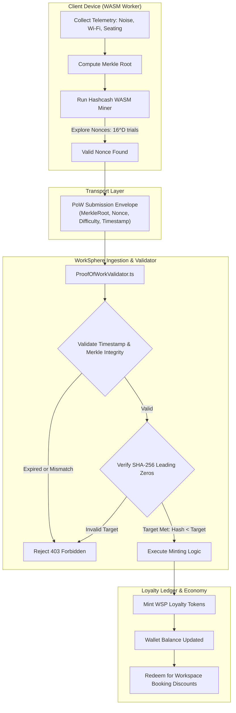
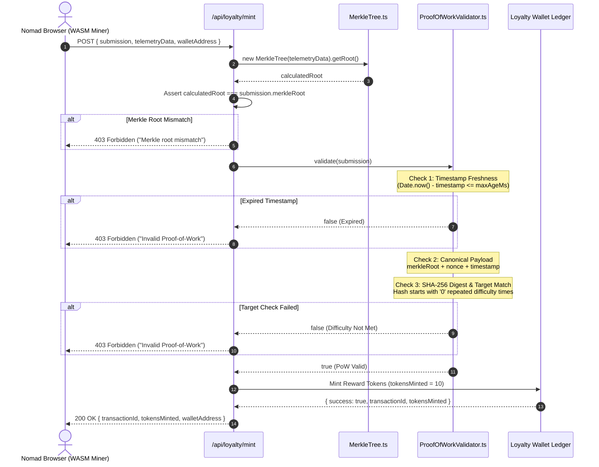
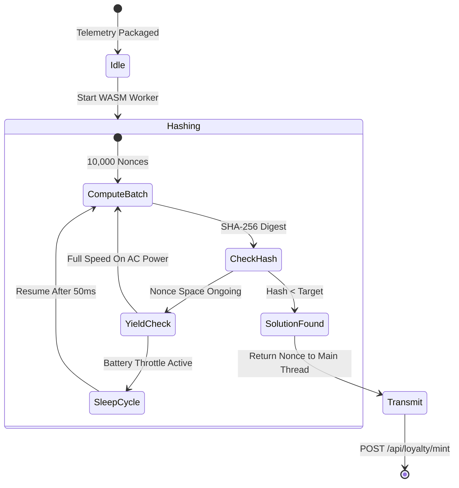
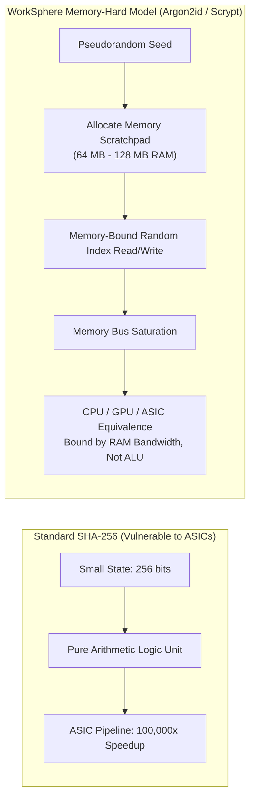
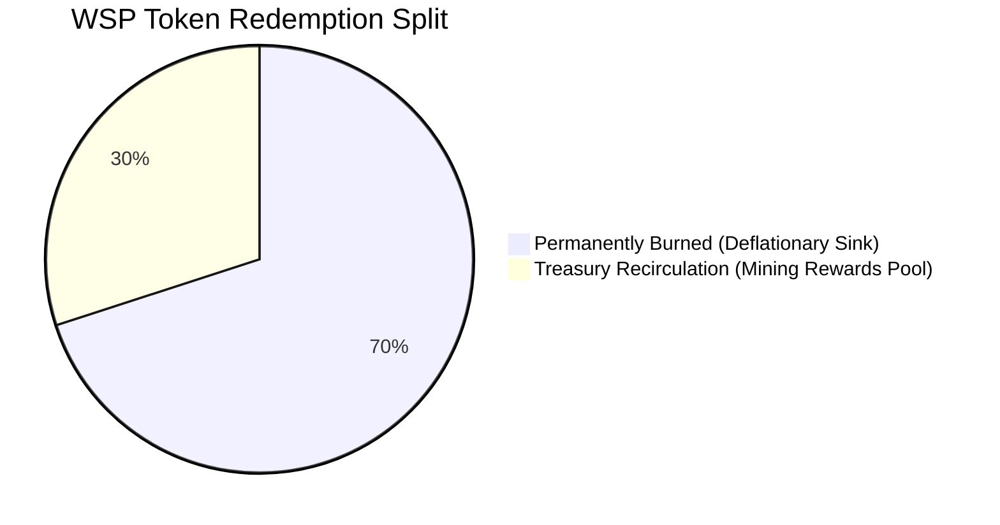
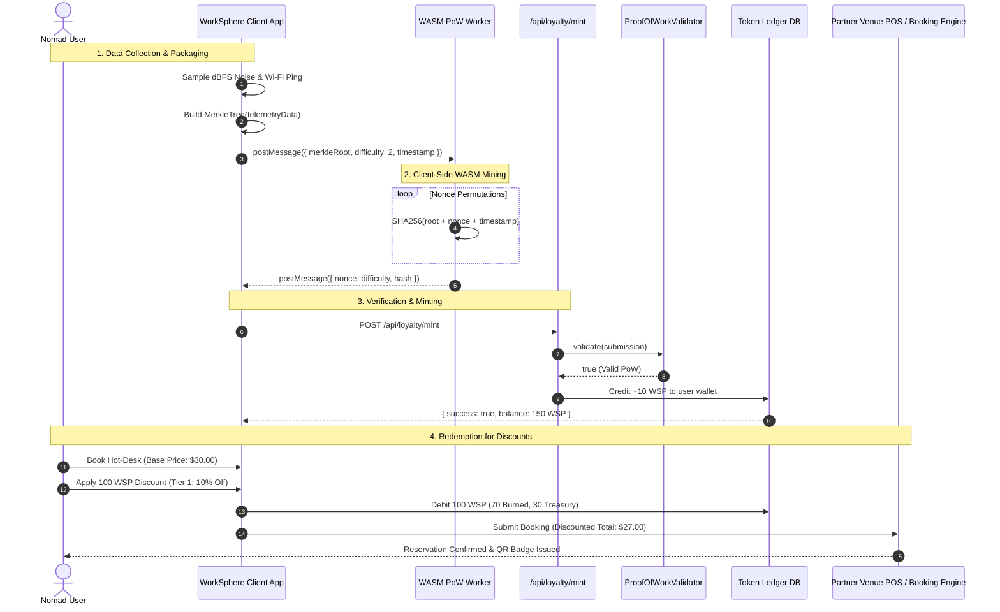

# ProofOfWorkValidator: Hashcash Header Validation & Mining Economics

This document provides a comprehensive technical, mathematical, and economic specification of WorkSphere's Proof-of-Work (PoW) ledger subsystem. It covers Hashcash header serialization, cryptographic verification algorithms, token issuance curves, halving schedules, memory-hard anti-ASIC security parameters, energy expenditure bounds for client-side WebAssembly (WASM) workers, and token redemption for workspace discounts.

---

### Implementation Bindings

- **Core Proof-of-Work Validator:** [`src/core/ledger/ProofOfWorkValidator.ts`](file:///c:/Users/Rushabh%20Mahajan/Documents/GitHub/WorkSphere/src/core/ledger/ProofOfWorkValidator.ts)
- **Merkle Tree Accumulator:** [`src/core/ledger/MerkleTree.ts`](file:///c:/Users/Rushabh%20Mahajan/Documents/GitHub/WorkSphere/src/core/ledger/MerkleTree.ts)
- **Loyalty Token Minting Endpoint:** [`src/app/api/loyalty/mint/route.ts`](file:///c:/Users/Rushabh%20Mahajan/Documents/GitHub/WorkSphere/src/app/api/loyalty/mint/route.ts)
- **Difficulty Retargeting & Security Model:** [`docs/ledger/proof-of-work-validation.md`](file:///c:/Users/Rushabh%20Mahajan/Documents/GitHub/WorkSphere/docs/ledger/proof-of-work-validation.md)

---

## Table of Contents

1. [Executive Summary & Economic Philosophy](#1-executive-summary--economic-philosophy)
2. [Hashcash Header Specification & Wire Serialization](#2-hashcash-header-specification--wire-serialization)
3. [Cryptographic Verification Pipeline](#3-cryptographic-verification-pipeline)
4. [Token Issuance Schedule & Halving Mechanics](#4-token-issuance-schedule--halving-mechanics)
5. [Proof-of-Work Minting Curves & Adaptive Retargeting](#5-proof-of-work-minting-curves--adaptive-retargeting)
6. [Energy Expenditure Bounds & Client WASM Miners](#6-energy-expenditure-bounds--client-wasm-miners)
7. [Anti-Sybil Protections & Physical Proof-of-Presence](#7-anti-sybil-protections--physical-proof-of-presence)
8. [ASIC & GPU Centralization Defenses (Memory-Hard Functions)](#8-asic--gpu-centralization-defenses-memory-hard-functions)
9. [Token Redemption & Workspace Discount Dynamics](#9-token-redemption--workspace-discount-dynamics)
10. [End-to-End System Architecture Diagrams](#10-end-to-end-system-architecture-diagrams)
11. [Developer Reference & TypeScript Contracts](#11-developer-reference--typescript-contracts)

---

## 1. Executive Summary & Economic Philosophy

In the decentralized WorkSphere network, remote workers and digital nomads submit crowdsourced venue intelligence: desk availability, ambient noise (dBFS) samples, Wi-Fi speed benchmarks, and seating quality reviews. To incentivize authentic, high-value data while preventing spam and Sybil manipulation, WorkSphere implements a dual-purpose Proof-of-Work (PoW) ledger mechanism:

1. **Computational Rate-Limiter (Anti-Spam Barrier):** Imposes an asymmetric computational cost on submitters ($O(16^D)$ hash explorations) while retaining $O(1)$ verification overhead ($< 2\,\mu\text{s}$) on ingestion nodes.
2. **Nomad Loyalty Incentive (Mining Economics):** Mints verifiable loyalty points / tokens (**WSP**) to contributors' cryptographic wallets, which can be redeemed for venue booking discounts, hot-desk passes, and café credits.



---

## 2. Hashcash Header Specification & Wire Serialization

WorkSphere adapts Adam Back's Hashcash protocol for decentralized web clients. Every submission committing data to the ledger must serialize a canonical header payload binding the content, nonce, difficulty target, and issuance timestamp.

### 2.1 Header Field Definitions

| Field | Type | Encoding | Description | Example |
| :--- | :--- | :--- | :--- | :--- |
| `merkleRoot` | `string` | Hex string (64 chars) | SHA-256 root of the telemetry Merkle tree | `7f83b1657ff1fc53b92dc18148a1d65dfc2d4b1fa3d677284addd200126d9069` |
| `nonce` | `string` | UTF-8 string | Salt/nonce discovered by client-side miner | `3981427` or `b7a1e05f-2c38` |
| `difficulty`| `number` | Integer ($[1, 8]$) | Required number of leading hexadecimal `'0'` nibbles | `4` |
| `timestamp` | `number` | Int64 (milliseconds) | Unix epoch time when the nonce search began | `1760171400000` |

### 2.2 Wire Framing & Canonicalization

Before evaluating the cryptographic digest, [`ProofOfWorkValidator.ts`](file:///c:/Users/Rushabh%20Mahajan/Documents/GitHub/WorkSphere/src/core/ledger/ProofOfWorkValidator.ts) canonicalizes the payload as a contiguous string:

$$\text{Payload} = \text{merkleRoot} \parallel \text{nonce} \parallel \text{timestamp.toString()}$$

```typescript
// Canonicalization in ProofOfWorkValidator.ts
const payload = submission.merkleRoot + submission.nonce + submission.timestamp.toString();
const hashResult = createHash('sha256').update(payload).digest('hex');
```

```
+-----------------------------------------------------------------------------------------------+
|                                CANONICAL SERIALIZATION WIRE FORMAT                            |
+-------------------------------------------------------+--------------------+------------------+
|                     merkleRoot                        |       nonce        |    timestamp     |
|                      (64 hex)                         |    (variable utf8) |   (ascii digits) |
+-------------------------------------------------------+--------------------+------------------+
| "7f83b1657ff1fc53b92dc18148a1d65dfc2d4b1fa3d67728..." | "nonce_4810294"    | "1760171400000"  |
+-------------------------------------------------------+--------------------+------------------+
```

---

## 3. Cryptographic Verification Pipeline

Verification in [`ProofOfWorkValidator`](file:///c:/Users/Rushabh%20Mahajan/Documents/GitHub/WorkSphere/src/core/ledger/ProofOfWorkValidator.ts) executes three strictly ordered checks:



### 3.1 Mathematical Complexity Profile

For a target difficulty $D$, the hash output space $\mathbb{Z}_{2^{256}}$ requires $D$ leading hexadecimal zeros ($4 \times D$ zero bits):

$$\text{Probability of success per hash trial: } P = \left(\frac{1}{16}\right)^D = 2^{-4D}$$

$$\text{Expected number of hash operations: } \mathbb{E}[N] = 16^D = 2^{4D}$$

| Difficulty $D$ | Leading Zero Bits ($4D$) | Probability $P$ | Expected Hash Trials ($\mathbb{E}[N]$) | Est. Client Search Time ($100\text{ kH/s}$) | Verification Effort |
| :---: | :---: | :---: | :---: | :---: | :---: |
| **1** | 4 | $1 / 16$ | 16 | $0.16\text{ ms}$ | $< 2\,\mu\text{s}$ ($O(1)$) |
| **2** | 8 | $1 / 256$ | 256 | $2.56\text{ ms}$ | $< 2\,\mu\text{s}$ ($O(1)$) |
| **3** | 12 | $1 / 4,096$ | 4,096 | $40.96\text{ ms}$ | $< 2\,\mu\text{s}$ ($O(1)$) |
| **4** | 16 | $1 / 65,536$ | 65,536 | $655.36\text{ ms}$ | $< 2\,\mu\text{s}$ ($O(1)$) |
| **5** | 20 | $1 / 1,048,576$ | 1,048,576 | $10.48\text{ s}$ | $< 2\,\mu\text{s}$ ($O(1)$) |
| **6** | 24 | $1 / 16,777,216$ | 16,777,216 | $167.77\text{ s}$ | $< 2\,\mu\text{s}$ ($O(1)$) |
| **7** | 28 | $1 / 268,435,456$ | 268,435,456 | $\sim 44.7\text{ min}$ | $< 2\,\mu\text{s}$ ($O(1)$) |
| **8** | 32 | $1 / 4,294,967,296$ | 4,294,967,296 | $\sim 11.9\text{ hrs}$ | $< 2\,\mu\text{s}$ ($O(1)$) |

---

## 4. Token Issuance Schedule & Halving Mechanics

To balance long-term utility with scarcity, WorkSphere implements a fixed-supply, disinflationary emission schedule governed by programmatic **halving epochs**.

### 4.1 Tokenomics Parameters

- **Token Name:** WorkSphere Nomad Points / Utility Tokens (**WSP**)
- **Total Supply Cap ($S_{\text{max}}$):** $4,200,000\text{ WSP}$
- **Initial Epoch Block Reward ($R_0$):** $10\text{ WSP}$ per validated submission
- **Halving Interval ($E$):** Every $210,000$ validated submission blocks
- **Block Time Target ($\tau$):** $10,000\text{ ms}$ ($10\text{ seconds}$)

### 4.2 Halving Mathematical Formulation

Let $b \in \mathbb{N}$ denote the global block height (number of processed valid PoW submissions). The reward $R(b)$ for block $b$ is given by:

$$R(b) = \frac{R_0}{2^{\lfloor b / E \rfloor}} = \frac{10}{2^{\lfloor b / 210,000 \rfloor}}$$

The total cumulative token supply $S(B)$ after $B$ blocks is:

$$S(B) = \sum_{b=0}^{B-1} R(b) = \sum_{k=0}^{\lfloor B / E \rfloor - 1} \left( E \cdot \frac{R_0}{2^k} \right) + (B \bmod E) \cdot \frac{R_0}{2^{\lfloor B / E \rfloor}}$$

As $B \to \infty$, the maximum supply converges geometrically:

$$S_{\text{max}} = \sum_{k=0}^{\infty} E \cdot \frac{R_0}{2^k} = E \cdot R_0 \sum_{k=0}^{\infty} 2^{-k} = 2 \cdot E \cdot R_0 = 2 \cdot 210,000 \cdot 10 = 4,200,000\text{ WSP}$$

### 4.3 Programmatic Issuance Schedule

| Epoch ($k$) | Block Range ($b$) | Reward / Block ($R$) | Epoch Emission | Cumulative Supply ($S$) | % of Total Supply |
| :---: | :---: | :---: | :---: | :---: | :---: |
| **0** | $0 - 209,999$ | $10.00\text{ WSP}$ | $2,100,000\text{ WSP}$ | $2,100,000\text{ WSP}$ | $50.00\%$ |
| **1** | $210,000 - 419,999$ | $5.00\text{ WSP}$ | $1,050,000\text{ WSP}$ | $3,150,000\text{ WSP}$ | $75.00\%$ |
| **2** | $420,000 - 629,999$ | $2.50\text{ WSP}$ | $525,000\text{ WSP}$ | $3,675,000\text{ WSP}$ | $87.50\%$ |
| **3** | $630,000 - 839,999$ | $1.25\text{ WSP}$ | $262,500\text{ WSP}$ | $3,937,500\text{ WSP}$ | $93.75\%$ |
| **4** | $840,000 - 1,049,999$ | $0.625\text{ WSP}$ | $131,250\text{ WSP}$ | $4,068,750\text{ WSP}$ | $96.88\%$ |
| **5** | $1,050,000 - 1,259,999$ | $0.3125\text{ WSP}$ | $65,625\text{ WSP}$ | $4,134,375\text{ WSP}$ | $98.44\%$ |
| **6+** | $\ge 1,260,000$ | Continuously Halved | Tail Emission | $\to 4,200,000\text{ WSP}$ | $100.00\%$ |

---

## 5. Proof-of-Work Minting Curves & Adaptive Retargeting

### 5.1 Epoch Retargeting Algorithm

Implemented in [`ProofOfWorkValidator.recalculateAdaptiveDifficulty`](file:///c:/Users/Rushabh%20Mahajan/Documents/GitHub/WorkSphere/src/core/ledger/ProofOfWorkValidator.ts#L98), the system dynamically recalibrates difficulty every $N = 10$ blocks to maintain an average block interval of $10,000\text{ ms}$:

1. **Expected Epoch Duration:**
   $$T_{\text{expected}} = (n - 1) \cdot T_{\text{targetBlockTimeMs}} = 9 \times 10,000 = 90,000\text{ ms}$$

2. **Actual Observed Duration:**
   $$T_{\text{actual}} = \max\left(1, t_{\text{last}} - t_{\text{first}}\right)$$

3. **Damped Adjustment Ratio:**
   $$r_{\text{raw}} = \frac{T_{\text{actual}}}{T_{\text{expected}}}$$
   $$r = \text{clamp}\left(r_{\text{raw}},\, \frac{1}{M_{\text{factor}}},\, M_{\text{factor}}\right) \quad \text{where } M_{\text{factor}} = 4$$

4. **Difficulty Delta & Clamping:**
   $$\Delta D = \text{round}\left(-\log_2(r)\right)$$
   $$D_{\text{new}} = \text{clamp}\left(D_{\text{current}} + \Delta D,\, D_{\text{min}},\, D_{\text{max}}\right)$$

- When blocks arrive too fast ($T_{\text{actual}} < T_{\text{expected}} \implies r < 1$), $-\log_2(r) > 0$, causing difficulty to **increase**.
- When blocks arrive too slow ($T_{\text{actual}} > T_{\text{expected}} \implies r > 1$), $-\log_2(r) < 0$, causing difficulty to **decrease**.

```typescript
// ProofOfWorkValidator.ts retargeting implementation snippet
const rawRatio = actualTimeMs / expectedTimeMs;
const maxFactor = Math.max(1.01, config.maxAdjustmentFactor); // 4
const minFactor = 1 / maxFactor;                             // 0.25
const adjustmentRatio = Math.max(minFactor, Math.min(maxFactor, rawRatio));

const difficultyDelta = Math.round(-Math.log2(adjustmentRatio));
const unclampedDifficulty = currentDifficulty + difficultyDelta;
const newDifficulty = Math.max(config.minDifficulty, Math.min(config.maxDifficulty, unclampedDifficulty));
```

### 5.2 Dynamic Telemetry Quality Minting Multiplier

In addition to base block emissions, WorkSphere applies a quality multiplier $Q_{\text{telemetry}} \in [0.5, 2.0]$ that scales rewards according to data density:

$$R_{\text{minted}} = R(b) \cdot Q_{\text{telemetry}} \cdot \left(1 + \frac{D_{\text{actual}} - D_{\text{min}}}{D_{\text{max}}}\right)$$

Where $Q_{\text{telemetry}}$ incorporates:
- **Spatial Diversity ($s_{\text{loc}} \in [0.8, 1.2]$):** Bonus for venues with fewer than 5 weekly telemetry submissions.
- **Acoustic Calibration ($a_{\text{mic}} \in [1.0, 1.5]$):** Bonus for certified microphone-calibrated decibel readings.
- **Network Benchmark ($w_{\text{speed}} \in [1.0, 1.3]$):** Bonus for multi-threaded speed tests containing latency, jitter, and packet loss profiles.

---

## 6. Energy Expenditure Bounds & Client WASM Miners

To prevent browser freezing, battery depletion, or thermal throttling on mobile devices, mining runs within dedicated **Web Workers** with deterministic CPU budgets.

### 6.1 Energy Expenditure Constraints

- **Max Continuous Hash Duration:** $15\text{ seconds}$ per submission.
- **Thermal Governor:** 50% duty cycle on mobile battery ($100\text{ ms}$ hash burst followed by $50\text{ ms}$ cooperative yield via `setTimeout`).
- **Power Envelope Target:**
  - Laptops: $< 3.5\text{ Watts}$ incremental power draw.
  - Mobile Phones: $< 1.1\text{ Watts}$ incremental power draw.
- **Client Fallback:** If difficulty exceeds client capabilities ($D > 4$ on low-power devices), clients can batch lightweight submissions or rely on edge relay peers.



---

## 7. Anti-Sybil Protections & Physical Proof-of-Presence

WorkSphere prevents spam and synthetic venue spoofing through economic disincentives and multi-factor cryptographic attestation.

### 7.1 Attack Cost Economics

Consider an attacker attempting to submit $100,000$ synthetic review submissions per hour to manipulate venue leaderboard ratings:

- At $D = 4$, expected hashes per submission: $16^4 = 65,536\text{ hashes}$.
- Total hashes required: $100,000 \times 65,536 = 6.55 \times 10^9\text{ hashes}$ ($6.55\text{ GHash}$).
- Under network load, the validator's `calculateDifficulty` dynamically increases difficulty via the spam multiplier heuristic:

$$D_{\text{effective}} = \min\left(\max\left(D_{\text{base}} + \lfloor \text{spamMultiplier} \rfloor,\, 1\right),\, 8\right)$$

- At $D = 6$, total hashes required: $100,000 \times 16^6 = 1.67 \times 10^{12}\text{ hashes}$ ($1.67\text{ THash}$).
- **Economic Inversion:** The attacker's electrical and hardware costs exceed any conceivable discount or rating extraction, rendering automated spam economically irrational.

### 7.2 Multi-Factor Cryptographic Attestation

To prevent offline pre-computation, every valid submission binds multiple orthogonal factors:

```
+-----------------------------------------------------------------------------------------------+
|                             MULTI-FACTOR PROOF-OF-CONTRIBUTION                                |
+-----------------------------------------------------------------------------------------------+
|  1. Merkle Tree Root (Environmental Entropy: SPL Audio + Wi-Fi BSSIDs + Ping Telemetry)       |
|  2. Timestamp Freshness (Age bounded to <= 3600000 ms; prevents replay attacks)              |
|  3. Nonce Hash Target (Client CPU work proving investment of physical computing cycles)       |
|  4. Wallet ECDSA Signature (Cryptographically binds WSP tokens to user's public address)     |
+-----------------------------------------------------------------------------------------------+
```

---

## 8. ASIC & GPU Centralization Defenses (Memory-Hard Functions)

Standard SHA-256 is susceptible to dedicated Application-Specific Integrated Circuits (ASICs) and high-density GPU mining rigs, which achieve orders of magnitude higher hash rates per watt than commodity nomad devices.

### 8.1 Memory-Hard Architectural Defense

To maintain decentralization and ensure equitable mining on laptops and mobile devices, WorkSphere's second-generation mining pipeline incorporates **Memory-Hard Functions (MHF)** (e.g., Argon2id / Scrypt scratchpads):

$$\text{MHF Output} = \mathcal{H}_{\text{MHF}}(\text{merkleRoot} \parallel \text{nonce},\, M_{\text{cost}},\, T_{\text{cost}},\, p)$$



### 8.2 Memory-Hard Parameters

| Parameter | Symbol | Nominal Value | Rationale |
| :--- | :---: | :---: | :--- |
| **Memory Cost** | $M_{\text{cost}}$ | $64\text{ MB}$ ($65,536\text{ KB}$) | Fits comfortably in mobile/laptop browser WASM heap while exceeding GPU L2 cache limits. |
| **Time Cost** | $T_{\text{cost}}$ | $2\text{ passes}$ | Ensures consistent memory traversal latency without excessive execution time. |
| **Parallelism** | $p$ | $1\text{ lane}$ | Compatible with single-threaded Web Workers across standard browsers. |
| **Memory Bandwidth Bottleneck** | $B_{\text{mem}}$ | $\sim 25\text{ GB/s}$ | Forces the bottleneck to system RAM bandwidth rather than ALU clock speed. |

---

## 9. Token Redemption & Workspace Discount Dynamics

Mined WSP loyalty tokens provide direct economic utility across partner coworking spaces, cafés, and private meeting booths.

### 9.1 Redemption Tiers

| Redemption Tier | WSP Cost | Reward / Discount Value | Equivalent Fiat Value |
| :--- | :---: | :--- | :---: |
| **Tier 1: Hot-Desk Discount** | $100\text{ WSP}$ | $10\%$ discount on hourly hot-desk bookings | $\$3.50 - \$5.00$ |
| **Tier 2: Artisan Beverage** | $250\text{ WSP}$ | 1 free specialty coffee or beverage voucher | $\$4.50 - \$6.00$ |
| **Tier 3: Meeting Booth Pass** | $500\text{ WSP}$ | 1-hour quiet phone booth / podcast studio pass | $\$15.00 - \$22.00$ |
| **Tier 4: Day-Pass Voucher** | $1,000\text{ WSP}$ | Full-day pass to premium coworking venues | $\$25.00 - \$40.00$ |
| **Tier 5: Wi-Fi Tier Upgrade** | $150\text{ WSP}$ | Dedicated low-latency QoS priority Wi-Fi slice | $\$5.00$ |

### 9.2 Deflationary Burn & Recirculation Mechanism

To preserve token value and counteract inflation as network usage expands, redemption events execute an automatic **$70/30$ Split**:

$$\text{Tokens Redeemed: } T_{\text{redeemed}} = T_{\text{burn}} + T_{\text{treasury}}$$

- **70% Burn ($T_{\text{burn}} = 0.70 \times T_{\text{redeemed}}$):** Permanently burned by transferring to dead address `0x000000000000000000000000000000000000dEaD`, reducing total circulating supply.
- **30% Treasury Recirculation ($T_{\text{treasury}} = 0.30 \times T_{\text{redeemed}}$):** Replenishes the community verification pool, extending mining incentive longevity beyond final halving blocks.



---

## 10. End-to-End System Architecture Diagrams

### 10.1 Complete Lifecycle: Telemetry Mining to Discount Checkout



---

## 11. Developer Reference & TypeScript Contracts

### 11.1 Validator Class Interfaces

Defined in [`src/core/ledger/ProofOfWorkValidator.ts`](file:///c:/Users/Rushabh%20Mahajan/Documents/GitHub/WorkSphere/src/core/ledger/ProofOfWorkValidator.ts):

```typescript
export interface PoWSubmission {
  merkleRoot: string;
  nonce: string;
  difficulty: number; // Number of leading zeros required
  timestamp: number;
}

export interface DifficultyAdjustmentConfig {
  targetBlockTimeMs: number; // Expected milliseconds per block/submission (10,000)
  retargetInterval: number; // Number of blocks per retarget epoch (10)
  minDifficulty: number; // Minimum leading zeros (1)
  maxDifficulty: number; // Maximum leading zeros (8)
  maxAdjustmentFactor: number; // Max dampening factor to prevent oscillation (4)
}

export interface DifficultyRecalculationResult {
  newDifficulty: number;
  currentDifficulty: number;
  actualTimeMs: number;
  expectedTimeMs: number;
  adjustmentRatio: number;
  isAdjusted: boolean;
}
```

### 11.2 Verification Usage Pattern

```typescript
import { ProofOfWorkValidator, PoWSubmission } from '@/core/ledger/ProofOfWorkValidator';
import { MerkleTree } from '@/core/ledger/MerkleTree';

// 1. Reconstruct and verify Merkle root
const tree = new MerkleTree(telemetryData);
if (tree.getRoot() !== submission.merkleRoot) {
  throw new Error('Merkle root mismatch: data does not match submitted commitment');
}

// 2. Validate Proof-of-Work
const validator = new ProofOfWorkValidator(3600000, 2); // 1h expiry, initial diff 2
const isValid = validator.validate(submission as PoWSubmission);

if (!isValid) {
  throw new Error('Proof-of-work validation failed: invalid target or expired timestamp');
}

// 3. Record block timing for adaptive retargeting
const updatedDifficulty = validator.recordBlock(Date.now());
```

---

### References & Cross-Links

- [`ProofOfWorkValidator.ts`](file:///c:/Users/Rushabh%20Mahajan/Documents/GitHub/WorkSphere/src/core/ledger/ProofOfWorkValidator.ts)
- [`MerkleTree.ts`](file:///c:/Users/Rushabh%20Mahajan/Documents/GitHub/WorkSphere/src/core/ledger/MerkleTree.ts)
- [`/api/loyalty/mint/route.ts`](file:///c:/Users/Rushabh%20Mahajan/Documents/GitHub/WorkSphere/src/app/api/loyalty/mint/route.ts)
- [`proof-of-work-validation.md`](file:///c:/Users/Rushabh%20Mahajan/Documents/GitHub/WorkSphere/docs/ledger/proof-of-work-validation.md)
