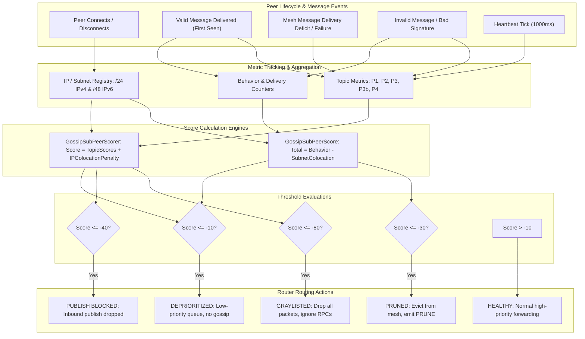

# GossipSub Sybil Attack Mitigation and IP Colocation Penalties

This guide documents WorkSphere's peer-to-peer GossipSub Sybil attack mitigation architecture, multi-factor peer scoring engine, IP subnet colocation penalties, score decay mechanics, threshold evaluations, and operational incident response workflows.

---

## 1. Overview and Threat Model

WorkSphere utilizes peer-to-peer WebRTC mesh routing (`src/core/p2p/GossipSubRouter.ts`) to enable real-time collaborative state synchronization, emergency broadcasts, and distributed document updates during network partitions. In permissionless or federated distributed networks, malicious actors can exploit open peer discovery to compromise routing integrity.

### 1.1 Threat Vectors

WorkSphere's GossipSub layer specifically defends against five primary adversarial threat vectors:

1. **Sybil Identity Inflation:** An attacker instantiates dozens or hundreds of virtual peer IDs from a single machine, hosting provider, or localized IP subnet (`/24` for IPv4 or `/48` for IPv6) to gain disproportionate representation within topic meshes (`D_low` to `D_high`).
2. **Eclipse Attacks:** By saturating a target peer's inbound and outbound GossipSub mesh degree ($D=6$, $D_{\text{high}}=12$) with colluding Sybils, the adversary isolates the victim from the legitimate network, dropping or delaying genuine state updates.
3. **Message Flooding and Amplification:** Malicious nodes generate or replay massive volumes of gossip RPC packets, overwhelming peer bandwidth, consuming WebRTC DataChannel buffers, and exhausting CPU cycles through redundant deserialization.
4. **Invalid Payload Injection:** Nodes inject malformed packets, corrupted CRDT state chunks, or messages with invalid cryptographic signatures (e.g., forged Ed25519 signatures), forcing relays to waste compute on signature verification.
5. **Free-Riding and Mesh Starvation:** Peers join the topic mesh via `GRAFT` control messages to consume gossip streams but refuse to relay or emit first-delivery messages to downstream peers, starving the epidemic dissemination tree.

### 1.2 Legitimate Colocation and False Positive Surface

In corporate offices, universities, coworking facilities, and cellular networks, multiple legitimate users frequently connect through shared Carrier-Grade NAT (CGNAT) gateways or corporate forward proxies, presenting identical external IP addresses or sharing a common `/24` IPv4 subnet. The scoring system incorporates grace quotas, quadratic scaling, bounded decay, and distinct behavior thresholds to avoid falsely graylisting legitimate collaborators.

---

## 2. Peer Scoring Architecture

WorkSphere deploys a dual-engine peer scoring architecture:
1. **`GossipSubPeerScore` (`src/core/p2p/GossipSubPeerScore.ts`):** Lightweight subnet-level scorer managing IPv4 `/24` and IPv6 `/48` colocation groupings, behavior bonuses, invalid message penalties, and priority routing queues (`HEALTHY`, `DEPRIORITIZED`, `PRUNED`).
2. **`GossipSubPeerScorer` (`src/core/p2p/GossipSubPeerScorer.ts`):** Full libp2p GossipSub v1.1 specification scoring engine tracking topic-specific metrics ($P_1, P_2, P_3, P_{3b}, P_4$), exact-IP colocation, periodic decay intervals, and strict routing gates (`shouldGossip`, `shouldPublish`, `isGraylisted`).

### 2.1 Lifecycle and Decision Pipeline



---

## 3. Mathematical Peer Scoring Formulas

The composite score of a peer balances positive engagement (longevity, timely deliveries) against malicious or defective behaviors (invalid signatures, mesh delivery deficits, colocation clustering).

### 3.1 Composite Score Equation

In the full specification engine (`GossipSubPeerScorer`), the overall score $S(p)$ for peer $p$ is defined as:

$$S(p) = \sum_{t \in \text{Topics}} S_t(p) + P_5(p)$$

Where the topic-specific score $S_t(p)$ is composed of:

$$S_t(p) = P_1(t, p) + P_2(t, p) + P_3(t, p) + P_{3b}(t, p) + P_4(t, p)$$

And $S(p)$ is clamped within safe numerical boundaries:

$$\text{MIN\_PEER\_SCORE} \le S(p) \le \text{MAX\_PEER\_SCORE}$$
$$-1000 \le S(p) \le 100$$

In the subnet engine (`GossipSubPeerScore`), the score is computed as:

$$\text{TotalScore}(p) = \text{behaviorScore}(p) - \text{colocationPenalty}(p)$$

### 3.2 Scoring Parameter Specifications

| Parameter | Symbol | Default Value | Scorer Engine | Scope | Description |
|-----------|--------|---------------|---------------|-------|-------------|
| Time in Mesh Weight | $W_1$ | `0.05` | `PeerScorer` | Per-Topic | Reward factor per time quantum active in topic mesh |
| Time in Mesh Quantum | $Q_1$ | `1000 ms` | `PeerScorer` | Per-Topic | Mesh duration unit required for each weight step |
| Time in Mesh Cap | $C_1$ | `10.0` | `PeerScorer` | Per-Topic | Maximum score contribution attainable from mesh tenure |
| First Message Delivery Weight | $W_2$ | `1.0` | `PeerScorer` | Per-Topic | Reward per unique valid message first delivered |
| First Message Delivery Cap | $C_2$ | `50.0` | `PeerScorer` | Per-Topic | Ceiling on positive delivery rewards |
| Mesh Delivery Deficit Weight | $W_3$ | `-0.5` | `PeerScorer` | Per-Topic | Penalty multiplier for failing to meet delivery threshold |
| Mesh Delivery Threshold | $T_3$ | `5` | `PeerScorer` | Per-Topic | Minimum expected message deliveries in active mesh |
| Mesh Delivery Failure Weight | $W_{3b}$ | `-1.0` | `PeerScorer` | Per-Topic | Penalty per broken promise or mesh relay failure |
| Invalid Message Penalty Weight | $W_4$ | `-10.0` | `PeerScorer` | Per-Topic | Quadratic penalty factor for malformed/forged packets |
| IP Colocation Grace Threshold | $T_{\text{ip}}$ | `2` | `PeerScorer` | Global (IP) | Number of co-located peers permitted before penalty |
| IP Colocation Penalty Weight | $W_{\text{ip}}$ | `-5.0` | `PeerScorer` | Global (IP) | Quadratic penalty multiplier applied to excess co-located peers |
| Subnet Grace Peers | $G_{\text{subnet}}$ | `1` | `PeerScore` | Global (`/24`, `/48`) | Allowed peer count per subnet before penalty |
| Subnet Penalty Weight | $W_{\text{subnet}}$ | `4` | `PeerScore` | Global (`/24`, `/48`) | Subnet quadratic penalty multiplier |
| Valid Message Reward | $R_{\text{valid}}$ | `1` | `PeerScore` | Global | Bonus added to behavior score for valid message delivery |
| Invalid Message Penalty | $P_{\text{invalid}}$ | `10` | `PeerScore` | Global | Deducted from behavior score on invalid message delivery |
| Heartbeat Decay Factor | $\gamma$ | `0.9` | `PeerScore` | Global | Exponential decay multiplier applied to behavior score |
| P2 Delivery Decay Factor | $\gamma_2$ | `0.9` | `PeerScorer` | Topic | Heartbeat decay applied to delivery counter |
| P3 Failure Decay Factor | $\gamma_3$ | `0.85` | `PeerScorer` | Topic | Heartbeat decay applied to mesh failures |
| P4 Invalid Decay Factor | $\gamma_4$ | `0.8` | `PeerScorer` | Topic | Heartbeat decay applied to invalid message counter |

---

## 4. Parameter Breakdown: $P_1$ Time-in-Mesh Scoring

Parameter $P_1$ rewards peers that remain stable, persistent participants in a topic's mesh without thrashing connections or repeatedly leaving and rejoining.

### 4.1 Mathematical Formulation

$$P_1(t, p) = \min\left( \left\lfloor \frac{\text{meshTimeMs}(t, p)}{Q_1} \right\rfloor \times W_1,\; C_1 \right)$$

With default values ($Q_1 = 1000\text{ ms}$, $W_1 = 0.05$, $C_1 = 10.0$):

$$P_1(t, p) = \min\left( \lfloor \text{secondsInMesh} \rfloor \times 0.05,\; 10.0 \right)$$

### 4.2 Behavior Dynamics and Saturation

- **Linear Growth Phase:** During the first 200 seconds (3 minutes, 20 seconds) in the mesh, the peer earns $+0.05$ score units per second.
- **Saturation Cap ($C_1 = 10.0$):** At 200 seconds, $P_1$ reaches its maximum score contribution of $+10.0$. This prevents ancient nodes from accumulating infinite credit that could mask future malicious behavior.
- **Reset on Prune/Leave:** If a peer leaves the mesh or is pruned (`GRAFT` state cleared), $\text{meshTimeMs}$ is immediately reset to 0, eliminating all $P_1$ accrued credit. Rejoining peers must rebuild their tenure from scratch.

---

## 5. Parameter Breakdown: $P_2$ Message Delivery Rate

Parameter $P_2$ rewards peers that actively relay valid, unique messages first to the local node, proving they are fast, well-connected distribution conduits.

### 5.1 Mathematical Formulation

$$P_2(t, p) = \min\left( \text{deliveries}(t, p),\; C_2 \right) \times W_2$$

With defaults ($W_2 = 1.0$, $C_2 = 50.0$):

$$P_2(t, p) = \min(\text{deliveries},\; 50.0) \times 1.0$$

### 5.2 Delivery Accounting and Decay

- **First-Delivery Rule:** A peer's delivery counter increments only when it delivers a message that has **not** previously been seen by the local node's Bloom filter. Duplicate deliveries yield 0 credit.
- **Heartbeat Geometric Decay:** At each decay tick ($1000\text{ ms}$), the delivery counter decays geometrically:
  $$\text{deliveries}_{k+1} = \text{deliveries}_k \times \gamma_2 = \text{deliveries}_k \times 0.9$$
- **Floor Cutoff:** If $\text{deliveries} < 0.01$, the counter resets cleanly to $0$ to prevent floating-point underflow.

---

## 6. Parameter Breakdown: $P_3$ Mesh Message Delivery Rate & Deficit

Parameter $P_3$ detects and penalizes **free-riders** and **silent Sybils**—peers that join the topic mesh (`GRAFT`) but fail to relay messages when the topic is active.

### 6.1 Deficit Formulation ($P_3$)

If a peer is currently in the mesh for topic $t$ and its delivery count falls below the expected delivery threshold $T_3$:

$$P_3(t, p) = \begin{cases} (T_3 - \text{deliveries}(t, p))^2 \times W_3 & \text{if } \text{inMesh} = \text{true} \text{ and } \text{deliveries} < T_3 \\ 0 & \text{otherwise} \end{cases}$$

With defaults ($T_3 = 5$, $W_3 = -0.5$):

$$P_3(t, p) = (5 - \text{deliveries})^2 \times (-0.5)$$

- When a peer delivers 0 messages: $(5 - 0)^2 \times (-0.5) = 25 \times (-0.5) = -12.5$.
- When a peer delivers 3 messages: $(5 - 3)^2 \times (-0.5) = 4 \times (-0.5) = -2.0$.
- When a peer delivers 5 or more messages: deficit is eliminated ($0.0$).

### 6.2 Mesh Relay Failures ($P_{3b}$)

If a peer commits to delivering a message (e.g., via `IHAVE` gossip announcements) or drops expected relay packets:

$$P_{3b}(t, p) = \text{failures}(t, p) \times W_{3b} = \text{failures} \times (-1.0)$$

Failures decay at each heartbeat by $\gamma_3 = 0.85$.

---

## 7. Parameter Breakdown: $P_4$ Invalid Message Penalties

Parameter $P_4$ is the most aggressive defense against active attacks. Any node injecting invalid, corrupt, or cryptographically unverified messages is penalized quadratically.

### 7.1 Mathematical Formulation

$$P_4(t, p) = (\text{invalidMessages}(t, p))^2 \times W_4$$

With default $W_4 = -10.0$:

$$P_4(t, p) = (\text{invalidMessages})^2 \times (-10.0)$$

### 7.2 Penalty Escalation Table

| Invalid Messages Injected | Penalty Calculation | $P_4$ Penalty | Router State Triggered (Assuming $0$ Other Metrics) |
|:-------------------------:|:-------------------:|:-------------:|:----------------------------------------------------|
| **1** | $1^2 \times (-10.0)$ | **-10.0** | Gossip threshold breached (`shouldGossip = false`) |
| **2** | $2^2 \times (-10.0)$ | **-40.0** | Publish threshold breached (`shouldPublish = false`) |
| **3** | $3^2 \times (-10.0)$ | **-90.0** | Graylist threshold breached (`isGraylisted = true`) |
| **4** | $4^2 \times (-10.0)$ | **-160.0** | Severe graylist isolation |
| **5** | $5^2 \times (-10.0)$ | **-250.0** | Total isolation (approaching $-1000$ floor) |

### 7.3 Instantaneous Graylisting

Because $3^2 \times (-10.0) = -90.0 < -80.0$, **a peer injecting just three invalid packets is immediately graylisted**, completely blocking all RPCs and packets from that peer.

The invalid message counter decays by $\gamma_4 = 0.8$ per heartbeat, ensuring malicious peers remain locked out until long after the attack stops.

---

## 8. Parameter Breakdown: $P_5$ IP Colocation Penalty and Sybil Detection

Sybil attackers often spin up multiple virtual peer processes on a single physical host, VPS, or cloud instance. WorkSphere counters this by tracking IP addresses and network prefixes.

### 8.1 Subnet Masking and CIDR Grouping

In `src/core/p2p/GossipSubPeerScore.ts`, `extractIpSubnet(ip)` maps IP addresses into standardized subnet buckets:
- **IPv4:** Masked to `/24` (e.g., `192.0.2.45` $\to$ `192.0.2.0/24`). All 256 host addresses in the `/24` share one bucket.
- **IPv6:** Masked to `/48` prefix (e.g., `2001:db8:abcd:0012::1` $\to$ `2001:db8:abcd::/48`).
- **Invalid / Loopback:** Fallback grouping `invalid-ip` or exact representation.

### 8.2 Subnet Colocation Penalty Formula (`GossipSubPeerScore`)

$$\text{excess}(s) = \max(0, N_{\text{subnet}}(s) - G_{\text{subnet}})$$
$$\text{colocationPenalty}(p) = (\text{excess}(s))^2 \times W_{\text{subnet}}$$

Where $G_{\text{subnet}} = 1$ (default grace peers) and $W_{\text{subnet}} = 4$:

$$\text{colocationPenalty}(p) = (\max(0, N_{\text{subnet}} - 1))^2 \times 4$$

| Peers in Same Subnet ($N$) | Excess ($N - 1$) | Colocation Penalty | Resulting Score (0 Behavior) | Peer State |
|:--------------------------:|:----------------:|:------------------:|:----------------------------:|:----------:|
| 1 | 0 | 0 | 0 | `HEALTHY` |
| 2 | 1 | $1^2 \times 4 = 4$ | -4 | `HEALTHY` |
| 3 | 2 | $2^2 \times 4 = 16$ | -16 | `DEPRIORITIZED` |
| 4 | 3 | $3^2 \times 4 = 36$ | -36 | `PRUNED` |
| 5 | 4 | $4^2 \times 4 = 64$ | -64 | `PRUNED` |

### 8.3 Exact-IP Colocation Penalty Formula (`GossipSubPeerScorer`)

In `src/core/p2p/GossipSubPeerScorer.ts`, exact-IP colocation penalizes multiple peers sharing the exact identical IP address:

$$\text{excess}(ip) = \max(0, N_{\text{ip}} - T_{\text{ip}})$$
$$P_{\text{colocation}}(p) = (\text{excess}(ip))^2 \times W_{\text{ip}}$$

With $T_{\text{ip}} = 2$ and $W_{\text{ip}} = -5.0$:

$$P_{\text{colocation}}(p) = (\max(0, N_{\text{ip}} - 2))^2 \times (-5.0)$$

- 1 or 2 peers on IP: Excess = $0$, Penalty = $0.0$.
- 3 peers on IP: Excess = $1$, Penalty = $1^2 \times (-5.0) = -5.0$.
- 4 peers on IP: Excess = $2$, Penalty = $2^2 \times (-5.0) = -20.0$.
- 5 peers on IP: Excess = $3$, Penalty = $3^2 \times (-5.0) = -45.0$ (Publish blocked).
- 7 peers on IP: Excess = $5$, Penalty = $5^2 \times (-5.0) = -125.0$ (Graylisted).

---

## 9. Score Thresholds and Router Actions

WorkSphere enforces strict operational thresholds across both scoring engines. When a peer's score drops across these boundaries, the router restricts its capabilities or severs connection.

| Threshold Name | Value | Scorer Engine | Condition | Router Action |
|----------------|:-----:|---------------|-----------|---------------|
| **Graylist Threshold** | `-80.0` | `PeerScorer` | $S(p) < -80.0$ | **Total packet drop:** All RPC packets and gossip from peer are dropped immediately without processing. |
| **Publish Threshold** | `-40.0` | `PeerScorer` | $S(p) < -40.0$ | **Publish drop:** Inbound `PUBLISH` messages from this peer are rejected; node will not relay them. |
| **Prune Threshold** | `-30.0` | `PeerScore` | $\text{Total} \le -30.0$ | **Mesh eviction:** Peer is pruned from active topic meshes; emitted control messages instruct peer eviction. |
| **Gossip Threshold** | `-10.0` | `PeerScorer` | $S(p) < -10.0$ | **Gossip withholding:** `IHAVE` and `IWANT` metadata gossip packets are withheld from this peer. |
| **Deprioritize Threshold**| `-10.0` | `PeerScore` | $\text{Total} \le -10.0$ | **Queue demotion:** Peer messages routed through low-priority queue with strict rate limiting. |
| **Accept PX Threshold** | `+10.0` | `PeerScorer` | $S(p) \ge +10.0$ | **Peer exchange trust:** Peer is trusted to provide Peer Exchange (PX) candidate lists during PRUNE. |

---

## 10. Score Decay and Heartbeat Execution

To reflect dynamic network conditions and allow reformed peers to rehabilitate, scores decay periodically during the router heartbeat.

### 10.1 Decay Loop Mechanics

The heartbeat timer executes once every `HEARTBEAT_INTERVAL_MS` (default $1000\text{ ms}$):

```typescript
// Decay in GossipSubPeerScore
this.behaviorScore *= this.config.decayFactor; // 0.9

// Decay in GossipSubPeerScorer
metrics.deliveries *= this.config.p2Decay;      // 0.9
metrics.failures *= this.config.p3FailureDecay;  // 0.85
metrics.invalidMessages *= this.config.p4Decay; // 0.8
```

### 10.2 Floor Cutoff & State Cleanup

1. **Underflow Protection:** When any decayed metric falls below $0.01$, it is set to $0.0$.
2. **Rehabilitation Timeline:**
   - A single invalid message penalty ($P_4 = -10.0$, invalid counter $= 1$) decays as:
     - Tick 0: $1.0$ (Penalty: $-10.0$)
     - Tick 1: $0.8$ (Penalty: $-6.4$)
     - Tick 2: $0.64$ (Penalty: $-4.096$)
     - Tick 3: $0.512$ (Penalty: $-2.62$)
     - Tick 6: $< 0.26$ (Penalty: $< -0.68$)
     - Tick 10: $< 0.1$ (Cleared to 0)
3. **Disconnection Cleanup:** When a peer disconnects, its active mesh timers halt. In `GossipSubPeerScore`, `removePeer(peerId)` cleans up tracking records and re-evaluates the colocation count of any remaining peers sharing that subnet, immediately relieving their penalties.

---

## 11. Concrete Sybil Cluster Simulations

The following scenarios illustrate how the scoring formulas handle legitimate nodes versus Sybil attacks.

### Simulation A: 3 Legitimate Peers on Distinct Subnets

Three colleagues connect to WorkSphere from distinct home ISP connections:
- Peer A: `198.51.100.14` (Subnet `198.51.100.0/24`)
- Peer B: `203.0.113.88` (Subnet `203.0.113.0/24`)
- Peer C: `192.0.2.55` (Subnet `192.0.2.0/24`)

Each peer stays in the mesh for 60 seconds and delivers 10 valid messages.

```
Subnet Count:
  198.51.100.0/24: 1 peer  -> Excess = max(0, 1 - 1) = 0 -> Colocation Penalty = 0
  203.0.113.0/24:  1 peer  -> Excess = max(0, 1 - 1) = 0 -> Colocation Penalty = 0
  192.0.2.0/24:    1 peer  -> Excess = max(0, 1 - 1) = 0 -> Colocation Penalty = 0

PeerScorer Topic Metrics (per peer):
  P1 = min(60 * 0.05, 10.0) = +3.0
  P2 = min(10, 50.0) * 1.0 = +10.0
  P3 = 0.0 (deliveries 10 >= 5)
  P4 = 0.0 (0 invalid)
  P5 (IP colocation) = 0.0

Total Score = 3.0 + 10.0 = +13.0
GossipSubPeerScore:
  Behavior = +10, Colocation = 0 -> Total = +10

Outcome:
  Score (+13.0) >= +10.0 -> Accept PX enabled, Healthy, full gossip & publish rights.
```

---

### Simulation B: 4 Sybil Peers Sharing a Single Subnet

An attacker creates 4 virtual peer nodes (`S1`, `S2`, `S3`, `S4`) from AWS EC2 instances residing in the same `/24` subnet (`198.51.100.0/24`):
- `S1`: `198.51.100.10`
- `S2`: `198.51.100.11`
- `S3`: `198.51.100.12`
- `S4`: `198.51.100.13`

The Sybils join the mesh, stay for 30 seconds ($P_1 = +1.5$), but deliver 0 messages ($P_3$ deficit applies):

```
Subnet Calculation (GossipSubPeerScore):
  Subnet count = 4
  Excess = max(0, 4 - 1) = 3
  Colocation Penalty = 3^2 * 4 = 36

Behavior Score: 0 (no deliveries)
Total Score = 0 - 36 = -36

Outcome in GossipSubPeerScore:
  Total Score <= -30.0 -> State: PRUNED.
  All 4 Sybils are immediately evicted from the active mesh.

Outcome in GossipSubPeerScorer:
  P1 = min(30 * 0.05, 10.0) = +1.5
  P2 = 0.0
  P3 = (5 - 0)^2 * (-0.5) = -12.5
  Score = 1.5 - 12.5 = -11.0

Threshold Evaluation:
  Score (-11.0) < -10.0 -> shouldGossip = FALSE.
  Router refuses to send IHAVE / IWANT gossip to these Sybils.
```

---

### Simulation C: 4 Sybils on Shared Subnet with Invalid Message Spam

The attacker commands all 4 Sybils to spam the network with 3 malformed state update packets:

```
From Simulation B:
  Subnet Colocation Penalty = -36 (GossipSubPeerScore) -> PRUNED

Invalid Message Impact (GossipSubPeerScorer):
  Invalid count = 3
  P4 = 3^2 * (-10.0) = -90.0

Composite Score:
  P1 = +1.5
  P3 = -12.5
  P4 = -90.0
  Total Score = 1.5 - 12.5 - 90.0 = -101.0

Threshold Evaluation:
  Score (-101.0) < -80.0 -> isGraylisted = TRUE.
  Score (-101.0) < -40.0 -> shouldPublish = FALSE.
  Score (-101.0) < -10.0 -> shouldGossip = FALSE.

Outcome:
  All 4 Sybils are instantly GRAYLISTED.
  Every inbound WebRTC DataChannel packet from their peer IDs is dropped at the ingress layer.
```

---

## 12. Operational Troubleshooting and False Positives

### 12.1 Shared NAT and Corporate Gateways

In large enterprise workspaces, multiple engineers may connect to the same collaborative session from behind a corporate NAT or office Wi-Fi, sharing a single public IP.

**Symptom:** Up to 3 or 4 office users connect, and suddenly peer scores begin degrading to `DEPRIORITIZED` or `PRUNED`.

**Diagnostic Verification:**
1. Check the active peer IP registry:
   ```typescript
   const peerIp = router.getPeerIp(peerId);
   const subnet = extractIpSubnet(peerIp);
   ```
2. Verify if behavioral scores are positive ($P_2 > 20$) while colocation penalties exceed 16.

**Mitigation:**
- Configure `subnetGracePeers` in `PeerScoreConfig` to match the expected team density (e.g., increase `subnetGracePeers: 4` for known office deployments).
- Increase `ipColocationThreshold` in `PeerScorerConfig` from `2` to `4` or `5`.

### 12.2 Sudden Graylisting of Relay Peers

**Symptom:** A previously well-behaved peer suddenly triggers $S(p) < -80$ and drops off the mesh.

**Root Cause:**
- Cryptographic clock drift causing valid Ed25519 message signatures to fail expiration checks.
- Corrupted DataChannel chunks due to MTU truncation being parsed as malformed messages.

**Diagnostic Verification:**
- Inspect router logs for `P4` invalid message spikes:
  ```
  [GossipSubScorer] Peer client-72 scored -90.0 on topic room-alpha. Reason: invalid message signature.
  ```

---

## 13. Security Limitations and Future Improvements

While WorkSphere's peer scoring robustly repels localized Sybils, several architectural limitations remain:

1. **Distributed Botnets:** An attacker commanding residential proxies across thousands of distinct `/24` subnets bypasses $P_5$ colocation penalties entirely. Defense relies on $P_3$ delivery deficits and proof-of-work or cryptographic invitation tokens.
2. **IPv6 Privacy Extensions:** In IPv6 networks, devices frequently rotate their 64-bit interface identifiers. WorkSphere mitigates this by grouping IPv6 into `/48` prefix blocks rather than `/64` or `/128`.
3. **Sybil Disconnect Thrashing:** Attackers could disconnect before heartbeat decay to reset penalties. WorkSphere maintains a tombestone cache of recent penalties by peer ID and IP address across reconnections.

---

## 14. Source References and Related Guides

- [`src/core/p2p/GossipSubPeerScore.ts`](../../src/core/p2p/GossipSubPeerScore.ts) — Subnet grouping, colocation penalties, and queue priority states.
- [`src/core/p2p/GossipSubPeerScorer.ts`](../../src/core/p2p/GossipSubPeerScorer.ts) — libp2p GossipSub v1.1 multi-factor scoring implementation ($P_1$–$P_4$, exact-IP).
- [`src/core/p2p/GossipSubRouter.ts`](../../src/core/p2p/GossipSubRouter.ts) — Mesh routing, heartbeat loop, topic maintenance, and packet dispatch.
- [`docs/architecture/GOSSIPSUB_WEBRTC_MESH.md`](../architecture/GOSSIPSUB_WEBRTC_MESH.md) — Mesh architecture, $D$ parameters, and Bloom filter duplicate suppression.
- [`docs/architecture/GOSSIPSUB_IP_COLOCATION.md`](../architecture/GOSSIPSUB_IP_COLOCATION.md) — IP colocation scoring comparison guide.
- [`docs/p2p/DATACHANNEL_CHUNKING_RUNBOOK.md`](../p2p/DATACHANNEL_CHUNKING_RUNBOOK.md) — WebRTC DataChannel framing, chunking, and backpressure.
