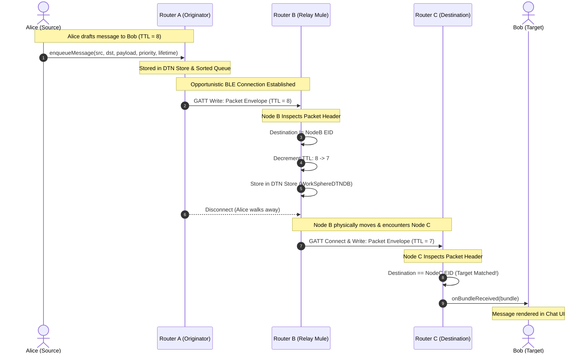

# BLEMeshRouter: Multi-Hop Routing Protocol & TTL Forwarding Rules

This document specifies the technical architecture, Bluetooth Low Energy (BLE 5.0) advertisement payload structures, neighbor discovery procedures, multi-hop relaying, hop count (TTL) decrementing, and routing loop mitigation mechanisms implemented in [`src/core/network/BLEMeshRouter.ts`](file:///c:/Users/admin/Desktop/workfere/src/core/network/BLEMeshRouter.ts) and [`src/core/network/DTNBundleProtocol.ts`](file:///c:/Users/admin/Desktop/workfere/src/core/network/DTNBundleProtocol.ts).

WorkSphere operates in mobile coworking venues, subterranean conference facilities, and off-grid remote retreats where cellular and Wi-Fi networks are unavailable. By organizing nomad devices into an ad-hoc opportunistic Bluetooth mesh, workers can exchange desk reservations, attendance check-ins, collaborative text notes, and critical alerts peer-to-peer.

---

## 1. Executive Summary & Mesh Architecture

The **BLEMeshRouter** acts simultaneously as a **GATT Client** and **GATT Server** using the Web Bluetooth API:
1. **GATT Client:** Discovers adjacent nomad nodes, connects to the standardized WorkSphere DTN service, and pushes prioritized bundles.
2. **GATT Server:** Broadcasts service advertisements, accepts inbound connections, receives fragments via GATT characteristic writes, and notifies adjacent peers of pending outbound traffic.
3. **Multi-Hop Relay:** Forwarding nodes inspect incoming bundle headers. If the current device is not the destination, it decrements the hop count (TTL) and re-enqueues the bundle into its prioritized store-and-forward queue for subsequent peer hops.

```mermaid
flowchart LR
    subgraph NodeA ["Originator: Node A (Alice)"]
        AppA["WorkSphere App"] --> RouterA["BLEMeshRouter (Node A)"]
        RouterA --> GattClientA["GATT Client (Scanner)"]
    end

    subgraph NodeB ["Relay Hop: Node B (Data Mule)"]
        GattServerB["GATT Server"] --> RouterB["BLEMeshRouter (Node B)"]
        RouterB --> StoreB[("DTN Bundle Store<br/>TTL = TTL - 1")]
        StoreB --> GattClientB["GATT Client"]
    end

    subgraph NodeC ["Recipient: Node C (Bob / Gateway)"]
        GattServerC["GATT Server"] --> RouterC["BLEMeshRouter (Node C)"]
        RouterC --> AppC["Process Inbound Bundle"]
    end

    GattClientA -->|BLE 5.0 GATT Write<br/>TTL = 8| GattServerB
    GattClientB -->|BLE 5.0 GATT Write<br/>TTL = 7| GattServerC
```



---

## 2. Standardized GATT Services & Characteristic Architecture

The BLE mesh router relies on standardized 128-bit UUIDs defined in [`BLEMeshRouter.ts`](file:///c:/Users/admin/Desktop/workfere/src/core/network/BLEMeshRouter.ts#L10-L11):

| Attribute | UUID | Type | Permissions / Properties | Description |
| :--- | :--- | :--- | :--- | :--- |
| **DTN Mesh Service** | `0000ffe0-0000-1000-8000-00805f9b34fb` | Primary Service | N/A | Advertised by participating WorkSphere peers |
| **DTN Ingress / Egress Char** | `0000ffe1-0000-1000-8000-00805f9b34fb` | Characteristic | `WRITE`, `WRITE_WITHOUT_RESPONSE`, `NOTIFY` | Point-to-point packet envelope interchange |

### Neighbor Discovery & Advertisement
- Participating devices advertise the `DTN_SERVICE_UUID`.
- Discovery utilizes `navigator.bluetooth.requestDevice({ filters: [{ services: [DTN_SERVICE_UUID] }] })`.
- Upon connection, nodes subscribe to notifications on `DTN_CHAR_UUID` before streaming outgoing binary envelopes.

---

## 3. Packet Header Byte Structure & Wire Framing

Bundles transmitted over the BLE characteristic are formatted into length-prefixed binary frames defined by [`DTNBundleProtocol.serializeBundle()`](file:///c:/Users/admin/Desktop/workfere/src/core/network/DTNBundleProtocol.ts#L112-L127):

```
 0                   1                   2                   3
 0 1 2 3 4 5 6 7 8 9 0 1 2 3 4 5 6 7 8 9 0 1 2 3 4 5 6 7 8 9 0 1
+-+-+-+-+-+-+-+-+-+-+-+-+-+-+-+-+-+-+-+-+-+-+-+-+-+-+-+-+-+-+-+-+
|       Header Length (uint16)  |                               |
+-+-+-+-+-+-+-+-+-+-+-+-+-+-+-+-+                               |
|                                                               |
|        JSON Metadata Block (Header Length H bytes)            |
|  - Source EID (string)        - Destination EID (string)      |
|  - Sequence Number (uint32)   - TTL / Hop Limit (uint8)       |
|  - Priority (uint8)           - Creation Timestamp (uint64)   |
|  - Lifetime (uint32)          - Processing Flags (uint8)      |
|                                                               |
+-+-+-+-+-+-+-+-+-+-+-+-+-+-+-+-+-+-+-+-+-+-+-+-+-+-+-+-+-+-+-+-+
|                                                               |
|               Binary Payload Slice (0 .. 244 bytes)           |
|                                                               |
+-+-+-+-+-+-+-+-+-+-+-+-+-+-+-+-+-+-+-+-+-+-+-+-+-+-+-+-+-+-+-+-+
```

### Detailed Field Byte Layout & Semantics:

| Byte Offset | Field Name | Data Type | Description |
| :---: | :--- | :--- | :--- |
| `0..1` | **Header Length ($H$)** | `uint16` (Big-Endian) | Total byte size of serialized metadata header |
| `2..(H+1)` | **Header Metadata** | `UTF-8 JSON` | Encoded `BundleHeader` object: |
| — | `source` | `string` | Canonical EID URI of authoring peer (e.g. `dtn://worksphere/user-alice`) |
| — | `destination` | `string` | Canonical EID URI of target peer or service (e.g. `dtn://worksphere/venue-101/checkin`) |
| — | `sequenceNumber` | `uint32` | Monotonic per-source counter for packet ordering and deduplication |
| — | `ttl` / `hopLimit` | `uint8` | Maximum number of intermediate forwarding hops allowed before packet drop |
| — | `priority` | `uint8` | Urgency tier (`0` = Bulk, `1` = Normal, `2` = Expedited, `3` = Critical) |
| — | `creationTimestamp`| `uint64` | Millisecond Unix timestamp of bundle origination |
| — | `lifetime` | `uint32` | Millisecond lifespan after creation before packet is purged |
| — | `fragmentOffset` | `uint32` | Byte offset of fragment inside total unfragmented application payload |
| — | `processingFlags`| `uint8` | Bit flags: `0x01` (Fragment), `0x02` (Custody Requested), `0x08` (ACK) |
| `(H+2)..End` | **Raw Payload** | `uint8[]` | Binary application slice constrained to BLE ATT MTU ($244\text{ bytes}$) |

---

## 4. Multi-Hop Forwarding & Hop Count Decrementing Rules

When a node receives a bundle over the BLE characteristic notification listener:

```mermaid
flowchart TD
    InboundPacket["Inbound BLE Packet Received"] --> Deserialize["Deserialize via protocol.deserializeBundle()"]
    Deserialize --> CheckDest{"Is Current Node<br/>Destination EID?"}

    CheckDest -->|Yes| LocalDelivery["Local Application Ingestion<br/>Deliver to App & Emit Telemetry"]
    CheckDest -->|No| CheckHopLimit{"hopLimit / TTL > 1?"}

    CheckHopLimit -->|No (TTL <= 1)| DropPacket["Drop Packet & Emit HopLimitExceeded Telemetry"]
    CheckHopLimit -->|Yes| DecrementTTL["Decrement Hop Count:<br/>bundle.header.hopLimit = hopLimit - 1"]
    
    DecrementTTL --> LoopCheck{"Has Bundle ID been<br/>seen in Deduplication Filter?"}
    LoopCheck -->|Yes (Duplicate)| DropLoop["Discard to prevent routing loop"]
    LoopCheck -->|No| EnqueueStore["Store in DTN Store & Outgoing Queue<br/>protocol.storeBundle(bundle)<br/>router.enqueueMessage()"]
```

### TTL Forwarding Rules:
1. **Initial TTL Assignment:** Authoring nodes set `hopLimit = 8` by default (sufficient for indoor venue coverage across 8 consecutive hops).
2. **Hop Decrement Invariant:** Prior to forwarding, every intermediate node must execute:
   $$\text{hopLimit} \leftarrow \text{hopLimit} - 1$$
3. **Exhaustion Eviction:** If $\text{hopLimit} \le 0$, the packet is silently dropped from the relay queue to conserve radio bandwidth and memory.

---

## 5. Routing Loop Mitigation Mechanics

In decentralized wireless ad-hoc networks without centralized routing tables, broadcast forwarding risks message storms, loops, and memory depletion. `BLEMeshRouter` mitigates loops through four defense layers:

### 5.1 Canonical Bundle ID Deduplication
Every bundle generates a deterministic unique identifier:
$$\text{bundleId} = \text{source} + \text{":"} + \text{sequenceNumber} + \text{":"} + \text{creationTimestamp} + \text{":"} + \text{fragmentOffset}$$
Nodes maintain an in-memory sliding window Bloom filter / LRU Set of recently processed `bundleId`s. If an arriving packet matches an active entry, it is discarded immediately.

### 5.2 Split-Horizon Forwarding Invariant
A node never forwards a bundle back to the peer from which it was received during the same connection session.

### 5.3 Lifetime Expiration Purge
Bundles enforce strict temporal validity:
$$\text{isExpired} \iff \text{currentTime} \ge \text{creationTimestamp} + \text{lifetime}$$
Expired bundles are purged upon storage insertion and periodic interval sweeps via `purgeExpiredQueue()`, preventing zombie bundles from cycling through the mesh.

### 5.4 Priority-Driven Urgency Scheduling
Queues are ordered strictly by priority before transmission:
$$\text{Priority: CRITICAL (3)} > \text{EXPEDITED (2)} > \text{NORMAL (1)} > \text{BULK (0)}$$
Tie-breakers enforce FIFO order via `creationTimestamp`, guaranteeing high-priority desk bookings and emergency alerts bypass lower-priority background telemetry.

---

## 6. Multi-Hop Message Relay Sequence Diagram



---

## 7. Security, Integrity & Abuse Prevention

1. **End-to-End Cryptography:** Intermediate forwarding mules cannot view message contents; payloads are pre-encrypted via ECDH (X25519) + ChaCha20-Poly1305.
2. **Payload CRC32:** Every bundle header includes a mandatory CRC verification flag (`crcType: 0x01`). Corrupted frames failing CRC checks are discarded before memory allocation.
3. **Queue Sizing Protection:** Intermediate queues are capped to prevent memory exhaustion, with non-critical bulk items dropped under storage pressure.
