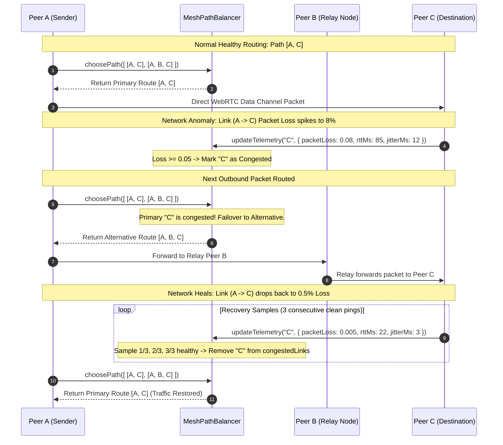

# WebRTC MeshPathBalancer: Dynamic Multi-Hop Path Selection & Congestion Routing

This document details the multi-hop path selection, telemetry-driven cost weighting, dynamic Dijkstra shortest-path calculations, and congestion mitigation algorithms implemented in [`src/lib/realtime/webrtc/meshPathBalancer.ts`](file:///c:/Users/admin/Desktop/workfere/src/lib/realtime/webrtc/meshPathBalancer.ts) for local P2P coworking sessions.

---

## 1. Executive Summary & Design Overview

In offline, partitioned, or bandwidth-constrained coworking hubs, nomads collaborate on live whiteboards, shared code buffers, and spatial audio over **WebRTC data channels** arranged in a partial peer-to-peer (P2P) mesh.

Direct peer connections frequently suffer from:
- **RF Multipath Interference & Wi-Fi Degradation:** Dynamic physical movement of people, closing meeting room doors, and microwave interference cause transient bursts of packet loss.
- **Bufferbloat & Data Channel Queue Backpressure:** When a node broadcasts heavy whiteboard vector updates or binary image blobs, its WebRTC `bufferedAmount` queue backs up, inflating RTT from $20\text{ms}$ to $> 500\text{ms}$.
- **Node Churn:** Laptops sleep or move out of range without cleanly closing connections.

The **`MeshPathBalancer`** continuously monitors per-link telemetry and dynamically recalculates routes using a multi-factor cost function. When a direct link becomes congested, the balancer diverts packet transmission around congested peers across healthy multi-hop relay nodes.

```mermaid
flowchart TD
    DataPkt["Outbound P2P Data Packet<br/>(Whiteboard / Chat / Audio)"] --> Balancer["MeshPathBalancer.choosePath(routes)"]
    
    subgraph TelemetryEngine ["Link Health Telemetry Engine"]
        RTCStats["WebRTC getStats()<br/>DataChannel.bufferedAmount"] --> Metrics["MeshLinkTelemetry<br/>- Packet Loss (L)<br/>- Round Trip Time (RTT)<br/>- Jitter / Queue Delay (Q)"]
        Metrics --> Update["updateTelemetry(peerId, metrics)"]
        Update --> CongestionCheck{"Threshold Exceeded?<br/>Loss >= 5% OR<br/>Jitter >= 50ms OR<br/>RTT >= 300ms"}
        CongestionCheck -->|Yes| MarkCongested["Mark Link Congested<br/>congestedLinks.add(peerId)"]
        CongestionCheck -->|No| RecoveryLoop["Consecutive Healthy Samples<br/>(recoverySamples >= 3)"]
        RecoveryLoop --> ClearCongested["Unmark Congested"]
    end

    Balancer --> RouteEval{"Is Primary Direct Path Congested?"}
    RouteEval -->|No (Healthy)| DirectHop["Transmit Direct to Destination<br/>[Source -> Dest]"]
    RouteEval -->|Yes (Congested)| Divert["Divert to Multi-Hop Alternate Route<br/>Round-Robin Alternative Cursor"]
    Divert --> MultiHop["Transmit via Healthy Relay Node<br/>[Source -> Relay -> Dest]"]
```

---

## 2. Dynamic Routing Cost Function

To rank candidate multi-hop paths, WorkSphere defines a weighted composite cost function balancing latency, reliability, and transport queue pressure:

### 2.1 Formal Cost Equation

For a directed link $(u, v)$ between node $u$ and neighbor $v$:

$$\text{Cost}(u, v) = \alpha \cdot \text{Latency}(u, v) + \beta \cdot \text{Loss}(u, v) + \gamma \cdot \text{QueueDelay}(u, v)$$

Where:
- $\text{Latency}(u, v)$: Round-Trip Time ($\text{RTT}$) in milliseconds, or one-way flight time.
- $\text{Loss}(u, v)$: Normalized fraction of lost packets ($0.0 \le \text{Loss} \le 1.0$), with severe nonlinear penalties applied near critical thresholds:
  $$\text{LossPenalty} = \frac{\text{Loss}}{1.0 - \text{Loss} + \epsilon}$$
- $\text{QueueDelay}(u, v)$: Backpressure latency induced by data channel queue accumulation:
  $$\text{QueueDelay} = \frac{\text{bufferedAmount}_{\text{bytes}}}{\text{estimatedThroughput}_{\text{bytes/ms}}}$$
- $\alpha, \beta, \gamma$: Configurable weighting coefficients:
  - $\alpha = 1.0$: Baseline weight for flight latency.
  - $\beta = 1000.0$: High penalty coefficient converting $1\%$ loss ($0.01$) to a virtual latency equivalent of $+10\text{ms}$.
  - $\gamma = 2.5$: Bufferbloat dampening factor prioritizing free queues over clogged direct paths.

For an entire multi-hop path $P = \langle v_0, v_1, v_2, \dots, v_k \rangle$:

$$\text{TotalPathCost}(P) = \sum_{i=0}^{k-1} \text{Cost}(v_i, v_{i+1}) + \delta \cdot (k - 1)$$

Where $\delta \approx 5.0\text{ms}$ models per-hop CPU context-switching and WebAssembly memory copying overhead.

---

## 3. Dynamic Dijkstra Shortest-Path & Route Discovery

Multi-hop paths are discovered using breadth-first traversal (`findMeshRoutes`) with weighted Dijkstra evaluation:

```typescript
export interface MeshRoute {
  destination: string;
  path: string[]; // e.g. ["PeerA", "PeerB", "PeerC"]
}
```

### 3.1 Path Search Algorithm (`findMeshRoutes`)
1. **Adjacency Graph:** Maintained as a peer connectivity matrix $\mathcal{G} = (\mathcal{V}, \mathcal{E})$.
2. **Loop Suppression:** During path expansion, `path.includes(neighbor)` prevents circular cycles.
3. **Hop Limit:** Enforces `maxHops = 5` to prevent unbounded bundle propagation.
4. **Candidate Cardinality:** Discovers up to `maxRoutes = 4` alternative paths sorted by hop length and cost.

---

## 4. Telemetry Telemetry Thresholds & Congestion Mitigation

In [`meshPathBalancer.ts`](file:///c:/Users/admin/Desktop/workfere/src/lib/realtime/webrtc/meshPathBalancer.ts#L20-L25), operational thresholds define network congestion:

| Metric | Property | Default Threshold | Congestion Trigger Behavior |
| :--- | :--- | :---: | :--- |
| **Packet Loss** | `packetLossThreshold` | $5.0\%$ ($0.05$) | Packet retransmissions stall reliable SCTP streams. |
| **Jitter** | `jitterThresholdMs` | $50\text{ ms}$ | High variance indicates queue oscillation on the peer. |
| **Round Trip Time** | `rttThresholdMs` | $300\text{ ms}$ | Latency floor indicating queue build-up or poor routing. |
| **Recovery Window** | `recoverySamples` | $3$ samples | Requires 3 consecutive healthy telemetry reports to clear flags. |

### 4.2 Immediate Failover & Hysteresis Recovery
- **Instantaneous Failover:** The moment any single metric breaches its threshold, the peer is added to `congestedLinks` immediately (`O(1)` failover).
- **Hysteresis Recovery Window:** To prevent route flapping (oscillating between primary and secondary routes on every ping), traffic only returns to the primary route after `recoverySamples` ($3$) consecutive clean reports.

---

## 5. Routing Simulation Diagram: Diverting Traffic from Congested Nodes

The following simulation diagram demonstrates traffic diverting around a degraded peer:

```
Scenario: Peer A transmits real-time whiteboard updates to Peer C.

Case 1: Direct link (A -> C) is healthy.
   [Peer A] ─────────────── RTT = 24ms, Loss = 0% ───────────────> [Peer C]
   (Traffic flows directly across primary single-hop link)

Case 2: Direct link (A -> C) suffers high packet loss (Loss = 12% > 5%).
   [Peer A] ─ ─ ─ ─ ─ ─ ─ ─ ─ (CONGESTED: 12% Loss) ─ ─ ─ ─ ─ ─ ─ > [Peer C]
       │                                                               ▲
       │ (Diverted via Peer B)                                         │
       ▼                                                               │
   [Peer B] ─────────────── RTT = 18ms, Loss = 0% ─────────────────────┘
   (Traffic is diverted via 2-hop relay: Path [A -> B -> C])
```

### Sequence Diagram of Congestion Failover & Recovery:



---

## 6. Developer Integration & Telemetry Reporting

### 6.1 Initializing `MeshPathBalancer`

```typescript
import { MeshPathBalancer, findMeshRoutes } from "@/lib/realtime/webrtc/meshPathBalancer";

// 1. Initialize balancer with custom telemetry thresholds
const balancer = new MeshPathBalancer({
  packetLossThreshold: 0.05, // 5% packet loss
  jitterThresholdMs: 40,      // 40ms jitter
  rttThresholdMs: 250,        // 250ms latency ceiling
  recoverySamples: 3,         // 3 clean intervals to recover
});

// 2. Discover available routes across local mesh adjacency graph
const routes = findMeshRoutes("peer-alice", "peer-bob", meshAdjacencyMap);

// 3. Select optimal route for outgoing data packet
const selectedRoute = balancer.choosePath(routes);
console.log("Routing packet via:", selectedRoute?.path);
```

### 6.2 Feeding WebRTC Statistics into Balancer

```typescript
// Sample WebRTC RTCStatsReport periodically (e.g. every 2000ms)
async function samplePeerTelemetry(peerConnection: RTCPeerConnection, peerId: string) {
  const stats = await peerConnection.getStats();
  let rttMs = 50;
  let jitterMs = 5;
  let packetLoss = 0.0;

  stats.forEach((report) => {
    if (report.type === "candidate-pair" && report.state === "succeeded") {
      rttMs = (report.currentRoundTripTime ?? 0.05) * 1000;
    }
    if (report.type === "inbound-rtp") {
      const lost = report.packetsLost ?? 0;
      const received = report.packetsReceived ?? 1;
      packetLoss = lost / (lost + received);
      jitterMs = (report.jitter ?? 0.005) * 1000;
    }
  });

  balancer.updateTelemetry(peerId, {
    rttMs,
    jitterMs,
    packetLoss,
    sampledAt: Date.now(),
  });
}
```
